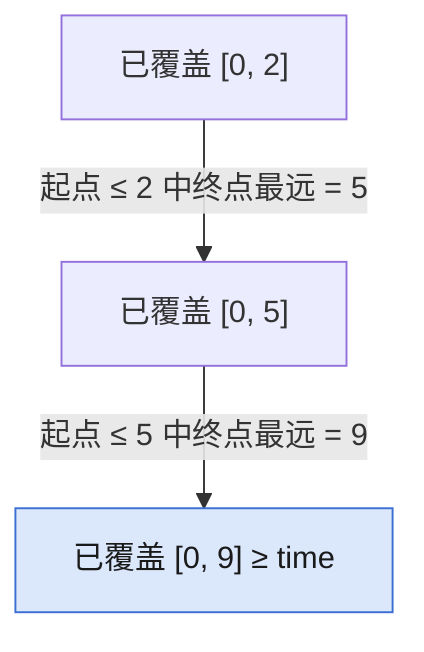

## Q
**LC 1024 视频拼接**｜Medium

`clips[i] = [start, end]` 是一段视频片段（可任意裁剪、重叠）。用最少的片段拼出覆盖 `[0, time]` 的完整视频，不可能则返回 `-1`。

## A
**一句话。** 贪心，等价于 Jump Game II：记录每个起点能到达的最远终点；当前覆盖到 `cur_end`，在不超过它的所有起点里挑最远的下一段。

**图解。** 每次只在「已覆盖范围内能起步的片段」里选终点最远的，覆盖点向右推进。



```python
def video_stitching(clips, time):
    reach = [0] * time           # reach[l]：从 l 起步能到的最远
    for l, r in clips:
        if l < time:
            reach[l] = max(reach[l], r)
    cnt = cur_end = nxt = 0
    for i in range(time):
        nxt = max(nxt, reach[i])
        if i == cur_end:         # 走到当前覆盖的尽头，必须再选一段
            if nxt <= i:
                return -1        # 接不上
            cnt += 1
            cur_end = nxt
            if cur_end >= time:
                return cnt
    return cnt if cur_end >= time else -1
```

**复杂度。** 时间 `O(n + time)`，空间 `O(time)`。

**易错点。**
- `reach` 没过滤 `l < time`：起点不小于 `time` 的片段没用，还会让下标越界。
- 每个位置都加一段：只有走到 `cur_end` 时才新选一段，其余位置只更新 `nxt`。
- 接不上时不返回 `-1`：`nxt <= i` 说明起点不超过 `cur_end` 的片段到不了更远。

**追问。**
- 排序后怎么做？：按起点排序，维护当前覆盖，每轮在 `start ≤ cur_end` 的片段里取最远终点，同样贪心。
- 能用 DP 吗？：`dp[t]` 为覆盖 `[0, t]` 的最少片段数，对每个片段更新区间内的 `dp`，`O(n · time)`。

**同模式。** LC 45 跳跃游戏 II、LC 1326 灌溉花园的最少水龙头数目、LC 55 跳跃游戏、LC 452 用最少数量的箭引爆气球
