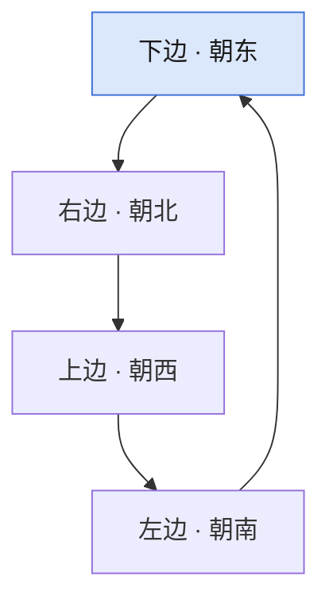

## Q
**LC 2069 模拟行走机器人 II**｜Medium

`width × height` 的网格，机器人从 `(0, 0)` 出发朝东。`step(num)` 让它前进 `num` 步，遇到边界先逆时针转 90 度再继续；`get_pos()` 返回坐标，`get_dir()` 返回朝向 `"East" / "North" / "West" / "South"`。

## A
**一句话。** 机器人只会沿网格最外圈一圈圈走，把周长 `2(w + h) - 4` 个格子编号成 `0..cycle-1`，位置只需一个对周长取模的计数；坐标和朝向由计数所在的边决定。

**图解。** 四条边依次是下边（东）、右边（北）、上边（西）、左边（南），到达角落时仍保持来时的朝向。



```python
class Robot:
    def __init__(self, width, height):
        self.w, self.h = width, height
        self.cycle = 2 * (width + height) - 4
        self.p = 0
        self.moved = False

    def step(self, num):
        self.moved = True
        self.p = (self.p + num) % self.cycle

    def get_pos(self):
        p, w, h = self.p, self.w, self.h
        if p < w:
            return [p, 0]
        if p < w + h - 1:
            return [w - 1, p - w + 1]
        if p < 2 * w + h - 2:
            return [2 * w + h - 3 - p, h - 1]
        return [0, 2 * w + 2 * h - 4 - p]

    def get_dir(self):
        p, w, h = self.p, self.w, self.h
        if p == 0:               # 回到原点后朝南，从未走过才朝东
            return "South" if self.moved else "East"
        if p < w:
            return "East"
        if p < w + h - 1:
            return "North"
        if p < 2 * w + h - 2:
            return "West"
        return "South"
```

**复杂度。** 每次调用 `O(1)`，空间 `O(1)`。

**易错点。**
- 原点的朝向：刚出发朝东；绕一圈回到 `(0, 0)` 时是从左边向南走来的，朝南。要用 `moved` 区分。
- 逐步模拟：`num` 最大 `10^5`，调用次数多，必须取模。
- 四个角的归属：角落属于来时的那条边，朝向保持来时的方向。

**追问。**
- 为什么只要一个计数？：机器人的轨迹是固定的一圈，位置完全由它在圈上的偏移决定。
- 宽或高为 2 时？：周长公式仍成立，每条边的区间长度仍是 `w`、`h - 1`、`w - 1`、`h - 2` 的组合。

**同模式。** LC 874 模拟行走机器人、LC 54 螺旋矩阵、LC 1041 困于环中的机器人、LC 2326 螺旋矩阵 IV
