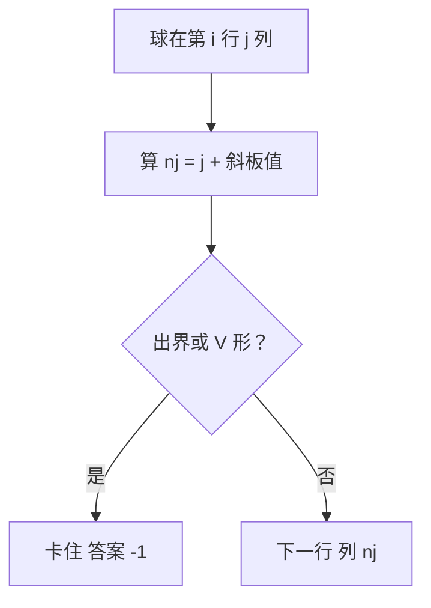

## Q
**LC 1706 球会落何处**｜Medium

`m x n` 的盒子，每格是斜板：`1` 表示 `\`（把球导向右下），`-1` 表示 `/`（把球导向左下）。在顶部每一列各放一个球，求每个球从底部掉出的列号，卡住则为 `-1`。

## A
**一句话。** 逐行模拟：球在列 `j`，下一列是 `j + grid[i][j]`；撞墙或相邻格斜向相反（V 形）就卡住。



```python
def find_ball(grid):
    n = len(grid[0])
    ans = []
    for start in range(n):
        j = start
        for row in grid:
            nj = j + row[j]
            if not 0 <= nj < n or row[nj] != row[j]:
                j = -1                # 撞墙或 V 形，卡住
                break
            j = nj
        ans.append(j)
    return ans
```

**复杂度。** 时间 `O(mn)`，空间 `O(1)`（不计答案）。

**易错点。**
- 只判断出界：相邻格斜向相反（`\/`）时球被夹住，要比较 `row[nj] != row[j]`。
- 卡住后还继续走：设 `-1` 后必须 `break`，否则 `row[-1]` 会取到末列。

**追问。**
- 球的路径互相影响吗？：不影响，球不占格子，各列独立模拟。

**同模式。** LC 289 生命游戏、LC 48 旋转图像、LC 54 螺旋矩阵、LC 73 矩阵置零
