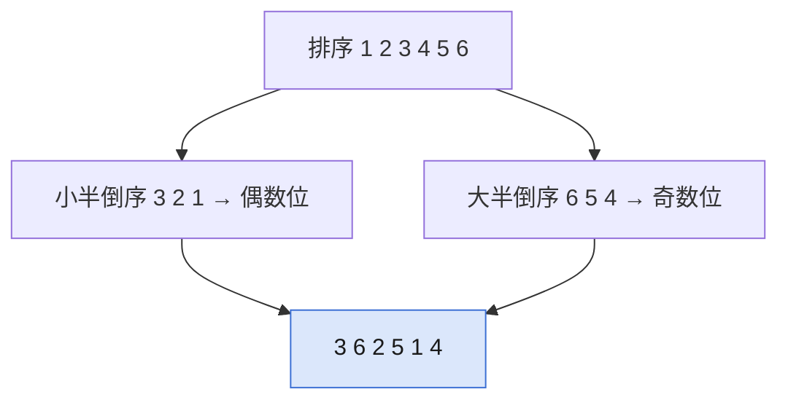

## Q
**LC 324 摆动排序 II**｜Medium

重排整数数组 `nums`，使 `nums[0] < nums[1] > nums[2] < nums[3] …`（严格），原地修改，保证有解。

## A
**一句话。** 排序后分成「小的一半」和「大的一半」，两半各自倒序，小的填偶数位、大的填奇数位，相同的数就不会相邻。

**图解。** 排序结果 `[1,2,3,4,5,6]` 拆成 `[1,2,3]` 与 `[4,5,6]`，各自倒序再交错放置。



```python
def wiggle_sort(nums):
    s = sorted(nums)
    half = (len(s) + 1) // 2         # 小的一半多一个（奇数长度）
    nums[::2] = s[:half][::-1]       # 小数倒序放偶数位
    nums[1::2] = s[half:][::-1]      # 大数倒序放奇数位
```

**复杂度。** 时间 `O(n log n)`，空间 `O(n)`。

**易错点。**
- 两半不倒序：中位数重复时，小半的最大和大半的最小会在交界处相邻，倒序才能把相同的值隔开。
- 奇数长度时分半点用 `n // 2`：小的一半应多一个，因为偶数位比奇数位多一个。
- 与 LC 280 混淆：那里允许等号，这里要求严格不等。

**追问。**
- 能 `O(n)` 时间 `O(1)` 空间吗？：快速选择找中位数加三路划分，并把下标做虚拟映射，是进阶解法。
- 为什么倒序能保证严格？：同一个数只能出现在小半的开头和大半的结尾，交错后最多相隔一个位置，不会相邻。

**同模式。** LC 280 摆动排序、LC 75 颜色分类、LC 215 数组中的第 K 个最大元素、LC 148 排序链表
