# 题面信号到模式 · 决策图

读完题面先找信号：输入是什么形状、要求的是一个值还是所有方案、有没有「最短」「前 K 个」这类字眼。信号对上了，模式和模板就跟着来。下面先给一张总图，按提问顺序把最常见的信号分到模式家族；再按知识树的每张题单各画一张图，从子模式走到「何时用」和「模板步骤」，每个子模式附 1–2 道经典题。

## 总图：从信号到模式家族

从上往下逐个问自己，第一个回答「是」的就是首选模式。

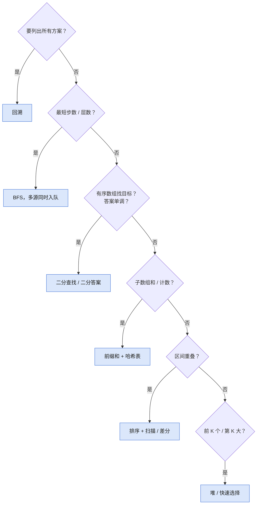

总图之外的常见信号：

| 题面信号 | 模式 | 经典题 |
|---|---|---|
| 两数配对、找补数 | 哈希表 | [[interviews/core/leetcode/problems/two-sum\|LC 1 两数之和]] |
| 连续子串最长 / 最短 | 不定长滑动窗口 | [[interviews/core/leetcode/problems/longest-substring-without-repeating-characters\|LC 3 无重复字符的最长子串]] |
| 有序数组两端配对 | 对撞双指针 | [[interviews/core/leetcode/problems/3sum\|LC 15 三数之和]] |
| 下一个更大 / 更小 | 单调栈 | [[interviews/core/leetcode/problems/daily-temperatures\|LC 739 每日温度]] |
| 括号、嵌套、相邻消除 | 栈 | [[interviews/core/leetcode/problems/valid-parentheses\|LC 20 有效的括号]] |
| 连通块、合并分组 | DFS / 并查集 | [[interviews/core/leetcode/problems/number-of-islands\|LC 200 岛屿数量]]、[[interviews/core/leetcode/problems/accounts-merge\|LC 721 账户合并]] |
| 先修、依赖顺序 | 拓扑排序 | [[interviews/core/leetcode/problems/course-schedule\|LC 207 课程表]] |
| 带权最短路 | Dijkstra | [[interviews/core/leetcode/problems/network-delay-time\|LC 743 网络延迟时间]] |
| 最优值或方案数，子问题重叠 | 动态规划 | [[interviews/core/leetcode/problems/coin-change\|LC 322 零钱兑换]] |
| 成对出现找落单 | 异或 | [[interviews/core/leetcode/problems/single-number\|LC 136 只出现一次的数字]] |

## 1. 常用数据结构

用一张表或一个栈记住扫过的东西，换掉内层循环。图中是最常考的三个子模式：子模式 → 何时用 → 模板步骤。

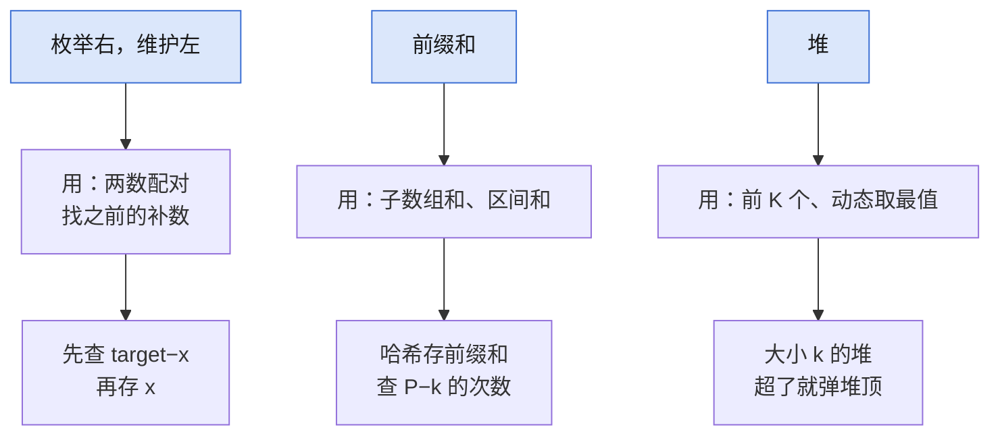

- **常用枚举技巧**：见图。例：[[interviews/core/leetcode/problems/two-sum|LC 1 两数之和]]、[[interviews/core/leetcode/problems/best-time-to-buy-and-sell-stock|LC 121 买卖股票的最佳时机]]
- **前缀和**：见图。例：[[interviews/core/leetcode/problems/subarray-sum-equals-k|LC 560 和为 K 的子数组]]、[[interviews/core/leetcode/problems/continuous-subarray-sum|LC 523 连续的子数组和]]
- **差分**：区间批量加减、上下车计数；端点 `+v` / `-v`，再求前缀和还原。例：[[interviews/core/leetcode/problems/car-pooling|LC 1094 拼车]]、[[interviews/core/leetcode/problems/meeting-rooms-ii|LC 253 会议室 II]]
- **栈**：括号、嵌套、相邻消除；栈顶是最近一个还没配对的。例：[[interviews/core/leetcode/problems/valid-parentheses|LC 20 有效的括号]]、[[interviews/core/leetcode/problems/decode-string|LC 394 字符串解码]]
- **队列**：滑窗最值用单调队列；队头过期出队，队尾比新数小就弹掉。例：[[interviews/core/leetcode/problems/sliding-window-maximum|LC 239 滑动窗口最大值]]
- **堆**：见图。例：[[interviews/core/leetcode/problems/k-closest-points-to-origin|LC 973 最接近原点的 K 个点]]、[[interviews/core/leetcode/problems/merge-k-sorted-lists|LC 23 合并 K 个升序链表]]
- **字典树**：前缀查询、多个单词一起匹配；每个节点一张子表加结束标记。例：[[interviews/core/leetcode/problems/implement-trie-prefix-tree|LC 208 实现 Trie (前缀树)]]、[[interviews/core/leetcode/problems/word-search-ii|LC 212 单词搜索 II]]
- **并查集**：动态合并分组、判断连通；`find` 带路径压缩，根不同才合并。例：[[interviews/core/leetcode/problems/accounts-merge|LC 721 账户合并]]、[[interviews/core/leetcode/problems/redundant-connection|LC 684 冗余连接]]
- **树状数组和线段树**：单点修改 + 区间查询都要 `O(log n)`。例：[[interviews/core/leetcode/problems/reverse-pairs|LC 493 翻转对]]、[[interviews/core/leetcode/problems/my-calendar-i|LC 729 我的日程安排表 I]]
- **哈希表计数、查重与映射**：分组、计频、判重；键选对就是一半。例：[[interviews/core/leetcode/problems/group-anagrams|LC 49 字母异位词分组]]、[[interviews/core/leetcode/problems/top-k-frequent-elements|LC 347 前 K 个高频元素]]
- **设计类**：哈希表配链表或数组，增量维护计数，每个操作 `O(1)`。例：[[interviews/core/leetcode/problems/lru-cache|LC 146 LRU 缓存]]、[[interviews/core/leetcode/problems/insert-delete-getrandom-o1|LC 380 O(1) 时间插入、删除和获取随机元素]]

## 2. 链表、二叉树与回溯

三者都是递归结构：把问题交给下一个节点或下一层选择。图中是最常考的三个子模式：子模式 → 何时用 → 模板步骤。

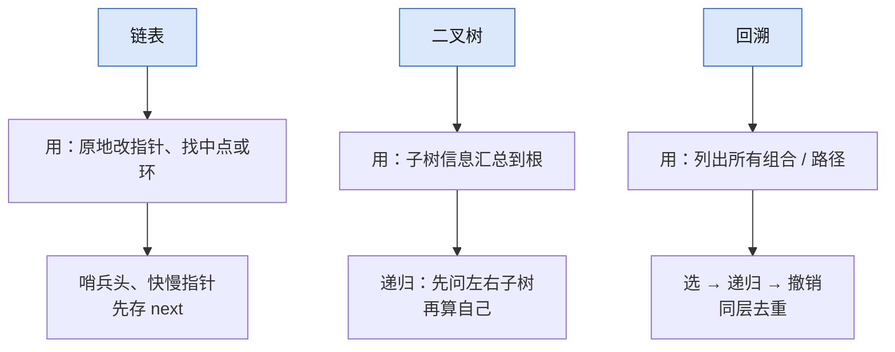

- **链表**：见图。例：[[interviews/core/leetcode/problems/reverse-linked-list|LC 206 反转链表]]、[[interviews/core/leetcode/problems/linked-list-cycle|LC 141 环形链表]]
- **二叉树**：见图。例：[[interviews/core/leetcode/problems/all-nodes-distance-k-in-binary-tree|LC 863 二叉树中所有距离为 K 的结点]]、[[interviews/core/leetcode/problems/binary-tree-maximum-path-sum|LC 124 二叉树中的最大路径和]]
- **一般树**：邻接表存树，DFS 时带上父节点防止走回头路。例：[[interviews/core/leetcode/problems/tree-diameter|LC 1245 树的直径]]、[[interviews/core/leetcode/problems/time-needed-to-inform-all-employees|LC 1376 通知所有员工所需的时间]]
- **回溯**：见图。例：[[interviews/core/leetcode/problems/subsets-ii|LC 90 子集 II]]、[[interviews/core/leetcode/problems/word-search|LC 79 单词搜索]]
- **其他递归 / 分治**：每次只处理一半，或拆两半再合并。例：[[interviews/core/leetcode/problems/kth-largest-element-in-an-array|LC 215 数组中的第 K 个最大元素]]、[[interviews/core/leetcode/problems/sort-an-array|LC 912 排序数组]]

## 3. 滑动窗口与双指针

两个下标都只往前走，总共 `O(n)` 步就扫完。图中是最常考的三个子模式：子模式 → 何时用 → 模板步骤。

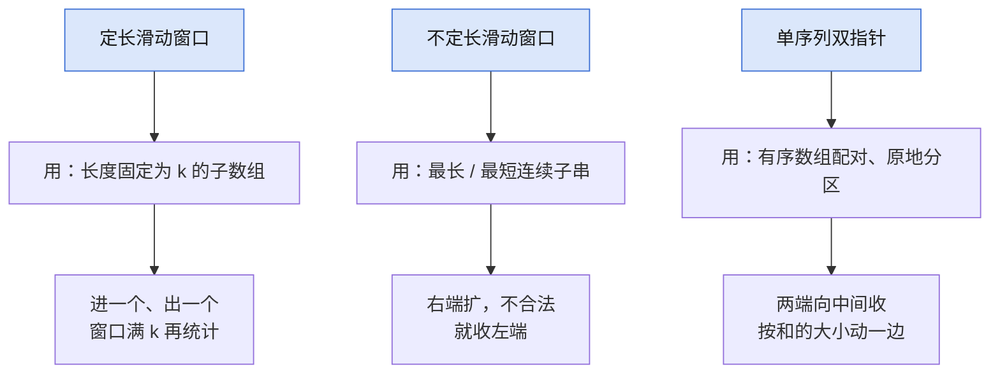

- **定长滑动窗口**：见图。例：[[interviews/core/leetcode/problems/find-all-anagrams-in-a-string|LC 438 找到字符串中所有字母异位词]]、[[interviews/core/leetcode/problems/maximum-average-subarray-i|LC 643 子数组最大平均数 I]]
- **不定长滑动窗口**：见图。例：[[interviews/core/leetcode/problems/longest-substring-without-repeating-characters|LC 3 无重复字符的最长子串]]、[[interviews/core/leetcode/problems/minimum-window-substring|LC 76 最小覆盖子串]]
- **单序列双指针**：见图。例：[[interviews/core/leetcode/problems/3sum|LC 15 三数之和]]、[[interviews/core/leetcode/problems/container-with-most-water|LC 11 盛最多水的容器]]
- **双序列双指针**：两个有序序列一起走，谁小动谁。例：[[interviews/core/leetcode/problems/merge-sorted-array|LC 88 合并两个有序数组]]、[[interviews/core/leetcode/problems/adding-spaces-to-a-string|LC 2109 向字符串添加空格]]
- **三指针**：同时记住几个关键位置最近一次出现的下标。例：[[interviews/core/leetcode/problems/count-subarrays-with-fixed-bounds|LC 2444 统计定界子数组的数目]]
- **分组循环**：按段处理性质相同的连续元素：外层找段头，内层走到段尾。例：[[interviews/core/leetcode/problems/summary-ranges|LC 228 汇总区间]]、[[interviews/core/leetcode/problems/longest-mountain-in-array|LC 845 数组中的最长山脉]]

## 4. 动态规划

先定状态的含义，再写它由哪些更小的状态推出。图中是最常考的三个子模式：子模式 → 何时用 → 模板步骤。

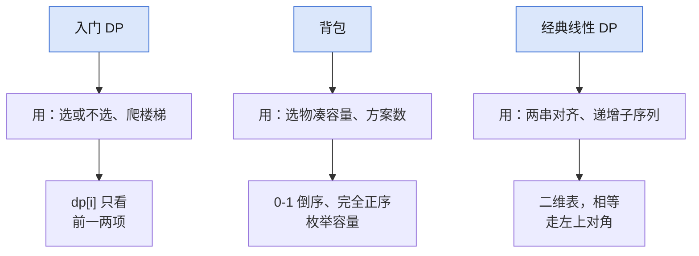

- **入门 DP**：见图。例：[[interviews/core/leetcode/problems/climbing-stairs|LC 70 爬楼梯]]、[[interviews/core/leetcode/problems/house-robber|LC 198 打家劫舍]]
- **网格图 DP**：只能向右、向下走的路径数或最小和；每格来自上和左。例：[[interviews/core/leetcode/problems/unique-paths|LC 62 不同路径]]、[[interviews/core/leetcode/problems/minimum-path-sum|LC 64 最小路径和]]
- **背包**：见图。例：[[interviews/core/leetcode/problems/coin-change|LC 322 零钱兑换]]、[[interviews/core/leetcode/problems/partition-equal-subset-sum|LC 416 分割等和子集]]
- **经典线性 DP**：见图。例：[[interviews/core/leetcode/problems/longest-common-subsequence|LC 1143 最长公共子序列]]、[[interviews/core/leetcode/problems/edit-distance|LC 72 编辑距离]]
- **划分型 DP**：把序列切成若干段，`dp[i]` 枚举最后一段的起点。例：[[interviews/core/leetcode/problems/word-break|LC 139 单词拆分]]、[[interviews/core/leetcode/problems/decode-ways|LC 91 解码方法]]
- **状态机 DP**：每天在「持有 / 不持有」等几个状态之间转移。例：[[interviews/core/leetcode/problems/best-time-to-buy-and-sell-stock-ii|LC 122 买卖股票的最佳时机 II]]、[[interviews/core/leetcode/problems/best-time-to-buy-and-sell-stock-with-cooldown|LC 309 买卖股票的最佳时机含冷冻期]]
- **其他线性 DP**：状态仍是前缀，但转移要看更远的位置。例：[[interviews/core/leetcode/problems/maximal-square|LC 221 最大正方形]]、[[interviews/core/leetcode/problems/longest-valid-parentheses|LC 32 最长有效括号]]
- **区间 DP**：`dp[i][j]` 由更短的区间推出，按长度从小到大算。例：[[interviews/core/leetcode/problems/longest-palindromic-subsequence|LC 516 最长回文子序列]]、[[interviews/core/leetcode/problems/palindromic-substrings|LC 647 回文子串]]
- **状态压缩 DP**：「已选集合」用二进制位表示，`n` 一般不超过 20。例：[[interviews/core/leetcode/problems/partition-to-k-equal-sum-subsets|LC 698 划分为k个相等的子集]]、[[interviews/core/leetcode/problems/matchsticks-to-square|LC 473 火柴拼正方形]]
- **数位 DP**：按位填数，记住是否仍贴着上界。例：[[interviews/core/leetcode/problems/numbers-at-most-n-given-digit-set|LC 902 最大为 N 的数字组合]]
- **树形 DP**：后序遍历，每个节点向父节点返回子树的几个值。例：[[interviews/core/leetcode/problems/diameter-of-binary-tree|LC 543 二叉树的直径]]、[[interviews/core/leetcode/problems/house-robber-iii|LC 337 打家劫舍 III]]
- **图 DP**：按边数或拓扑序分层转移。例：[[interviews/core/leetcode/problems/cheapest-flights-within-k-stops|LC 787 K 站中转内最便宜的航班]]
- **博弈 DP**：当前玩家得分减去对手在剩余局面的最优得分。例：[[interviews/core/leetcode/problems/predict-the-winner|LC 486 预测赢家]]、[[interviews/core/leetcode/problems/stone-game-ii|LC 1140 石子游戏 II]]

## 5. 贪心算法

每一步做当下最好的选择，并能用交换论证说明不会更差。图中是最常考的三个子模式：子模式 → 何时用 → 模板步骤。

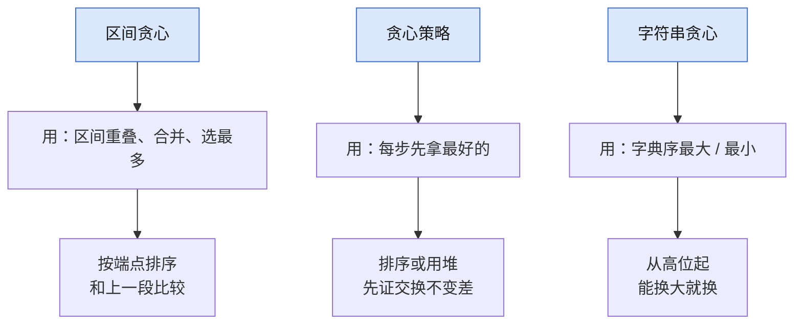

- **贪心策略**：见图。例：[[interviews/core/leetcode/problems/task-scheduler|LC 621 任务调度器]]、[[interviews/core/leetcode/problems/largest-number|LC 179 最大数]]
- **区间贪心**：见图。例：[[interviews/core/leetcode/problems/merge-intervals|LC 56 合并区间]]、[[interviews/core/leetcode/problems/non-overlapping-intervals|LC 435 无重叠区间]]
- **字符串贪心**：见图。例：[[interviews/core/leetcode/problems/maximum-swap|LC 670 最大交换]]、[[interviews/core/leetcode/problems/valid-palindrome-ii|LC 680 验证回文串 II]]
- **数学贪心**：排序后只可能是两端几个数的组合。例：[[interviews/core/leetcode/problems/maximum-product-of-three-numbers|LC 628 三个数的最大乘积]]
- **思维题**：换个角度：先找不变量或等价条件。例：[[interviews/core/leetcode/problems/group-anagrams|LC 49 字母异位词分组]]、[[interviews/core/leetcode/problems/candy|LC 135 分发糖果]]
- **构造题**：按规则直接摆出一个合法答案。例：[[interviews/core/leetcode/problems/wiggle-sort|LC 280 摆动排序]]、[[interviews/core/leetcode/problems/beautiful-arrangement-ii|LC 667 优美的排列 II]]
- **交互题**：每次询问排除一半或一个候选。例：[[interviews/core/leetcode/problems/first-bad-version|LC 278 第一个错误的版本]]、[[interviews/core/leetcode/problems/find-the-celebrity|LC 277 搜寻名人]]
- **其他**：一次扫描，失败就把起点挪到下一个位置。例：[[interviews/core/leetcode/problems/gas-station|LC 134 加油站]]

## 6. 网格图

把每个格子当成图的节点，上下左右四条边。图中是最常考的三个子模式：子模式 → 何时用 → 模板步骤。

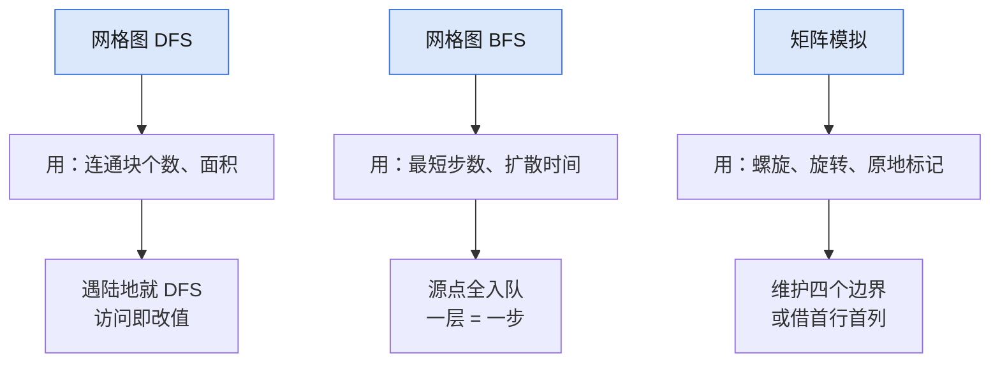

- **网格图 DFS**：见图。例：[[interviews/core/leetcode/problems/number-of-islands|LC 200 岛屿数量]]、[[interviews/core/leetcode/problems/max-area-of-island|LC 695 岛屿的最大面积]]
- **网格图 BFS**：见图。例：[[interviews/core/leetcode/problems/rotting-oranges|LC 994 腐烂的橘子]]、[[interviews/core/leetcode/problems/shortest-path-in-binary-matrix|LC 1091 二进制矩阵中的最短路径]]
- **网格图 0-1 BFS**：边权只有 0 和 1：权 0 放队头，权 1 放队尾。例：[[interviews/core/leetcode/problems/find-a-safe-walk-through-a-grid|LC 3286 穿越网格图的安全路径]]
- **综合应用**：岛屿形状去重、按高度二分或用堆。例：[[interviews/core/leetcode/problems/number-of-distinct-islands|LC 694 不同岛屿的数量]]、[[interviews/core/leetcode/problems/swim-in-rising-water|LC 778 水位上升的泳池中游泳]]
- **矩阵模拟**：见图。例：[[interviews/core/leetcode/problems/spiral-matrix|LC 54 螺旋矩阵]]、[[interviews/core/leetcode/problems/rotate-image|LC 48 旋转图像]]

## 7. 图论算法

先建邻接表，再按问题选遍历方式。图中是最常考的三个子模式：子模式 → 何时用 → 模板步骤。

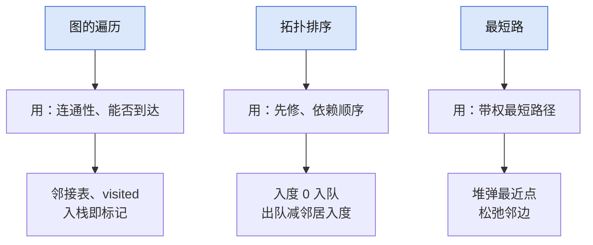

- **图的遍历**：见图。例：[[interviews/core/leetcode/problems/number-of-provinces|LC 547 省份数量]]、[[interviews/core/leetcode/problems/accounts-merge|LC 721 账户合并]]
- **拓扑排序**：见图。例：[[interviews/core/leetcode/problems/course-schedule-ii|LC 210 课程表 II]]、[[interviews/core/leetcode/problems/alien-dictionary|LC 269 火星词典]]
- **最短路**：见图。例：[[interviews/core/leetcode/problems/network-delay-time|LC 743 网络延迟时间]]、[[interviews/core/leetcode/problems/cheapest-flights-within-k-stops|LC 787 K 站中转内最便宜的航班]]
- **最小生成树**：按边权从小到大，用并查集跳过成环的边。例：[[interviews/core/leetcode/problems/min-cost-to-connect-all-points|LC 1584 连接所有点的最小费用]]
- **欧拉路径**：每条边恰好走一次：后序把点加入路径再反转。例：[[interviews/core/leetcode/problems/reconstruct-itinerary|LC 332 重新安排行程]]
- **二分图染色**：相邻点染不同色，冲突就不是二分图。例：[[interviews/core/leetcode/problems/is-graph-bipartite|LC 785 判断二分图]]、[[interviews/core/leetcode/problems/possible-bipartition|LC 886 可能的二分法]]
- **其他**：用一次比较排除一个候选。例：[[interviews/core/leetcode/problems/find-the-celebrity|LC 277 搜寻名人]]

## 8. 二分算法

只要判断条件单调，就能每次丢掉一半。图中是最常考的三个子模式：子模式 → 何时用 → 模板步骤。

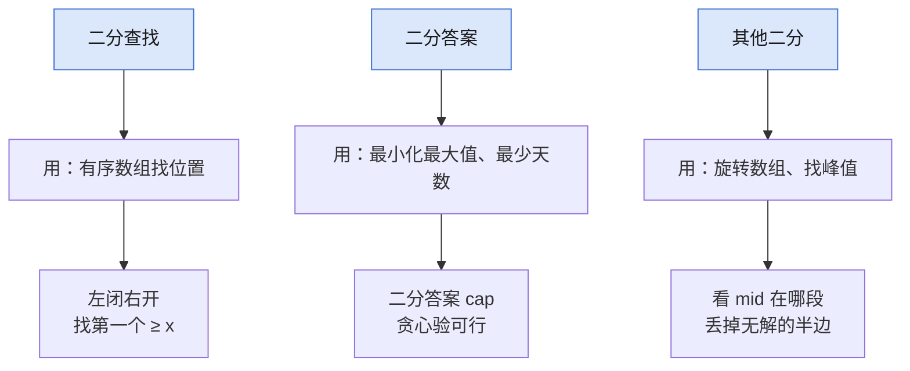

- **二分查找**：见图。例：[[interviews/core/leetcode/problems/binary-search|LC 704 二分查找]]、[[interviews/core/leetcode/problems/search-a-2d-matrix|LC 74 搜索二维矩阵]]
- **二分答案**：见图。例：[[interviews/core/leetcode/problems/koko-eating-bananas|LC 875 爱吃香蕉的珂珂]]、[[interviews/core/leetcode/problems/split-array-largest-sum|LC 410 分割数组的最大值]]
- **其他**：见图。例：[[interviews/core/leetcode/problems/search-in-rotated-sorted-array|LC 33 搜索旋转排序数组]]、[[interviews/core/leetcode/problems/find-peak-element|LC 162 寻找峰值]]

## 9. 数学算法

先找数学性质，把模拟降成公式或一次扫描。图中是最常考的三个子模式：子模式 → 何时用 → 模板步骤。

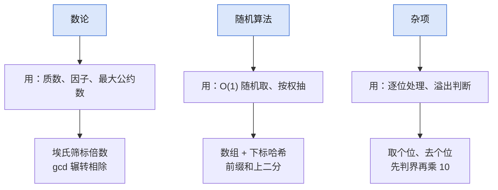

- **数论**：见图。例：[[interviews/core/leetcode/problems/count-primes|LC 204 计数质数]]、[[interviews/core/leetcode/problems/water-and-jug-problem|LC 365 水壶问题]]
- **组合数学**：数路径或方案时直接用组合数。例：[[interviews/core/leetcode/problems/unique-paths|LC 62 不同路径]]
- **博弈论**：从终局倒推必胜、必败态。例：[[interviews/core/leetcode/problems/predict-the-winner|LC 486 预测赢家]]
- **计算几何**：面积用容斥，判断形状比较距离平方。例：[[interviews/core/leetcode/problems/rectangle-area|LC 223 矩形面积]]、[[interviews/core/leetcode/problems/valid-square|LC 593 有效的正方形]]
- **随机算法**：见图。例：[[interviews/core/leetcode/problems/insert-delete-getrandom-o1|LC 380 O(1) 时间插入、删除和获取随机元素]]、[[interviews/core/leetcode/problems/random-pick-with-weight|LC 528 按权重随机选择]]
- **杂项**：见图。例：[[interviews/core/leetcode/problems/reverse-integer|LC 7 整数反转]]、[[interviews/core/leetcode/problems/palindrome-number|LC 9 回文数]]

## 10. 单调栈

栈里保持单调，被弹出的元素恰好找到了它的答案。图中是最常考的三个子模式：子模式 → 何时用 → 模板步骤。

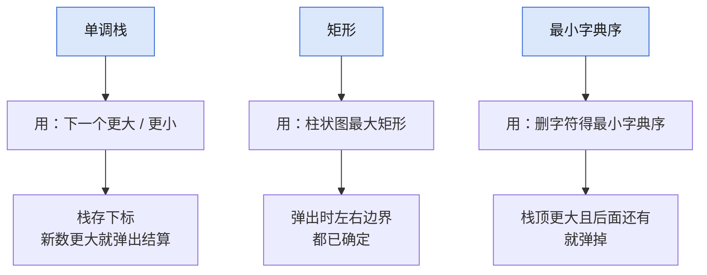

- **单调栈**：见图。例：[[interviews/core/leetcode/problems/daily-temperatures|LC 739 每日温度]]、[[interviews/core/leetcode/problems/next-greater-element-ii|LC 503 下一个更大元素 II]]
- **矩形**：见图。例：[[interviews/core/leetcode/problems/largest-rectangle-in-histogram|LC 84 柱状图中最大的矩形]]、[[interviews/core/leetcode/problems/trapping-rain-water|LC 42 接雨水]]
- **贡献法**：算每个元素作为最小值能覆盖多少子数组，左右边界都用单调栈求。例：[[interviews/core/leetcode/problems/sum-of-subarray-minimums|LC 907 子数组的最小值之和]]
- **最小字典序**：见图。例：[[interviews/core/leetcode/problems/remove-k-digits|LC 402 移掉 K 位数字]]、[[interviews/core/leetcode/problems/remove-duplicate-letters|LC 316 去除重复字母]]

## 11. 字符串

匹配类问题靠预处理复用已比较的信息，扫描类问题靠指针。图中是最常考的三个子模式：子模式 → 何时用 → 模板步骤。

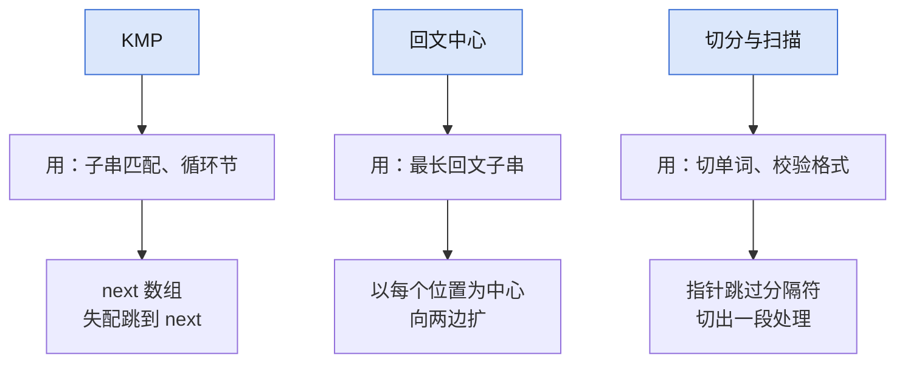

- **KMP**：见图。例：[[interviews/core/leetcode/problems/find-the-index-of-the-first-occurrence-in-a-string|LC 28 找出字符串中第一个匹配项的下标]]、[[interviews/core/leetcode/problems/rotate-string|LC 796 旋转字符串]]
- **Manacher / 回文中心**：见图。例：[[interviews/core/leetcode/problems/longest-palindromic-substring|LC 5 最长回文子串]]、[[interviews/core/leetcode/problems/palindromic-substrings|LC 647 回文子串]]
- **字符串哈希**：子串映射成数，`O(1)` 比较两段是否相等。例：[[interviews/core/leetcode/problems/repeated-dna-sequences|LC 187 重复的DNA序列]]、[[interviews/core/leetcode/problems/longest-duplicate-substring|LC 1044 最长重复子串]]
- **AC 自动机**：多个模式串一次扫描全部匹配。例：[[interviews/core/leetcode/problems/number-of-strings-that-appear-as-substrings-in-word|LC 1967 作为子字符串出现在单词中的字符串数目]]
- **后缀数组**：最长重复子串一类问题。例：[[interviews/core/leetcode/problems/longest-repeating-substring|LC 1062 最长重复子串]]
- **字符串切分、扫描与校验**：见图。例：[[interviews/core/leetcode/problems/reverse-words-in-a-string|LC 151 反转字符串中的单词]]、[[interviews/core/leetcode/problems/zigzag-conversion|LC 6 Z 字形变换]]
- **数字与文本互转**：从高位到低位查表，注意减法组合。例：[[interviews/core/leetcode/problems/roman-to-integer|LC 13 罗马数字转整数]]、[[interviews/core/leetcode/problems/integer-to-roman|LC 12 整数转罗马数字]]

## 12. 位运算

把整数看成一排开关，用与、或、异或一次改很多位。图中是最常考的三个子模式：子模式 → 何时用 → 模板步骤。

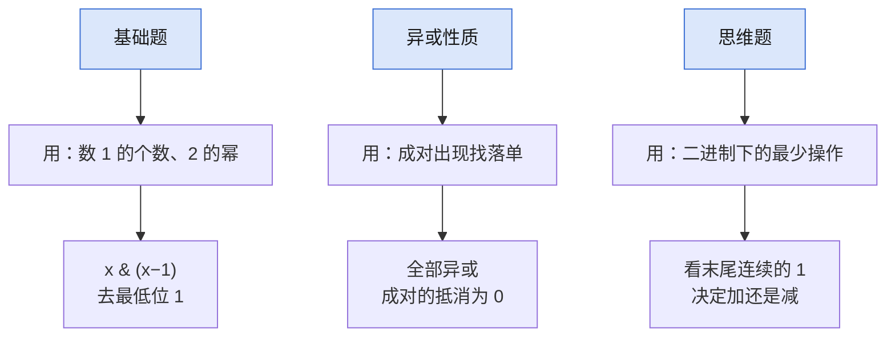

- **基础题**：见图。例：[[interviews/core/leetcode/problems/number-of-1-bits|LC 191 位 1 的个数]]、[[interviews/core/leetcode/problems/power-of-two|LC 231 2 的幂]]
- **异或性质**：见图。例：[[interviews/core/leetcode/problems/single-number|LC 136 只出现一次的数字]]、[[interviews/core/leetcode/problems/single-number-iii|LC 260 只出现一次的数字 III]]
- **思维题**：见图。例：[[interviews/core/leetcode/problems/minimum-operations-to-reduce-an-integer-to-0|LC 2571 将整数减少到零需要的最少操作数]]
- **其他**：不用加号做加法：异或是不进位的和，与再左移是进位。例：[[interviews/core/leetcode/problems/sum-of-two-integers|LC 371 两整数之和]]
