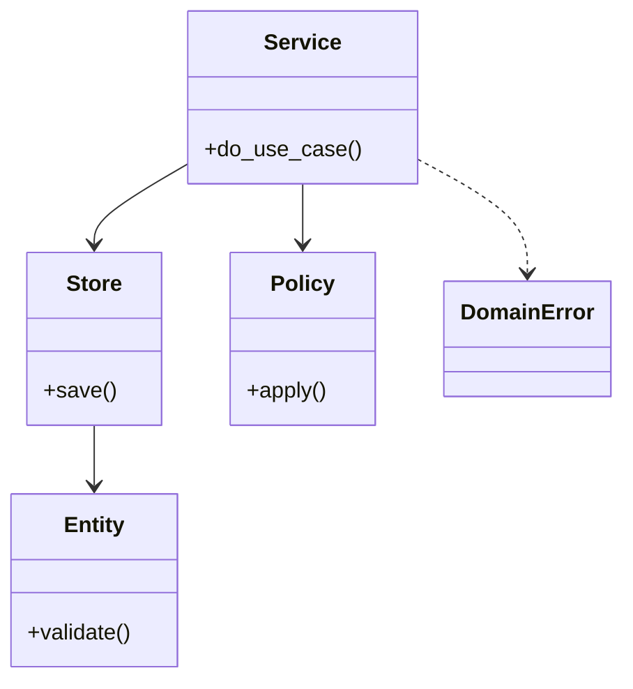

# Amazon OOD 轮怎么打（作答框架）

## 题目

Amazon 的面向对象设计（Object-Oriented Design，OOD）轮，通常是前面 10–30 分钟的行为面试（领导力准则，Leadership Principles，LP），后面 30–45 分钟的设计题。题目往往只有一句话，例如「设计火车票价计算」「设计快递柜」。你要写类和核心方法，面试官陆续追加 5–6 条需求。**面试官真正在测的是「别人接手后能不能改」：职责分离、命名、可扩展、测试名，而不是算法技巧。**

代码**不编译也不运行**，面试官在脑子里按你的代码走一遍（dry run，人工试跑）。所以语法必须正确，不接受伪代码。

你听到的提示大概是：「请设计一个 X 系统，写出主要的类和核心方法。」常见追问有三条：

- 加一条新规则（新折扣、新车型、新计费方式），你要说出改哪个类。
- 要不要线程安全，临界区在哪。
- 输入非法或资源用完时，系统怎么表现。

## 先问这几个问题

- 核心操作有哪几个？ → **只设计这几个**，其余写进「不做什么」。
- 非法输入抛异常还是返回错误？ → 决定每个公开方法的签名，也决定测试怎么写。
- 要不要线程安全、持久化？ → 要线程安全就先定一把锁的范围；不要就只口述，不写。
- 数据从哪来、规模多大？ → 决定用列表加遍历，还是要排序结构或索引。
- 金额、时间用什么类型？ → 钱用整数分（cents），时间由外部传入，测试才稳定。

把答案写成 3–5 条需求加一条「不做什么」，**让面试官点头确认后再画类**。这一步 5 分钟以内。

## 核心对象

每道题的骨架都是同一套分工。画图时先套这张表，再换成题目里的名词。

| 类 | 职责（一句话） | 守住的不变量 |
|---|---|---|
| 实体（Entity） | 带数据的名词：订单、柜子、车位 | 自己的字段永远合法，构造时校验 |
| 服务（Service） | 对外的入口，一个公开方法对应一个用例 | 一次调用要么全成功，要么什么都没改 |
| 仓库（Store） | 存取实体，隐藏数据结构 | 索引与主数据始终一致 |
| 规则（Policy） | 会变的那部分：计价、选择、淘汰 | 只依赖输入，不改全局状态 |
| 错误（Error） | 用具体异常表达失败路径 | 每种失败有自己的类型和消息 |



**判断一个东西是不是「类」的标准：它有没有自己要守的规则。** 只有数据、没有规则的东西，用 dataclass 或字典就够。

## 主流程

整轮 45 分钟，按下面的节奏走。LP 占得多时，把每一步等比压缩，不要照满配走。

1. **澄清（5 分钟）**：问上一节的五类问题，写下需求清单和「不做什么」。
2. **说方案（3 分钟）**：先口述 3–5 个类各自的一句话职责，再动笔。这一步让面试官有机会在你写错方向前纠正你。
3. **写第一版（20 分钟）**：先写实体和异常，再写服务的主方法，最后写规则。每个类写完立刻用一个例子走一遍。
4. **自己试跑（3 分钟）**：用一个正常例子、一个失败例子，口述每一步变量的值，**在面试官之前发现自己的错**。
5. **接追加需求（剩余时间）**：每来一条，先说「落在哪个类，哪些类不动」，再动手。
6. **收尾（2 分钟）**：说测试名、锁的范围、规模变大后会换什么。

时间不够时的取舍：

- **保**：能跑通核心路径的类和方法，命名清楚，一句话说出下一条需求改哪里。
- **先砍**：线程安全的完整实现（改口述临界区和锁）、持久化、次要的非法输入分支（写一个典型的，说明其余同理）。
- **不能砍**：「此处省略」式的伪代码。需要时写 `raise NotImplementedError("out of scope")`，它读起来是主动取舍。

## 关键决策

### 决策一：先说方案，还是直接写代码

- 直接写：看起来快，方向错了要整块重写。
- 先说 3 分钟类和职责：多花一点时间，但面试官会在这时纠偏。

**先说方案。** 草图只需要画清职责，不是完整 UML；能跑通的代码才是交付物。前期设计最容易超时。

### 决策二：会变的部分放哪里

- 用 if/elif 把每种情况写在主方法里：第一版最短，每条追加需求都要改核心方法。
- 把会变的部分抽成规则对象或数据表：多一个类，追加需求只加一项。

**面试官的追加需求几乎都能一行解决，这就是隐含的评分标准。** 如果追加需求要改已写好的核心方法，说明第一版把「会变」和「不变」切错了。但只有一种实现时不要抽接口：只在真有两种实现的地方留接缝（seam）。

### 决策三：什么时候不用设计模式

- 凡事套策略（Strategy）、工厂（Factory）、观察者（Observer）：看上去专业，类数翻倍，10 分钟内写不完。
- 先写最短的正确版本，面试官要求第二种实现时再抽。

**简单答案赢。** 一个字典加一个函数能解决的，不要写成三个类。

### 决策四：测试名怎么写

- `test_calculate_fare`：读不出规则。
- `test_weekend_fare_is_capped_at_daily_limit`：读起来是一条业务规则。

**测试名写成业务规则，测试体与名字一致。** 时间紧时只写 2–3 个这样的名字并口述断言，比写满十个 `test_x` 得分高。

## Python 骨架

下面是一个通用模板：服务加仓库加规则，一个失败路径，一个追加需求。练习时换成题目里的名词，目标是 30 分钟内默写出来。

```python
from dataclasses import dataclass
from typing import Callable, Dict
import threading


class DomainError(Exception):
    """所有业务失败的基类，调用方只需捕获这一个。"""


class NotFound(DomainError):
    pass


class InvalidInput(DomainError):
    pass


@dataclass(frozen=True)
class Item:
    """实体：构造时校验，之后不可变。"""
    id: str
    price_cents: int  # 钱用整数分，避免浮点误差

    def __post_init__(self):
        if self.price_cents < 0:
            raise InvalidInput("price must be >= 0")


# 规则就是一个函数：输入金额，输出金额。新增规则只加一个函数。
Policy = Callable[..., int]


def no_discount(total: int) -> int:
    return total


def ten_percent_off(total: int) -> int:
    return total * 90 // 100  # 整数运算，只在最后取整一次


class Store:
    """仓库：隐藏字典，对外只给 save / get。"""

    def __init__(self):
        self._items: Dict[str, Item] = {}

    def save(self, item: Item) -> None:
        self._items[item.id] = item

    def get(self, item_id: str) -> Item:
        if item_id not in self._items:
            raise NotFound(item_id)  # 失败路径用具体异常
        return self._items[item_id]


class Service:
    """入口：一个公开方法一个用例，锁只包住读改写。"""

    def __init__(self, store: Store, policy: Policy = no_discount):
        self._store = store
        self._policy = policy
        self._lock = threading.Lock()

    def checkout(self, item_ids: list) -> int:
        with self._lock:  # 临界区：整个查询加计算
            total = sum(self._store.get(i).price_cents for i in item_ids)
            return self._policy(total)


if __name__ == "__main__":
    store = Store()
    store.save(Item("a", 1000))
    store.save(Item("b", 250))
    assert Service(store).checkout(["a", "b"]) == 1250
    # 追加需求：打九折，只换一个参数，Service 不动
    assert Service(store, ten_percent_off).checkout(["a", "b"]) == 1125
    try:
        Service(store).checkout(["a", "missing"])
        raise SystemExit("should have failed")
    except NotFound:
        pass
    try:
        Item("bad", -1)
        raise SystemExit("should have failed")
    except InvalidInput:
        pass
    print("ok")
```

## 面试官加需求时

| 新需求 | 改哪里 | 不用动哪里 |
|---|---|---|
| 加一种计价或折扣规则 | 新增一个规则函数，构造服务时传入 | 服务、仓库、实体 |
| 新增一种实体类型 | 新增一个实体类，仓库按 id 存即可 | 已有实体与规则 |
| 要持久化 | 换一个仓库实现，接口不变 | 服务和规则 |
| 要线程安全 | 在服务里加一把锁，圈住读改写 | 实体、规则 |
| 失败要分类上报 | 在异常基类下加子类 | 所有成功路径 |
| 规模变大要加索引 | 仓库内部加一个索引字典 | 服务的公开方法 |

回答格式固定两句：**「这条需求落在某某类」「其余类不动」**。

## 并发与扩展

- 竞态出在「先查再改」：两个线程都查到「有空位」再各自占用。**用一把锁圈住整个读改写，而不是只圈写。**
- 先用一把粗锁，说清楚临界区。面试官要求更高并发时，再说按资源分片加锁。
- 锁内不要调用外部回调或做慢操作，否则会拖住所有线程，也可能死锁。
- 规模变大时：仓库换成数据库，服务无状态可水平扩展，唯一性约束交给数据库的事务或唯一索引。
- 时间、随机数从外部传入，才能写出确定的测试。

## 常见错误

- 一上来就画完整 UML，十分钟过去代码还没有：**只画职责草图，立刻写。**
- LP 故事讲太长挤掉设计时间：**每个故事 2–3 分钟，按剩余时间倒推每一步。**
- 用浮点数算钱，或每一步都取整：**整数分计算，只在最后取整一次。**
- 失败路径一律 `return None`：**用具体异常，并在测试里各写一条。**
- 写了一半的分支留在文件里：**删掉或抛 NotImplementedError，跑不起来的代码比缺功能扣分更多。**

## 30 秒复述

- 先花 5 分钟澄清，写下需求和「不做什么」，让面试官确认。
- 再用一句话各讲一个类：实体守字段，服务做用例，仓库藏数据结构，规则承载会变的部分。
- 关键决策：简单答案赢，只在真有两种实现时才抽接口。
- 扩展的证明：每条追加需求只新增一个规则或一个类，核心方法不改。
- 并发：一把锁圈住整个读改写，锁内不做慢操作；规模大了按资源分片，持久化换仓库。
- 测试名写成业务规则；时间不够先砍线程安全和持久化，不写伪代码。

## 来源

- [[method.delivery]]、[[method.evaluation]]、[[amazon.amz-round]]
- [[hellointerview-delivery]]
