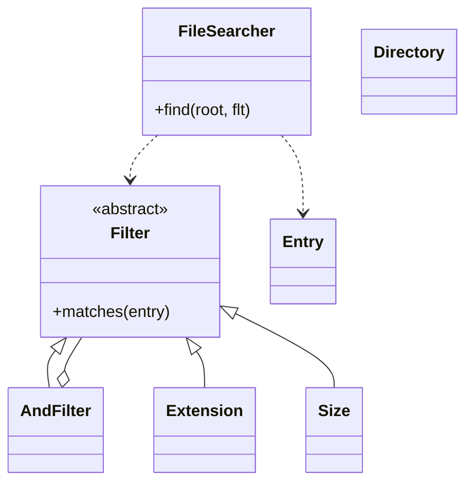

# Linux find / 文件搜索 API（File Search API）

## 题目

系统是一棵已经存在的目录树，调用方想按条件（大小、后缀、名字）把满足条件的文件找出来，像 Linux 的 `find` 命令。**面试官真正在测的是：条件怎么表示，才能新增条件时不改搜索代码，而且条件能自由组合。** 遍历本身不难，难在「把遍历和判断分开」。

你听到的提示大概是：「设计一个类似 Linux find 的 API，能按大小、格式等条件跨目录搜索文件，接口要干净、可扩展。」常见追问有三条：

- 加一个新条件（修改时间、是否空目录），改了几个文件？
- 条件要支持「且、或、非」，怎么做？
- 目录很大、有符号链接环，怎么办？

## 先问这几个问题

- 树是内存里的对象，还是真实磁盘？ → 内存就直接遍历对象；磁盘只换遍历的读取方式，**过滤器完全不变**。
- 条件之间只有「且」，还是还有「或、非」？ → 只有「且」用列表就够；有「或、非」就要可递归组合的结构。
- 结果要整个列表，还是边找边处理？ → 决定返回列表还是生成器。
- 符号链接要不要跟随？ → 不跟随就没有环；跟随就要做环检测。
- 大小的单位和边界怎么算？ → 「大于 5MB」是严格大于，MB 取 1024 的平方，写进需求清单。

不做：按文件内容搜索、权限属主、并行遍历、`-exec` 执行命令。

## 核心对象

| 类 | 职责（一句话） | 守住的不变量 |
|---|---|---|
| `File` / `Directory` | 存放数据：名字、大小、子节点 | 同一目录内名字唯一；**节点不存自己的路径** |
| `Entry` | 遍历时临时算出的「路径 + 节点」 | 不可变，过滤器只看它 |
| `Filter`（抽象基类） | 只回答一个问题：这个位置满足吗 | 只有 `matches` 一个方法，不改任何状态 |
| `Extension` / `Size` | 叶子条件 | 每个条件的规则写在自己类里 |
| `AndFilter` / `OrFilter` / `NotFilter` | 组合条件 | 返回新对象，不改原对象 |
| `FileSearcher` | 走树，把满足条件的位置逐个交出 | 只认识 `Filter` 接口，不认识具体条件 |



节点不存路径，是因为一个目录可以通过符号链接从两个路径到达，存路径会出错；真实文件系统里名字也存在父目录里。`AndFilter` 既持有 `Filter`，自己又是 `Filter`，这就是组合模式（Composite）：叶子和容器对调用方是同一个接口。

## 主流程

核心操作是 `find(root, filter)`，它是一个惰性生成器。

1. 把根节点包成 `Entry` 压入显式栈。
2. 循环弹出栈顶；对它调用 `filter.matches(entry)`，满足就 `yield`。
3. 如果是目录，把子节点**按名字逆序**压栈，这样弹出时是字典序，输出稳定。
4. 符号链接默认当叶子，不展开。
5. 栈空则结束。调用方只取第一个结果时，生成器停在第一个匹配处，没走的部分不会被访问。

失败点：`Directory.add` 遇到重名抛 `DuplicateNameError`；大小字符串解析不了（如 `5XB`）抛 `InvalidSizeError`。没有锁，因为遍历只读。

## 关键决策

### 决策一：条件用一堆参数，还是一棵可组合的对象树

- 选项 A：`find(root, name=None, ext=None, min_size=None, ...)`。第一关够用，但每加一个条件都要改签名和函数体，「或、非」无处可放。
- 选项 B：一个 `Filter` 接口加子类，组合靠 `AndFilter` 等。多几个类，但新增条件零修改。

**选 B（规约模式，Specification）。** 例：`Extension("xml") & Size.over("5MB")` 是一棵两个叶子的树。组合运算符返回新对象，所以同一个条件可以在多个表达式里复用。`AND` 短路，**便宜的条件放左边**。

### 决策二：遍历和判断分开，还是让节点自己搜索

- 选项 A：给节点加 `search(filter)` 方法，递归调用子节点。经典写法，但遍历策略（深度还是广度、是否跟随链接）被固化进节点。
- 选项 B：节点只是数据，`FileSearcher.find` 是外部函数。

**选 B。** 面试官最爱追问的恰好是遍历策略，B 里只有一处遍历代码，变化只影响 `FileSearcher`。这里不用访问者模式（Visitor）：操作只有「收集满足条件的位置」这一种，用不着。

### 决策三：返回列表，还是惰性生成器

- 列表加递归：简单，但必须走完整棵树才能返回第一个结果，目录深于约 1000 层会 `RecursionError`。
- 生成器加显式栈：取第一个结果就停，深目录不撞递归上限。

**选生成器加显式栈。** 访问每个节点一次，O(N)。

### 决策四：每种条件各写一个小类，还是一个通用 `Range`

通用的 `Range(attr, lo, hi)` 看起来更省，但「只有普通文件才有大小」「严格大于」这些规则就得推给调用方。**简单答案赢：每个条件一个小类，每个类不超过 10 行**，新增条件不用理解任何通用框架。

符号链接环的做法一句话：不跟随就无环；跟随时只检查「是否走回了自己的祖先」，不用全局 visited，否则会漏掉 `/alias` 和 `/a` 这两条合法路径。

## Python 骨架

```python
import fnmatch
from abc import ABC, abstractmethod
from dataclasses import dataclass, field


class DuplicateNameError(Exception):
    pass


class InvalidSizeError(Exception):
    pass


@dataclass
class File:
    name: str
    size: int = 0  # 字节
    is_dir = False


@dataclass
class Directory:
    name: str
    children: dict = field(default_factory=dict)
    size = 0
    is_dir = True

    def add(self, node):
        if node.name in self.children:  # 不变量：同目录名字唯一
            raise DuplicateNameError(node.name)
        self.children[node.name] = node
        return node


@dataclass(frozen=True)
class Entry:
    path: str  # 路径是遍历时算出来的，节点自己不存
    node: object

    @property
    def name(self):
        return self.node.name


class Filter(ABC):
    @abstractmethod
    def matches(self, e: Entry) -> bool: ...

    def __and__(self, o):
        return AndFilter(self, o)

    def __or__(self, o):
        return OrFilter(self, o)

    def __invert__(self):
        return NotFilter(self)


@dataclass(frozen=True)
class AndFilter(Filter):
    a: Filter
    b: Filter

    def matches(self, e):
        return self.a.matches(e) and self.b.matches(e)  # 短路


@dataclass(frozen=True)
class OrFilter(Filter):
    a: Filter
    b: Filter

    def matches(self, e):
        return self.a.matches(e) or self.b.matches(e)


@dataclass(frozen=True)
class NotFilter(Filter):
    a: Filter

    def matches(self, e):
        return not self.a.matches(e)


@dataclass(frozen=True)
class NameGlob(Filter):
    pattern: str

    def matches(self, e):
        return fnmatch.fnmatchcase(e.name, self.pattern)


@dataclass(frozen=True)
class Extension(Filter):
    ext: str

    def matches(self, e):
        if e.node.is_dir:
            return False
        stem = e.name.lstrip(".")  # .bashrc 没有扩展名
        return "." in stem and stem.rsplit(".", 1)[1].lower() == self.ext.lower()


_UNITS = {"B": 1, "KB": 1024, "MB": 1024 ** 2, "GB": 1024 ** 3}


def parse_size(text: str) -> int:
    digits = text.rstrip("BKMGbkmg")
    unit = text[len(digits):].upper() or "B"
    if not digits.isdigit() or unit not in _UNITS:
        raise InvalidSizeError(text)
    return int(digits) * _UNITS[unit]


@dataclass(frozen=True)
class Size(Filter):
    lo: int  # 严格大于 lo

    @staticmethod
    def over(text: str):
        return Size(parse_size(text))

    def matches(self, e):
        return not e.node.is_dir and e.node.size > self.lo


class FileSearcher:
    def find(self, root, flt: Filter):
        stack = [Entry("/" if root.name == "" else "/" + root.name, root)]
        while stack:  # 显式栈，生成器：取第一个结果就停
            e = stack.pop()
            if flt.matches(e):
                yield e
            if e.node.is_dir:
                for name in sorted(e.node.children, reverse=True):  # 逆序压栈，弹出为字典序
                    base = e.path.rstrip("/")
                    stack.append(Entry(f"{base}/{name}", e.node.children[name]))


if __name__ == "__main__":
    root = Directory("")
    docs = root.add(Directory("docs"))
    docs.add(File("a.xml", 6 * 1024 ** 2))
    docs.add(File("b.XML", 100))
    root.add(File("c.txt", 9 * 1024 ** 2))
    root.add(File(".bashrc", 10))
    s = FileSearcher()
    paths = lambda f: [e.path for e in s.find(root, f)]
    assert paths(Extension("xml")) == ["/docs/a.xml", "/docs/b.XML"]  # 后缀不分大小写
    assert paths(Extension("xml") & Size.over("5MB")) == ["/docs/a.xml"]
    assert paths(Size.over("5MB") & ~Extension("xml")) == ["/c.txt"]
    assert paths(Extension("bashrc")) == []  # 隐藏文件无扩展名
    assert next(s.find(root, NameGlob("*.txt"))).path == "/c.txt"
    try:
        parse_size("5XB")
        raise SystemExit("should have failed")
    except InvalidSizeError:
        pass
    print("ok")
```

## 面试官加需求时

| 新需求 | 改哪里 | 不用动哪里 |
|---|---|---|
| 按修改时间过滤 | 新增 `Modified` 类（给 `File` 加 `mtime` 字段） | `FileSearcher`、已有过滤器 |
| 只要空目录 | 新增 `EmptyDir` 类 | 其余全部 |
| 「xml 或 json，但不是 old 开头」 | 调用方写 `(Ext("xml") \| Ext("json")) & ~NameGlob("old*")` | 所有类 |
| 限制最大深度 | `Entry` 加 `depth`，`FileSearcher` 加一个配置 | 过滤器 |
| 跟随符号链接 | 新增 `Symlink` 节点；栈项带祖先链，遇到祖先就不展开 | 过滤器 |
| 真实磁盘 | 把 `os.scandir` 读成同样的树，或换遍历读取处 | 过滤器 |

判据只有一个：**改了几个文件？好答案是新增一个类、零处修改。**

## 并发与扩展

- 遍历和过滤器都只读，过滤器是不可变对象，可以跨线程共享，不需要锁。
- 一边搜索一边有人增删文件：内存树可在遍历前对子节点取快照（`sorted(children)` 本身就是快照）；真实磁盘用 `os.scandir`，某个文件消失就跳过。
- 树大到放不进内存：遍历换成按目录分页读取，生成器天然支持，调用方的用法不变。
- 并行遍历：每个子目录交给线程池，结果用队列汇总，输出顺序不再稳定，需要时再做。
- 想按内容搜索：新增昂贵的 `Contains` 条件，放在 `AND` 最右边，靠短路少读文件。

## 常见错误

- 把所有参数塞进 `find()` 的签名：**用 `Filter` 接口加子类，新增条件才是零修改。**
- 节点里存路径：**路径是遍历时算的，节点只存名字。**
- 递归加返回列表：**用生成器加显式栈，才能惰性取第一个，也不怕深目录。**
- 用全局 visited 防环：**会漏掉合法的第二条路径，用祖先链。**
- 大小比较用浮点或单位写错：**统一换成字节整数比较，写清「严格大于」。**
- `~Extension("py")` 把目录也选进来：**要排除目录，显式写 `& 只匹配文件`。**

## 30 秒复述

- 三件事分开：树只存数据，`Filter` 只回答是否满足，`FileSearcher` 只负责走树。
- 条件是规约模式：每个条件一个小类，`& | ~` 组合出且、或、非，返回新对象可复用。
- 关键决策：遍历放在外部函数里，不放进节点，所以遍历策略的变化只影响一处。
- 遍历是显式栈加生成器：取第一个就停，深目录不撞递归上限。
- 扩展故事：新增条件就是新增一个类，搜索器和已有条件零修改。
- 符号链接默认不跟随；跟随时只用祖先链检测环。

## 来源

- [[solution-amz-linux-find]]
- [[src-pythondocs-fnmatch-amz-linux-find]]
