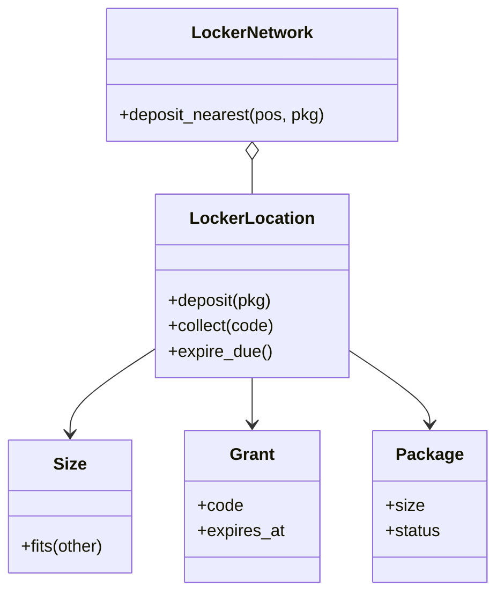

# 快递柜（Amazon Locker）

## 题目

街角有一台自助取件柜：快递员把包裹放进尺寸合适的空柜格，系统发一个取件码，收件人凭码取走，没人来取时柜格要能收回。看上去是「分配加查表」，**面试官真正在测的有两处：分配规则能不能经得起「加一种新尺寸」，以及你是否明白取件码不是密码**，它决定错误尝试怎么计数。

你听到的提示大概是：「设计一套快递柜。快递员把包裹放进柜子，系统给顾客一个取件码，顾客凭码取走。」常见追问有三条：

- 加一种超大柜格，分配代码要改吗？
- 三天没人取怎么办？
- 多个网点、多个快递员同时操作，怎么办？

## 先问这几个问题

- 柜格尺寸是固定几档，还是以后会加？ → 决定尺寸用枚举还是带三维的值对象；**会加就用值对象**。
- 小包裹能不能放大柜子？ → 能，规则就是「装得下的最小空柜」，代价是可能浪费大柜。
- 取件码多久过期，过期后包裹去哪？ → 决定要不要过期扫描；包裹标记退回寄件人。
- 一个网点还是多个？同一台柜机前有几个快递员？ → 多快递员就要一把锁；多网点放到最后再做。
- 码是给谁的？ → 它是持有即凭证（谁拿到谁能开那一个门），不绑定账号。

不做：柜门电机、短信网关、真正的地理索引、持久化、计费。

## 核心对象

| 类 | 职责（一句话） | 守住的不变量 |
|---|---|---|
| `Size` | 尺寸：名字加长宽高 | 不可变；「装得下」是三维都不小于 |
| `Package` | 一件包裹 | 有自己的状态（待取、已取、退回） |
| `Grant` | 一次开门授权：码、柜格、到期时间 | 不可变，签出后不会变 |
| `LockerLocation` | 一个网点：分配、发码、取件、过期 | 空闲柜格索引和码表始终一致；空桶立刻删键 |
| `LockerNetwork` | 多网点时挑最近且有空位的网点 | 不先查后投，直接尝试 |



没有 `LockerManager` 这种只转发调用的类：它守不住任何网点没守住的不变量。

## 主流程

**投件 `deposit(pkg)`：**

1. 加锁。临界区是「选柜、占柜、发码」三步的整体，不是其中任何一步。
2. 在空闲索引里找所有装得下的尺寸，取体积最小的；没有就抛 `NoLockerAvailable`，此时什么都没改。
3. 从空闲索引里拿走一个柜格（桶空了删键），生成取件码，记下到期时间，码表加一条，到期堆加一条。
4. 返回 `Grant`。

**取件 `collect(code)`：**

1. 加锁；若这台柜机正在冷却期，抛 `TerminalLocked`。
2. 码表里没有这个码：错误计数加一，达到阈值整台柜机冷却；抛 `UnknownCode`。**只有这一种失败算可疑。**
3. 码存在但已过期：当场收回柜格，抛 `ExpiredCode`，不计入失败。
4. 否则清零失败计数，删码、释放柜格，返回包裹。

过期扫描 `expire_due()` 只看到期堆的堆顶，弹出已到期的条目；对应的码已被取走就是陈旧条目，直接丢掉。

## 关键决策

### 决策一：尺寸用枚举，还是值对象

- 选项 A：`IntEnum`（小、中、大）。短，但加一档要改枚举、改所有判断，还假设尺寸有全序；又高又窄和又矮又宽谁大？
- 选项 B：带三维的值对象，「装得下」是一次三维比较。

**选 B。** 判据可验证：分配代码里没有任何地方写具体的尺寸名，加一种新尺寸后，大包裹立刻能分配。用体积加名字做排序键来打破并列，保证结果确定。分配规则不做成策略模式：只有一个实现，真要换时提成函数是五分钟的事。

### 决策二：取件码不是密码，错误尝试按什么计数

- 按包裹计数：错码不属于任何人，你根本不知道输入者想开哪个门；而且别人能故意输错把机主锁在外面。
- 按终端计数：连续输错达到阈值，整台柜机冷却几分钟。

**选按终端限流，熵靠码本身。** 码用 `secrets` 生成（不用 `random`），去掉易混淆字符。三种失败要分开：码不存在才算可疑；过期和用错门是真码，不计数。事件里不能带取件码，否则凭证会跟着进日志。

### 决策三：过期怎么驱动

- 每个授权一个定时器：上千个句柄，取走后忘了取消就泄漏，测试要真等。
- 后台线程全表扫描：每次 O(码表大小)，逻辑里出现了真实时间。

**选显式的 `expire_due()` 加注入的时钟加到期堆。** 谁来调用它（线程、cron）是部署问题，不是设计问题。代价是惰性删除：提前取走的码在堆里留着，弹出时丢掉。

### 决策四：简单答案赢

先把单网点的主流程和失败路径写完整、手工推演一遍，再谈多网点。最近网点只用朴素的距离排序，不写四叉树：地理搜索是另一道题。

## Python 骨架

```python
import heapq
import secrets
import threading
from dataclasses import dataclass


class LockerError(Exception):
    pass


class NoLockerAvailable(LockerError):
    pass


class UnknownCode(LockerError):
    pass


class ExpiredCode(LockerError):
    pass


class TerminalLocked(LockerError):
    pass


@dataclass(frozen=True)
class Size:
    name: str
    w: int
    d: int
    h: int

    def fits(self, o: "Size") -> bool:  # 偏序：三维都不小于
        return self.w >= o.w and self.d >= o.d and self.h >= o.h

    @property
    def sort_key(self):  # 并列时用名字，保证确定性
        return (self.w * self.d * self.h, self.name)


@dataclass
class Package:
    id: str
    size: Size
    status: str = "pending"


@dataclass(frozen=True)
class Grant:
    code: str
    locker_id: str
    expires_at: int


class LockerLocation:
    ALPHABET = "ABCDEFGHJKMNPQRSTUVWXYZ23456789"  # 去掉 0/O/1/I 等易混字符

    def __init__(self, lockers: dict, clock, ttl=3 * 86400, max_fail=3, cooldown=300):
        self._size_of = dict(lockers)  # locker_id -> Size
        self._free: dict = {}  # Size -> {locker_id}，空桶立刻删键
        for lid, s in lockers.items():
            self._free.setdefault(s, set()).add(lid)
        self._grants: dict = {}  # code -> Grant
        self._pkg: dict = {}  # locker_id -> Package
        self._deadlines: list = []  # 小顶堆 (到期时间, code)
        self._clock, self._ttl = clock, ttl  # 时间由外部注入，测试才能让它走
        self._max_fail, self._cooldown = max_fail, cooldown
        self._fail, self._locked_until = 0, 0
        self._lock = threading.Lock()

    def _new_code(self) -> str:
        return "".join(secrets.choice(self.ALPHABET) for _ in range(8))

    def _release(self, lid: str):
        self._free.setdefault(self._size_of[lid], set()).add(lid)

    def deposit(self, pkg: Package) -> Grant:
        with self._lock:  # 选柜、占柜、发码是一个整体
            fits = [s for s in self._free if s.fits(pkg.size)]
            if not fits:
                raise NoLockerAvailable(pkg.id)  # 拒绝时什么都没改
            size = min(fits, key=lambda s: s.sort_key)
            lid = min(self._free[size])
            self._free[size].remove(lid)
            if not self._free[size]:
                del self._free[size]
            code = self._new_code()
            g = Grant(code, lid, self._clock() + self._ttl)
            self._grants[code] = g
            self._pkg[lid] = pkg
            heapq.heappush(self._deadlines, (g.expires_at, code))
            return g

    def collect(self, code: str) -> Package:
        with self._lock:
            now = self._clock()
            if now < self._locked_until:
                raise TerminalLocked()
            g = self._grants.get(code)
            if g is None:  # 唯一可疑的失败：有人在猜
                self._fail += 1
                if self._fail >= self._max_fail:
                    self._locked_until, self._fail = now + self._cooldown, 0
                raise UnknownCode(code)
            if g.expires_at <= now:  # 真码但来晚了：不计失败，当场收回
                self._expire(g)
                raise ExpiredCode(code)
            self._fail = 0
            del self._grants[code]
            pkg = self._pkg.pop(g.locker_id)
            self._release(g.locker_id)
            pkg.status = "collected"
            return pkg

    def _expire(self, g: Grant) -> Package:
        del self._grants[g.code]
        pkg = self._pkg.pop(g.locker_id)
        pkg.status = "return_to_sender"
        self._release(g.locker_id)
        return pkg

    def expire_due(self) -> list:
        with self._lock:
            now, out = self._clock(), []
            while self._deadlines and self._deadlines[0][0] <= now:
                _, code = heapq.heappop(self._deadlines)
                g = self._grants.get(code)
                if g is not None and g.expires_at <= now:  # 码已被取走则是陈旧条目，丢掉
                    out.append(self._expire(g))
            return out


if __name__ == "__main__":
    S, M, L = Size("S", 1, 1, 1), Size("M", 2, 2, 2), Size("L", 3, 3, 3)
    t = [0]
    loc = LockerLocation({"S1": S, "M1": M, "L1": L}, lambda: t[0])
    g = loc.deposit(Package("p1", S))
    assert g.locker_id == "S1"  # 装得下的最小柜
    assert loc.deposit(Package("p2", M)).locker_id == "M1"
    assert loc.collect(g.code).status == "collected"
    try:
        loc.collect(g.code)  # 码只能用一次
        raise SystemExit("should have failed")
    except UnknownCode:
        pass
    assert loc.deposit(Package("p3", S)).locker_id == "S1"  # 柜格已回到空闲池
    loc.deposit(Package("p4", L))
    try:
        loc.deposit(Package("p5", L))
        raise SystemExit("should have failed")
    except NoLockerAvailable:
        pass
    t[0] = 4 * 86400  # 时间走过期限
    assert sorted(p.id for p in loc.expire_due()) == ["p2", "p3", "p4"]
    assert not loc._grants and not loc._deadlines
    for _ in range(3):
        try:
            loc.collect("WRONG")
        except LockerError:  # 连续输错，整台柜机进入冷却
            pass
    try:
        loc.collect("WRONG")
        raise SystemExit("should have failed")
    except TerminalLocked:
        pass
    print("ok")
```

## 面试官加需求时

| 新需求 | 改哪里 | 不用动哪里 |
|---|---|---|
| 加一种超大柜格 | 构造时多传一个 `Size` | `deposit` 的分配逻辑 |
| 多个网点 | 新增 `LockerNetwork`，按距离排序，尝试第一个收得下的网点 | `LockerLocation` |
| 退货（顾客投件，快递员取件） | `Grant` 加「用途」字段（取件或投件） | 分配和过期逻辑 |
| 到期前提醒顾客 | 事件订阅者；事件不带码 | 主流程 |
| 持久化 | 柜格表和授权表各一张，内存对象不变 | 类的职责 |
| 把码存起来 | 只存哈希 | 取件流程的分支 |

## 并发与扩展

- 竞态在「选柜再占柜」：两个快递员选到同一个柜格。**一把锁圈住选、占、发码三步。**
- 多网点时不要先问「有没有空位」再投：两步之间别人会占走。直接调用 `deposit`，抛 `NoLockerAvailable` 就试下一个。
- 过期扫描和取件共用同一把锁，所以过期的码不会被取走。
- 变成系统设计题：下单时预留柜格，预留带有效期；占格用数据库的条件更新（状态为空闲才改为预留）；码只存哈希；扫描变成定时任务。
- 类的职责划分不变，内存里的锁换成数据库行上的条件更新。

## 常见错误

- 把时间花在最近网点的地理算法上，单网点主流程还没写完：**先写完单网点主流程和失败路径，并手工推演。**
- 错误次数按包裹计数：**码不属于任何人，只能按终端限流。**
- 把过期或用错门也算进失败：**只有码不存在才计数。**
- 为每个授权起一个定时器：**用显式扫描加注入时钟。**
- 在方法里直接读系统时间：**时钟从构造函数传入，否则测不了过期。**
- 用 `random` 生成码：**用 `secrets`。**

## 30 秒复述

- 对象：`Size`（值对象）、`Package`、`Grant`、`LockerLocation`，多网点再加 `LockerNetwork`。
- 分配：在装得下的柜格里取最小的；尺寸是三维值对象，加新尺寸不改分配代码。
- 取件码是持有即凭证，不是密码：错误按终端计数，三种失败只有「码不存在」算可疑。
- 过期：显式 `expire_due()` 加注入时钟加到期堆，陈旧条目弹出时丢弃。
- 并发：一把锁圈住选柜、占柜、发码；多网点直接尝试，不先查后投。
- 扩展：退货只加「用途」字段，分配逻辑不动；持久化换成数据库条件更新。

## 来源

- [[solution-amazon-locker]]
- [[src-hellointerview-amz-locker-onsite]]
