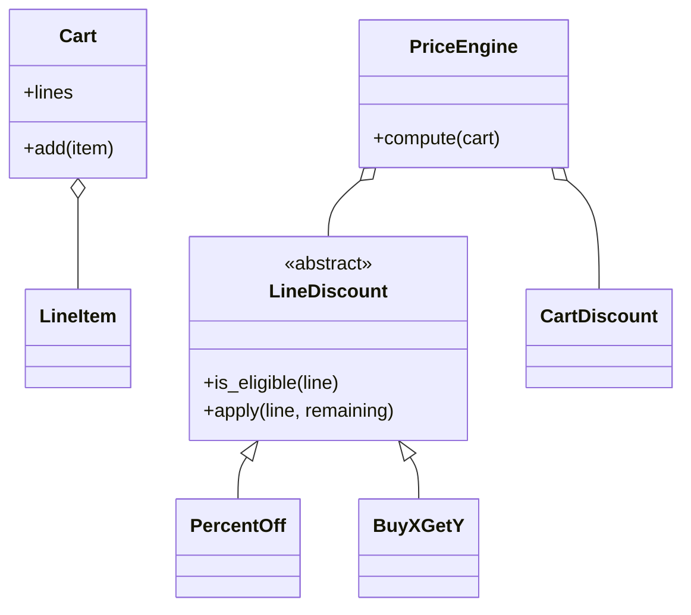

# 购物车折扣引擎（Checkout Price Engine）

## 题目

顾客把若干商品放进购物车，商家有一批促销规则；引擎读购物车和规则，算出每件商品该付多少钱，并列出每一笔减免。没有数据库、没有支付，核心就是一个函数：购物车加规则得到账单。**面试官真正在测的是三件事：折扣依赖的数据范围不同怎么分层、多个折扣同时命中怎么叠加、钱怎么表示才不会差几分钱。**

你听到的提示大概是：「抽象一个 `Discount` 基类，`isEligible` 判断商品是否适用，`apply` 返回折扣金额；`PriceEngine` 遍历购物车每一行，依次检查所有折扣，累加后从原价里扣。其中 BUY_X_GET_Y（买 X 送 Y）不直接减钱，要把赠品数量乘单价折成减免。」常见追问有三条：

- 再加一个全场折扣、满额减、买三送一。
- 两个折扣同时命中同一件商品，先算哪个？
- 多线程同时加购物车、同时算价会不会出错？

## 先问这几个问题

- 同一件商品能同时享受多个折扣吗？先算哪个？ → 能叠加就要定顺序，后一个看到的是前一个减完后的价格；只取最划算的，就要多一条「选最大」的策略。
- 有没有看整车金额的折扣，比如满 100 减 10？ → 有，折扣就要分「只看一行」和「看整车」两层。
- 钱用什么表示，有没有多币种？ → 单币种用**整数分**，全程不出现浮点数。
- 满减的门槛按原价还是折后价？ → 按折后小计，是常见口径；要换成原价，只改传给判断函数的那个数。

不做：税费和运费、优惠券发放核销、库存。

## 核心对象

| 类 | 职责（一句话） | 守住的不变量 |
|---|---|---|
| `LineItem` | 一行商品：SKU、单价（分）、数量 | 不可变；数量为正、单价非负，构造时拒绝坏数据 |
| `Cart` | 购物车容器 | 同一 SKU 只占一行，再次加入时数量合并；对外只给快照 |
| `LineDiscount` | 行级折扣：能不能用，在剩余价格上减多少 | 只看一行，各自负责自己的舍入 |
| `CartDiscount` | 购物车级折扣：满减 | 只看折后总额，只执行一次 |
| `PriceEngine` | 遍历、钳位、记账 | 不认识任何具体折扣；构造后只含元组 |
| `Receipt` | 带标签的账单 | 应付等于原价合计减全部减免，永不为负 |



折扣不持有购物车，也不修改购物车；引擎读快照，算完就丢。

## 主流程

核心操作是 `compute(cart)`，它是纯函数。

1. 取购物车快照，算出原价合计。
2. 对每一行：剩余价格先设为单价乘数量。依次问每个行级折扣 `is_eligible(line)`；适用就调用 `apply(line, remaining)`。
3. 减免是负数就抛 `InvalidRuleError`（写坏的规则不能让价格变高）；超过剩余价格就**钳到剩余价格**；大于 0 才记一笔账，并从剩余价格里扣掉。
4. 所有行算完得到折后小计。对每个购物车级折扣，门槛按折后小计判断，满足就减一次，同样钳位。
5. 返回 `Receipt`：原价合计、每笔减免（标签加金额）、应付。

买 X 送 Y 的算法：送出件数等于 `qty // (buy + free) * free`，减免等于**剩余价格乘送出件数再整除数量**。例：7 支 2.50 元的笔，买 2 送 1，送 2 支，减 5.00 元，应付 12.50 元。

## 关键决策

### 决策一：钱用浮点、`Decimal`，还是整数分

- 浮点：`19.99 * 100` 是 `1998.9999999999998`，`int` 之后少一分钱，误差还会累积。
- `Decimal`：精确，但每一步都要想舍入模式，对象也重。
- 整数分：加法和比较都精确，只在「按比例」时才需要舍入。

**选整数分，比例用整数基点（万分之一，8.5% 记 850），舍入只发生一次**：在每条折扣自己的 `apply` 里用整数半进位除法。例：199 分打 8.5% 折，`199 × 850 / 10000 = 16.915`，得 17 分。字符串价格先经 `Decimal` 转成分，不经过浮点。不写 `Money` 类：只有一种币种，一个包着 `int` 的类只会多一层拆装箱。

### 决策二：折扣按行还是按整车

- 统一 `apply(cart, line)`：灵活，但满减若被每行各执行一次就多减了钱，引擎也无法保证钳位。
- 两层接口：行级折扣只看一行，购物车级折扣只看折后总额。

**选两层，判据是折扣依赖的数据范围。** 百分比、买 X 送 Y 只需一行的数量和单价，放行级；满减依赖整车，放购物车级。若追问「买 A 送 B」（跨商品），它就升到购物车级，这是预期的扩展点。

### 决策三：叠加还是只取最大，用枚举而不是第二个引擎

- 全部叠加：按列表顺序，后一个看到前一个减完后的价格。
- 只取最大：多一步筛选。

**叠加顺序就是规则列表的顺序，是显式约定。** 例：1000 分乘 3 件，先八折剩 2400，再买 2 送 1，送出的那件按剩余价格折 800，总价 1600。送出那件用剩余价格而不是原价，否则总减免会超过实际价格。需要「只取最大」时，给引擎加一个枚举参数和一个 `if`，**不写 `BestOnlyEngine` 子类**。

### 决策四：简单答案赢，折扣不要工厂

折扣带状态（比例、买几送几、作用范围、标签）又有两个方法，所以用类。**不写 `DiscountFactory`、`DiscountRegistry`**：折扣就是普通对象，调用方构造后传给引擎。要从配置加载时，写一个 20 行的名字到类的字典即可。

## Python 骨架

```python
import threading
from abc import ABC, abstractmethod
from dataclasses import dataclass


class InvalidItemError(Exception):
    pass


class InvalidRuleError(Exception):
    pass


def div_half_up(n: int, d: int) -> int:  # 纯整数半进位除法，唯一的舍入点
    return (2 * n + d) // (2 * d)


@dataclass(frozen=True)
class LineItem:
    sku: str
    unit_cents: int
    qty: int

    def __post_init__(self):
        if self.qty <= 0 or self.unit_cents < 0:
            raise InvalidItemError(self.sku)


class Cart:
    def __init__(self):
        self._lines: dict = {}
        self._lock = threading.Lock()

    def add(self, item: LineItem):
        with self._lock:  # 读-改-写必须是一个整体，否则丢更新
            old = self._lines.get(item.sku)
            if old and old.unit_cents != item.unit_cents:
                raise InvalidItemError("price mismatch " + item.sku)
            qty = item.qty + (old.qty if old else 0)
            self._lines[item.sku] = LineItem(item.sku, item.unit_cents, qty)

    @property
    def lines(self) -> tuple:
        with self._lock:
            return tuple(self._lines.values())  # 快照，不暴露内部字典


class LineDiscount(ABC):
    def __init__(self, label: str, skus=None):
        self.label, self.skus = label, skus  # skus 为 None 表示全场

    def is_eligible(self, line: LineItem) -> bool:
        return self.skus is None or line.sku in self.skus

    @abstractmethod
    def apply(self, line: LineItem, remaining: int) -> int: ...


class PercentOff(LineDiscount):
    def __init__(self, label, bps, skus=None):
        super().__init__(label, skus)
        self.bps = bps  # 基点：8.5% 记 850

    def apply(self, line, remaining):
        return div_half_up(remaining * self.bps, 10_000)


class BuyXGetY(LineDiscount):
    def __init__(self, label, buy, free, skus=None):
        super().__init__(label, skus)
        self.buy, self.free = buy, free

    def is_eligible(self, line):
        return super().is_eligible(line) and line.qty >= self.buy + self.free

    def apply(self, line, remaining):
        free_units = line.qty // (self.buy + self.free) * self.free
        return remaining * free_units // line.qty  # 用剩余价格，不用原单价


@dataclass(frozen=True)
class ThresholdOff:  # 购物车级：按折后小计判断，只执行一次
    label: str
    threshold: int
    off: int


@dataclass(frozen=True)
class Receipt:
    subtotal: int
    adjustments: tuple
    total: int


class PriceEngine:
    def __init__(self, line_discounts=(), cart_discounts=()):
        self._lines, self._carts = tuple(line_discounts), tuple(cart_discounts)

    def compute(self, cart: Cart) -> Receipt:
        lines = cart.lines
        subtotal = sum(l.unit_cents * l.qty for l in lines)
        adj, total = [], 0
        for line in lines:
            remaining = line.unit_cents * line.qty
            for d in self._lines:  # 规则列表的顺序就是叠加顺序
                if not d.is_eligible(line):
                    continue
                amt = d.apply(line, remaining)
                if amt < 0:
                    raise InvalidRuleError(d.label)
                amt = min(amt, remaining)  # 钳位：价格不会减成负数
                if amt > 0:
                    adj.append((d.label, amt))
                    remaining -= amt
            total += remaining
        for c in self._carts:
            if total >= c.threshold:
                amt = min(c.off, total)
                adj.append((c.label, amt))
                total -= amt
        return Receipt(subtotal, tuple(adj), total)


if __name__ == "__main__":
    def cart_of(*items):
        c = Cart()
        for i in items:
            c.add(i)
        return c

    pens = cart_of(LineItem("pen", 250, 4), LineItem("pen", 250, 3))  # 合并成 7 支
    assert pens.lines == (LineItem("pen", 250, 7),)
    r = PriceEngine([BuyXGetY("买2送1", 2, 1)]).compute(pens)
    assert r.total == 1250 and r.adjustments == (("买2送1", 500),)
    shirts = cart_of(LineItem("shirt", 1000, 3))  # 先八折再买2送1：1000*3 -> 2400 -> 1600
    r = PriceEngine([PercentOff("八折", 2000), BuyXGetY("买2送1", 2, 1)]).compute(shirts)
    assert r.total == 1600 and r.subtotal - sum(a for _, a in r.adjustments) == r.total
    assert PercentOff("x", 850).apply(LineItem("a", 199, 1), 199) == 17  # 16.915 进位
    rule = [PercentOff("八折", 2000)], [ThresholdOff("满100减10", 10000, 1000)]
    assert PriceEngine(*rule).compute(cart_of(LineItem("a", 13000, 1))).total == 9400
    assert PriceEngine(*rule).compute(cart_of(LineItem("a", 12000, 1))).total == 9600  # 折后不满门槛
    try:
        PriceEngine([PercentOff("坏规则", -100)]).compute(shirts)
        raise SystemExit("should have failed")
    except InvalidRuleError:
        pass
    print("ok")
```

## 面试官加需求时

| 新需求 | 改哪里 | 不用动哪里 |
|---|---|---|
| 全场折扣、热销商品折扣 | 只是 `skus` 取值不同（`None` 或某个集合） | 所有类 |
| 买三送一 | `BuyXGetY(label, 3, 1)` 换参数 | 引擎 |
| 满额翻倍、满减 | 新增一个购物车级折扣类 | 行级折扣、`Cart` |
| 买 A 送 B（跨商品） | 升到购物车级，新增一个折扣类 | 行级折扣 |
| 只取最划算的一个 | 引擎加一个枚举参数和一处 `if` | 折扣类 |
| 多币种 | 引入 `Money`，改 `LineItem` 和账单 | 折扣的结构 |

## 并发与扩展

- 引擎构造后只含元组，`compute` 是纯函数，可被多线程共享，不需要锁。
- 竞态在 `Cart.add` 的「取旧数量、加新数量、写回」：线程在中间切换会丢更新。**一把锁圈住整个读改写**，`lines` 在锁内复制成元组，`compute` 在快照上工作，读不到修改了一半的购物车。
- 全局的锁只此一把，没有嵌套，所以不会死锁。
- 规模变大：规则从数据库或配置加载，购物车放在会话存储里；`compute` 无状态，可以水平扩展。
- 账单需要审计时：持久化 `Receipt`，其中每笔减免带标签，可以复现。

## 常见错误

- 用 `float` 存钱：**整数分，字符串价格用 `Decimal` 一次转换。**
- 满减放进逐行循环，被每行各扣一次：**满减放购物车级，只执行一次。**
- 买 X 送 Y 用原单价折算：**用剩余价格，否则前面已有折扣时会超减。**
- 折扣没有钳位，价格减成负数：**每笔减免钳到剩余价格；负的减免直接抛异常。**
- 每一步都取整：**只在每条折扣的 `apply` 里取整一次。**
- 写 `DiscountFactory` 和一整套继承：**折扣是普通对象，需要时再抽象。**

## 30 秒复述

- 对象：`LineItem`、`Cart`、行级折扣、购物车级折扣、`PriceEngine`、`Receipt`。
- 钱用整数分，比例用基点，舍入只发生一次。
- 关键决策：折扣按依赖范围分两层，百分比和买 X 送 Y 看一行，满减看折后总额。
- 叠加顺序就是规则列表的顺序，每笔减免钳到剩余价格，账单上每笔带标签。
- 扩展故事：新增折扣就是新增一个类或换参数，引擎不认识任何具体折扣。
- 并发：引擎是纯函数，不需要锁；购物车的读改写用一把锁，读出快照。

## 来源

- [[solution-amz-discount-engine]]
- [[src-pythondocs-decimal-amz-discount-engine]]
