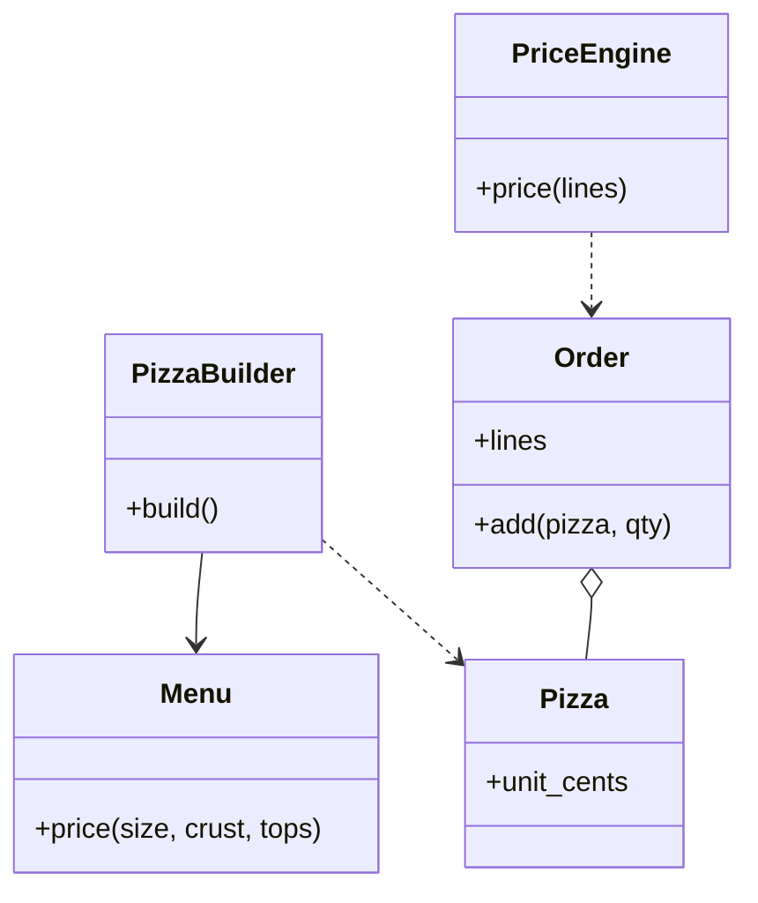

# 披萨订单（Pizza Order）

## 题目

披萨店的点单系统：顾客自选尺寸、饼底（crust）和若干配料（toppings），系统算出一份的价格；一张订单有多份，再套上优惠，给出总价。没有数据库、支付、配送。**面试官真正在测的是：菜单会经常变，新增一种配料能不能不改代码结构；搭配有规则，校验放在哪里；优惠怎么叠在价格上又不把价格减成负数。** 教科书会让你用装饰器模式（Decorator），这里恰好是「说得出为什么不用」得分的地方。

你听到的提示大概是：「顾客可以自定义饼底、尺寸和配料，设计类并计算订单总价。」常见追问有三条：

- 某些组合不允许（小号做不了芝心饼底，两种奶酪互斥）。
- 加优惠：小号九折、每两份最便宜的一份免费。
- 一单多份、多线程同时加。

## 先问这几个问题

- 配料价格和尺寸有关吗？能加双份吗？ → 有关，价格就存成「尺寸对应价格」的小表；双份则 `topping` 要带份量。
- 有没有不允许的组合？ → 有，就要一个统一的校验点，规则放进菜单数据，不散在 `if` 里。
- 优惠只看一份，还是看整单？ → 有整单的（最便宜的免费），优惠就分行级和整单两层。
- 金额用什么表示？ → 整数分，不用浮点数。

不做：税费、小费、配送费、支付、库存。

## 核心对象

| 类 | 职责（一句话） | 守住的不变量 |
|---|---|---|
| `Menu` | 纯数据：尺寸基础价、饼底加价和适用尺寸、配料按尺寸的价格和互斥表 | 新增配料只加一行数据 |
| `PizzaBuilder` | 分步收集选择，`build()` 时一次性校验 | 产出的每份 `Pizza` 都合法 |
| `Pizza` | 不可变值对象：尺寸、饼底、**已排序**的配料、定格的单价 | 同样的搭配相等、可哈希 |
| `Order` | 披萨容器，同款合并成一行 | 读改写用一把锁；对外只给快照 |
| 行级规则 / 整单规则 | 每条规则两问：适用吗，减多少 | 不改购物车，只给金额 |
| `PriceEngine` | 遍历、钳位、记账 | 不认识任何具体规则 |



引擎和订单只通过 `order.lines` 这个快照相遇。

## 主流程

**搭配并校验 `build()`：**

1. 调用方分步调用 `size()`、`crust()`、`topping()`，这些方法只记录，不判断。
2. `build()` 按固定顺序检查：尺寸存在，饼底存在且支持该尺寸，配料不重复、不超上限，每种配料存在且与其他已选的不互斥。
3. 任何一步失败，抛带原因的 `InvalidChoiceError`；全部通过才定价。
4. 配料先 `sorted` 再放进 `Pizza`，所以同样的搭配得到同一个对象。

**算价 `price(lines)`：**

1. 对每一行，先在单价乘数量上依次套行级规则，每笔钳到剩余价格。
2. 再用折后的各行结果套整单规则（例如每两份里最便宜的一份免费）。
3. 返回总价和带标签的减免。

## 关键决策

### 决策一：菜单用数据，还是每种配料一个装饰器类

- 装饰器：价格写死在类里；配料价随尺寸变，类数是「配料数乘尺寸数」；互斥和上限这类跨配料规则无处可放；装饰器链不可哈希，订单没法合并相同披萨。
- 菜单是数据：所有配料的行为只有「按尺寸查价」一种，变的只是参数。

**选数据。** 新增配料是加一行；互斥和上限在 `Menu` 里一次性可见。装饰器适合行为各不相同的叠加（日志、压缩），这里不需要。**简单答案赢，不用模式。** 缺点只有一个：以后若有配料按重量计价，数据表达不了，到时再加。

### 决策二：校验放在 setter、构造函数，还是 `build()`

- 每个 setter 立刻校验：先选饼底后选尺寸时，中间状态没法判断，逻辑散在各处。
- 全塞进 `Pizza` 的构造函数：值对象背上对菜单的依赖，也没有分步点选的体验。

**选建造者模式（Builder）：setter 只收集，`build()` 集中校验。** 校验顺序固定，与调用顺序无关；`Pizza` 保持纯净；失败的 `build()` 不改 Builder，前端每点一下就 `build()` 一次试算价格也没问题。

### 决策三：配料必须排序，价格在构建时定格

两种顺序的同一款披萨，若配料元组不同就不相等，订单里占两行，「同款买二送一」就不触发。**`build()` 里 `sorted` 配料，并在此时定下单价**，`Pizza` 之后不再变化。

### 决策四：优惠分两层，整单规则读折后价

- 「小号九折」只看一份：行级规则。
- 「每两份里最便宜的免费」看整单：整单规则。

**整单规则必须读行级折扣之后的每份价格。** 例：小号 800 先九折成 720，若按原价 800 去免，会多免 80。优惠的结构和购物车折扣引擎相同：遍历、钳位、记账。

## Python 骨架

```python
import threading
from dataclasses import dataclass


class InvalidChoiceError(Exception):
    pass


@dataclass(frozen=True)
class Menu:  # 纯数据：新增配料只加一行
    base: dict  # 尺寸 -> 基础价（分）
    crusts: dict  # 饼底 -> (加价, 适用尺寸；空集合表示不限)
    toppings: dict  # 配料 -> ({尺寸: 价格}, 互斥集合)
    max_toppings: int = 5

    def price(self, size, crust, tops) -> int:
        return (self.base[size] + self.crusts[crust][0]
                + sum(self.toppings[t][0][size] for t in tops))


@dataclass(frozen=True)
class Pizza:  # 值对象：配料已排序，同样的搭配相等、可哈希
    size: str
    crust: str
    toppings: tuple
    unit_cents: int


class PizzaBuilder:
    def __init__(self, menu: Menu):
        self._m, self._size, self._crust, self._tops = menu, None, None, []

    def size(self, s):
        self._size = s
        return self

    def crust(self, c):
        self._crust = c
        return self

    def topping(self, t):
        self._tops.append(t)
        return self

    def build(self) -> Pizza:  # 集中校验；失败不修改 Builder
        m, size = self._m, self._size
        if size not in m.base:
            raise InvalidChoiceError(f"unknown size {size!r}")
        spec = m.crusts.get(self._crust)
        if spec is None or (spec[1] and size not in spec[1]):
            raise InvalidChoiceError(f"{size} cannot have {self._crust}")
        tops = tuple(sorted(self._tops))  # 排序，同款才能合并
        if len(set(tops)) != len(tops) or len(tops) > m.max_toppings:
            raise InvalidChoiceError("duplicate or too many toppings")
        for t in tops:
            if t not in m.toppings or m.toppings[t][1] & set(tops):
                raise InvalidChoiceError(f"bad topping {t}")
        return Pizza(size, self._crust, tops, m.price(size, self._crust, tops))


class Order:
    def __init__(self):
        self._lines: dict = {}
        self._lock = threading.Lock()

    def add(self, pizza: Pizza, qty: int = 1):
        with self._lock:  # 读-改-写是一个整体
            self._lines[pizza] = self._lines.get(pizza, 0) + qty

    @property
    def lines(self) -> tuple:
        with self._lock:
            return tuple(self._lines.items())  # 快照


class SmallTenOff:  # 行级规则：只看一份
    label = "小号九折"

    def is_eligible(self, p: Pizza) -> bool:
        return p.size == "S"

    def apply(self, p, remaining) -> int:
        return remaining * 1000 // 10_000


class CheapestFreePerN:  # 整单规则：读折后的每份价格
    def __init__(self, n):
        self.label, self.n = f"每{n}份免最便宜一份", n

    def apply(self, results) -> int:
        prices = sorted((f // q for q, f in results for _ in range(q)), reverse=True)
        return sum(prices[self.n - 1::self.n])  # 每满 n 份，组内最便宜的一份


class PriceEngine:
    def __init__(self, line_rules=(), order_rules=()):
        self._lr, self._or = tuple(line_rules), tuple(order_rules)

    def price(self, lines) -> int:
        results = []
        for pizza, qty in lines:
            remaining = pizza.unit_cents * qty
            for r in self._lr:
                if r.is_eligible(pizza):
                    remaining -= min(r.apply(pizza, remaining), remaining)  # 钳位
            results.append((qty, remaining))
        total = sum(f for _, f in results)
        for r in self._or:
            total -= min(r.apply(results), total)
        return total


if __name__ == "__main__":
    menu = Menu(
        base={"S": 800, "M": 1000, "L": 1200},
        crusts={"thin": (0, set()), "thick": (100, set()), "stuffed": (200, {"M", "L"})},
        toppings={"pepperoni": ({"S": 150, "M": 200, "L": 250}, set()),
                  "mushroom": ({"S": 100, "M": 120, "L": 150}, set()),
                  "cheese": ({"S": 100, "M": 100, "L": 100}, {"vegan"}),
                  "vegan": ({"S": 100, "M": 100, "L": 100}, {"cheese"})})
    big = PizzaBuilder(menu).size("L").crust("thick").topping("pepperoni").topping("mushroom").build()
    assert big.unit_cents == 1200 + 100 + 250 + 150  # 1700
    same = PizzaBuilder(menu).size("L").crust("thick").topping("mushroom").topping("pepperoni").build()
    assert big == same  # 配料顺序不同，仍是同一款
    order = Order()
    order.add(big)
    order.add(same)
    assert order.lines == ((big, 2),)  # 合并成一行
    for bad in (PizzaBuilder(menu).size("S").crust("stuffed"),
                PizzaBuilder(menu).size("M").crust("thin").topping("cheese").topping("vegan")):
        try:
            bad.build()
            raise SystemExit("should have failed")
        except InvalidChoiceError:
            pass
    small = PizzaBuilder(menu).size("S").crust("thin").build()
    med = PizzaBuilder(menu).size("M").crust("thin").build()
    o = Order()
    o.add(small)
    o.add(med)
    engine = PriceEngine([SmallTenOff()], [CheapestFreePerN(2)])
    assert engine.price(o.lines) == 1000  # 小号九折成 720，再免最便宜的 720
    print("ok")
```

## 面试官加需求时

| 新需求 | 改哪里 | 不用动哪里 |
|---|---|---|
| 新增一种配料或饼底 | `Menu` 里加一行数据 | 所有类 |
| 新的不允许组合 | 互斥表或适用尺寸里加数据 | `build()` 的结构 |
| 加双份配料 | `topping` 带份量，`Menu.price` 乘份量 | 订单、引擎 |
| 周二小号九折、满额减 | 新增行级或整单规则类 | `Pizza`、`Order`、引擎 |
| 同款买二送一 | 新增整单规则类 | 其余全部 |
| 订单要存下来 | 订单行序列化，披萨本身是不可变数据 | 引擎、规则 |

## 并发与扩展

- 竞态在合并数量：两个线程都读到旧数量 1，各自写回 2，丢了一份。**一把锁圈住 `add` 的读改写**，`lines` 在锁内复制成元组。
- `PriceEngine` 只含不可变元组，`price` 是纯函数，可共享，不用锁。结算时先取一次快照，之后只用快照。
- `Pizza` 不可变，所以可以安全地在线程间传递，也可以作为字典的键。
- 规模变大：菜单从数据库或配置加载，改价后新订单用新菜单；已下单的披萨单价已定格，不受影响。
- 订单持久化：存「披萨加数量」；规则从配置读取，账单可以重算。

## 常见错误

- 为每种配料写一个装饰器类：**菜单做成数据，价格按尺寸查表。**
- 配料不排序，同款占两行，买二送一不触发：**`build()` 里 `sorted`，并在此去重。**
- 校验散在每个 setter 里，和调用顺序有关：**集中在 `build()`，顺序固定。**
- 「最便宜的免费」按原价免，多减了钱：**读行级折扣之后的每份价格。**
- 订单合并数量不加锁：**读改写整体加锁。**

## 30 秒复述

- 对象：`Menu`（数据）、`PizzaBuilder`（校验关口）、`Pizza`（不可变）、`Order`、`PriceEngine`。
- 关键决策：不用装饰器，菜单做成数据，价格按尺寸查表，新增配料加一行。
- 校验：Builder 只收集，`build()` 集中检查，配料排序后同款相等，订单才能合并。
- 优惠分行级和整单两层，整单规则读折后价格；引擎只管遍历、钳位、记账。
- 扩展故事：新规则只加一个类，`Pizza`、`Order`、引擎不动。
- 并发：订单的读改写用一把锁，引擎是纯函数不用锁。

## 来源

- [[solution-amz-pizza-order]]
- [[solution-amz-discount-engine]]
