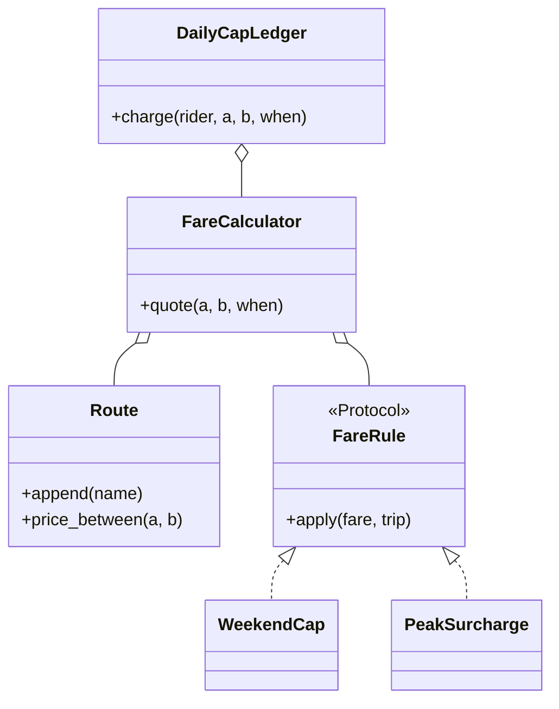

# 火车线路票价（Train Fare Calculator）

## 题目

一条线性火车线路上有一串车站，乘客从任一站上车、任一站下车，票价按经过的区间数（相邻两站之间的一段）计算。线路会在运行时加站，周末票价要封顶。用它的是售票和结算程序。

**面试官真正在看的不是算术，而是：新需求（加站、周末封顶、每日封顶）落在新类上，还是逼你改已经写好的核心方法；以及「今天周几」这种依赖时间的规则怎么写才测得了。**

你会听到的原话：已知线路 G → U → H → K → I，每相邻两站票价 1（G 到 I 是 4）。第一步实现 `calculateFare(start, stop)`；第二步设计一个类持有路线并支持动态加站；第三步周末总票价要封顶。

常见追问：
- 封顶是「一次行程」还是「一个人一天的累计」？
- 车站要插在中间怎么办？
- 再加一条工作日高峰加价，你的代码要改哪里？

## 先问这几个问题

- 「封顶」封什么？**一次行程封顶是无状态规则；一人一天累计封顶要记住谁今天付了多少，必须有账本和锁。** 先问清，从无状态的开始。
- 加站只能加在末尾，还是可以插在中间？**末尾追加 O(1)，中间插入要重排，还要决定被切开的那段价格怎么分。**
- 价格每站统一，还是每个区间可以不同？**把价格设计成「每个区间一个价」几乎不增加复杂度，却让「不同区间不同价」变成零改动。**
- 线路单向还是双向，未知车站怎么处理？**默认与方向无关；未知车站抛异常，不要返回 0。**
- 范围外要主动声明：多条线路与换乘、往返票、折扣卡、持久化与支付。

## 核心对象

| 类 | 职责（一句话） | 守住的不变量 |
|---|---|---|
| `Money` | 整数「分」的值对象 | 金额运算永远是整数，没有浮点 |
| `Route` | 持有有序站点、区间价格、前缀和 | `prefix` 严格由区间价格累加得到，长度等于站数 |
| `Trip` | 一次行程（起、终、时间）的只读记录 | 规则只看它，不看系统时钟 |
| `FareRule` | 「拿到当前价格，返回调整后价格」的协议 | 无状态，可任意复用和并发 |
| `FareCalculator` | 线路原价 + 规则依次调整 | 时钟由构造函数注入 |
| `DailyCapLedger` | 唯一有状态的类：某天某乘客已付多少 | 实付总额不超过当日封顶 |



## 主流程

**算一次票价（`quote`）：**
1. `FareCalculator.quote(start, stop, when)` 先问 `Route.price_between`，得到原价。
2. 持 `Route` 的锁，查两站位置，取两个前缀和之差的绝对值；站不存在就抛 `UnknownStationError`。
3. 把原价和 `Trip` 依次交给每条 `FareRule.apply`，上一条的输出是下一条的输入。
4. 返回最终价格。`calculate_fare(start, stop)` 只是用注入的时钟取一次 `when` 再调 `quote`。

**每日封顶记账（`charge`）：**
1. 只取一次时钟得到 `when`，用它算票价，也用它定日期。
2. 拿账本的锁。
3. 读当日已付，实付 = `min(票价, 封顶 - 已付)`，不低于 0，写回。
4. 顺手删掉早于昨天的日期，避免字典无限增长。

## 关键决策

### 票价怎么算：扫描、位置相减还是前缀和

- 方案 A，每次扫描累加：O(k)，价格全是 1 时纯属浪费。
- 方案 B，位置之差乘单价：O(1)，但把「每段同价」写死在公式里，一句「有些区间更贵」就全错。
- **选前缀和：存每个区间的价格和累计和，票价 = |prefix[a] − prefix[b]|。** 查询仍是 O(1)，统一价只是特例；追加一站不改已有前缀和，已有两站的票价永远不变。代价：中间插入要整体重排，O(n)，且被切开的区间变成两个默认价区间（G 到 I 从 4 变 5），这个语义要和面试官确认。

### 周末封顶放哪：if 还是规则对象

- 方案 A，在 `calculate_fare` 里写 `if 周末: min(...)`：当场可用，高峰加价、节假日再各加一个 `if`，函数迟早一团。
- 方案 B，`FareRule` 协议，每条规则一个小类。
- **选 B，因为这里已有两个真实实现（周末封顶、高峰加价），协议不是「为将来准备」。** 加规则只新增一个类、改一处装配列表。规则顺序有语义（先加价再封顶不等于先封顶再加价），所以顺序由调用方显式给出。

### 时间从哪里来：简单的答案赢

- 在规则里 `datetime.now()`：测试无法固定今天是周几。
- 每次由调用方传 `when`：干净，但与面试官给的签名冲突。
- **选构造函数注入时钟（一个返回 datetime 的函数），保留原签名，另给 `quote(..., when)`。** 不引入任何模式，一个参数解决。测试传 `lambda: datetime(2026, 10, 17, 9, 0)` 就固定了周六早上。

### 每日封顶的并发：一把全局锁

- **「读已付、算、写回」是三步，必须在同一把锁里。** 两个线程同时读到「已付 0」，各付 600，总共付了 1200；GIL 不保护这种复合操作。
- 每乘客一把锁并行度更高，但锁表本身又要保护和清理；持锁只有微秒级，**一把全局锁就够，简单且正确。**

## Python 骨架

```python
from __future__ import annotations
import threading
from dataclasses import dataclass
from datetime import date, datetime, timedelta
from typing import Callable, Protocol


class UnknownStationError(LookupError):
    pass


@dataclass(frozen=True, order=True)
class Money:  # 整数分，永远不用 float
    cents: int

    def __add__(self, o: Money) -> Money:
        return Money(self.cents + o.cents)

    def __sub__(self, o: Money) -> Money:
        return Money(self.cents - o.cents)


class Route:
    def __init__(self, stations="", hop: Money = Money(100)) -> None:
        self._hop = hop
        self._pos: dict[str, int] = {}
        self._prefix: list[int] = []  # prefix[i] = 首站到第 i 站的累计价
        self._lock = threading.Lock()
        for s in stations:
            self.append(s)

    def append(self, name: str) -> None:  # O(1)：已有前缀和不变
        with self._lock:
            if name in self._pos:
                raise ValueError(name)
            self._prefix.append(self._prefix[-1] + self._hop.cents if self._prefix else 0)
            self._pos[name] = len(self._pos)

    def price_between(self, a: str, b: str) -> Money:  # 与方向无关
        with self._lock:
            try:
                return Money(abs(self._prefix[self._pos[a]] - self._prefix[self._pos[b]]))
            except KeyError as e:
                raise UnknownStationError(e.args[0]) from None


@dataclass(frozen=True)
class Trip:
    start: str
    stop: str
    when: datetime


class FareRule(Protocol):
    def apply(self, fare: Money, trip: Trip) -> Money: ...


@dataclass(frozen=True)
class WeekendCap:  # 无状态规则：周六周日单程封顶
    cap: Money

    def apply(self, fare: Money, trip: Trip) -> Money:
        return min(fare, self.cap) if trip.when.weekday() >= 5 else fare


@dataclass(frozen=True)
class PeakSurcharge:  # 工作日高峰加价，向下取整到分
    start_hour: int
    end_hour: int
    percent: int

    def apply(self, fare: Money, trip: Trip) -> Money:
        t = trip.when
        if t.weekday() < 5 and self.start_hour <= t.hour < self.end_hour:
            return fare + Money(fare.cents * self.percent // 100)
        return fare


class FareCalculator:
    def __init__(self, route: Route, rules=(), clock: Callable[[], datetime] = datetime.now) -> None:
        self.route, self.rules, self.clock = route, tuple(rules), clock  # 时钟注入，测试可固定

    def quote(self, a: str, b: str, when: datetime) -> Money:
        fare, trip = self.route.price_between(a, b), Trip(a, b, when)
        for rule in self.rules:  # 规则顺序有语义：调用方显式给出
            fare = rule.apply(fare, trip)
        return fare

    def calculate_fare(self, a: str, b: str) -> Money:
        return self.quote(a, b, self.clock())


class DailyCapLedger:  # 唯一有状态的类
    def __init__(self, calc: FareCalculator, daily_cap: Money) -> None:
        self.calc, self.cap = calc, daily_cap
        self._paid: dict[date, dict[str, Money]] = {}
        self._lock = threading.Lock()

    def charge(self, rider: str, a: str, b: str, when: datetime | None = None) -> Money:
        when = when or self.calc.clock()  # 只取一次时钟：算价和记账落在同一天
        fare, day = self.calc.quote(a, b, when), when.date()
        with self._lock:  # 读已付、算、写回 必须是一步
            paid = self._paid.setdefault(day, {}).get(rider, Money(0))
            charged = min(fare, max(self.cap - paid, Money(0)))
            self._paid[day][rider] = paid + charged
            for d in [d for d in self._paid if d < day - timedelta(days=1)]:
                del self._paid[d]  # 只留今天和昨天，内存有界
            return charged


if __name__ == "__main__":
    route = Route("GUHK")
    sat, mon = datetime(2026, 10, 17, 9), datetime(2026, 10, 19, 9)
    calc = FareCalculator(route, [WeekendCap(Money(300))], clock=lambda: sat)
    assert calc.calculate_fare("G", "K") == Money(300)  # 周六封顶（原价 300 恰好等于封顶）
    route.append("I")  # 动态加站
    assert calc.calculate_fare("G", "I") == Money(300)  # 原价 400，周六封顶到 300
    assert calc.quote("I", "G", mon) == Money(400)  # 周一不封顶，且与方向无关
    ledger = DailyCapLedger(calc, Money(500))
    assert ledger.charge("amy", "G", "I") == Money(300)
    assert ledger.charge("amy", "G", "I") == Money(200)  # 只剩 200 额度
    assert ledger.charge("amy", "G", "I") == Money(0)
    try:
        calc.calculate_fare("G", "Z")
        raise SystemExit("应当抛 UnknownStationError")
    except UnknownStationError:
        pass
    print("ok")
```

## 面试官加需求时

| 新需求 | 改哪里 | 不用动哪里 |
|---|---|---|
| 高峰加价 | 新增 `PeakSurcharge`，装配列表里加一项 | `Route`、`calculate_fare`、其它规则 |
| 不同区间不同价 | `append(name, price)` 传入该段价格 | 前缀和公式、`price_between` |
| 每日累计封顶 | 用 `DailyCapLedger` 包住计算器 | `Route` 和所有规则 |
| 节假日封顶 | 新增一个带日期集合的规则 | 计算器和账本 |
| 中间插站 | `Route` 加 `insert_after`，重排位置与前缀和 | 规则、计算器 |
| 多币种 | `Money` 增加币种字段 | 规则逻辑的结构 |

## 并发与扩展

- 竞态 1：**账本的「读已付、算、写回」，用一把锁罩住整个 `charge`。** 测试用 `Barrier` 同时放行 16 个线程，断言实付之和恰好等于封顶。
- 竞态 2：加站和查价并发，查价要同时读位置与前缀和，**`Route` 用自己的锁，防止读到加站做了一半的状态。**
- 账本按天累积，要清理过期日期；假设时间基本单调，比已见最新日期早两天以上的迟到记录会被清掉，要写明。
- 规模变大后：账本换成 Redis 之类的外部存储，用原子的「增加并封顶」脚本替代进程内锁；线路数据改为从存储加载并缓存。

## 常见错误

- 在 `calculate_fare` 里直接写 `datetime.now().weekday()`：没法测。**时钟注入。**
- 用 `float` 存金额：累加有误差。**用整数分。**
- 账本在锁外读已付再加锁写回：并发时超额收费。**读、算、写同在一把锁里。**
- 一次行程里取两次时钟：23:59:59 算价、00:00:01 记账，落到两天。**只取一次。**
- 未知车站返回 0：悄悄少收钱。**抛异常。**

## 30 秒复述

- 对象：`Route` 管站点和前缀和，`Money` 用整数分，`FareRule` 是调整价格的小接缝，`FareCalculator` 串起来，`DailyCapLedger` 是唯一有状态的类。
- 核心决策：票价用前缀和，查询 O(1)，统一价只是特例，追加不改已有票价。
- 周末封顶和高峰加价各是一个无状态规则类，**加规则只新增类，不改 `calculate_fare`**。
- 时间由构造函数注入的时钟提供，保留原签名，测试可固定。
- 并发：账本「读、算、写」同在一把锁里，两个并发乘车不会一起突破封顶；规模变大换外部存储的原子操作。
- 中间插站是 O(n)，并且要先和面试官确认被切开的区间怎么定价。

## 来源

- [[solution-amz-train-fare]]
