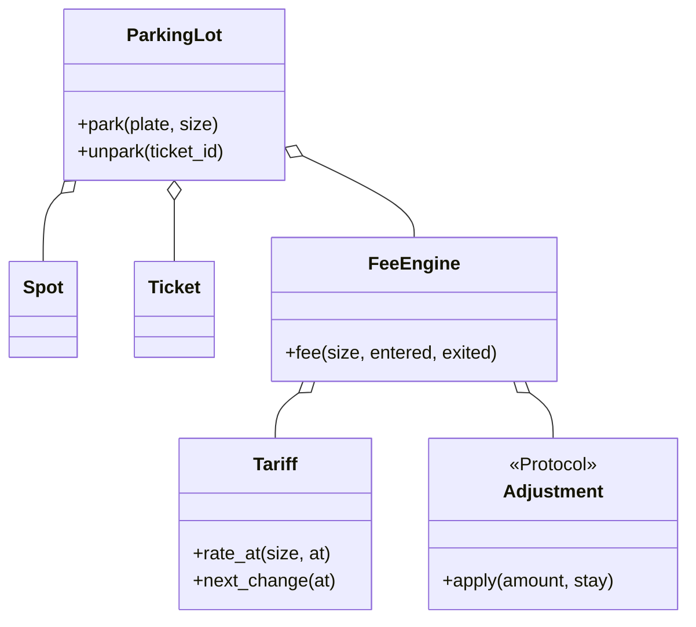

# 停车场与计费（Parking Lot）

## 题目

车进停车场领一张票，票上记着车牌、车型和入场时间；车出场凭票结算，按停了多久、什么车型、什么时段算出该付多少钱，然后票作废。用它的是入口闸机、出口闸机和收银。这是最经典的 OOD 题，Amazon 版本把重点压在出场那一笔钱上。

**面试官真正在看的是：车位分配和计费规则能不能换而不改核心流程；一程停留跨过费率边界（工作日高峰到夜间、跨午夜）时钱算得对不对；两个出口同时扫同一张票会不会收两次钱。**

你会听到的原话：设计一个停车场系统。车和车位都有几种，支持入场、出场，出场时按停留时长收费，不同场景有不同计价逻辑。

常见追问：
- 高峰、夜间、周末的单价不同，停留跨过边界怎么收？
- 前 15 分钟免费、每天封顶、会员折扣、丢票罚款怎么加？
- 两个出口同时扫同一张票呢？

## 先问这几个问题

- 车型和车位怎么匹配？**默认大位能停小车，小位停不下大车：这是一个「装得下」的偏序，用可比较的等级表达，不写 `isinstance` 链。**
- 不足一小时怎么收？**整小时进位时一次停留只有一个数字；按比例折算且费率随时段变时，必须把停留切段，设计整体不同。**
- 费率随什么变？车型、工作日时段、周末。**这决定价目表是一张表，还是一棵条件树。**
- 封顶封什么？**「每天最多 20 元」是日历日还是入场起 24 小时，决定切段的边界。** 默认日历日。
- 丢票怎么收？默认照常计价再加固定罚款。范围外：支付网关、车牌识别、持久化。

## 核心对象

| 类 | 职责（一句话） | 守住的不变量 |
|---|---|---|
| `Money` | 整数「分」的值对象 | 没有浮点 |
| `VehicleSize` | 可比较的尺寸等级（IntEnum） | 车位等级 ≥ 车辆等级才装得下 |
| `Spot` | 一个车位：楼层、编号、尺寸、占用车牌 | 一个车位同时只停一辆 |
| `Tariff` | 纯数据价目表 + 两个纯查询：此刻单价、下一次变价时刻 | `next_change` 严格晚于入参，不漏变价点 |
| `FeeEngine` | 纯计算：一次停留 → 应付金额 | 不持有票、不读时钟，可任意并发 |
| `ParkingLot` | 唯一有状态的类：车位表和未结算的票 | 一张票只能被一个出口取走 |



## 主流程

**入场 `park`：**
1. 拿锁；车牌已在场内就拒绝（防重复入场）。
2. 在空闲且装得下的车位里挑一个：这里取「最小够用、再最近」的。没有就抛 `NoSpotError`。
3. 占住车位，发票（含入场时刻，时钟注入），放进未结算表。

**出场 `unpark`：**
1. 拿锁，**一次性把票从表里取走**，同时释放车位；票不存在就抛 `InvalidTicketError`。
2. 释放锁。后面的计价是纯计算，不需要锁。
3. `FeeEngine` 从入场时刻出发，每次跳到 `next_change`（今天的高峰开始、高峰结束、下一个午夜，取最小）或出场时刻。每段单价固定，同一日历日内累加「单价 × 秒」。
4. 每个日历日除以 3600 后向上取整一次，再套当日封顶；各日相加，再按顺序应用调整（折扣、罚款）。

## 关键决策

### 跨过费率边界的停留怎么算

- 方案 A，入场时刻的单价乘总时长：周五 19:30 入场的 13 小时全按高峰算，多收 2500 分，而且只要跨边界就错。
- 方案 B，切段，每段各自取整再相加：段越多误差越大，换一个入场秒数就多收一分，用户看得见。
- **选切段，同一天内累加「单价 × 秒」，每天只取整一次。** 天是封顶的自然单位，取整放在最后一步。周五 19:30 到周六 08:30 的小汽车（高峰 400、非高峰 200，分/小时）：周五 30 分钟高峰 200 + 4 小时非高峰 800 = 1000；周六周末全天非高峰，8.5 小时 1700；合计 2700。

### 不同场景不同逻辑：条件、策略类还是数据

- 方案 A，核心方法里写 `if 周末 elif 夜间`：每个场景改一次，而且只看入场时刻。
- 方案 B，每个场景一个策略类，工厂按入场时刻挑一个：**一程停留会同时经过多个场景，挑一个策略算整程会丢掉边界另一侧。**
- **选数据：价目表是数据，引擎沿变价时刻切段。** 加场景只是 `rate_at` 里多一个条件、`next_change` 里多一个候选时刻。这里没有模式：一个循环加一个「下一个变价时刻」的查询就够了。

### 车位分配与计费：函数还是抽象类

- 抽象基类加两个实现类：分配规则「输入什么算一次」，不持有字段，类只是空壳。
- **选普通函数：函数签名就是接口，面试官要「均摊各层」时再传另一个函数。** 计费如果需要「算总价之外还要报明细」才升级成类，这里的 `FeeEngine` 因此是类。

### 两个出口扫同一张票

- 方案 A，先查票再结算再删除：两个出口都查到，各收一次。
- **选在锁内一次性取走票（pop），失败的一方拿到 `InvalidTicketError`。** 计价放锁外，因为它是纯计算，不应拖慢别的闸机。
- 停车场本身不做 Singleton：它就是普通对象，测试要能造互不干扰的多个实例。

## Python 骨架

```python
from __future__ import annotations
import itertools
import threading
from dataclasses import dataclass
from datetime import date, datetime, time, timedelta
from enum import IntEnum
from typing import Callable


class VehicleSize(IntEnum):  # 可比较的等级：车位 >= 车辆 才装得下
    MOTO = 1
    CAR = 2
    LARGE = 3


class NoSpotError(Exception):
    pass


class InvalidTicketError(Exception):
    pass


@dataclass(frozen=True)
class Tariff:  # 纯数据 + 两个纯查询，没有状态，所以不需要锁
    peak: dict      # 尺寸 -> 高峰每小时（分）
    off_peak: dict  # 尺寸 -> 非高峰每小时（分）
    daily_cap: dict
    grace: timedelta = timedelta(minutes=15)
    peak_start: time = time(8)
    peak_end: time = time(20)

    def rate_at(self, size: VehicleSize, at: datetime) -> int:
        is_peak = at.weekday() < 5 and self.peak_start <= at.time() < self.peak_end
        return (self.peak if is_peak else self.off_peak)[size]

    def next_change(self, at: datetime) -> datetime:  # 严格晚于 at：高峰边界或下一个午夜
        c = [datetime.combine(at.date() + timedelta(days=1), time.min)]
        c += [m for e in (self.peak_start, self.peak_end) if (m := datetime.combine(at.date(), e)) > at]
        return min(c)


class FeeEngine:  # 纯计算：不持有票、不读时钟
    def __init__(self, tariff: Tariff, adjustments=()) -> None:
        self.t, self.adjustments = tariff, tuple(adjustments)

    def fee(self, size: VehicleSize, entered: datetime, exited: datetime, member: bool = False) -> int:
        if exited - entered <= self.t.grace:  # 不超过宽限期全免
            return 0
        units: dict[date, int] = {}  # 单位：分/小时 x 秒
        at = entered
        while at < exited:  # 沿变价时刻切段，每段单价固定
            end = min(self.t.next_change(at), exited)
            units[at.date()] = units.get(at.date(), 0) + self.t.rate_at(size, at) * int((end - at).total_seconds())
            at = end
        # 每个日历日只向上取整一次，再套当日封顶
        total = sum(min(-(-u // 3600), self.t.daily_cap[size]) for u in units.values())
        for adj in self.adjustments:  # 折扣、罚款按顺序应用
            total = adj(total, member)
        return total


@dataclass
class Spot:
    floor: int
    num: int
    size: VehicleSize
    plate: str | None = None


@dataclass(frozen=True)
class Ticket:
    id: str
    plate: str
    size: VehicleSize
    spot: Spot
    entered_at: datetime


class ParkingLot:  # 唯一有状态的类
    def __init__(self, spots, engine: FeeEngine, clock: Callable[[], datetime] = datetime.now) -> None:
        self.spots, self.engine, self.clock = list(spots), engine, clock
        self._open: dict[str, Ticket] = {}
        self._lock = threading.Lock()
        self._ids = (f"T{n}" for n in itertools.count(1))

    def park(self, plate: str, size: VehicleSize) -> Ticket:
        with self._lock:
            if any(t.plate == plate for t in self._open.values()):
                raise ValueError("车已在场内")
            fits = [s for s in self.spots if s.plate is None and s.size >= size]
            if not fits:
                raise NoSpotError(plate)
            spot = min(fits, key=lambda s: (s.size, s.floor, s.num))  # 最小够用，再最近
            spot.plate = plate
            ticket = Ticket(next(self._ids), plate, size, spot, self.clock())
            self._open[ticket.id] = ticket
            return ticket

    def unpark(self, ticket_id: str, member: bool = False) -> int:
        with self._lock:  # 一次性取走票：两个出口只有一个拿得到
            ticket = self._open.pop(ticket_id, None)
            if ticket is None:
                raise InvalidTicketError(ticket_id)
            ticket.spot.plate = None
        return self.engine.fee(ticket.size, ticket.entered_at, self.clock(), member)  # 纯计算，锁外


if __name__ == "__main__":
    tariff = Tariff({s: p for s, p in zip(VehicleSize, (200, 400, 600))},
                    {s: p for s, p in zip(VehicleSize, (100, 200, 300))},
                    {s: p for s, p in zip(VehicleSize, (1000, 2000, 3000))})
    now = [datetime(2026, 10, 16, 19, 30)]  # 周五
    lot = ParkingLot([Spot(1, 1, VehicleSize.CAR), Spot(1, 2, VehicleSize.LARGE)],
                     FeeEngine(tariff, [lambda amt, member: amt - amt // 10 if member else amt]), lambda: now[0])
    t = lot.park("A1", VehicleSize.CAR)
    assert t.spot.num == 1  # 最小够用
    assert lot.park("B2", VehicleSize.CAR).spot.num == 2  # 小位满了，用大位
    try:
        lot.park("C3", VehicleSize.CAR)
        raise SystemExit("应当满了")
    except NoSpotError:
        pass
    now[0] = datetime(2026, 10, 17, 8, 30)  # 跨高峰边界和午夜
    assert lot.unpark(t.id) == 2700
    try:
        lot.unpark(t.id)  # 同一张票第二次
        raise SystemExit("应当拒绝")
    except InvalidTicketError:
        pass
    assert lot.engine.fee(VehicleSize.CAR, now[0], now[0] + timedelta(minutes=10)) == 0  # 宽限期
    print("ok")
```

## 面试官加需求时

| 新需求 | 改哪里 | 不用动哪里 |
|---|---|---|
| 新车型（电动车位） | `VehicleSize` 加一级，价目表加一行 | `park` 的匹配逻辑、引擎 |
| 均摊各层的分配 | 换一个挑车位的函数 | 计费、出场流程 |
| 前 N 分钟免费 | `Tariff.grace` 数据 | 切段循环 |
| 节假日半价 | `rate_at` 加条件，`next_change` 加候选时刻 | 引擎主体 |
| 会员折扣、丢票罚款 | 新增 `Adjustment`，装配列表加一项 | 切段与封顶 |
| 封顶改为入场起 24 小时 | 切段边界多一个「入场 +24h」 | 价目表 |

## 并发与扩展

- 竞态 1：**两个出口同时扫一张票。锁内 `pop` 保证只有一个拿到票。**
- 竞态 2：**两辆车同时挑同一个空位。挑位和占位必须在同一把锁里，不能先查后占。**
- 计价放在锁外：它是纯计算，持锁只会拖慢别的闸机。
- 时钟倒退（出场早于入场）要抛错，并把票放回去，别让车主白白丢票。
- 规模变大：按楼层分片加锁，空位索引用按尺寸分桶的堆，未结算票落库；价目表热更新时给每张票固化入场时的价目版本。

## 常见错误

- 用入场时刻的单价乘总时长：**跨边界必错，要切段。**
- 每段各自取整再相加：**每个日历日只取整一次。**
- 先查票、再计价、最后删票：**取走票和释放车位必须是一个原子动作。**
- 金额用 `float`：**用整数分。**
- 把 `Singleton` 当停车场的必备品：**普通对象，在组合根里 new 一次再传下去。**

## 30 秒复述

- 对象：`ParkingLot` 持有车位和未结算的票，是唯一有状态的类；`Tariff` 是纯数据价目表；`FeeEngine` 是纯计算。
- 尺寸用可比较的等级，车位选「最小够用、再最近」。
- 核心决策：**计费沿变价时刻切段，同一天累加「单价 × 秒」，每天取整一次再封顶**；场景再多也只是价目表里的数据，不是策略类。
- 扩展：折扣、罚款是 `Adjustment`，免费时长和封顶是价目表字段，都不改引擎主体。
- 并发：出场在锁内一次性取走票，所以同一张票不会被两个出口各收一次；计价是纯计算，放在锁外。

## 来源

- [[solution-amz-parking-fees]]
- [[solution-parking-lot]]
