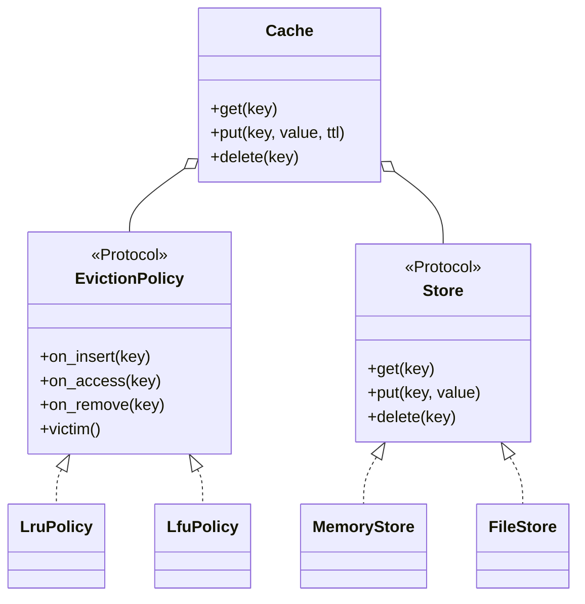

# 可配置缓存（Configurable Cache：LRU / LFU）

## 题目

设计一个有容量上限的键值缓存：满了以后由「淘汰策略」决定踢走哪一条，数据本身存在可替换的「存储后端」里（内存、文件）。起点是人人都写过的 LRU 缓存，Amazon 版本考你能不能把它**拆开**。

**面试官真正在看的是：你能不能看出「淘汰谁」和「数据放哪」是两条互相独立的变化轴，拆成两个互不认识的部件；以及后端会失败时，两份各自记账的状态怎么保持一致。**

你会听到的原话：设计一个可配置的缓存，支持不同的淘汰策略（LRU、LFU）和不同的存储（内存、文件系统）。

常见追问：
- 加一个 FIFO 策略要改哪些类？
- 加 TTL（过期时间）和命中率统计。
- 文件写失败了缓存处于什么状态？多线程怎么办？

## 先问这几个问题

- 策略和后端是创建时选定，还是运行时切换？**创建时选定，换策略等于新建缓存；运行时切换要把使用历史迁移给新策略，除非面试官要求，不做。**
- 值是什么类型？**任意对象时，文件后端要序列化；约定值必须能转成 JSON，不能的话抛 `StoreError`。**
- key 是什么类型？**约定字符串。文件后端把 key 变文件名时，用哈希值，防 `../` 路径穿越。**
- 要不要 TTL、统计、线程安全？**这三样都是「骨架之上加一层」，能不能后加而不重写，就是「可扩展」的打分点。**
- 后端写失败怎么办？这是区分普通答案和好答案的一问。

## 核心对象

| 类 | 职责（一句话） | 守住的不变量 |
|---|---|---|
| `Cache` | 编排一次读写：查、写后端、选受害者、登记；管容量、过期、统计、锁 | 策略里的 key 集合 = 后端里的 key 集合；失败时两边都停在操作之前 |
| `EvictionPolicy`（协议） | 只记 key 的使用顺序或次数，回答「扔谁」 | 不持有值 |
| `LruPolicy` / `LfuPolicy` | 具体的淘汰规则 | 所有操作 O(1)；空桶立即回收 |
| `Store`（协议） | 只按 key 存取值 | 写入要么完整成功要么旧值不动；删除不存在的 key 是空操作 |
| `MemoryStore` / `FileStore` | 具体的存储 | 互不认识策略 |



策略只认 key，后端只认值，两者互不引用，也不引用 `Cache`。2 种策略乘 2 种后端，只写 4 个小类，而不是 4 个组合类。

## 主流程

**`put(key, value)`：**
1. 拿锁。
2. 判断 key 是否存在且未过期；过期的当场清掉，计入过期统计。
3. **先写后端**（会失败的那一步放最前）。失败就抛错，此时策略一点没动，什么都没变。
4. key 已存在：通知策略 `on_access`。不存在：如果满了，先 `victim()` 选受害者，从后端删掉，成功后策略才 `on_remove`；再 `on_insert` 新 key。
5. 记录过期时间（`ttl` 为空则不过期）。

**`get(key)`：**
1. 拿锁（读也要锁，因为读会改策略的顺序）。
2. 不存在或已过期：未命中计数，返回默认值。
3. 命中：读后端，通知策略 `on_access`，命中计数。

## 关键决策

### 两条变化轴：组合，不是子类

- 子类方案：`LruMemoryCache`、`LfuFileCache`……组合爆炸，加一种策略要写 N 个类。
- **选组合：`Cache` 持有一个策略对象和一个后端对象，两个协议互不认识。** 加 FIFO 只新增一个策略类加注册表一行，`Cache` 一行不改。如果加 LFU 需要改 `Cache`，说明第一版的接口画错了。

### 策略接口多宽：只传 key 的四个钩子

- 宽接口：策略直接拿到值、大小、时间戳：什么都能做，但每个策略都被迫理解值。
- **选窄接口：`on_insert`、`on_access`、`on_remove`、`victim` 四个动作，只传 key。** 四个动作足以表达 LRU、LFU、FIFO；策略不持有值，因此换后端对它没有任何影响。

### 后端会失败：操作顺序就是正确性

- 先动策略再写后端：写失败后策略登记了一个后端里不存在的 key，两边永久对不上。
- **选先动会失败的一方（后端），成功之后才动策略。** 淘汰同理：后端删除成功才让策略忘记。一个例外：满了要淘汰时，新值已写进后端，删旧值失败就要把新值撤回再抛错。
- 文件后端写临时文件再 `os.replace`，失败时旧文件原封不动。

### 过期、配置、锁：简单的答案赢

- **TTL 放在 `Cache` 里一张 `key -> 截止时间` 的表，不做装饰器。** 过期是 `Cache` 的流程，不是后端或策略的性质；时钟注入，测试可控。
- **配置用字典注册表 `{"lru": LruPolicy, "lfu": LfuPolicy}`，不做工厂类层级。** 新增一种策略只改注册表，名字找不到就报 `ConfigError`。
- **一把粗锁罩住每个公开操作，读也要锁。** 简单且正确；文件 IO 也在锁内，用吞吐换正确性。

## Python 骨架

```python
from __future__ import annotations
import threading
import time
from collections import OrderedDict
from typing import Any, Callable, Protocol


class StoreError(Exception):
    pass


class EvictionPolicy(Protocol):  # 只传 key，从不持有值
    def __len__(self) -> int: ...
    def __contains__(self, key: object) -> bool: ...
    def on_insert(self, key: str) -> None: ...
    def on_access(self, key: str) -> None: ...
    def on_remove(self, key: str) -> None: ...
    def victim(self) -> str: ...


class LruPolicy:  # OrderedDict 的顺序就是使用顺序，队首最久没用
    def __init__(self) -> None:
        self._order: OrderedDict[str, None] = OrderedDict()

    def __len__(self): return len(self._order)
    def __contains__(self, key): return key in self._order
    def on_insert(self, key): self._order[key] = None
    def on_access(self, key): self._order.move_to_end(key)
    def on_remove(self, key): self._order.pop(key, None)
    def victim(self): return next(iter(self._order))


class LfuPolicy:  # 按访问次数分桶，桶内保持先后；同频淘汰最久没动的
    def __init__(self) -> None:
        self._freq: dict[str, int] = {}
        self._buckets: dict[int, OrderedDict] = {}
        self._min = 0  # 0 表示「最小桶刚被删空，还没重算」

    def __len__(self): return len(self._freq)
    def __contains__(self, key): return key in self._freq

    def _detach(self, key) -> int:
        f = self._freq[key]
        del self._buckets[f][key]
        if not self._buckets[f]:
            del self._buckets[f]  # 空桶立即回收，否则桶表无限增长
        return f

    def _attach(self, key, f) -> None:
        self._freq[key] = f
        self._buckets.setdefault(f, OrderedDict())[key] = None

    def on_insert(self, key):
        self.on_remove(key)
        self._attach(key, 1)
        self._min = 1

    def on_access(self, key):
        f = self._detach(key)
        self._attach(key, f + 1)
        if f == self._min and f not in self._buckets:
            self._min = f + 1

    def on_remove(self, key):
        if key in self._freq:
            f = self._detach(key)
            del self._freq[key]
            if f == self._min and f not in self._buckets:
                self._min = 0

    def victim(self):
        if not self._min:
            self._min = min(self._buckets)
        return next(iter(self._buckets[self._min]))


class MemoryStore:
    def __init__(self) -> None:
        self._d: dict[str, Any] = {}

    def __len__(self): return len(self._d)
    def get(self, key): return self._d[key]
    def put(self, key, value): self._d[key] = value
    def delete(self, key): self._d.pop(key, None)


class Cache:
    def __init__(self, capacity: int, policy, store, clock: Callable[[], float] = time.monotonic) -> None:
        self.cap, self.policy, self.store, self.clock = capacity, policy, store, clock
        self._expires: dict[str, float] = {}
        self.hits = self.misses = self.evictions = 0
        self._lock = threading.Lock()  # 读也会改策略顺序，所以读也要锁

    def _drop(self, key) -> None:  # 先删后端（会失败），成功后策略才忘记
        self.store.delete(key)
        self.policy.on_remove(key)
        self._expires.pop(key, None)

    def _live(self, key) -> bool:  # 过期的 key 对外等于不存在，读到当场清掉
        if key not in self.policy:
            return False
        if key in self._expires and self.clock() >= self._expires[key]:
            self._drop(key)
            return False
        return True

    def get(self, key, default=None):
        with self._lock:
            if not self._live(key):
                self.misses += 1
                return default
            value = self.store.get(key)
            self.policy.on_access(key)
            self.hits += 1
            return value

    def put(self, key, value, ttl: float | None = None) -> None:
        with self._lock:
            exists = self._live(key)
            self.store.put(key, value)  # 会失败的一步放最前：失败则策略一点没动
            if exists:
                self.policy.on_access(key)
            else:
                if len(self.policy) >= self.cap:
                    self._evict(key)
                self.policy.on_insert(key)
            if ttl is None:
                self._expires.pop(key, None)
            else:
                self._expires[key] = self.clock() + ttl

    def _evict(self, new_key) -> None:
        victim = self.policy.victim()
        try:
            self._drop(victim)
        except StoreError:
            self.store.delete(new_key)  # 新值已写入，删旧值失败就撤回新值
            raise
        self.evictions += 1


POLICIES = {"lru": LruPolicy, "lfu": LfuPolicy}  # 注册表：新增策略只加一行


def create_cache(capacity: int, policy: str = "lru", store=None, clock=time.monotonic) -> Cache:
    return Cache(capacity, POLICIES[policy](), store if store is not None else MemoryStore(), clock)


if __name__ == "__main__":
    c = create_cache(2, "lru")
    c.put("a", 1); c.put("b", 2); c.get("a"); c.put("c", 3)
    assert c.get("b") is None and c.get("a") == 1  # LRU 淘汰了 b
    f = create_cache(2, "lfu")
    f.put("a", 1); f.put("b", 2); f.get("a"); f.put("c", 3)
    assert f.get("b") is None and f.get("a") == 1  # LFU：a 用了 2 次，淘汰只有 1 次的 b
    now = [0.0]
    t = create_cache(2, clock=lambda: now[0])
    t.put("k", 1, ttl=5)
    now[0] = 6
    assert t.get("k") is None and len(t.policy) == 0 and len(t.store) == 0  # 过期当场清理
    class Broken(MemoryStore):  # 失败路径：写失败后两边都停在操作之前
        def put(self, key, value): raise StoreError("disk full")
    b = create_cache(2, store=Broken())
    try:
        b.put("x", 1)
        raise SystemExit("应当抛 StoreError")
    except StoreError:
        assert len(b.policy) == 0 and len(b.store) == 0
    print("ok")
```

## 面试官加需求时

| 新需求 | 改哪里 | 不用动哪里 |
|---|---|---|
| 加 FIFO 策略 | 新增 `FifoPolicy`，注册表加一行 | `Cache`、所有后端 |
| 加 TTL | `Cache` 里一张过期表，时钟注入 | 策略和后端 |
| 命中率统计 | `Cache` 里几个计数器，返回冻结快照 | 策略和后端 |
| 加 Redis 后端 | 新增一个实现 `Store` 协议的类 | `Cache`、策略 |
| 按字节数限容 | `Cache` 改容量判断，`Store` 报告大小 | 策略接口 |
| 运行时切换策略 | `Cache` 把现有 key 按序重新 `on_insert` 给新策略 | 后端 |

## 并发与扩展

- 竞态 1：`get` 会改策略的使用顺序，所以**读也必须锁**，否则两个线程同时 `move_to_end` 会破坏链表。
- 竞态 2：「查 → 写后端 → 动策略」必须在同一把锁里，否则两个线程各自看到「没满」，一起插入，超出容量。
- 一把粗锁的代价是文件 IO 也在锁内，吞吐低。规模大了按 key 哈希分片，每片一个 `Cache` 和一把锁。
- 分布式缓存和一致性哈希、写穿透与写回、重启后从磁盘恢复，都属于范围外，要主动声明。

## 常见错误

- 为每个「策略 × 后端」组合写一个类：**用组合，两个协议互不认识。**
- 先动策略再写后端：写失败后两边永久对不上。**先动会失败的一方。**
- LFU 的频率桶清空后不删除：桶表无限增长。**空桶立即回收。**
- 覆盖已有 key 当成新增：错误淘汰、容量虚高。**已有 key 只算一次访问，不涨容量。**
- 读不加锁：读也在改策略状态。

## 30 秒复述

- 对象：`Cache` 编排，`EvictionPolicy` 只回答「扔谁」，`Store` 只存取值，三者通过两个协议解耦。
- 核心决策：**淘汰和存储是两条独立变化的轴，用组合，不用子类**；策略接口只有四个只传 key 的钩子。
- 一致性：先动会失败的后端，成功后才动策略，失败时两边都停在操作之前。
- 扩展：加 FIFO 或 Redis 都是新增一个类加注册表一行，`Cache` 不动；TTL 和统计是 `Cache` 之上多一张表。
- 并发：一把粗锁，读也要锁；规模变大按 key 分片。

## 来源

- [[solution-amz-configurable-cache]]
- [[solution-lru-cache]]
