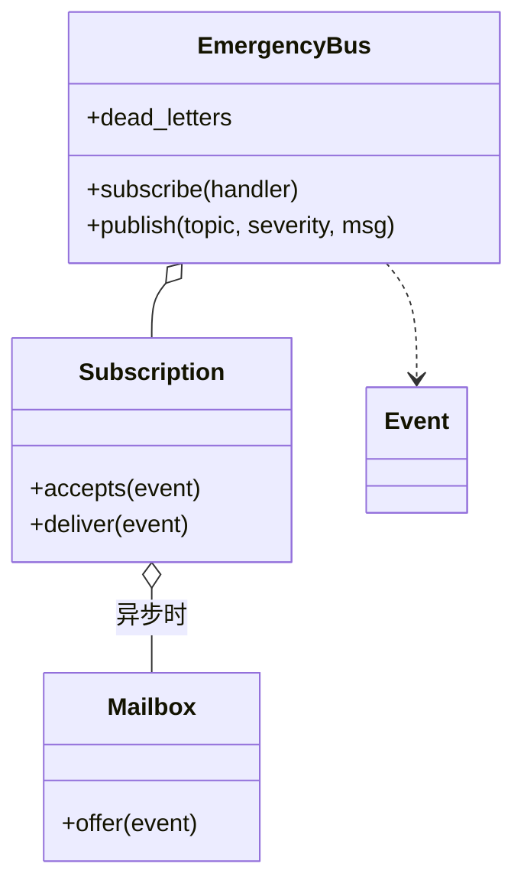

# 发布订阅（Pub/Sub：应急事件总线）

## 题目

一些组件订阅（监听）应急事件，另一些组件发布（通知）事件；中间是一条「总线」（bus），两边互相不认识。用它的是消防、医疗、指挥中心等各自独立的组件。

**面试官真正在看的是：一个订阅者出错或很慢，绝不能拖累其他订阅者和发布者；也就是失败隔离放在哪一层，以及持锁的范围想清楚没有。**

你会听到的原话：设计一个应急响应系统的发布订阅组件，实现处理发布与订阅逻辑的类。失败的订阅者不能阻塞其他订阅者。

常见追问：
- 订阅者只想听某些类型、某个严重度以上的事件。
- 处理函数抛异常要重试几次，仍失败怎么记录？
- 订阅者很慢怎么办？紧急事件能不能优先送？
- 处理函数里再发布事件，会不会死锁？

## 先问这几个问题

- 同步送还是异步送？**同步最简单，但慢订阅者会拖住发布者；异步是每人一个信箱加一个线程。从同步起步，同一个订阅类支持两种送法。**
- 订阅者出错怎么办？**答案决定异常处理放在哪一层：放在订阅对象的一次投递里，总线和发布者永远不会被打断。**
- 只听某些事件吗？**按主题（topic）和最低严重度过滤，两个字段够用，通配符不做。**
- 紧急事件要优先送吗？**只有排队存在时才有先后，所以优先级只出现在异步信箱里。**
- 要持久化、重放、跨进程吗？不要：这是进程内、尽力而为（best-effort）的投递；范围外要主动声明。

## 核心对象

| 类 | 职责（一句话） | 守住的不变量 |
|---|---|---|
| `Event` | 冻结的事件快照：编号、主题、严重度、内容 | 不可变，可同时交给任意多个订阅者 |
| `Subscription` | 过滤条件 + 重试次数 + 一次 `deliver` | 订阅者的任何异常都不逃出 `deliver`，变成一条死信 |
| `Mailbox` | 异步订阅者的有界优先队列 + 一个工作线程 | 严重度高的先出队，同级先进先出；满了挤掉最不重要且最旧的 |
| `EmergencyBus` | 注册表、事件编号、路由、死信列表 | 不持锁调用任何订阅者代码 |



## 主流程

**`publish(topic, severity, message)`：**
1. **拿锁**：检查总线没关、给事件递增编号、生成冻结的 `Event`，并**拍下当前订阅列表的快照**，只留下 `accepts(event)` 为真的订阅者。
2. **释放锁**。
3. 对每个目标订阅者：同步的直接 `deliver`；异步的 `mailbox.offer`。
4. `deliver` 最多尝试 `max_attempts` 次，吞掉所有 `Exception`，全部失败就返回一条 `DeadLetter`；总线把死信记入有上限的列表。
5. 返回事件。订阅者的失败永远不会变成 `publish` 的异常。

**异步订阅者的信箱线程：** 等队列非空 → 弹出最高优先级的一条 → 在锁外调用 `deliver` → 失败的记死信。

## 关键决策

### 失败隔离的边界：放在订阅对象的 `deliver` 一处

- 在总线的发布循环里 `try/except`：每一种送法（同步、异步、重试）都要各写一遍，漏一处就有订阅者拖垮别人。
- **选在 `Subscription.deliver` 里：重试和吞异常都在这一个函数内，返回「成功」或一条死信。** 总线和信箱线程只管调用它，永远不会被订阅者的 bug 打断。

### 慢订阅者：每人一个信箱，而不是共享队列

- 共享一个队列和线程池：一个慢订阅者占满线程，别人也被堵住。
- **选每个异步订阅者自带有界信箱和工作线程：慢订阅者只堵自己的信箱。** 信箱满了怎么办是产品决定：这里挤掉「最不重要且最旧」的一条并记 `QUEUE_FULL` 死信，CRITICAL 只会被更晚的 CRITICAL 挤掉。

### 持锁只拍快照，处理函数在锁外调用

- 持锁调用处理函数：处理函数里再 `publish` 或退订自己，就死锁了；一个慢处理函数还会阻塞所有发布。
- **选持锁只做「编号 + 拍订阅快照」，投递全在锁外。** 代价：并发退订后，一次发布仍可能送给刚退订的人一次，这是可接受的尽力而为语义。

### 过滤：两个字段，不要类层级

- 过滤器类层级（`TopicFilter`、`SeverityFilter`、组合过滤器）：只有两个条件，类是空壳。
- **选 `Subscription` 里一个主题集合加一个最低严重度，一行 `accepts`。** 严重度用 `IntEnum`，「至少 WARNING」直接比较，也是优先队列的排序依据。真出现第三个维度再抽象。

## Python 骨架

```python
from __future__ import annotations
import heapq
import threading
from collections import deque
from dataclasses import dataclass
from enum import IntEnum


class Severity(IntEnum):  # IntEnum：「至少 WARNING」可直接比较，也是优先队列的依据
    INFO = 1
    WARNING = 2
    CRITICAL = 3


@dataclass(frozen=True)
class Event:  # 冻结快照：可同时交给任意多个订阅者，不用加锁
    seq: int
    topic: str
    severity: Severity
    message: str


@dataclass(frozen=True)
class DeadLetter:  # 没送到的记录：谁、哪条、为什么
    subscriber: str
    event: Event
    reason: str


class Subscription:
    def __init__(self, name, handler, topics, min_severity, max_attempts) -> None:
        self.name, self.handler, self.topics = name, handler, topics
        self.min_severity, self.max_attempts = min_severity, max_attempts

    def accepts(self, e: Event) -> bool:  # 主题集合（None 表示全部）+ 最低严重度
        return e.severity >= self.min_severity and (self.topics is None or e.topic in self.topics)

    def deliver(self, e: Event) -> DeadLetter | None:
        """失败隔离的边界：重试和吞异常都在这里，调用方永远不会被订阅者打断。"""
        for _ in range(self.max_attempts):
            try:
                self.handler(e)
                return None
            except Exception:
                pass
        return DeadLetter(self.name, e, "handler_failed")


class Mailbox:  # 异步订阅者：有界优先队列 + 一个工作线程
    def __init__(self, sub: Subscription, capacity: int, on_dead) -> None:
        self.sub, self.cap, self.on_dead = sub, capacity, on_dead
        self.heap: list[tuple[int, int, Event]] = []  # (-严重度, 序号, 事件)：高优先、先到先出
        self.busy = 0
        self.cond = threading.Condition()
        threading.Thread(target=self._run, daemon=True).start()

    def offer(self, e: Event) -> None:
        with self.cond:
            if len(self.heap) >= self.cap:  # 满了：挤掉最不重要且最旧的一条（可能是新来的自己）
                worst = max(self.heap + [(-e.severity, e.seq, e)], key=lambda t: (t[0], -t[1]))  # 最不重要里最旧的
                if worst[2] is e:
                    self.on_dead(DeadLetter(self.sub.name, e, "queue_full"))
                    return
                self.heap.remove(worst)
                heapq.heapify(self.heap)
                self.on_dead(DeadLetter(self.sub.name, worst[2], "queue_full"))
            heapq.heappush(self.heap, (-e.severity, e.seq, e))
            self.cond.notify()

    def _run(self) -> None:
        while True:
            with self.cond:
                self.cond.wait_for(lambda: self.heap)
                e = heapq.heappop(self.heap)[2]
                self.busy = 1
            dead = self.sub.deliver(e)  # 在锁外：慢处理不挡 offer
            if dead:
                self.on_dead(dead)
            with self.cond:
                self.busy = 0
                self.cond.notify_all()

    def wait_idle(self) -> None:
        with self.cond:
            self.cond.wait_for(lambda: not self.heap and not self.busy)


class EmergencyBus:
    def __init__(self) -> None:
        self._subs: dict[Subscription, Mailbox | None] = {}
        self._dead: deque[DeadLetter] = deque(maxlen=1000)  # 死信列表有上限，内存有界
        self._seq = 0
        self._lock = threading.Lock()

    def subscribe(self, handler, name, topics=None, min_severity=Severity.INFO,
                  max_attempts=1, queue_size=None) -> Subscription:
        sub = Subscription(name, handler, topics, min_severity, max_attempts)
        box = Mailbox(sub, queue_size, self._record) if queue_size else None
        with self._lock:
            self._subs[sub] = box
        return sub

    def unsubscribe(self, sub: Subscription) -> None:
        with self._lock:
            self._subs.pop(sub, None)

    def publish(self, topic: str, severity: Severity, message: str) -> Event:
        with self._lock:  # 持锁只做：编号 + 拍订阅快照
            self._seq += 1
            e = Event(self._seq, topic, severity, message)
            targets = [(s, b) for s, b in self._subs.items() if s.accepts(e)]
        for sub, box in targets:  # 锁外投递：处理函数里可以再 publish / 退订
            if box:
                box.offer(e)
            elif (dead := sub.deliver(e)):
                self._record(dead)
        return e

    def _record(self, d: DeadLetter) -> None:
        with self._lock:
            self._dead.append(d)

    @property
    def dead_letters(self) -> list[DeadLetter]:
        with self._lock:
            return list(self._dead)

    def flush(self) -> None:
        for box in [b for b in self._subs.values() if b]:
            box.wait_idle()


if __name__ == "__main__":
    bus, got = EmergencyBus(), []
    bus.subscribe(lambda e: got.append(("fire", e.message)), "fire-dept", topics={"fire"})
    bus.subscribe(lambda e: 1 / 0, "buggy")  # 它出错，不影响别人
    bus.subscribe(lambda e: got.append(("hq", e.message)), "hq", min_severity=Severity.CRITICAL)
    bus.publish("fire", Severity.CRITICAL, "三号楼起火")
    bus.publish("flood", Severity.INFO, "路面积水")
    assert got == [("fire", "三号楼起火"), ("hq", "三号楼起火")]  # 过滤生效，buggy 没拖累别人
    assert [d.subscriber for d in bus.dead_letters] == ["buggy", "buggy"]
    # 异步 + 优先级：信箱 2 格，工作线程被卡住时依次来 INFO a、INFO b、CRITICAL c
    started, gate, log = threading.Event(), threading.Event(), []
    def slow(e):
        started.set()
        gate.wait()
        log.append(e.message)
    bus2 = EmergencyBus()
    bus2.subscribe(slow, "slow", queue_size=2)
    bus2.publish("x", Severity.INFO, "first")
    started.wait()
    for sev, m in ((Severity.INFO, "a"), (Severity.INFO, "b"), (Severity.CRITICAL, "c")):
        bus2.publish("x", sev, m)  # 第三条到达时信箱已满：挤掉最不重要里最旧的 a
    gate.set()
    bus2.flush()
    assert log == ["first", "c", "b"] and bus2.dead_letters[0].event.message == "a"
    print("ok")
```

## 面试官加需求时

| 新需求 | 改哪里 | 不用动哪里 |
|---|---|---|
| 重试 N 次再进死信 | `subscribe(max_attempts=N)`，`deliver` 里的循环 | 总线、信箱 |
| 只听某主题、某严重度以上 | `Subscription.accepts` | 发布路径 |
| 订阅者很慢 | `subscribe` 给 `queue_size`，走信箱 | `Subscription`、发布路径 |
| 主题通配符（`fire.*`） | `accepts` 里换匹配函数 | 其它所有类 |
| 退订与处理函数里再发布 | 无：快照加锁外投递已经支持 | 全部 |
| 持久化与重放 | 总线前加一层追加日志，订阅者带游标 | `Subscription`、过滤 |

## 并发与扩展

- 竞态 1：并发订阅、退订与发布。**持锁拍订阅快照，发布看到的永远是一份完整的列表。**
- 竞态 2：处理函数里再 `publish` 或退订自己。**投递全在锁外，所以不会死锁。**
- 竞态 3：信箱的「入队、出队、满了挤人」共用一把条件变量（`Condition`）的锁；处理函数在锁外跑，慢处理不挡 `offer`。
- `flush` 要同时等「队列空」和「正在处理的 1 条」，只看队列会漏掉最后一条。
- 规模变大：进程内换成真正的消息中间件（Kafka、SQS），订阅者各带消费位点；这里的死信列表对应其死信队列。

## 常见错误

- 在发布循环里持锁调用处理函数：处理函数一再发布就死锁，慢订阅者阻塞所有人。**只拍快照，锁外投递。**
- 只在同步路径吞异常：异步线程里的异常会让工作线程悄悄死掉。**异常边界放在 `deliver`，两种路径共用。**
- 死信列表无上限：内存增长。**用 `deque(maxlen=…)`。**
- 信箱无上限：慢订阅者把内存吃光。**有界，满了有明确的丢弃规则，并记死信。**
- 事件做成可变对象：多个订阅者互相篡改。**冻结。**

## 30 秒复述

- 对象：`EmergencyBus` 管注册表、编号、路由、死信；`Subscription` 拥有过滤和一次投递；异步订阅者多一个 `Mailbox`。
- 核心决策：**失败隔离的边界放在 `Subscription.deliver` 一处**，重试和吞异常都在里面，同步和异步共用。
- 慢订阅者：每人一个有界优先信箱，只堵自己；满了挤掉最不重要且最旧的，并记死信。
- 并发：持锁只做编号加拍快照，处理函数全在锁外，所以处理函数里再发布、退订都不会死锁。
- 扩展：加过滤、重试、异步，都是新增参数或新增一层，发布路径一行不改。

## 来源

- [[solution-amz-emergency-pubsub]]
- [[solution-pub-sub]]
