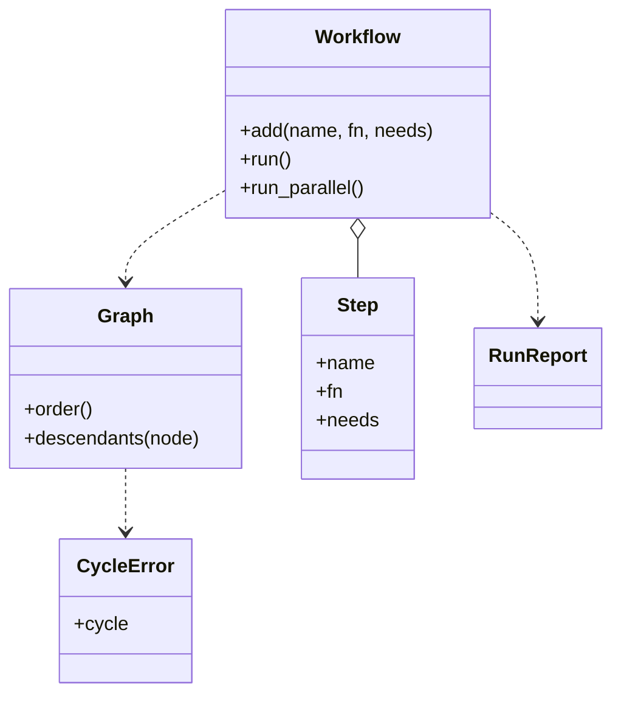

# DAG 执行器与依赖安装（DAG Runner）

## 题目

有一批任务（或软件包），其中一些必须等另一些做完才能开始。系统要算出一个能依次做完它们的顺序，发现「A 等 B、B 又等 A」这种死结（环，cycle）就报错，再进一步让每个节点成为一个函数、上游结果传给下游，并把互不相关的节点同时跑起来。这样的图叫有向无环图（DAG，Directed Acyclic Graph）。包管理器装软件、构建系统编译、工作流引擎调度步骤，都是这个结构。

**面试官真正在看的是：拓扑排序写得对不对（入度怎么数、孤立节点、排完要不要检查数量）；环能不能说出具体是哪几个；并行时调度状态由谁持有、一个失败怎么只影响它的后代。**

你会听到的原话：给一份依赖邻接表，返回安装顺序，有环就抛异常。接着给一段有 bug 的拓扑排序代码让你找出并修好；再追问让每个节点是一个函数、上游结果传给下游，以及独立节点并行执行。

常见追问：
- 异常里能不能告诉我环是哪几个节点？
- 某一步失败了，其它分支还跑不跑？
- 为什么用 Kahn 而不是 DFS？

## 先问这几个问题

- `deps["a"] = ["b"]` 是「a 依赖 b」还是「a 之后做 b」？**方向反了整个顺序就倒过来。约定 `deps[x]` 是 x 的前置依赖。** 只出现在依赖列表里、自己没有一行的名字算节点，否则它永远装不上。
- 有环时只抛异常，还是要说出环？**带环本身的异常（`a -> b -> c -> a`）调用方能直接告诉用户该改哪一条依赖，也是评审想看到的。**
- 多个合法顺序时要哪一个？**拓扑序一般不唯一；要确定性就规定平局规则，这里按首次出现的先后，测试可以断言整个列表。**
- 一个步骤失败后其它分支怎么办？**默认只取消它的后代，别的分支照常完成，最后给一份报告。**
- 范围外：版本约束、增量安装与缓存、重试与超时、跨机器调度。

## 核心对象

| 类 | 职责（一句话） | 守住的不变量 |
|---|---|---|
| `Graph` | 不可变的依赖图：去重边、拓扑序、找环、求后代 | 边去重后才算入度；不知道什么是「执行」 |
| `CycleError` | 带着具体的环 | `cycle` 里每个名字依赖它后面那个，最后一个依赖第一个 |
| `Step` | 冻结的数据：名字、函数、依赖名 | 函数入参是 `{依赖名: 结果}` |
| `Workflow` | 步骤登记处和执行入口 | 同名不能重复登记；运行前统一检查环和未登记的依赖 |
| `RunReport` | 并行运行的结局 | 每个步骤恰好落在成功、失败、跳过之一 |



## 主流程

**`order()`（Kahn 算法）：**
1. 建图：每个出现过的名字都是节点；同一条依赖声明两次只算一条边（用集合）。
2. 入度 = 去重后的前置依赖数。入度为 0 的进就绪堆，堆按首次出现序号排，输出确定。
3. 弹出一个节点放进结果，把它的每个后继入度减 1，减到 0 就入堆。
4. 结束后若结果长度小于节点总数，剩下的里一定有环：任选一个仍有未完成前置的节点，**沿它的前置依赖一直走，必然撞上走过的点**，那一段就是环，抛 `CycleError`。

**`run_parallel()`：**
1. 先 `order()` 检查环，有环直接抛，不启动任何线程。
2. 调用线程独占调度状态（入度表、结果、失败、跳过）；线程池里的 worker 只跑 `fn`。
3. 提交入度为 0 的步骤；等任意一个完成。成功就记结果，给后继入度减 1，减到 0 且没被跳过就提交，入参是此刻已完成依赖的结果快照。
4. 失败就记入失败，把它的所有后代标为跳过；别的分支照常继续。
5. 全部结束，返回 `RunReport`。

## 关键决策

### 怎么排序：Kahn 算法还是 DFS 后序

- DFS 后序再反转：代码短，但找环要额外维护三色标记，并行调度也接不上。
- **选 Kahn：它天然就是调度循环——就绪的先做，做完减后继入度。** 同一套入度表直接支撑第 4 关的并行；有环时「没排完」就是信号，而 DFS 要另写检测。

### 环怎么报：沿着前置依赖一直走

- 只抛「有环」：调用方不知道改哪条依赖。
- **没排完时，剩下节点每个都至少还有一个未完成前置，沿它走必然回到走过的点，截出那一段。** 不需要额外的 DFS，几行代码。

### 入度怎么数：按去重后的边

- 按声明条数数入度：`{"b": ["a", "a"]}` 会数出 2，但减入度时只减一次，`b` 永远到不了 0，被误报成环。
- **选先把边放进集合再数。** 这也是代码评审题最常考的 bug 之一。

### 并行调度的状态由谁持有：调用线程独占

- worker 线程自己改入度表：要给每个字段加锁，容易死锁或漏减。
- **选只有调用线程读写调度状态，worker 只跑函数并返回结果。** 不需要任何锁；顺序也确定（同一批完成的按拓扑序处理），测试不依赖线程时序。

### 不做 Node 类层次，也不做 Visitor

- **简单者胜出：节点就是字符串，步骤是一个冻结的数据类。** 没有第二种节点行为，类层次和 Visitor 只会增加样板。

## Python 骨架

```python
from __future__ import annotations
import heapq
from concurrent.futures import FIRST_COMPLETED, ThreadPoolExecutor, wait
from dataclasses import dataclass
from typing import Any, Callable


class CycleError(Exception):
    def __init__(self, cycle: tuple[str, ...]) -> None:
        self.cycle = cycle  # 每个依赖它后面那个，最后一个依赖第一个
        super().__init__(" -> ".join((*cycle, cycle[0])))


class Graph:
    """deps[x] 是 x 的前置依赖；只出现在依赖里的名字也算节点。"""

    def __init__(self, deps: dict[str, list[str]]) -> None:
        self.index: dict[str, int] = {}  # 名字 -> 首次出现序号，用于稳定排序
        self.prereqs: dict[str, set[str]] = {}
        for node, ds in deps.items():
            self.index.setdefault(node, len(self.index))
            self.prereqs.setdefault(node, set())
            for d in ds:
                self.index.setdefault(d, len(self.index))
                self.prereqs.setdefault(d, set())
                self.prereqs[node].add(d)  # 集合：重复声明只算一条边
        self.dependents: dict[str, set[str]] = {n: set() for n in self.index}
        for node, ds in self.prereqs.items():
            for d in ds:
                self.dependents[d].add(node)

    def order(self) -> list[str]:  # Kahn 算法
        waiting = {n: len(p) for n, p in self.prereqs.items()}  # 入度按去重后的边数
        names = list(self.index)
        ready = [self.index[n] for n, c in waiting.items() if c == 0]
        heapq.heapify(ready)  # 同时可选的，按首次出现先后
        out: list[str] = []
        while ready:
            node = names[heapq.heappop(ready)]
            out.append(node)
            for nxt in self.dependents[node]:
                waiting[nxt] -= 1
                if waiting[nxt] == 0:
                    heapq.heappush(ready, self.index[nxt])
        if len(out) != len(names):  # 没排完 = 有环：沿未完成的前置依赖走，撞上走过的点
            stuck = {n for n, c in waiting.items() if c > 0}
            node, path, pos = min(stuck, key=self.index.get), [], {}
            while node not in pos:
                pos[node] = len(path)
                path.append(node)
                node = next(d for d in sorted(self.prereqs[node], key=self.index.get) if d in stuck)
            raise CycleError(tuple(path[pos[node]:]))
        return out

    def descendants(self, node: str) -> set[str]:
        seen, stack = set(), [node]
        while stack:
            for nxt in self.dependents[stack.pop()]:
                if nxt not in seen:
                    seen.add(nxt)
                    stack.append(nxt)
        return seen


def install_order(deps: dict[str, list[str]]) -> list[str]:
    return Graph(deps).order()


@dataclass(frozen=True)
class Step:
    name: str
    fn: Callable[..., Any]  # 入参：{依赖名: 依赖的结果}
    needs: tuple[str, ...] = ()


class Workflow:
    def __init__(self) -> None:
        self.steps: dict[str, Step] = {}

    def add(self, name: str, fn, needs=()) -> None:
        if name in self.steps:
            raise ValueError(f"重复步骤 {name}")
        self.steps[name] = Step(name, fn, tuple(needs))

    def _graph(self) -> Graph:
        g = Graph({s.name: list(s.needs) for s in self.steps.values()})
        missing = [n for n in g.index if n not in self.steps]
        if missing:
            raise KeyError(f"未登记的步骤: {missing}")
        return g

    def run(self) -> dict[str, Any]:  # 顺序执行，上游结果传给下游
        results: dict[str, Any] = {}
        for name in self._graph().order():
            step = self.steps[name]
            results[name] = step.fn({d: results[d] for d in step.needs})
        return results

    def run_parallel(self, workers: int = 4):
        g = self._graph()
        order = g.order()  # 先检查环：有环直接抛，不启动线程
        waiting = {n: len(g.prereqs[n]) for n in order}
        results, failed, skipped, running = {}, {}, set(), {}
        with ThreadPoolExecutor(workers) as pool:  # 调度状态只由本线程读写，worker 只跑 fn
            def submit(n: str) -> None:
                running[pool.submit(self.steps[n].fn, {d: results[d] for d in self.steps[n].needs})] = n

            for n in order:
                if waiting[n] == 0:
                    submit(n)
            while running:
                done, _ = wait(running, return_when=FIRST_COMPLETED)
                for fut in sorted(done, key=lambda f: order.index(running[f])):
                    n = running.pop(fut)
                    if fut.exception() is not None:
                        failed[n] = fut.exception()
                        skipped |= g.descendants(n)  # 失败只让后代跳过
                        continue
                    results[n] = fut.result()
                    for nxt in sorted(g.dependents[n], key=order.index):
                        waiting[nxt] -= 1
                        if waiting[nxt] == 0 and nxt not in skipped:
                            submit(nxt)
        return results, failed, skipped


if __name__ == "__main__":
    # 孤立被依赖节点 b、重复边都要处理对
    assert install_order({"app": ["web", "db"], "web": ["lib"], "db": ["lib"]}) == ["lib", "web", "db", "app"]
    assert install_order({"a": ["b"]}) == ["b", "a"]
    assert install_order({"b": ["a", "a"]}) == ["a", "b"]
    try:
        install_order({"a": ["b"], "b": ["c"], "c": ["a"]})
        raise SystemExit("应当抛 CycleError")
    except CycleError as err:
        assert err.cycle == ("a", "b", "c")  # 说出具体的环
    wf = Workflow()
    wf.add("load", lambda up: 2)
    wf.add("double", lambda up: up["load"] * 2, ["load"])
    wf.add("boom", lambda up: 1 / 0, ["load"])
    wf.add("after", lambda up: up["boom"], ["boom"])
    wf.add("other", lambda up: up["load"] + 1, ["load"])
    res, failed, skipped = wf.run_parallel()
    assert res == {"load": 2, "double": 4, "other": 3}  # 别的分支照常完成
    assert set(failed) == {"boom"} and skipped == {"after"}  # 失败只影响后代
    print("ok")
```

## 面试官加需求时

| 新需求 | 改哪里 | 不用动哪里 |
|---|---|---|
| 要说出环是哪几个 | `order()` 末尾的找环，`CycleError` 带 `cycle` | Kahn 主体 |
| 上游结果传给下游 | `Step` 的入参设为 `{依赖名: 结果}` | `Graph` |
| 独立节点并行 | 新增 `run_parallel`，复用同一套入度表 | `Graph`、`Step` |
| 失败只取消后代 | `Graph.descendants` + 报告的跳过集合 | 调度循环结构 |
| 失败后重试、超时 | `Step` 加字段，worker 函数外包一层 | 图和调度 |
| 只执行某个目标及其依赖 | `Graph` 加 `ancestors`，裁剪子图再排 | 其它 |

## 并发与扩展

- 竞态：**多个 worker 同时完成时谁来改入度？答案是没人并发改**：只有调用线程在 `wait` 返回后读写调度状态，worker 只返回结果。
- 提交入参时依赖都已完成，所以入参是不会再变的快照。
- 同一批完成的按拓扑序处理，结果确定，测试不靠 `sleep`。
- 线程池适合 I/O 型步骤；CPU 密集的步骤换进程池，函数要可序列化。
- 规模变大：持久化每个步骤的状态，崩溃后从未完成的步骤续跑；跨机器调度就是工作流引擎（Airflow 一类）的问题，范围外。

## 常见错误

- 按声明条数数入度：重复声明让入度永远到不了 0，被误报成环。**先去重再数。**
- 只遍历有一行的键，漏掉只出现在依赖里的名字：它永远装不上。**出现过的名字都是节点。**
- 排完不检查结果长度是否等于节点数：有环时悄悄返回不完整的顺序。**检查，不等就抛。**
- 环的报错只有「有环」两个字：**沿未完成的前置一直走，报出具体的环。**
- worker 线程自己改共享的入度表：要么加锁、要么出竞态。**调度状态只由调用线程持有。**

## 30 秒复述

- 对象：`Graph` 管排序、找环、求后代，不知道执行；`Step` 是函数加依赖；`Workflow` 是登记处和入口；`RunReport` 记成功、失败、跳过。
- 核心算法：**Kahn，入度按去重后的边数，排不完就沿未完成的前置依赖走，截出具体的环。**
- 平局规则按首次出现的先后，所以输出确定、可断言。
- 并行：调用线程独占调度状态，worker 只跑函数；一个失败只让它的后代跳过，别的分支照常完成。
- 扩展：结果传递、并行、重试都是在同一张图上加一层，`Graph` 不改。

## 来源

- [[solution-amz-dag-runner]]
