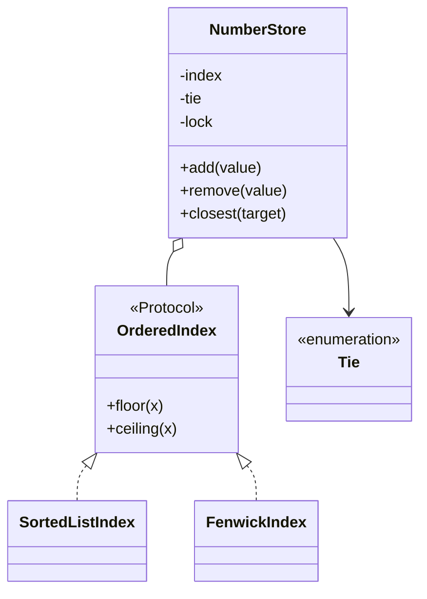

# 增删查最近值（Add / Remove / Closest）

## 题目

一个整数的集合：可以放入数、拿走数，还可以问「集合里哪个数离 target 最近」。用它的人是任何要按数值就近匹配的程序，比如按价格找最接近的档位。**面试官真正看的是：你能不能说出「最近的数只可能是前驱或后继」，存储能不能整体换掉而门面不动，一次查询读两次时有没有想过版本一致。**

你会听到这样的开场：

- 「先给你一批数，排好序后回答离 target 最近的是哪个。」
- 「现在要能随时 add 和 remove。」

常见的后续追问：

- 所有的值都落在一个已知范围 [lo, hi] 里，怎么利用？
- 多线程同时增删查怎么办？
- 返回最近的 k 个。

两个术语先说清：前驱（floor）是不大于 target 的最大值；后继（ceiling）是不小于 target 的最小值。

## 先问这几个问题

- **平局怎么办？**（集合 {10, 20}，target 15）→ 决定返回规则；做成一个 `Tie` 枚举，默认取较小的。
- **允许重复值吗？**→ 允许就是多重集合（multiset）：`remove` 每次删一个副本，存储里重复值重复出现。
- **值有范围吗？数据量多大？**→ 这是最关键的一问。无范围只能用有序结构；范围小（比如 0 到 10 的六次方）可以按值下标，换成树状数组。
- **删除不存在的值怎么办？**→ 决定失败路径：抛异常，并保证集合不变。
- **要线程安全吗？浮点数呢？**→ 默认只做整数；并发要一把锁。

## 核心对象

| 类 | 职责（一句话） | 守住的不变量 |
|---|---|---|
| `NumberStore` | 对外门面：校验输入、定平局规则、持有锁 | 一次 `closest` 读到的前驱和后继来自同一个版本 |
| `OrderedIndex` | 存储接缝（Protocol）：add / remove / count / floor / ceiling | 对外只回答这几个问题 |
| `SortedListIndex` | 升序列表 + 二分 | 列表永远升序 |
| `FenwickIndex` | 值域有界时的树状数组（Fenwick tree） | 节点存区间个数之和；删除失败不改任何状态 |
| `Tie` | 平局规则枚举 | 只有 LOWER / HIGHER 两个取值 |



索引由门面独占，外面拿不到索引引用，锁才有意义。

## 主流程

**closest(target)**

1. 校验 target 是整数（`bool` 虽然是 `int` 的子类，也要拒绝）。
2. 拿锁，读 `floor(target)` 与 `ceiling(target)`，放锁。
3. 两个都没有 → 抛 `EmptyStoreError`；只有一个 → 返回它。
4. 两个都有 → 比较与 target 的距离；一样近按 `Tie` 规则取。

**remove(value)**

1. 校验整数，拿锁。
2. 索引的 `remove` 返回 bool：删掉一个副本则 True，没有则 False 且不改状态。
3. 门面把 False 翻译成 `ValueNotFoundError`，调用方可 `except LookupError`。

可能失败的点：输入非整数、空集合、删除不存在的值、值超出有界索引的值域。

## 关键决策

### 一、用什么结构存「随时增删的有序数」

问题：`closest` 要 O(log n) 找到邻居，`add` 又不能每次重排。

- 排序一次、增删后重排：每次 add O(n log n)，只适合只读的第 1 关。
- 有序列表 + `bisect.insort`：查 O(log n)，增删有一次 O(n) 的内存搬移，常数极小；**不需要知道值域**。
- 树状数组：值域 [lo, hi] 已知时，增删查都是 O(log R)，与 n 无关；代价是必须知道值域，内存 O(R)。
- 手写平衡树：渐近最好，但 45 分钟里写对既慢又容易错，面试官看的是设计不是旋转。

**选择：默认有序列表，值域约束一出现就换树状数组，两者是同一条接缝的两个实现。** 不用工厂和注入框架，`NumberStore(FenwickIndex(0, 10**6))` 就是全部。

### 二、接缝只放一处（简单答案赢，不上模式）

问题：把「怎么存」写进门面，值域一来就要重写；可是把平局、校验也全做成接口，类比逻辑还多。

- 门面里写 `if bounded: ...`：每加一种存储，每个方法多一个分支。
- 每个变化点一个接口：类爆炸。

**选择：只对「真有两个实现」的地方开接缝。** 存储有两个实现，所以是 Protocol；平局只有两个取值，一个 `Enum` 加一行比较；校验只有一条规则，一个静态方法。`Tie` 做成 `TieBreaker` 抽象类加两个子类，就是用三个类做了一个布尔值的事。

### 三、删除不存在的值

- 静默忽略：计数悄悄错位，bug 看不见，不选。
- 门面也返回布尔：调用方容易忘检查。
- **选择：索引返回 bool，门面抛异常，两层各司其职。** 索引只报告「删了没有」，门面是公开 API，失败用领域异常。

还有一个常错点：**索引 `remove` 失败时不能改任何状态**。树状数组如果不先看个数就减 1，某个值的个数会变成 −1，之后 `floor` 就返回一个不存在的值。

### 四、线程安全的粒度

问题：`closest` 读两次，中间另一个线程删掉了其中一个，就得到「从没同时存在过」的答案。GIL 保护单条字节码，不保护这两次读。

- 读写锁：标准库没有，要自己处理写者饥饿，而一次查询只要微秒。
- 不可变快照：每次写 O(n)，违背第 2 关的目的。
- **选择：一把 `threading.Lock`，每个公开方法进来就持有。** 注意 `k_closest` 要在持锁期间把结果取完，不能把生成器返回到锁外再遍历。

## Python 骨架

```python
import bisect
import enum
import threading
from typing import Protocol


class NumberStoreError(Exception): ...
class InvalidValueError(NumberStoreError, ValueError): ...
class ValueNotFoundError(NumberStoreError, LookupError): ...
class EmptyStoreError(NumberStoreError, LookupError): ...


class Tie(enum.Enum):
    LOWER = "lower"
    HIGHER = "higher"


class OrderedIndex(Protocol):  # 接缝：只回答这几个问题
    def add(self, value: int) -> None: ...
    def remove(self, value: int) -> bool: ...
    def floor(self, value: int) -> int | None: ...
    def ceiling(self, value: int) -> int | None: ...


class SortedListIndex:
    def __init__(self) -> None:
        self._xs: list[int] = []  # 不变量：永远升序，重复值重复出现

    def add(self, value: int) -> None:
        bisect.insort(self._xs, value)

    def remove(self, value: int) -> bool:
        i = bisect.bisect_left(self._xs, value)
        if i == len(self._xs) or self._xs[i] != value:
            return False  # 失败不改状态
        del self._xs[i]
        return True

    def floor(self, value: int) -> int | None:  # 不大于 value 的最大值
        i = bisect.bisect_right(self._xs, value)
        return self._xs[i - 1] if i else None

    def ceiling(self, value: int) -> int | None:  # 不小于 value 的最小值
        i = bisect.bisect_left(self._xs, value)
        return self._xs[i] if i < len(self._xs) else None


class NumberStore:
    def __init__(self, index: OrderedIndex | None = None, tie: Tie = Tie.LOWER) -> None:
        self._index = index if index is not None else SortedListIndex()
        self._tie = tie
        self._lock = threading.Lock()  # 两次读必须是同一个版本

    @staticmethod
    def _check(x: int) -> None:
        if isinstance(x, bool) or not isinstance(x, int):  # bool 是 int 子类，要单独拒绝
            raise InvalidValueError(f"需要整数，得到 {x!r}")

    def add(self, value: int) -> None:
        self._check(value)
        with self._lock:
            self._index.add(value)

    def remove(self, value: int) -> None:
        self._check(value)
        with self._lock:
            if not self._index.remove(value):
                raise ValueNotFoundError(value)  # 索引报告布尔，门面翻译成异常

    def closest(self, target: int) -> int:
        self._check(target)
        with self._lock:  # 锁只包住两次读
            lo, hi = self._index.floor(target), self._index.ceiling(target)
        if lo is None and hi is None:
            raise EmptyStoreError("集合为空")
        if lo is None:
            return hi
        if hi is None:
            return lo
        d_lo, d_hi = target - lo, hi - target
        if d_lo < d_hi or (d_lo == d_hi and self._tie is Tie.LOWER):
            return lo
        return hi


if __name__ == "__main__":
    s = NumberStore()
    for v in (10, 20, 20, 42):
        s.add(v)
    assert s.closest(15) == 10  # 平局取较小
    h = NumberStore(tie=Tie.HIGHER)
    h.add(10), h.add(20)
    assert h.closest(15) == 20  # 平局取较大
    assert s.closest(100) == 42 and s.closest(-5) == 10  # 只有一侧邻居
    s.remove(20)
    assert s.closest(19) == 20  # 重复值只删了一个副本
    s.remove(20)
    assert s.closest(19) == 10
    try:
        s.remove(20)
        raise SystemExit("应当抛异常")
    except ValueNotFoundError:
        pass
    try:
        NumberStore().closest(1)
        raise SystemExit("应当抛异常")
    except EmptyStoreError:
        pass
```

## 面试官加需求时

| 新需求 | 改哪里 | 不用动哪里 |
|---|---|---|
| 值有已知范围 | 新增 `FenwickIndex`，构造时传入 | `NumberStore` 的所有方法 |
| 平局取较大 / 全部返回 | `Tie` 加一个值，改比较那一行 | 索引 |
| 最近的 k 个 | 门面加 `k_closest`，从 floor / ceiling 两侧向外归并 | 索引接口 |
| 多线程 | 已有那把锁；检查生成器不泄漏到锁外 | 索引 |
| 浮点数 | `_check` 放宽，比较处小心精度 | 接缝形状 |
| 持久化 | 在索引外加一层，门面不变 | 门面对外 API |

## 并发与扩展

- 竞态在 `closest` 的两次读之间：删除可能插进来。**一把锁包住两次读**，持锁微秒级，够用。
- 树状数组一次更新要改 O(log R) 个节点，读到一半会看到半成品，同样靠这把锁。
- 测试并发用 `Barrier` 同时放行多个线程去删同一个值的 5 个副本，断言恰好成功 5 次，不依赖时序。
- 规模变大：有序列表的搬移是 O(n)，百万级时换树状数组或跳表（skip list）；分布式则按值域分片，查询向相邻分片取邻居。

## 常见错误

- 以为最近的数要扫全集：**只比较前驱和后继两个候选**。
- 只考虑一个候选：target 比所有数都大或都小时，另一侧为空，要单独处理。
- `remove` 失败时先改了状态（树状数组减成 −1）：先判断个数再动手。
- `True` 被当成数字 1 存进去：先排除 `bool`。
- 为平局规则写策略类：一个 `Enum` 加一行比较就够了。

## 30 秒复述

- 最近的数只可能是前驱或后继，**`closest` 就是比较这两个候选**。
- 门面 `NumberStore` 校验输入、定平局、持锁；存储是 `OrderedIndex` 接缝。
- 默认有序列表加二分，不需要值域；值域一出现就换树状数组，增删查 O(log R)。
- **只对真有两个实现的地方开接缝**，平局用 Enum，不上模式。
- 删除不存在的值：索引报告布尔，门面抛 `ValueNotFoundError`，失败时集合不变。
- 并发：一把锁包住前驱和后继两次读，保证同一个版本。

## 来源

- [[solution-amz-closest-store]]
