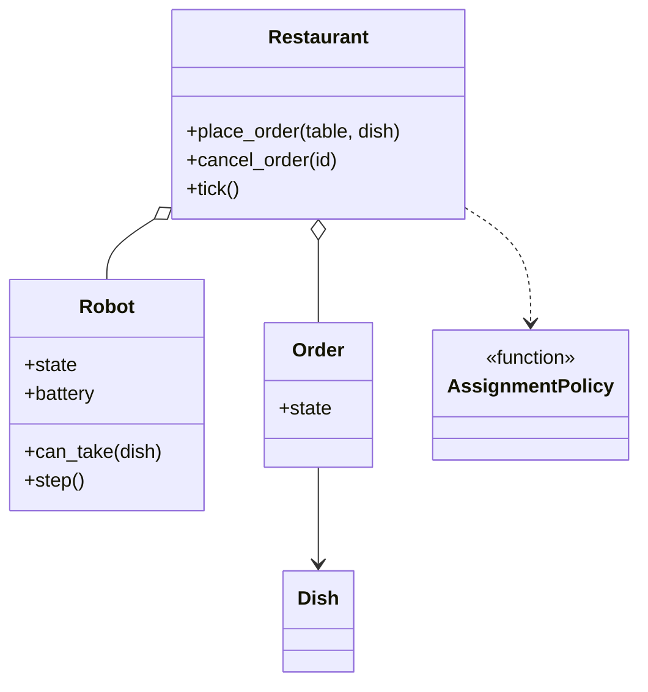

# 机器人餐厅（Robot Restaurant）

## 题目

顾客在某张桌子点一道菜，餐厅里有若干台机器人。空闲的机器人接下这张单，先在厨房做菜，再送到桌子，然后回到空闲等下一张单；机器人有电量，电量低了要去充电桩。**面试官真正看的是：机器人的状态机是不是守得住（做菜中不能直接去充电）、「谁接单」的规则能不能换、充电桩这类有限资源会不会泄漏。**

你会听到：

- 「设计一个机器人餐厅。」
- 追问一：多台机器人怎么分配？
- 追问二：机器人没电了怎么办？
- 追问三：多线程同时下单怎么保证每张单只送一次？

## 先问这几个问题

- **一台机器人从头做到尾，还是做菜机器人和送餐机器人分开？**→ 分开就要两个队列、两类资源；默认「一台负责一张单」，机器人状态和订单阶段一一对应。
- **时间怎么走，真的睡眠还是离散的步？**→ 用离散的刻（tick），`tick()` 推进一刻，测试不需要 `sleep`。
- **分配规则是什么？**→ 先到先得、谁空闲谁接是最简单的答案，但开场就要说「规则可以换」。
- **电量不够时订单怎么办？**→ 决定接单条件：不是「电量低于阈值」，而是「做完后电量是否仍不低于保底」。
- **范围外**：菜单价格、支付、路径规划、机器人故障。

## 核心对象

| 类 | 职责（一句话） | 守住的不变量 |
|---|---|---|
| `Dish` | 菜名和做菜刻数，frozen | 不可变 |
| `Order` | 订单号、桌号、菜、状态 | 只是记录，由机器人或餐厅写入状态 |
| `Robot` | 一台状态机，每刻 `step()` 一次 | 状态只能按转移表变化，非法转移抛异常 |
| `AssignmentPolicy` | 一个函数：候选快照 + 菜 → 选中的编号 | 只能选，不能改机器人 |
| `Restaurant` | 收单、排队、推进时间、派单、安排充电，持有锁 | 一把锁保护队列和全部机器人 |



`Robot` 不知道餐厅的存在，只知道自己的参数，所以状态机可以脱离餐厅单独测试。

## 主流程

**下单与派单**

1. `place_order`：菜不在菜单抛错；耗电超过上限的菜直接拒绝（否则可能永远没人接）；入队，返回订单号。
2. `tick()` 先让每台机器人 `step()`：做菜完成转为送餐，送达后订单 DELIVERED、机器人回 IDLE。
3. 再给「电量低且有空桩」的空闲机器人安排充电；空桩数现数，不另存计数器。
4. 最后派单：队首订单让策略从「接得了的空闲机器人」里选一台；没人能接，队首留着，后面的也不越过它。

**取消**：只有 PENDING 的订单能取消；机器人接走之后抛 `OrderNotCancellableError`。

可能失败的点：未知菜、订单被拒、取消已被接走的单、策略返回不在候选里的编号。

## 关键决策

### 一、状态用枚举加转移表，还是每个状态一个类

问题：IDLE、COOKING、DELIVERING、CHARGING 四个状态，不是任意两个之间都能转。

- 状态模式（State）：四个类各实现 `step`，每加一个状态加一个类，共享的电量要回传。
- 枚举 + 合法转移表 + 一个 `step` 里的 `if/elif`：转移规则集中在一张字典里。

**选择：枚举加转移表。** 四个状态每个行为只有几行，真正要保证的是转移合法，一张表比散在四个类里的 `next()` 好审查。状态涨到十几个、行为很重时再重构。

### 二、「哪台接单」：写死、子类，还是传入函数

- 在派单里写死 `min(candidates, key=id)`：换规则就要改餐厅。
- 每种规则一个类：只有一个方法，是 Java 习惯。
- **选择：策略就是一个函数 `(candidates, dish) -> id | None`。** `first_idle`、`most_battery` 各三行；有状态的策略（轮询）才写成带 `__call__` 的类。

两个细节：策略拿到的是只读快照，只能选不能改；餐厅要校验返回的编号确实在候选里，用异常而不是 `assert`。

### 三、充电桩占用数：再设计计数器，还是现数

- `ChargerPool` 计数器：第二份真相，某条路径忘了释放，桩就泄漏。
- **选择：现数。** 占用数 = 处于 CHARGING 的机器人数，没有可以忘记的释放步骤；机器人几十台，遍历可以忽略。

### 四、没有空桩、电量又低（简单答案赢）

「低了不许接」会让订单排队到停摆；「低了照接」会半路没电。**接单条件是 `battery - job_cost >= reserve`，不是「电量是否低于阈值」。** 默认一碗汤耗电 8：电量 25 的机器人没空桩时仍可接；电量 12 的不能接，原地等桩。

配套下界：下单时拒绝耗电超过 `low_battery - reserve` 的菜，这样电量不低于阈值的机器人一定能接任何合法订单，系统总有进展。派单严格先来先服务，代价是队头阻塞，换来公平。订单状态不另建状态机：它只是几个固定位置写入的字段。

## Python 骨架

```python
import threading
from collections import deque
from dataclasses import dataclass
from enum import Enum


class RestaurantError(Exception): ...
class UnknownDishError(RestaurantError, LookupError): ...
class OrderRejectedError(RestaurantError, ValueError): ...
class NotCancellableError(RestaurantError): ...
class InvalidTransitionError(RestaurantError): ...


class RS(Enum):  # 机器人状态
    IDLE = 1
    COOKING = 2
    DELIVERING = 3
    CHARGING = 4


# 合法转移表：非法转移直接抛异常
_ALLOWED = {RS.IDLE: {RS.COOKING, RS.CHARGING}, RS.COOKING: {RS.DELIVERING},
            RS.DELIVERING: {RS.IDLE}, RS.CHARGING: {RS.IDLE}}


@dataclass(frozen=True)
class Dish:
    name: str
    cook_ticks: int


@dataclass
class Order:
    id: int
    dish: Dish
    state: str = "pending"


@dataclass(frozen=True)
class Cfg:
    chargers: int = 1
    deliver_ticks: int = 3
    cook_drain: int = 1
    move_drain: int = 2
    charge_rate: int = 20
    low: int = 30
    reserve: int = 10

    def cost(self, d: Dish) -> int:
        return d.cook_ticks * self.cook_drain + self.deliver_ticks * self.move_drain


class Robot:
    def __init__(self, rid: int, cfg: Cfg) -> None:
        self.id, self.cfg, self.battery = rid, cfg, 100
        self.state, self.order, self.left = RS.IDLE, None, 0

    def _to(self, new: RS) -> None:  # 唯一改状态的地方
        if new not in _ALLOWED[self.state]:
            raise InvalidTransitionError(f"{self.state} -> {new}")
        self.state = new

    def can_take(self, d: Dish) -> bool:  # 做完后电量仍不低于保底
        return self.state is RS.IDLE and self.battery - self.cfg.cost(d) >= self.cfg.reserve

    def start(self, o: Order) -> None:
        self._to(RS.COOKING)
        self.order, self.left, o.state = o, o.dish.cook_ticks, "cooking"

    def step(self) -> None:
        c = self.cfg
        if self.state is RS.COOKING:
            self.battery, self.left = self.battery - c.cook_drain, self.left - 1
            if self.left == 0:
                self._to(RS.DELIVERING)
                self.left, self.order.state = c.deliver_ticks, "delivering"
        elif self.state is RS.DELIVERING:
            self.battery, self.left = self.battery - c.move_drain, self.left - 1
            if self.left == 0:
                self.order.state, self.order = "delivered", None
                self._to(RS.IDLE)
        elif self.state is RS.CHARGING:
            self.battery = min(100, self.battery + c.charge_rate)
            if self.battery == 100:
                self._to(RS.IDLE)


def first_idle(cands: list[Robot], dish: Dish) -> int | None:  # 策略 = 一个函数
    return cands[0].id if cands else None


class Restaurant:
    def __init__(self, n: int, cfg: Cfg = Cfg(), policy=first_idle) -> None:
        self.cfg, self.policy = cfg, policy
        self.robots = [Robot(i, cfg) for i in range(n)]
        self.menu = {"noodle": Dish("noodle", 4), "soup": Dish("soup", 2)}
        self.pending: deque[Order] = deque()
        self.orders: dict[int, Order] = {}
        self._lock = threading.Lock()  # 保护队列和全部机器人

    def place_order(self, name: str) -> int:
        dish = self.menu.get(name)
        if dish is None:
            raise UnknownDishError(name)
        if self.cfg.cost(dish) > self.cfg.low - self.cfg.reserve:  # 否则可能永远没人接
            raise OrderRejectedError(name)
        with self._lock:
            o = Order(len(self.orders) + 1, dish)
            self.orders[o.id] = o
            self.pending.append(o)
            return o.id

    def cancel(self, oid: int) -> None:
        with self._lock:
            o = self.orders[oid]
            if o.state != "pending":
                raise NotCancellableError(oid)
            self.pending.remove(o)
            o.state = "cancelled"

    def tick(self) -> None:
        with self._lock:
            for r in self.robots:
                r.step()
            busy = sum(r.state is RS.CHARGING for r in self.robots)  # 现数，不另存计数器
            for r in self.robots:
                if r.state is RS.IDLE and r.battery < self.cfg.low and busy < self.cfg.chargers:
                    r._to(RS.CHARGING)
                    busy += 1
            while self.pending:  # 严格先来先服务
                head = self.pending[0]
                cands = [r for r in self.robots if r.can_take(head.dish)]
                pick = self.policy(cands, head.dish)
                if pick is None:
                    break
                if pick not in {r.id for r in cands}:
                    raise RestaurantError("策略返回了不在候选里的机器人")
                self.robots[pick].start(self.pending.popleft())


if __name__ == "__main__":
    rest = Restaurant(1)
    oid = rest.place_order("noodle")
    for _ in range(8):  # 派单 1 刻 + 做菜 4 刻 + 送餐 3 刻
        rest.tick()
    assert rest.orders[oid].state == "delivered" and rest.robots[0].battery == 90
    second = rest.place_order("soup")
    rest.cancel(second)
    assert rest.orders[second].state == "cancelled"
    rest.robots[0].battery = 12  # 电量太低：接不了汤，只能去充电
    assert not rest.robots[0].can_take(rest.menu["soup"])
    try:
        rest.cancel(second)
        raise SystemExit("应当抛异常")
    except NotCancellableError:
        pass
    try:
        rest.robots[0]._to(RS.DELIVERING)  # IDLE 不能直接到 DELIVERING
        raise SystemExit("应当抛异常")
    except InvalidTransitionError:
        pass
```

## 面试官加需求时

| 新需求 | 改哪里 | 不用动哪里 |
|---|---|---|
| 优先派电量最多的 | 再写一个策略函数传入 | `Restaurant`、`Robot` |
| 做菜与送餐分开 | 订单状态机变成两阶段，加厨房队列 | 派单策略的签名 |
| 新增状态（如维修） | 转移表加一行，`step` 加一个分支 | 餐厅 |
| 菜单与价格 | `menu` 换成独立类 | 机器人 |
| 事件通知 | 餐厅记事件日志，订阅者读快照 | 状态机 |
| 取消送餐中的订单 | 机器人加「取消」转移，餐厅调用 | 其他状态 |

## 并发与扩展

- 竞态在「下单 / 取消 / 派单」之间：同一张订单可能既被取消又被接走。**一把锁保护待处理队列、全部机器人和日志**，对外只给快照。
- 派单时锁内完成「选机器人 + 状态转移」，不会两个线程把同一张单派给两台机器人。
- 测试并发用 `Barrier` 同时放行，断言每张单恰好送达一次，不依赖时序。
- 规模变大：机器人上万台时，充电占用才值得改成计数器，并把「改状态」与「改计数」封装成同一个操作；多楼层则按区域分队列。

## 常见错误

- 让订单自己去找机器人、机器人去改订单：三个类互相依赖；**机器人是状态机的唯一执行者**。
- 用 `time.sleep` 表示做菜：测试无法写；用离散刻。
- 单独存一份充电桩占用数：忘记释放就泄漏；现数。
- 「电量低就不许接」：订单排队到停摆；改成接单后仍不低于保底。
- 策略直接拿活的机器人：策略能改状态；给只读快照。

## 30 秒复述

- 五个对象：`Dish`、`Order`、`Robot`、策略函数、`Restaurant`。
- **机器人是枚举加转移表的状态机**，`_to` 是唯一改状态的地方，非法转移抛异常。
- 离散时间：`tick()` 先让机器人走一步，再安排充电，最后严格先来先服务派单。
- 分配规则就是一个函数，换规则不动餐厅；餐厅校验策略返回的编号。
- 充电桩占用数现数；接单条件是做完后电量不低于保底，并在下单时拒绝过耗电的菜。
- 并发：一把锁保护队列和全部机器人，每张订单恰好送达一次。

## 来源

- [[solution-amz-robot-restaurant]]
