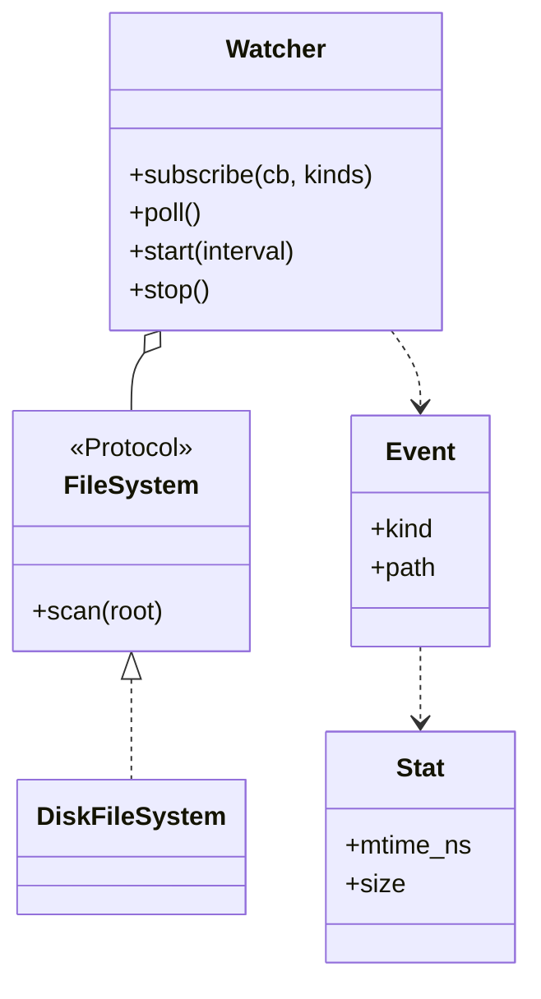

# 文件监听器（File Watcher）

## 题目

告诉监听器一个目录，它就盯着这个目录，里面有文件被新建、修改或删除时，调用你登记的回调函数（callback，事先交给它的函数）。可以在后台一直跑，也可以被停下。IDE 自动刷新、热重载、日志采集都靠这类组件。**面试官真正看的是：怎么发现变化、一个坏回调会不会拖垮监听、后台线程怎么安全地停。**

你会听到：

- 「设计一个 file watcher system。」
- 追问一：多个订阅者、按事件种类订阅？
- 追问二：文件写到一半，订阅者收到一串半截事件怎么办（去抖，debounce）？
- 追问三：回调很慢，或者回调里调用 `stop()`？

## 先问这几个问题

- **事件靠系统通知，还是自己定期去看？**→ 系统通知（inotify 等）三个平台三套接口、标准库没有；自己定期扫描并比对快照（轮询，polling）只依赖标准库。默认轮询，但把「读磁盘」藏在接口后面，将来能换。
- **要看子目录吗？要过滤文件吗？**→ 递归是一个布尔参数；过滤做成一个谓词函数。
- **改名算什么？**→ 轮询只看见前后两张快照，改名就是一个 DELETED 加一个 CREATED。
- **写到一半的文件要不要报？**→ 决定要不要去抖。
- **范围外**：符号链接内容、文件 diff、权限变化、网络文件系统。

## 核心对象

| 类 | 职责（一句话） | 守住的不变量 |
|---|---|---|
| `Stat` | 一个文件的指纹：修改时间（纳秒）+ 大小 | 不可变 |
| `Event` | 一次变化：种类 + 相对路径 | 订阅者只靠它就能更新自己 |
| `FileSystem` | Protocol，只有 `scan(root) -> 快照` | 监听器唯一的磁盘入口，测试可换假实现 |
| `diff(old, new)` | 纯函数：两张快照进，事件列表出 | 结果按路径排序，确定 |
| `Watcher` | 持有「订阅者已知的世界」、订阅表，唯一推进动作是 `poll()` | 事件只由「已提交的世界」与「现在看到的世界」之差产生，同一变化只报一次 |



## 主流程

**poll()：一轮扫描**

1. 拿锁，调 `fs.scan` 得到「现在看到的世界」。
2. 第一次调用只建立基线，不产生事件。
3. 去抖开启时，只采纳「连续两轮都一样」的路径状态，还在变的沿用旧状态。
4. `diff(已提交, 采纳后)` 得到事件，更新已提交的世界；同时复制出订阅者列表。
5. **释放锁**，再依次调用回调；回调抛异常只记录，不影响别人。

**start / stop**：`start(interval)` 起守护线程，循环 `poll()` 然后 `Event.wait(interval)`；`stop()` 置位事件并 `join`，但不 `join` 当前线程自己。

可能失败的点：根目录不存在、回调抛异常、回调里调 `stop()`。

## 关键决策

### 一、轮询比对快照，还是系统通知

- 系统通知：延迟低、不耗 CPU；平台各异，同一次保存在不同平台可能是 1 个或 3 个事件，白板上写不出来。
- 轮询：只用标准库，行为一致；有延迟，要遍历目录。

**选择：轮询，但读磁盘藏在 `FileSystem.scan` 后面。** 通知版将来是另一个实现；比对是纯函数，一眼可测。

指纹不能只用 mtime：文件系统时间有粒度，同一粒度内改两次，mtime 不变。加上 size 能抓住大多数；「同粒度内改成同样长度」仍会漏，要主动说出这个盲区，真实工具用 inode 或内容哈希补。

### 二、谁来调用 `poll()`（简单答案赢，不为「将来异步」上线程池）

- 构造时就起一个后台线程：构造函数有副作用，所有逻辑绑在线程上，测试要等时间。
- **选择：`poll()` 是普通同步方法，线程只是可选的 `start()` 里的循环。** 测试自己改假文件系统、自己调 `poll()`，立刻得到确定结果；只有少数测试用真线程，并用 `threading.Event` 等回调而不是睡眠。

### 三、去抖要不要时钟

编辑器保存大文件会连续写好几次，订阅者收到一串半截的 MODIFIED。

- 计时去抖：每个路径记最后变化时间，安静 N 毫秒才发；要注入时钟和待定表。
- **选择：稳定性去抖。** 一个路径的状态必须连续两次轮询都一样才采纳，轮询间隔就是安静窗口，不需要时钟。

时间线：文件出现（大小 10）无事件；变成 500 仍无事件；再一轮仍是 500，才报 CREATED。代价是事件多延迟一轮，持续被写的日志永远不稳定，所以默认关闭。

### 四、回调在锁内还是锁外

- 锁内调用：回调里再 `subscribe` 或 `poll` 就死锁（`Lock` 不可重入）。
- **选择：锁内复制事件和订阅者，释放锁之后再调回调。** 一个回调的异常被捕获并记录（队列有上限），其他订阅者和下一轮照常；回调跑在轮询线程上，慢回调会推迟下一轮，想隔离就让回调往 `queue.Queue` 里放。

订阅者就是一个收 `Event` 的普通函数，不要观察者基类和事件总线；`subscribe` 返回取消订阅的函数。

## Python 骨架

```python
import os
import threading
from collections import deque
from dataclasses import dataclass
from enum import Enum


@dataclass(frozen=True)
class Stat:  # 只用 mtime 会漏同一粒度内的第二次修改，所以加 size
    mtime_ns: int
    size: int


class Kind(Enum):
    CREATED = "created"
    MODIFIED = "modified"
    DELETED = "deleted"


@dataclass(frozen=True)
class Event:
    kind: Kind
    path: str


def diff(old: dict[str, Stat], new: dict[str, Stat]) -> list[Event]:  # 纯函数，按路径排序
    evs = [Event(Kind.CREATED, p) for p in new if p not in old]
    evs += [Event(Kind.DELETED, p) for p in old if p not in new]
    evs += [Event(Kind.MODIFIED, p) for p in new if p in old and new[p] != old[p]]
    return sorted(evs, key=lambda e: e.path)


class DiskFileSystem:  # FileSystem 的真实实现：唯一读磁盘的地方
    def scan(self, root: str) -> dict[str, Stat]:
        out = {}
        for e in os.scandir(root):
            if e.is_file(follow_symlinks=False):
                st = e.stat()
                out[e.name] = Stat(st.st_mtime_ns, st.st_size)
        return out


class Watcher:
    def __init__(self, fs, root: str, settle: bool = False) -> None:
        self.fs, self.root, self.settle = fs, root, settle
        self._committed: dict[str, Stat] | None = None  # 订阅者已知的世界
        self._last: dict[str, Stat] = {}
        self._subs: list = []
        self.failures: deque = deque(maxlen=100)  # 回调的异常只记录
        self._lock = threading.Lock()
        self._stop = threading.Event()
        self._thread: threading.Thread | None = None

    def subscribe(self, cb, kinds=frozenset(Kind)):
        entry = (cb, kinds)
        with self._lock:
            self._subs.append(entry)

        def unsubscribe() -> None:
            with self._lock:
                if entry in self._subs:
                    self._subs.remove(entry)
        return unsubscribe

    def poll(self) -> list[Event]:
        seen = self.fs.scan(self.root)
        with self._lock:
            if self._committed is None:  # 第一次只建立基线
                self._committed, self._last = seen, seen
                return []
            view = seen
            if self.settle:  # 连续两轮相同才采纳，否则沿用旧状态
                view = {}
                for p in set(seen) | set(self._committed):
                    if p in seen and self._last.get(p) == seen[p]:
                        view[p] = seen[p]
                    elif p in self._committed:
                        view[p] = self._committed[p]
            events = diff(self._committed, view)
            self._committed, self._last = view, seen
            subs = list(self._subs)  # 复制出来，回调在锁外
        for ev in events:
            for cb, kinds in subs:
                if ev.kind in kinds:
                    try:
                        cb(ev)
                    except Exception as exc:  # 坏回调不能拖垮监听
                        self.failures.append((ev, exc))
        return events

    def start(self, interval: float = 0.5) -> None:
        def loop() -> None:
            while not self._stop.is_set():
                self.poll()
                self._stop.wait(interval)
        self._thread = threading.Thread(target=loop, daemon=True)
        self._thread.start()

    def stop(self) -> None:
        self._stop.set()
        t = self._thread
        if t is not None and t is not threading.current_thread():  # 回调里调 stop 不 join 自己
            t.join()


class FakeFS:  # 测试用内存假文件系统：不碰真实磁盘和时间
    def __init__(self) -> None:
        self.files: dict[str, Stat] = {}

    def scan(self, root: str) -> dict[str, Stat]:
        return dict(self.files)


if __name__ == "__main__":
    fs = FakeFS()
    fs.files["a.txt"] = Stat(1, 10)
    w = Watcher(fs, "/x")
    got = []
    w.subscribe(got.append)
    assert w.poll() == []  # 基线
    fs.files["b.txt"] = Stat(2, 5)
    fs.files["a.txt"] = Stat(3, 12)
    assert [(e.kind, e.path) for e in w.poll()] == [(Kind.MODIFIED, "a.txt"), (Kind.CREATED, "b.txt")]
    assert w.poll() == []  # 同一变化只报一次
    del fs.files["b.txt"]
    w.subscribe(lambda e: 1 / 0)  # 坏回调：只记录
    w.poll()
    assert len(w.failures) == 1 and got[-1].kind is Kind.DELETED
    s = Watcher(fs, "/x", settle=True)
    s.poll()
    fs.files["big"] = Stat(9, 500)
    assert s.poll() == []  # 刚出现，还没稳定
    assert [e.kind for e in s.poll()] == [Kind.CREATED]  # 连续两轮相同才报
```

## 面试官加需求时

| 新需求 | 改哪里 | 不用动哪里 |
|---|---|---|
| 递归子目录 | `scan` 加 `recursive` 参数 | `diff`、`Watcher` |
| 只看 `.py` | 扫描后加一个谓词函数过滤 | 比对逻辑 |
| 改用系统通知 | 新增一个「推」的实现，复用订阅和事件 | 订阅表、`Event` |
| 去抖 | 打开 `settle`，或换计时去抖 | `diff` |
| 订阅者隔离慢回调 | 回调里往 `queue.Queue` 放，另一个线程消费 | `Watcher` |
| 识别改名 | 在 `diff` 里按 inode 配对 DELETED + CREATED | 订阅接口 |

## 并发与扩展

- 订阅表和已提交的世界由一把锁保护；**回调永远在锁外**，所以回调里可以订阅、取消订阅、甚至 `stop()`。
- `stop()` 靠 `threading.Event`，循环里用 `wait(interval)` 而不是 `sleep`，停得立刻；回调里调用 `stop()` 时不能 `join` 自己，否则抛 `RuntimeError`。
- 回调跑在轮询线程上，慢回调会推迟下一轮；要隔离就加队列。
- 规模变大：目录很大时全量扫描太贵，换系统通知，把轮询留作兜底；多目录就一个目录一个 `Watcher`。

## 常见错误

- 把读磁盘、比对、回调写在同一个 `while True` 里：没法测，也没法加线程；拆成 `scan`、`diff`、`poll`。
- 只比 mtime：漏掉同一粒度内的第二次修改；加 size，并说出盲区。
- 回调在锁内调用：回调里再订阅就死锁；锁外调用。
- 一个回调抛异常，整个监听停了：捕获并记录。
- 测试里 `sleep` 再断言：不稳定；手动调 `poll()` 或用 `threading.Event`。
- 第一次扫描就把所有文件报成 CREATED：第一次只建立基线。

## 30 秒复述

- 监听 = 反复拍快照再比对；快照是 `路径 -> (mtime, size)`，比对是纯函数 `diff`。
- 读磁盘藏在 `FileSystem` 接口后面，测试用假实现，将来可换系统通知。
- **`poll()` 是唯一推进动作**，线程只是反复调用它的循环，所以几乎全部逻辑不开线程就能测。
- 去抖不用时钟：连续两轮看到同一状态才算数。
- 回调在锁外执行，异常只记录；`stop()` 用 `Event`，回调里调用不 `join` 自己。
- 订阅者就是一个函数，不要观察者基类和事件总线。

## 来源

- [[solution-amz-file-watcher]]
