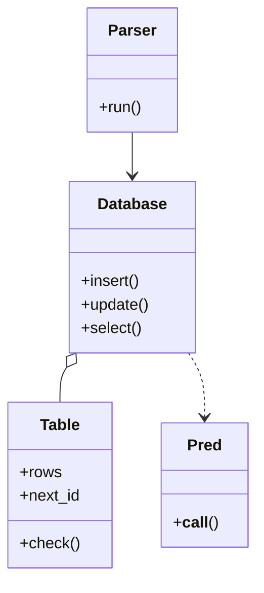

# 内存数据库（In-Memory Database）

## 题目

在内存里写一个迷你数据库：能建表、插入、删除、更新、按条件查询，面试官一步步往上加。先是最朴素的「按行号存取」，然后列有类型、查询有条件和排序，然后两张表连接（JOIN），最后甚至要你把一条 SQL 文本解析出来执行。**面试官真正看的是：数据怎么存、一次查询按什么顺序处理、条件里碰到 NULL（没有值）怎么算。**

第一关的原型：构造时给出若干张表和列数；`insertRow` 在表尾追加一行，行号从 1 自增；`deleteRow` 删掉那一行，**之后插入的行号不回退**；`selectCell` 返回某一格。

后续追问依次是：

- 列要有类型、能 WHERE 和 ORDER BY。
- 两张表按键连接。
- 输入变成 SQL 文本。
- 索引、事务。

## 先问这几个问题

- **列有类型吗？类型不对报错还是自动转换？**→ 有类型就要保存每列类型，写入时检查；没有则第一关就够了。
- **条件里遇到 NULL 怎么算？`age <> 2` 会选中 age 为 NULL 的行吗？**→ 最容易翻车的一问。按 SQL 标准结果是「未知」，不选中；这决定谓词的返回值不能是 `bool`，要有第三个值。
- **JOIN 要哪几种？键是等值吗？数据多大？**→ 只要等值连接才能用哈希连接；规模很小可以两层循环。内连接和左连接最常问。
- **范围外**：磁盘持久化、网络协议、查询优化器、子查询；并发和 GROUP BY 在追问里讲方案。

## 核心对象

| 类 | 职责（一句话） | 守住的不变量 |
|---|---|---|
| `Table` | 一张表的存储：列类型、主键、`{主键: 行}`、自增计数器 | 每个值符合列类型，主键唯一且非空；`check` 是唯一入口 |
| 谓词（Pred） | 判断一行，返回 `True` / `False` / `None`（未知） | 与 NULL 的比较一律是未知 |
| `Database` | 表的集合，拥有写操作的原子性和 `select` 流水线 | 写失败时表原样不变 |
| `Parser` | 把 SQL 文本翻译成对 `Database` 的调用 | 不碰存储，可单独替换 |



`Database` 拥有它的 `Table`；谓词是调用时传入的参数，数据库不保存它们。

## 主流程

**select 的流水线**（顺序本身就是文档）

1. 取表；有 JOIN 就先连接：扫右表建「键 → 行列表」的字典，再扫左表探测。
2. WHERE：只保留谓词 `is True` 的行，未知和假一样被丢掉。
3. ORDER BY：稳定排序，从最后一个键往前排，升降序可以混合。
4. LIMIT：截断。
5. 投影需要的列。

**update 的流程**

1. 先收集命中的行，在**副本**上算出所有新行。
2. 对每个新行做类型和主键检查；改了主键就检查新键之间、以及与未命中旧键的冲突。
3. 全部通过才删旧行、写新行。

可能失败的点：未知列、类型不符、主键重复或为空、更新到一半发现冲突。

## 关键决策

### 一、行存成列表，还是 `{主键: 行}` 字典

- `list[Row]`：追加 O(1)；按主键删除是 O(n)，若用下标当行号，删除后全部移位，行号就变了，正是第一关禁止的。
- **选择：`dict[主键, Row]`。** 字典保持插入顺序，全表扫描仍是插入顺序；读写删都是 O(1)；行号就是主键。

配套：自增计数器 `next_id` 只增不减，插入后设为 `max(next_id, pk + 1)`。先插入 1、2、3，显式插入 10，再自增得 11；删掉 11 后再自增得 12，不是 11。

### 二、NULL 用 Python 的 `None` 直接比，还是三值逻辑

五行，列 `a` 为 1、2、NULL、4、NULL，`WHERE a <> 2` 选谁？

- 直接比较：`None != 2` 是 `True`，把 NULL 行也选进来，和 SQL 不一致；`NOT IN` 更危险，SQL 里 `a NOT IN (1, NULL)` 一行都选不出。
- **选择：三值逻辑，谓词返回 `True` / `False` / `None`。**

规则：

- 与 NULL 的比较是未知，包括 `NULL = NULL`。
- `AND`：有一个假就是假，否则有未知就是未知。
- `OR`：有一个真就是真，否则有未知就是未知。
- `NOT 未知` 还是未知。
- `IS NULL` 是唯一不会未知的谓词；**WHERE 只留 `is True`**。

按此，`a <> 2` 选出 id 1、4；`a = NULL` 一行都没有，必须写 `IS NULL` 得 3、5。代码里一律写 `where(row) is True`，不要写 `if where(row):`。

### 三、JOIN：嵌套循环，还是哈希连接

- 嵌套循环：代码最短，O(|L|×|R|)，两张一万行的表就是一亿次比较。
- **选择：哈希连接。** 先扫右表按连接键建字典（O(|R|)），再扫左表探测。代价是多占内存，只能做等值条件。

要说出的细节：**NULL 键不匹配任何东西**，建表时跳过、探测时不查；**左连接**没有匹配时保留左行、右侧补 NULL；重复键是一对多，字典的值是列表；列名重复用「表名.列名」限定。

### 四、查询流水线：一个直线函数，还是算子树（简单答案赢）

- 算子树（Scan、Join、Filter、Sort、Limit 各一个类）：真数据库的做法，方便换执行计划；但 45 分钟里几乎全是脚手架。
- **选择：`select` 写成一个直线函数。** 顺序必须是 **JOIN → WHERE → ORDER BY → LIMIT**，先 LIMIT 再排序，取到的就不是最大的几行。要有两种以上可互换的执行计划（比如加了索引要换 `IndexScan`）时，再把那一步抽出来。

### 五、写操作先校验、后动手

`UPDATE SET id = 2` 命中两行，边改边查，第一行改成功了第二行才发现冲突，表停在一半。**选择：先在副本上算出所有新行并校验，全部通过再统一落盘。** `insert` 同理，检查都在写入字典之前。

## Python 骨架

```python
import operator


class DbError(Exception): ...
class SchemaError(DbError, ValueError): ...      # 未知列、类型不符
class ConstraintError(DbError): ...              # 主键重复或为空


class Table:
    def __init__(self, name: str, cols: dict[str, type], pk: str) -> None:
        self.name, self.cols, self.pk = name, cols, pk
        self.rows: dict[int, dict] = {}  # {主键: 行}，字典保持插入顺序
        self.next_id = 1                 # 只增不减，删除不回退

    def check(self, row: dict) -> None:  # 类型检查的唯一入口
        for c, v in row.items():
            if c not in self.cols:
                raise SchemaError(f"没有列 {c}")
            if v is not None and (type(v) is not self.cols[c]):  # bool 不算 int
                raise SchemaError(f"{c} 需要 {self.cols[c].__name__}")
        if row.get(self.pk) is None:
            raise ConstraintError("主键不能为空")

    def insert(self, row: dict) -> int:
        row = {c: row.get(c) for c in self.cols} | row
        if row.get(self.pk) is None:
            row[self.pk] = self.next_id  # 自增来自计数器，不是「行数 + 1」
        self.check(row)
        if row[self.pk] in self.rows:
            raise ConstraintError(f"主键 {row[self.pk]} 重复")  # 先校验，后写入
        self.rows[row[self.pk]] = row
        self.next_id = max(self.next_id, row[self.pk] + 1)
        return row[self.pk]


# 谓词返回 True / False / None(未知)；WHERE 只留 is True 的行
def cmp(col, op, val):
    f = {"=": operator.eq, "<>": operator.ne, "<": operator.lt, ">": operator.gt}[op]
    return lambda r: None if r[col] is None or val is None else f(r[col], val)

def is_null(col): return lambda r: r[col] is None  # 唯一永不为未知的谓词

def and_(a, b):
    def p(r):
        x, y = a(r), b(r)
        return False if x is False or y is False else (None if x is None or y is None else True)
    return p

def or_(a, b):
    def p(r):
        x, y = a(r), b(r)
        return True if x is True or y is True else (None if x is None or y is None else False)
    return p

def not_(a): return lambda r: None if a(r) is None else not a(r)


class Database:
    def __init__(self) -> None:
        self.tables: dict[str, Table] = {}

    def create(self, name: str, cols: dict[str, type], pk: str) -> Table:
        self.tables[name] = Table(name, cols, pk)
        return self.tables[name]

    def update(self, name: str, sets: dict, where) -> int:
        t = self.tables[name]
        hit = [pk for pk, r in t.rows.items() if where(r) is True]
        new = {pk: {**t.rows[pk], **sets} for pk in hit}  # 先在副本上算好
        for r in new.values():
            t.check(r)
        keys = [r[t.pk] for r in new.values()]
        if len(set(keys)) != len(keys) or set(keys) & (set(t.rows) - set(hit)):
            raise ConstraintError("主键冲突")  # 失败时表一个字节没变
        for pk in hit:
            del t.rows[pk]
        for r in new.values():
            t.rows[r[t.pk]] = r
        return len(hit)

    def select(self, name, where=None, order=(), limit=None, join=None):
        t = self.tables[name]
        rows = list(t.rows.values())
        if join:  # (右表, 左列, 右列, "inner" | "left")：哈希连接
            rt, lc, rc, how = join[0], join[1], join[2], join[3]
            idx: dict = {}
            for r in self.tables[rt].rows.values():
                if r[rc] is not None:  # NULL 键不匹配任何东西
                    idx.setdefault(r[rc], []).append(r)
            out = []
            for l in rows:
                lq = {f"{name}.{c}": v for c, v in l.items()}
                ms = idx.get(l[lc], []) if l[lc] is not None else []
                if not ms and how == "left":
                    ms = [dict.fromkeys(self.tables[rt].cols)]  # 左连接补 NULL
                out += [lq | {f"{rt}.{c}": v for c, v in m.items()} for m in ms]
            rows = out
        # 顺序不能换：WHERE -> ORDER BY -> LIMIT
        rows = [r for r in rows if where is None or where(r) is True]
        for col, desc in reversed(order):  # 稳定排序，从最后一个键往前排
            rows.sort(key=lambda r: (r[col] is not None, r[col] if r[col] is not None else 0), reverse=desc)
        return rows[:limit]


if __name__ == "__main__":
    db = Database()
    t = db.create("t", {"id": int, "a": int}, "id")
    for v in (1, 2, None, 4, None):
        t.insert({"a": v})
    ids = lambda w: [r["id"] for r in db.select("t", w)]
    assert ids(cmp("a", "<>", 2)) == [1, 4]        # NULL 行不会被选中
    assert ids(not_(cmp("a", "=", 2))) == [1, 4]
    assert ids(cmp("a", "=", None)) == []          # 必须写 IS NULL
    assert ids(is_null("a")) == [3, 5]
    t.rows.pop(5)
    assert t.insert({"a": 9}) == 6                 # 行号不回退
    assert [r["id"] for r in db.select("t", order=[("a", True)], limit=2)] == [6, 4]
    try:
        db.update("t", {"id": 1}, cmp("a", ">", 0))  # 多行改成同一个主键
        raise SystemExit("应当抛异常")
    except ConstraintError:
        assert list(t.rows) == [1, 2, 3, 4, 6]     # 表原样不变
    o = db.create("o", {"id": int, "uid": int}, "id")
    o.insert({"uid": 1}); o.insert({"uid": 1}); o.insert({"uid": None})
    j = db.select("t", join=("o", "id", "uid", "left"), where=cmp("t.id", "<", 4))
    assert [(r["t.id"], r["o.id"]) for r in j] == [(1, 1), (1, 2), (2, None), (3, None)]
    try:
        t.insert({"a": "x"})
        raise SystemExit("应当抛异常")
    except SchemaError:
        pass
```

## 面试官加需求时

| 新需求 | 改哪里 | 不用动哪里 |
|---|---|---|
| NOT NULL、UNIQUE 约束 | `Table` 加两个集合，`check` 多一个判断；唯一列另存「值 → 主键」 | `Database` 的流程 |
| 聚合与 GROUP BY | 投影前插一步：排序后用 `itertools.groupby` 切段 | 存储、谓词 |
| SQL 文本输入 | 加分词器和递归下降解析器，优先级 NOT > AND > OR 靠调用层次 | `Database` |
| 索引 | `Table` 额外维护「列值 → 主键集合」，写操作同步；`select` 的扫描那一步换成索引扫描 | 谓词、连接 |
| 事务 | 写前拷贝受影响的行做回滚日志，或整表快照 | 查询 |
| 更多 JOIN 类型 | 连接函数加分支；多个 JOIN 就是把上一步结果当新的左表 | WHERE 之后的步骤 |

## 并发与扩展

- 最简单的并发答案：**一把全库锁**包住每个公开方法，读也持锁；`update` 的「先算副本再落盘」在锁内完成才有原子性。
- 想要读不阻塞写：读写锁，或每次写生成新版本（MVCC，多版本并发控制）。
- 规模变大：行存字典放不进内存就分页落盘，主键换 B 树；JOIN 右表太大时分区后再哈希。
- 谓词在执行前先检查引用的列是否存在，空表也能报「没有这一列」。

## 常见错误

- 行号用「当前行数 + 1」：删掉最后一行再插入会复用行号；用只增不减的计数器。
- 用 Python 的 `None` 直接比较：`<>`、`NOT IN` 的结果和 SQL 相反；用三值逻辑。
- 写 `if where(row):`：把未知当假，在 `NOT` 里会错；写 `is True`。
- 先 LIMIT 再 ORDER BY：取到的不是最大的几行。
- 更新边改边检查：冲突时表停在一半；先校验再落盘。
- 哈希连接让 NULL 键互相匹配：NULL 键不匹配任何东西。

## 30 秒复述

- 表是 `{主键: 行}` 字典加只增不减的自增计数器；`check` 是类型和主键的唯一入口。
- **谓词是三值逻辑**：返回真、假、未知，WHERE 只留真；`IS NULL` 是唯一不会未知的。
- `select` 是一个直线函数：JOIN → WHERE → ORDER BY → LIMIT，顺序不能换，不上算子树。
- JOIN 用哈希连接；NULL 键不匹配，左连接补 NULL。
- 写操作先在副本上校验，全部通过再落盘，失败时表不变。
- 扩展：约束、索引、事务都落在 `Table` 和写路径上；SQL 文本是一个独立的解析器。

## 来源

- [[solution-amz-in-memory-db]]
- [[solution-kv-store]]
