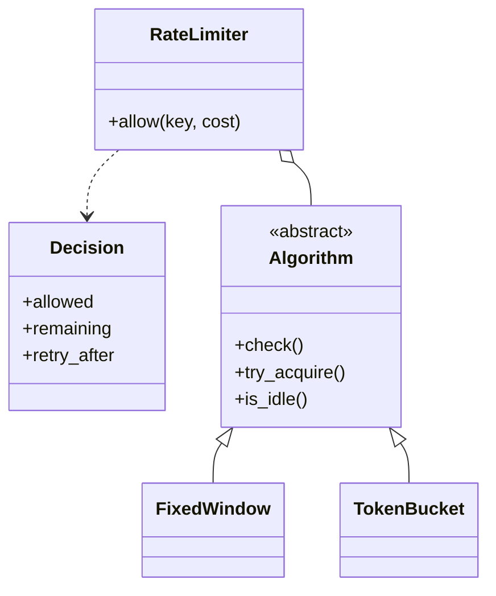

# 限流器（Rate Limiter）（low priority）

## 题目

「设计一个限流器：每个用户每分钟最多 100 次请求，超了就拒掉。」用它的人是任何要保护后端的服务。这句话里藏着一个岔路口：**要的是进程内的库组件（`limiter.allow(user_id)` 一行就用），还是分布式限流架构？** 机器编码轮的答案是前者；分布式（Redis 计数、Lua 原子脚本）是系统设计轮的题，开口第一句就把线划清，然后一直待在线内。**面试官真正看的是：算法能不能整体替换、被拒时能不能告诉调用方多久后再来、按 key 的状态怎么隔离和回收、多线程会不会超卖。**

常见后续追问：

- 把固定窗口换成令牌桶。
- 一百万个 IP 各来一次，内存占多少？
- 同时按用户和按接口限流。

## 先问这几个问题

- **按什么粒度限流？**（用户、API key、IP、接口，或同时几个）→ 一个限流器只认一个 key，多条规则靠组合而不是在类里塞 `if`。
- **被拒之后调用方需要知道什么？**→ 要回 HTTP 429 并带 `Retry-After`，返回值就必须携带「多久后再来」，所以不返回 `bool`。
- **算法定死吗？**→ 第二关多半说「换成令牌桶」，算法必须可替换。
- **一次请求算几次？**→ 接口是 `allow(key, cost=1)`，默认值让调用点没有区别。
- **允许突发吗？**→ 允许就指向令牌桶的容量与速率分离。
- **要线程安全吗？key 有多少？**→ 默认单进程多线程；key 的数量决定状态必须能回收。

## 核心对象

| 类 | 职责（一句话） | 守住的不变量 |
|---|---|---|
| `Decision` | 一次判定的结果：准不准、剩多少、多久后再来 | 不可变；允许时 `retry_after` 恒为 0 |
| `Algorithm` | 判定骨架：把「已占用多少」翻译成准 / 拒 / 等多久 | 被拒的请求一份额度都不扣 |
| `FixedWindow` / `TokenBucket` | 两种具体算法，每个 key 一份状态 | 令牌数恒在 `[0, capacity]`，不起后台线程 |
| `RateLimiter` | 按 key 隔离状态、分片加锁、回收闲置状态 | 常驻 key 数不随见过的 key 总数增长 |



限流器为每个 key 造一份状态并独占它的生命周期，外面拿不到状态对象。

## 主流程

**allow(key, cost)**

1. 按 `hash(key)` 选分片，拿这个分片的锁。
2. 取 key 的状态，没有就用工厂造一份（懒创建）。
3. `try_acquire`：先 `check`（只读，用 `_used` 算占用），够额度才 `commit` 扣除。
4. 分片的操作计数达到门槛时，扫一遍自己，删掉 `is_idle` 的状态。
5. 放锁，返回 `Decision`。

可能失败的点：`cost` 非正、`cost` 超过容量（永远不可能，`retry_after` 为无穷大）、额度不足（返回 `retry_after`）。

## 关键决策

### 一、返回 `Decision`，不返回 `bool`

`bool` 对调用方不够：HTTP 429 要带 `Retry-After`，仪表盘要显示剩余额度，而这两个数只有算法自己算得出（令牌桶是 `(cost - 令牌数) / 速率`）。**选择：返回不可变的 `Decision`，并给它加 `__bool__`，`if limiter.allow(u):` 仍然成立。**

### 二、四种算法共用一个判定骨架（简单答案赢，不抄四份）

- 每个算法各写一份完整的 `allow`：「够不够额度」「被拒不扣」「cost 超上限」这些规则抄四遍，迟早不一致。
- **选择：把接缝切在更低的地方，只抽 `_used(now)`。** 固定窗口说「格子里的计数」，令牌桶说「容量减现有令牌」。`check`、`try_acquire` 在基类写一次，子类只剩 `_used`、`_retry_after`、`_commit`。
- 红利：`is_idle` 一行写完（占用为 0），四种算法自动获得正确的回收语义。

固定窗口是错的，要当面算出来：限额每 10 秒 5 次，t=9.9 发 5 次，t=10.1 又发 5 次，两格各自没超，**0.2 秒内真实放行 10 次，是限额的 2 倍**。令牌桶把容量和速率分开，允许有限突发。

### 三、锁：全局一把，每个 key 一把，还是分片

- 全局一把：正确，但所有 key 排队，限流器成了每个请求必经的瓶颈。
- 每个 key 一把：锁的字典本身也会无限增长，回收一把可能正被持有的锁是经典竞态。
- **选择：固定数量的分片，每片一把锁一个字典。** 锁的数量是常数，同一个 key 的读写天然在同一把锁下。

GIL 只保证单条字节码不被撕开，不保证 `check` 到 `commit` 之间不切线程；锁保护的是这个「检查再动作」的原子性。

### 四、状态必须会缩，而且回收不能让客户端重置额度

回收太晚内存涨；回收太早，客户端停一下就清零了自己的额度。**选择：只删 `is_idle` 的状态**，它与新建状态对任何后续判定给出相同答案，所以删掉观察上等价，不可能删早。

触发用摊还：每个分片操作数超过门槛就扫一遍自己。**门槛要定死在上次整理后的规模上**（`max(64, 整理后条目数)`）；如果写成「当前条目数」，每次操作都带来新 key 时永远追不上，扫描再也不触发。

## Python 骨架

```python
import math
import threading
import time
from abc import ABC, abstractmethod
from dataclasses import dataclass


@dataclass(frozen=True)
class Decision:  # 返回结果而不是 bool：调用方要 Retry-After 和剩余额度
    allowed: bool
    remaining: int
    retry_after: float  # 允许时恒为 0；永远不可能时为 inf

    def __bool__(self) -> bool:
        return self.allowed


class Algorithm(ABC):
    """一个 key 一份带状态的对象。算法之间只差一件事：此刻已占用多少额度。"""
    capacity: float

    @abstractmethod
    def _used(self, now: float) -> float: ...
    @abstractmethod
    def _retry_after(self, now: float, cost: int) -> float: ...
    @abstractmethod
    def _commit(self, now: float, cost: int) -> None: ...

    def check(self, now: float, cost: int = 1) -> Decision:  # 判定骨架只写一次，不改状态
        if cost <= 0:
            raise ValueError("cost 必须为正")
        used = self._used(now)
        left = max(0, int(self.capacity - used))
        if used + cost <= self.capacity:
            return Decision(True, left - cost, 0.0)
        if cost > self.capacity:
            return Decision(False, left, math.inf)
        return Decision(False, left, self._retry_after(now, cost))

    def try_acquire(self, now: float, cost: int = 1) -> Decision:
        d = self.check(now, cost)
        if d.allowed:  # 被拒的请求一份额度都不扣
            self._commit(now, cost)
        return d

    def is_idle(self, now: float) -> bool:  # 占用为 0 等价于新建状态，删掉它观察上不可见
        return self._used(now) <= 0.0


class FixedWindow(Algorithm):  # 最简单，但窗口边界能放过 2 倍流量
    def __init__(self, limit: int, window: float) -> None:
        self.capacity, self.window, self.idx, self.count = limit, window, -1, 0

    def _used(self, now: float) -> float:
        return self.count if int(now // self.window) == self.idx else 0

    def _retry_after(self, now: float, cost: int) -> float:
        return (int(now // self.window) + 1) * self.window - now

    def _commit(self, now: float, cost: int) -> None:
        i = int(now // self.window)
        self.idx, self.count = i, (self.count if i == self.idx else 0) + cost


class TokenBucket(Algorithm):  # 容量和速率分离：允许突发；惰性补充，不起后台线程
    def __init__(self, capacity: int, rate: float) -> None:
        self.capacity, self.rate, self.tokens, self.last = capacity, rate, float(capacity), 0.0

    def _avail(self, now: float) -> float:
        return min(self.capacity, self.tokens + max(0.0, now - self.last) * self.rate)

    def _used(self, now: float) -> float:
        return self.capacity - self._avail(now)

    def _retry_after(self, now: float, cost: int) -> float:
        return (cost - self._avail(now)) / self.rate

    def _commit(self, now: float, cost: int) -> None:
        self.tokens, self.last = self._avail(now) - cost, now


class _Shard:
    def __init__(self) -> None:
        self.lock, self.states, self.ops, self.purge_at = threading.Lock(), {}, 0, 64


class RateLimiter:
    def __init__(self, factory, clock=time.monotonic, shards: int = 16) -> None:
        self.factory, self.clock = factory, clock  # 时钟可注入，测试不用 sleep
        self._shards = [_Shard() for _ in range(shards)]  # 固定数量的分片锁

    def allow(self, key, cost: int = 1) -> Decision:
        sh = self._shards[hash(key) % len(self._shards)]
        with sh.lock:  # check 与 commit 之间不能插入别人，否则超卖
            now = self.clock()
            st = sh.states.get(key)
            if st is None:
                st = sh.states[key] = self.factory()
            d = st.try_acquire(now, cost)
            sh.ops += 1
            if sh.ops >= sh.purge_at:  # 摊还回收：门槛定死在上次整理后的规模
                sh.states = {k: s for k, s in sh.states.items() if not s.is_idle(now)}
                sh.ops, sh.purge_at = 0, max(64, len(sh.states))
            return d

    def tracked_keys(self) -> int:
        return sum(len(s.states) for s in self._shards)


if __name__ == "__main__":
    t = [0.0]
    fw = RateLimiter(lambda: FixedWindow(5, 10), clock=lambda: t[0])
    t[0] = 9.9
    n1 = sum(bool(fw.allow("u")) for _ in range(5))
    t[0] = 10.1
    n2 = sum(bool(fw.allow("u")) for _ in range(5))
    assert n1 + n2 == 10  # 0.2 秒内放行 10 次：固定窗口是错的
    t[0] = 0.0
    tb = RateLimiter(lambda: TokenBucket(5, 1.0), clock=lambda: t[0])
    assert all(tb.allow("a") for _ in range(5))  # 允许突发 5 次
    d = tb.allow("a")
    assert not d and d.retry_after == 1.0  # 被拒，且告诉调用方多久后再来
    assert tb.allow("b")  # key 之间互不影响
    t[0] = 1.0
    assert tb.allow("a") and not tb.allow("a")  # 被拒那次没有扣额度
    assert tb.allow("a", cost=9).retry_after == math.inf  # 永远不可能
    sm = RateLimiter(lambda: TokenBucket(1, 1.0), clock=lambda: t[0], shards=1)
    for i in range(3000):
        t[0] = i * 0.5
        sm.allow(i)  # 每次都是新 key
    assert sm.tracked_keys() < 300  # 闲置状态被回收，内存有界
```

## 面试官加需求时

| 新需求 | 改哪里 | 不用动哪里 |
|---|---|---|
| 换成令牌桶 / 滑动窗口 | 新增一个 `Algorithm` 子类，实现三个方法 | `RateLimiter`、`Decision` |
| 一次请求消耗多份额度 | 已有 `cost` 参数 | 全部 |
| 同时按用户和按接口 | 新建组合器：每条规则一个 `RateLimiter`，两阶段判定 | 叶子限流器 |
| 返回剩余额度和重试时间 | 已在 `Decision` 里 | 算法骨架 |
| 不同用户不同限额 | `factory` 按 key 返回不同参数 | 限流器 |
| 测试 | 注入 `clock`，手动推进时间 | 业务代码 |

组合用两阶段：先对每条规则只 `check`，全部通过再统一 `commit`，所以任一条拒绝时没有任何一条被扣。不要为此抽一个「限流器接口」再套组合模式，叶子收 key、组合收请求对象，参数都不同。

## 并发与扩展

- 竞态在 `check` 与 `commit` 之间：两百个线程可能同时看到「还剩 1 个」。**分片锁让这个复合操作原子**，不同分片互不排队。
- 令牌桶用惰性补充（用到时按时间差算），不需要后台线程。
- 跨进程 / 跨机器：计数放 Redis，用 Lua 脚本原子读改写；或本地预分配配额。这是系统设计轮的内容，只需点到。
- 限流器自己故障时放行（fail open）还是拒绝（fail closed），按业务选，要主动说。

## 常见错误

- 上来就讲 Redis 分布式：写不完代码；先划线，进程内库组件。
- 只用固定窗口：边界处放行 2 倍；当面算出这个反例，再给令牌桶或滑动窗口。
- 返回 `bool`：调用方拿不到 `Retry-After`；返回 `Decision`。
- 被拒时仍扣了额度：`check` 与 `commit` 分开，拒绝不写状态。
- key 的状态只增不删：内存泄漏；用 `is_idle` 回收。
- 回收门槛写成当前条目数：每次都是新 key 时永远不触发；定死在上次整理后的规模。

## 30 秒复述

- 先划线：进程内的库组件，`allow(key, cost)` 一行就用，返回 `Decision`。
- **算法的差别只有「此刻占用多少」**，抽成 `_used`；判定骨架写一次，被拒不扣额度。
- 固定窗口边界会放过 2 倍流量；令牌桶容量和速率分离，惰性补充。
- 状态按 key 隔离，分片锁保护 `check` 加 `commit` 的原子性。
- 空闲状态（占用为 0）可以安全回收，门槛定死在上次整理后的规模。
- 多规则靠组合器两阶段判定；时钟可注入，测试不用睡眠。

## 来源

- [[solution-rate-limiter]]
