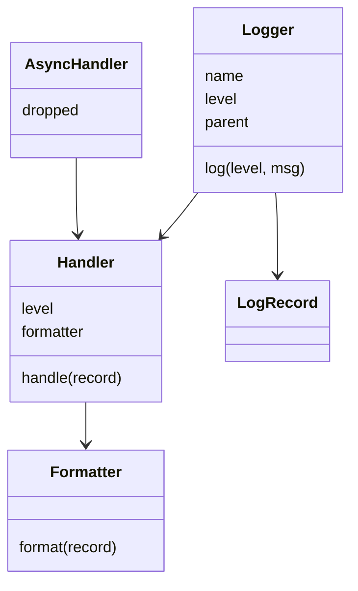

# 日志框架（Logger）（low priority）

## 题目

日志框架让业务代码只写 `logger.info(msg)`，由框架决定这条日志**要不要记、长什么样、写到哪里**。使用者是所有业务模块，所以它必须便宜（被关掉的级别几乎零开销）、线程安全、可扩展。**面试官真正在看的是：你能不能把「记什么、怎么排版、写到哪」拆成三个独立变化的维度，并且不滥用设计模式。**

面试官的原话大概是：「设计一个日志库，支持 DEBUG 到 CRITICAL 的级别，可以同时输出到控制台和文件，格式可以换。」

常见追问：

- 业务线程不能被慢磁盘拖住，怎么办？
- 按模块名分层，`app.db` 的日志要不要同时交给 `app` 的 handler？
- 日志文件满了要滚动，加在哪？

## 先问这几个问题

- 输出到几个目的地（控制台、文件、可以同时）？→ **Logger 持有 Handler 列表**，不是单个 handler。
- 要不要按模块名分层、级别可继承？→ 决定 Logger 是否带名字和父节点；不要就只做平铺。
- 格式固定还是可换（文本、JSON）？→ **Formatter 独立成类**；固定就内联一个函数。
- 同步写还是不能阻塞业务线程？→ 决定要不要 `AsyncHandler`，以及队列满了的策略。
- 要不要带上下文字段（request id）？→ `LogRecord` 里放一个只读字典，Formatter 负责展开。

## 核心对象

| 类 | 职责（一句话） | 守住的不变量 |
|---|---|---|
| `LogRecord` | 一次日志事件的快照（时间、级别、名字、消息） | 冻结，创建后不变，可安全交给多个 handler 和线程 |
| `Logger` | 决定「要不要记、交给谁」 | 级别只在起点判一次；`level=None` 表示向上继承 |
| `Handler` | 决定「写到哪」，有自己的级别门槛和一把锁 | 一行日志不会被另一行插进来 |
| `Formatter` | `record → 字符串`，只管排版 | 不碰 IO，不持状态 |
| `AsyncHandler` | 包住任意 handler，用有界队列和后台线程写 | 关闭时先排空再退出；丢弃必须计数 |



## 主流程

`logger.warning("disk low")` 的路径：

1. **Logger 先看自己的有效级别**（沿 `parent` 向上找第一个非 `None`）。低于门槛直接返回，**连 `LogRecord` 都不创建**，这是被关掉的 DEBUG 几乎零开销的原因。
2. 创建冻结的 `LogRecord`（时钟由外部注入，测试里换成固定时钟）。
3. 从当前 logger 沿 `parent` 一路向上，把记录交给**沿途每个 logger 的每个 handler**。向上走时不再比较祖先的级别。
4. Handler 比较自己的门槛，不够就丢；够了就 `formatter.format(record)`，**格式化在锁外**，只有 `write` 在锁内。
5. 失败路径：某个 handler 抛异常不能影响其他 handler 和业务线程，捕获后计数（骨架里省略）。

## 关键决策

### 多个目的地：责任链还是 handler 列表

- 责任链：每个 handler 持有 `next`。教科书里的责任链**接住就停**，而日志要求一条 ERROR 同时到控制台、文件和告警。要套用就得删掉它最核心的规则。
- 列表：Logger 持有一个 handler 列表，循环分发，每个目的地自己判断。

**选列表。主动说出「我考虑过责任链，但它的终止语义和日志的广播语义相反」，比背出模式名字值钱。**

### 格式化为什么要从 Handler 里拆出去

- 揉在一起：`JsonFileHandler`、`TextFileHandler`、`JsonConsoleHandler`……M 种格式 × N 个目的地，要 M×N 个类。
- 拆开：Handler 持有一个 Formatter，M+N 个类，任意组合。

**拆开（组合代替继承）。** 细节：`emit` 同时拿到格式化好的行和原始 record，这样「ERROR 走 stderr」不用去行里搜子串，换成 JSON 格式化器也不会悄悄失效。

### 层级与传播：级别只在起点判一次

- 每一级都判：父 logger 设成 WARNING，会把子 logger 已放行的 DEBUG 拦在父 handler 之外，和标准库相反。
- 只在起点判：之后只有各 handler 自己的门槛起作用；想中途截断用 `propagate=False`，不用级别。

**选只在起点判，并用 `level=None` 表示继承，不学标准库把 `NOTSET=0` 又当级别又当「没设过」。** 根 logger 永远有具体级别（默认 WARNING，和标准库一致），递归才有底。

### Filter 和单例：简单答案赢，不写模式

**过滤器就是 「接收记录、返回布尔值的函数」，不写 `Filter` 抽象类**：只有一个方法、没有共享实现的接口，在 Python 里就是一个函数。同理，**全局注册表用模块级实例加 `get_logger()`，不用 `__new__` 单例**，否则测试之间互相污染。

## Python 骨架

```python
import queue
import threading
import time
from enum import IntEnum
from dataclasses import dataclass


class Level(IntEnum):  # IntEnum 才能比大小；故意没有 NOTSET
    DEBUG = 10
    INFO = 20
    WARNING = 30
    ERROR = 40


@dataclass(frozen=True)
class LogRecord:  # 冻结：可以安全交给任意多个 handler / 线程
    ts: float
    level: Level
    name: str
    msg: str


class TextFormatter:  # 只负责排版，不碰 IO
    def format(self, r: LogRecord) -> str:
        return f"{r.level.name} {r.name}: {r.msg}"


class JsonFormatter:
    def format(self, r: LogRecord) -> str:
        return f'{{"level":"{r.level.name}","logger":"{r.name}","msg":"{r.msg}"}}'


class Handler:
    def __init__(self, sink: list, level=Level.DEBUG, formatter=None):
        self.sink, self.level = sink, level  # sink 用 list 代替文件，方便断言
        self.formatter = formatter or TextFormatter()
        self.filters = []  # 过滤器就是函数
        self._lock = threading.Lock()

    def handle(self, r: LogRecord) -> bool:
        if r.level < self.level or not all(f(r) for f in self.filters):
            return False
        line = self.formatter.format(r)  # 格式化在锁外
        with self._lock:  # 锁只保护「一行不被插进另一行」
            self.sink.append(line)
        return True


class AsyncHandler:  # 包住任意 handler，业务线程只入队
    def __init__(self, inner, maxsize=100):
        self.inner, self.dropped = inner, 0
        self._q = queue.Queue(maxsize)
        self._t = threading.Thread(target=self._run)
        self._t.start()

    def handle(self, r) -> bool:
        try:
            self._q.put_nowait(r)  # 满了丢新的并计数，业务优先
            return True
        except queue.Full:
            self.dropped += 1  # 丢弃必须可观测
            return False

    def _run(self):
        while (r := self._q.get()) is not None:  # None 是关闭哨兵
            self.inner.handle(r)

    def close(self):  # 先排空再退出
        self._q.put(None)
        self._t.join()


class Logger:
    def __init__(self, name, parent=None, level=None, clock=time.time):
        self.name, self.parent, self.level, self.clock = name, parent, level, clock
        self.handlers, self.propagate = [], True

    def effective_level(self) -> Level:  # level=None 表示问祖先
        node = self
        while node:
            if node.level is not None:
                return node.level
            node = node.parent
        return Level.WARNING  # 根的默认值

    def log(self, level: Level, msg: str) -> None:
        if level < self.effective_level():  # 起点判一次，低于门槛连记录都不建
            return
        r = LogRecord(self.clock(), level, self.name, msg)
        node = self
        while node:  # 沿祖先向上，不再比较祖先的级别
            for h in node.handlers:
                h.handle(r)
            node = node.parent if node.propagate else None

    def info(self, msg):
        self.log(Level.INFO, msg)

    def error(self, msg):
        self.log(Level.ERROR, msg)

    def debug(self, msg):
        self.log(Level.DEBUG, msg)


if __name__ == "__main__":
    console, disk = [], []
    root = Logger("root", level=Level.INFO)
    root.handlers.append(Handler(console, level=Level.ERROR))
    db = Logger("app.db", parent=root)  # 级别为 None，继承 root 的 INFO
    db.handlers.append(Handler(disk, formatter=JsonFormatter()))
    db.info("connected")
    db.error("timeout")
    db.debug("noise")  # 低于有效级别，被丢弃
    assert disk == ['{"level":"INFO","logger":"app.db","msg":"connected"}',
                    '{"level":"ERROR","logger":"app.db","msg":"timeout"}']
    assert console == ["ERROR app.db: timeout"]  # 传播到 root，root handler 只收 ERROR
    db.propagate = False
    db.error("again")
    assert len(console) == 1  # 截断传播
    slow = []
    ah = AsyncHandler(Handler(slow))
    ah.handle(LogRecord(0, Level.INFO, "x", "hi"))
    ah.close()
    assert slow == ["INFO x: hi"] and ah.dropped == 0
    print("ok")
```

## 面试官加需求时

| 新需求 | 改哪里 | 不用动哪里 |
|---|---|---|
| 按大小滚动文件 | 新写 `RotatingFileHandler`，只改 `emit` | Logger、Formatter |
| 新增 JSON / 彩色格式 | 新写一个 Formatter | 所有 Handler |
| 过滤健康检查日志 | `handler.filters.append(lambda r: ...)` | Logger |
| 带 request id | `LogRecord` 加只读字典，Formatter 展开 | Handler 的写路径 |
| 业务线程不能被拖慢 | 外面套 `AsyncHandler` | Logger、内层 handler |
| 敏感字段脱敏 | 用 `dataclasses.replace` 产生新记录的转换步骤 | 过滤器（它只能要或不要） |

## 并发与扩展

- **Handler 各有自己的锁**，一个 handler 挂在多个 logger 上也安全；记录是冻结的，handler 不会回头读 logger 的状态。
- **格式化放在锁外，写盘放在锁内**：不要在持锁时做慢操作，否则一次磁盘抖动会变成所有线程的停顿。
- **handler 列表整体替换而不是原地修改**，读者拿到的要么是旧快照要么是新快照，分发热路径不用加锁。
- **异步队列必须有界**：满了的策略是丢新的并计数（默认，业务优先）、丢最旧的、或阻塞调用方（审计日志不能丢时）。关闭顺序是停收、排空、汇合线程、再关内层。
- 规模变大：handler 内部做批量写（攒 N 条或 T 毫秒）；多进程各写自己的文件，或统一发给一个收集进程。

## 常见错误

- **把责任链原样搬来**，一条 ERROR 只到第一个 handler。改成列表循环。
- **只有一层级别**：只有 logger 有级别就做不到「控制台只看 ERROR、文件全收」；只有 handler 有级别，被关掉的 DEBUG 仍然要建记录。两层缺一不可：logger 的门槛省开销，handler 的门槛做分流。
- **传播时又判一次祖先级别**，和标准库语义相反，会拦掉子 logger 已放行的记录。
- **异步 handler 没有 `close()`**，或队列无界、丢弃不计数：进程退出时丢的恰好是崩溃现场的日志。
- **用动态字符串当 logger 名字**（`get_logger(f"req-{id}")`），注册表无界增长；随请求变化的东西放进上下文字段。

## 30 秒复述

- 四个对象：`LogRecord`（冻结快照）、`Logger`（要不要记）、`Handler`（写到哪）、`Formatter`（长什么样）。
- **记什么、写到哪、怎么排版三件事独立变化**，所以 Formatter 与 Handler 组合，是 M+N 不是 M×N。
- Logger 持有 handler 列表而不是责任链，因为日志是广播，责任链是接住就停。
- 级别判两次：logger 起点判一次省开销，handler 各判一次做分流；传播时不再判祖先级别。
- 加滚动文件、新格式、过滤规则，都是新增一个类或一个函数，Logger 不动。
- 并发：每个 handler 一把锁，格式化在锁外；慢 sink 用有界队列加后台线程，满了丢并计数，关闭先排空。

## 来源

- [[solution-logger]]
