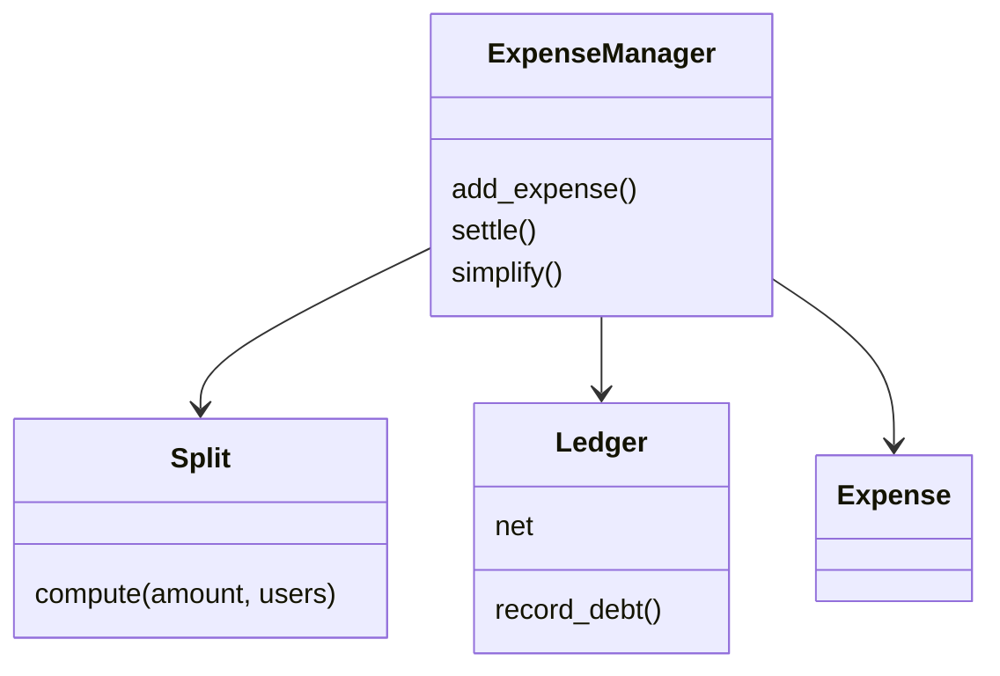

# 分账（Splitwise）（low priority）

## 题目

分账系统记录「谁垫了钱、谁该分担多少」，随时回答「A 和 B 之间谁欠谁多少」。使用者是一群朋友或室友，钱是真钱，所以**面试官真正在看的是三件事：金额不能丢一分钱（整数分加余数规则）、两两余额只存一份（规范化的键）、分摊方式能扩展而账本不动。**

面试官的原话大概是：「设计 Splitwise：用户可以记一笔支出，按均分、指定金额或百分比分摊，随时查谁欠谁多少。」

常见追问：

- 100 分钱三个人均分，那一分钱归谁？
- 最少用几笔转账结清全组？
- 两个人同时往同一个群里记账会怎样？

## 先问这几个问题

- 支持哪些分法（均分、精确金额、百分比）？→ 分法做成**策略**，账本不关心分法。
- 金额用什么单位，除不尽怎么办？→ **用整数分，写下余数规则**；用 float 就当场出局。
- 只要两两余额，还是要「最少笔转账结清」？→ 决定要不要做债务简化（要的话还要每人净额）。
- 要不要群组、要不要撤销一笔账？→ 要撤销就留下流水；账本只是流水的投影。
- 并发写同一个群吗？→ 决定锁放在哪里。

## 核心对象

| 类 | 职责（一句话） | 守住的不变量 |
|---|---|---|
| `Split`（均分 / 精确 / 百分比） | `compute(amount, users) → {user: 分}` | 各人份额之和恰好等于总额 |
| `Ledger` | 存两两净余额 `dict[(lo, hi)] → 分` | 同一对人只有一行；结清后删除该行 |
| `ExpenseManager` | 门面：先算分摊，再更新账本 | 一笔支出要么全部生效要么都不生效 |
| `Expense` | 一笔支出的流水记录 | 只追加，用于审计和撤销 |



## 主流程

`add_expense(payer, amount, users, split)`：

1. **在锁外调用 `split.compute`** 得到每个人的份额。它是纯函数，校验也在这里（百分比之和必须是 100，精确金额之和必须等于总额），失败直接抛异常，账本一点没动。
2. 取得 `ExpenseManager` 的锁。
3. 对每个非付款人，调用 `ledger.record_debt(user, payer, share)`：键规范化为 `(较小 id, 较大 id)`，值的正负表示方向。
4. 追加一条 `Expense` 流水，释放锁。

`settle(a, b, amount)` 用同一把锁，反方向调用一次 `record_debt`；结果为 0 时删除该行，账本才会缩小。

`balance_between(a, b)` 是一次字典读取，O(1)。

## 关键决策

### 余额存在哪

- 每人一个净额：最省，但答不出「谁欠谁」，而「我和这个人之间清不清」恰恰是产品的主界面。
- 从流水现算：最诚实，天然支持撤销，但每次查询 O(流水长度)。
- 每一对人一行净额：两个问题都能直接回答，代价是要守住「同一对人只有一行」。

**选每对一行，键规范化（较小 id 在前，正数表示后者欠前者），流水另外只追加保存。** 如果 (A,B) 和 (B,A) 各存一行，一次结算只改一行，两行迟早对不上。

### 那一分钱归谁

- 四舍五入再把差额塞给第一个人：均分时只差一分，按比例拆分时明显不公。
- 用 float 算完再 round：余数悄悄消失在浮点误差里。
- 最大余数法（Largest Remainder）：先各自向下取整，再把剩下的几分按小数余数从大到小补上，并列时按参与人列表的先后。

**选最大余数法，并把「并列按列表顺序」说出口。** 100 分三等份得 34、33、33，总和恰好 100，结果确定、可复现、可向用户解释。

### 分摊策略：这次是类，不是函数

**策略带数据且共享代码，所以做成类。** `ExactSplit` 要带金额表，`PercentSplit` 要带百分比表，闭包里的数据无法在构造时校验；均分和百分比还共享同一段「取整加最大余数法」。无状态、无共享代码的策略（比如停车场的车位分配）才写成函数。这是「按判据选，不是按习惯选」的例子。

### 债务简化：贪心，并说清它不是最优

每次让净额最大的债务人还给最大的债权人 `min(两者)`，至少一方清零，**至多 n-1 笔**。真正最少笔等价于把人划分成尽量多个「净额和为 0」的小组，是 NP 难问题。反例：净额 `[+3, +2, -3, +2, -4]`，最优 3 笔，贪心 4 笔。

**选贪心，面试时主动讲出上界和反例。** 这是最简单的答案，也不需要任何模式。

## Python 骨架

```python
import threading


class SplitError(Exception):
    pass


def _proportional(amount, weights):
    """最大余数法：按权重分 amount 分钱，结果之和恰好等于 amount。"""
    total = sum(weights)
    base = [amount * w // total for w in weights]
    rest = [amount * w % total for w in weights]
    # 并列时 sorted 是稳定的，所以按参与人列表的先后补
    order = sorted(range(len(weights)), key=lambda i: -rest[i])
    for i in order[: amount - sum(base)]:
        base[i] += 1
    return base


class EqualSplit:
    def compute(self, amount, users):
        return dict(zip(users, _proportional(amount, [1] * len(users))))


class PercentSplit:
    def __init__(self, pcts):  # 构造时就校验，而不是等到 compute
        if sum(pcts.values()) != 100:
            raise SplitError("percent must sum to 100")
        self.pcts = pcts

    def compute(self, amount, users):
        return dict(zip(users, _proportional(amount, [self.pcts[u] for u in users])))


class ExactSplit:
    def __init__(self, amounts):
        self.amounts = amounts

    def compute(self, amount, users):
        if sum(self.amounts.values()) != amount:  # 输入错了，不是可修正的取整噪声
            raise SplitError("exact amounts must sum to total")
        return dict(self.amounts)


class Ledger:
    def __init__(self):
        self.net = {}  # (lo, hi) -> 分；正数表示 hi 欠 lo

    def record_debt(self, debtor, creditor, cents):
        """debtor 欠 creditor cents 分；方向只在这一处决定。"""
        lo, hi = sorted((debtor, creditor))
        signed = cents if debtor == hi else -cents
        v = self.net.get((lo, hi), 0) + signed
        if v:
            self.net[(lo, hi)] = v
        else:
            self.net.pop((lo, hi), None)  # 结清就删，账本才会缩小

    def balance(self, a, b):
        """a 欠 b 多少（负数表示 b 欠 a）。"""
        lo, hi = sorted((a, b))
        v = self.net.get((lo, hi), 0)
        return v if a == hi else -v

    def net_balances(self):  # 每人净额：正数是应收
        out = {}
        for (lo, hi), v in self.net.items():
            out[lo] = out.get(lo, 0) + v
            out[hi] = out.get(hi, 0) - v
        return out


class ExpenseManager:
    def __init__(self):
        self.ledger, self.expenses = Ledger(), []
        self._lock = threading.RLock()  # 锁属于事务边界，不属于 Ledger

    def add_expense(self, payer, amount, users, split):
        shares = split.compute(amount, users)  # 纯函数，在锁外
        with self._lock:  # 一笔支出的所有行一起生效
            for u, s in shares.items():
                if u != payer:
                    self.ledger.record_debt(u, payer, s)
            self.expenses.append((payer, amount, shares))

    def settle(self, debtor, creditor, cents):
        with self._lock:
            self.ledger.record_debt(creditor, debtor, cents)  # 反方向抵掉

    def simplify(self):  # 贪心：至多 n-1 笔，不保证最少
        net = self.ledger.net_balances()
        pos = sorted((v, u) for u, v in net.items() if v > 0)
        neg = sorted((-v, u) for u, v in net.items() if v < 0)
        out = []
        while pos and neg:
            c, cu = pos.pop()
            d, du = neg.pop()
            t = min(c, d)
            out.append((du, cu, t))
            if c > t:
                pos.append((c - t, cu)); pos.sort()
            if d > t:
                neg.append((d - t, du)); neg.sort()
        return out


if __name__ == "__main__":
    m = ExpenseManager()
    m.add_expense("a", 100, ["a", "b", "c"], EqualSplit())  # 34 / 33 / 33
    assert m.ledger.balance("b", "a") == 33 and m.ledger.balance("c", "a") == 33
    assert sum(EqualSplit().compute(100, ["a", "b", "c"]).values()) == 100
    m.add_expense("b", 40, ["a", "b"], PercentSplit({"a": 50, "b": 50}))
    assert m.ledger.balance("a", "b") == 20 - 33  # 33 抵掉 20，b 还欠 a 13
    m.settle("b", "a", 13)
    assert ("a", "b") not in m.ledger.net  # 结清后行被删除
    assert m.simplify() == [("c", "a", 33)]
    try:
        ExactSplit({"a": 10, "b": 10}).compute(30, ["a", "b"])
    except SplitError:
        pass
    else:
        raise AssertionError("exact split must reject a bad sum")
    print("ok")
```

## 面试官加需求时

| 新需求 | 改哪里 | 不用动哪里 |
|---|---|---|
| 按份额（2 份 / 1 份）分摊 | 新增 `ShareSplit`，复用 `_proportional` | Ledger、ExpenseManager |
| 最少笔转账结清 | `simplify()`，读 `net_balances()` | add_expense 的写路径 |
| 撤销一笔支出 | 取出流水，对每个份额反向 `record_debt` | Split 策略 |
| 多币种 | 账本键加币种，或每币种一本账 | 分摊算法（仍是整数最小单位） |
| 群组 | 每群一个 `ExpenseManager` | Ledger 的结构 |
| 事件通知 | 在锁外发 `ExpenseAdded` 事件 | 账本更新逻辑 |

## 并发与扩展

- 两线程同时「读 A–B 余额、加份额、写回」会**丢失更新**。**把一笔支出涉及的所有行放在一把锁里**，要么全生效要么都不生效，别人不会读到记了一半的账。
- 锁放在 `ExpenseManager`（事务边界），不放在 `Ledger.record_debt`：后者每行原子，但一笔账可以被从中间劈开。
- 用 `RLock`，持锁方法调用另一个持锁方法不会死锁。通知发在锁外，事件对象自带全部信息，订阅者不用回头读账本。
- GIL 只保证单条字节码不被打断，「读、改、写」这种复合操作它不保护，锁不能省。
- 规模变大：按群分锁，不同群互不阻塞；持久化时流水是真源，余额是它的物化视图。

## 常见错误

- **用 float 存金额**，面试官问「份额加起来等于总额吗」只能答「差不多」。改成整数分。
- **(A,B) 和 (B,A) 各存一行**，一次结算只改一行，迟早对不上。规范化键，只存一行。
- **符号写反**：`net_balance` 的正负与账本行不对偶，`debts()` 仍然正确，只有 `simplify()` 把付款方和收款方整个对调，不报错。方向只在 `record_debt` 一处决定，测试要断言方向而不只是金额。
- **结清后留着 0**，账本越来越大。新值为 0 时删除该行。
- **把锁放进 `record_debt`**，一笔账被劈成两半。锁放在事务边界。

## 30 秒复述

- 对象：`Split` 策略、`Ledger`（两两净余额）、`ExpenseManager`（门面）、流水只追加。
- **金额用整数分，余数用最大余数法，并列按参与人顺序**，份额之和恰好等于总额。
- 账本每对人一行，键规范化，正数表示 hi 欠 lo；结清就删行；另存流水以支持撤销。
- 分摊策略做成类，因为它带数据且共享取整代码；换新分法只新增一个类。
- 简化债务用贪心，至多 n-1 笔，不保证最少（NP 难），我能给出反例。
- 并发：纯计算在锁外，一笔支出的所有行在一把锁里；规模大了按群分锁。

## 来源

- [[solution-splitwise]]
