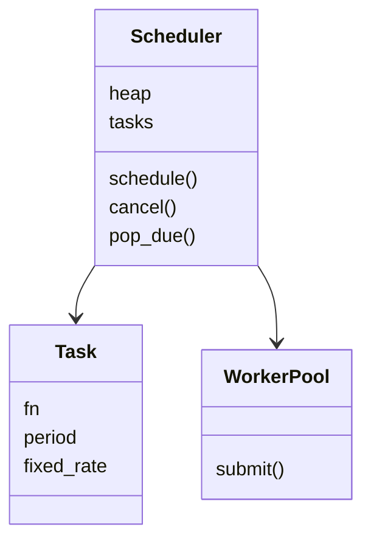

# 任务调度器（Task Scheduler）（low priority）

## 题目

调度器接收「在某个时刻执行这个函数」的请求，到点就执行。它是进程内的延时和周期任务调度，不是分布式任务队列。使用者是业务代码，所以必须精确掐点、不浪费 CPU、一个慢任务不能拖垮其他任务。**面试官真正在看的是：用最小堆加条件变量（condition variable）取代轮询，以及「何时执行」和「在哪执行」是否分开。**

面试官的原话大概是：「设计一个调度器，支持延迟执行和周期执行，可以取消。」

常见追问：

- 某个任务阻塞了 10 秒，后面的任务怎么办？
- 周期任务是固定频率还是固定间隔？
- 取消一个已经在堆里的任务怎么做？

## 先问这几个问题

- 只有一次性任务，还是也有周期任务？→ 周期任务执行完要**重新入堆**，不需要新结构。
- 任务在哪个线程执行，允许并行吗？→ 允许就要**线程池**，调度线程只负责到点分发。
- 要不要取消？任务抛异常怎么办？→ 任务要有 id 和状态；异常必须在 worker 里捕获并记录。
- 周期任务耗时超过周期怎么办？→ 决定固定频率（会追赶）还是固定间隔（不追赶）。
- 同一时刻到期的任务有没有优先级？→ 堆元素多加一栏即可。

## 核心对象

| 类 | 职责（一句话） | 守住的不变量 |
|---|---|---|
| `Task` | 函数、周期、周期模式 | 在任务表里存在，就等于「还活着」 |
| `Scheduler` | 持有最小堆、任务表、一把锁加条件变量 | 堆顶永远是最早到期的条目 |
| 调度线程 | 睡到堆顶到期或被唤醒，到点就分发 | 只分发，不执行 |
| 线程池（worker） | 真正执行任务 | 任务异常不会让线程死掉 |



## 主流程

`schedule(fn, delay)` 与调度线程的配合：

1. `schedule` 加锁，校验参数（负延时、非正周期直接抛异常），分配 id，登记到任务表，把 `(due, seq, id)` 压入堆。
2. **如果新条目成为堆顶，`notify` 唤醒调度线程**，让它重新计算睡多久。
3. 调度线程在条件变量上 `wait(剩余时间)`；堆空就无限 `wait`。
4. 到期后，调度线程在锁内弹出所有到期条目，**跳过任务表里已不存在的（取消留下的墓碑）**，释放锁。
5. 把任务提交给线程池。执行失败的异常在 worker 里捕获，不影响线程。
6. 周期任务：固定频率在弹出时立刻算 `due + period` 再入堆；固定间隔在**执行完成后**算 `完成时刻 + period` 再入堆。

## 关键决策

### 怎么等：轮询还是条件变量

- `while True: sleep(0.01)`：要么白烧 CPU，要么任务最多晚 10 毫秒。
- 堆顶加 `Condition.wait(剩余时间)`：到点才醒；有更早的新任务时被 `notify` 唤醒重算。

**选堆加条件变量。** 堆元素用 `(due, seq, id)`，`seq` 是递增序号，到期时间相同时不会去比较任务对象。

### 取消：从堆里删还是惰性删除

- 直接删：堆中间删一个元素要先找到再重建，O(n)。
- 惰性删除：从任务表里删掉 id，堆里的条目变成墓碑，弹到时跳过，取消是 O(1)。

**选惰性删除。** 代价是堆里留垃圾，所以另维护「待执行数」（任务表大小），墓碑过多时 `heapify` 重建一次。已经在运行的任务取消不了，`cancel` 返回 False 告诉调用方。

### 周期任务：固定频率还是固定间隔

- 固定频率（fixed rate）：`due += period`，任务耗时超过周期会连续追赶。
- 固定间隔（fixed delay）：`due = 完成时间 + period`，两次之间总隔一个周期，不追赶。

**默认选固定间隔，因为不会堆积；把两者做成一个参数，不是两个类。** 周期任务不需要新结构，执行完再入堆就是。

### 谁来执行：调度线程还是线程池

调度线程自己执行任务，一个阻塞任务会延后所有后续任务。**选调度线程只分发、线程池执行。** 池大小：CPU 密集型约等于核数，IO 密集型可以更多；队列要有界，池满时排队或拒绝。这里不需要「调度器」「执行器」「策略」多层抽象，一个堆加一个池就够。

## Python 骨架

```python
import heapq
import itertools
import threading
import time
from concurrent.futures import ThreadPoolExecutor


class Task:
    def __init__(self, fn, period=None, fixed_rate=False):
        self.fn, self.period, self.fixed_rate = fn, period, fixed_rate


class Scheduler:
    def __init__(self, clock=time.monotonic, workers=2):
        self.clock = clock  # 时钟注入：测试里不需要真实 sleep
        self._heap, self._tasks = [], {}  # 堆里是 (due, seq, id)；任务表里存在 = 还活着
        self._cv = threading.Condition()
        self._ids, self._seq = itertools.count(1), itertools.count()
        self._closed, self.errors = False, []
        self._pool = ThreadPoolExecutor(workers)
        self._thread = None

    def _push(self, tid, due):
        heapq.heappush(self._heap, (due, next(self._seq), tid))

    def schedule(self, fn, delay, period=None, fixed_rate=False):
        if delay < 0 or (period is not None and period <= 0):
            raise ValueError("bad schedule")
        with self._cv:
            if self._closed:
                raise RuntimeError("scheduler closed")
            tid = next(self._ids)
            self._tasks[tid] = Task(fn, period, fixed_rate)
            self._push(tid, self.clock() + delay)
            self._cv.notify()  # 新条目可能比堆顶更早，唤醒调度线程重算
            return tid

    def cancel(self, tid) -> bool:
        with self._cv:  # 只删任务表，堆里留墓碑，O(1)
            return self._tasks.pop(tid, None) is not None

    def pop_due(self, now):
        """锁内弹出所有到期且仍然存活的任务。"""
        out = []
        with self._cv:
            while self._heap and self._heap[0][0] <= now:
                due, _, tid = heapq.heappop(self._heap)
                task = self._tasks.get(tid)
                if task is None:  # 墓碑，跳过
                    continue
                if task.period is None:
                    del self._tasks[tid]
                elif task.fixed_rate:  # 固定频率：弹出时立刻算下一次
                    self._push(tid, due + task.period)
                out.append((tid, task))
        return out

    def _run(self, tid, task):
        try:
            task.fn()
        except Exception as e:  # 异常必须在 worker 里吞掉并记录，否则池越用越小
            self.errors.append(e)
        finally:
            if task.period and not task.fixed_rate:  # 固定间隔：完成后才算下一次
                with self._cv:
                    if tid in self._tasks:
                        self._push(tid, self.clock() + task.period)
                        self._cv.notify()

    def run_pending(self):  # 同步驱动，测试用
        for tid, task in self.pop_due(self.clock()):
            self._run(tid, task)

    def start(self):
        self._thread = threading.Thread(target=self._loop, daemon=True)
        self._thread.start()

    def _loop(self):
        while True:
            with self._cv:
                while not self._closed:
                    delay = self._heap[0][0] - self.clock() if self._heap else None
                    if delay is not None and delay <= 0:
                        break
                    self._cv.wait(delay)  # None 表示无限等
                if self._closed:
                    return
            for tid, task in self.pop_due(self.clock()):
                self._pool.submit(self._run, tid, task)  # 调度线程只分发

    def shutdown(self):
        with self._cv:
            self._closed = True
            self._cv.notify_all()
        if self._thread:
            self._thread.join()
        self._pool.shutdown(wait=True)


if __name__ == "__main__":
    now, log = [0.0], []
    s = Scheduler(clock=lambda: now[0])
    s.schedule(lambda: log.append("a"), 5)
    dead = s.schedule(lambda: log.append("dead"), 5)
    assert s.cancel(dead) and not s.cancel(dead)  # 第二次取消返回 False
    s.run_pending()
    assert log == []  # 没到点
    now[0] = 5
    s.run_pending()
    assert log == ["a"]  # 墓碑被跳过
    s.schedule(lambda: log.append("p"), 1, period=10)  # 固定间隔
    now[0] = 6
    s.run_pending()
    now[0] = 15
    s.run_pending()
    assert log == ["a", "p"]  # 完成于 6，下一次在 16
    now[0] = 16
    s.run_pending()
    assert log == ["a", "p", "p"]
    s.schedule(lambda: 1 / 0, 0)
    s.run_pending()
    assert len(s.errors) == 1  # 失败路径：异常被记录，调度器继续工作
    try:
        s.schedule(print, -1)
    except ValueError:
        pass
    else:
        raise AssertionError("negative delay must be rejected")
    real, done = Scheduler(), threading.Event()  # 真实线程：到点才执行
    real.start()
    real.schedule(done.set, 0.05)
    assert done.wait(2)
    real.shutdown()
    print("ok")
```

## 面试官加需求时

| 新需求 | 改哪里 | 不用动哪里 |
|---|---|---|
| 同一时刻按优先级 | 堆元素加一栏 `(due, priority, seq, id)` | 调度循环 |
| 周期任务 | `Task.period`，完成后重新入堆 | 堆、线程池 |
| 取消 | 任务表删除，堆里留墓碑 | 堆结构 |
| 任务失败重试 | `_run` 的异常分支重新入堆并带退避 | Scheduler 的对外接口 |
| 在指定时刻执行（`at`） | `schedule` 多一个参数，换算成 `due` | 堆、锁 |
| 关闭语义 | `shutdown(wait=True/False)`，是否排空已排队任务 | 调度逻辑 |

## 并发与扩展

- **一把锁保护堆和任务表，条件变量负责睡眠与唤醒。** 新任务比堆顶更早时必须 `notify`，否则调度线程会睡过头。
- **任务在锁外执行**：持锁调用用户函数，会让 `schedule` 和 `cancel` 被一个慢任务卡住。
- **「检查是否关闭」和「入堆」在同一把锁里**，否则关闭之后还有任务被悄悄加进来。
- **时钟注入**让调度逻辑可以用 `run_pending` 同步驱动，测试不需要真实 sleep；计时用单调时钟，不用墙上时钟。
- 规模变大：单进程堆放不下就按分片拆多个调度器；要持久化就把任务落盘，重启时按 `due` 重建堆。分布式需要租约和去重，已经是另一道题。

## 常见错误

- **用 `sleep(0.01)` 轮询**。改成堆顶加条件变量。
- **堆元素只放 `(due, task)`**，到期时间相同时去比较任务对象而抛 `TypeError`。加递增序号。
- **在调度线程里直接执行任务**，一个阻塞任务拖垮全部。交给线程池。
- **任务异常没捕获**，worker 线程死掉，池越用越小。在 `_run` 里捕获并记录。
- **新任务早于堆顶却不 `notify`**，该早执行的任务被晚执行。

## 30 秒复述

- 对象：`Task`、`Scheduler`（最小堆加任务表加锁和条件变量）、调度线程、线程池。
- **调度线程只回答「何时执行」，线程池回答「在哪执行」**，所以慢任务不影响掐点。
- 等待用堆顶加 `Condition.wait(剩余时间)`，不轮询；新任务更早就 `notify`。
- 取消用惰性删除：任务表删除、堆里留墓碑，O(1)；已经在运行的取消不了，返回 False。
- 周期任务就是执行完再入堆，默认固定间隔不追赶；频率与间隔只差「下一次到期时间何时算」。
- 并发：一把锁保护数据结构，用户函数在锁外执行，异常在 worker 里捕获。

## 来源

- [[solution-task-scheduler]]
