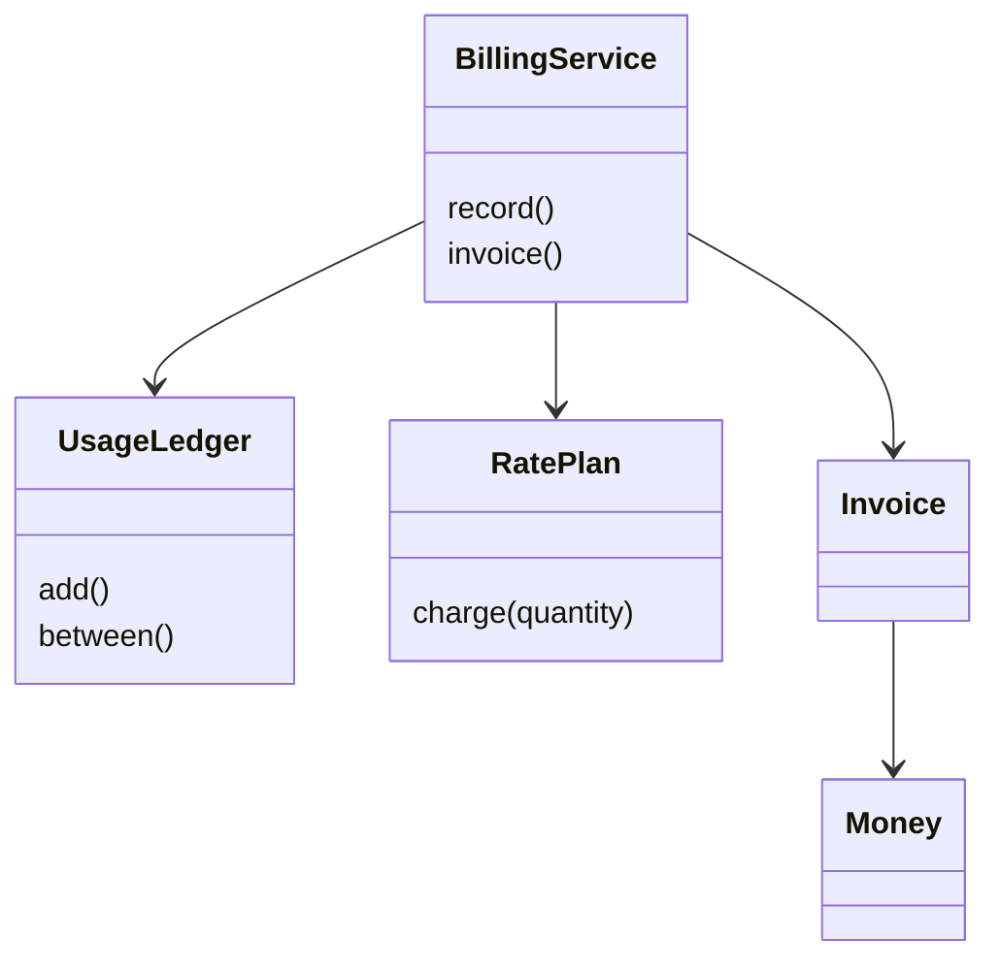

# AWS 账单服务（AWS Billing Service）（low priority）

## 题目

账单服务把一个用户在一个月里用过的各种云服务（存储 GB·月、函数调用次数、虚拟机小时），变成一张每一行都能解释的账单。使用者是客户和财务，**钱算错就是赔钱**。**面试官真正在看的是三件事：费率能不能互换（一口价、阶梯价、免费额度）、钱怎么表示和舍入、重复上报的用量会不会多收钱。**

面试官的原话大概是：「设计 AWS 的账单服务，只考虑单个用户；每个服务的用量和费率给定，算出这个月该付多少钱。」

常见追问：

- 存储用量越大单价越低（阶梯价），有的服务每月前一部分免费。
- 用量记录会重复上报。
- 月中调价，不同服务用不同币种。

## 先问这几个问题

- 费率只有一口价，还是有阶梯价和免费额度？→ 费率做成**可互换的对象**，一口价只是最简单的一个。
- 阶梯价对月总量生效，还是对每条记录各自生效？→ 决定**先聚合再分档**。
- 用量一次给齐，还是持续上报？→ 持续上报会重复投递，要有按编号去重的仓库。
- 月中会调价吗？有多币种吗？→ 价格要有生效时间，金额按币种分别求和。
- 金额精度和舍入规则？→ 整数分，每个账单行只舍入一次。

## 核心对象

| 类 | 职责（一句话） | 守住的不变量 |
|---|---|---|
| `Money` | 整数分加币种的值对象 | 币种不同的两个 `Money` 相加直接抛错 |
| `RatePlan`（一口价 / 阶梯 / 免费额度） | 周期内总用量 → 未舍入金额 | 只接收**总量**，不知道记录条数 |
| `UsageLedger` | 按 `usage_id` 去重存用量 | 同一编号最多入账一次；同编号内容不同是错误 |
| `BillingService` | 聚合、套费率、每行舍入一次 | 总额等于各行之和 |
| `Invoice` | 账单行与总额 | 多币种时按币种分别求和 |



## 主流程

`invoice(start, end)`：

1. 从 `UsageLedger` 取 `[start, end)` 内的记录。拿到的是**快照**，不是内部字典。
2. **按 (服务, 指标) 把数量加起来**，同一 key 的所有记录合成一个总量。
3. 对每个 key 调用一次对应 `RatePlan.charge(总量)`，得到未舍入的 `Decimal` 金额。
4. 用 `Money.from_decimal` **舍入一次**（四舍五入到分），生成账单行。
5. 总额是各行之和。

`record(usage)`：加锁，查 `usage_id`；新的入账返回 True，内容相同的重复返回 False 并计数，内容不同抛 `InvalidUsage`。负数用量也抛错。

没有注册费率的服务：抛 `KeyError`，而不是悄悄按 0 计费。

## 关键决策

### 阶梯价：对每条记录分档，还是先聚合再分档

- 逐条分档：每条记录都被当成「第一档」。两条各 30000 GB，各按 0.023 得 690.00，合计 1380.00。
- 先聚合：60000 GB 一起分档，前 51200 GB 按 0.023，其余 8800 GB 按 0.022，得 1371.20。

**选先聚合再分档。** 单价随用量递减，逐条分档会多收客户的钱。免费额度同理，扣在月总量上。同时，`RatePlan.charge` 只接收总量，`invoice` 里没有 `if` 链，换计费方式只是换对象。

### 阶梯是边际还是整体

- 整体：总量落在哪一档，全部按那一档的价。
- 边际：每一档只对落在本档内的那部分收本档的价。

**选边际（和云厂商一致）。** 102400 GB = 51200×0.023 + 51200×0.022 = 2304.00；整体解释会得 2252.80。

### 钱的表示：整数分，舍入只做一次

- float：`0.1 + 0.2` 得 `0.30000000000000004`，加一百行后总额和各行之和对不上。
- 费率和用量用 `Decimal`，金额用整数分，每个账单行最后舍入一次。

**选整数分加 `Decimal`。** 三个服务各 0.004 元，每行舍入后各 0.00，如果总额另外一次性舍入就成了 0.01，客户核对不上；所以总额必须是各行之和。

### 费率做成策略：简单答案赢

**一个只有 `charge` 一个方法的接口，用 `Protocol` 加几个不可变 dataclass 就够，不写抽象基类和工厂。** `FreeTierThen(免费量, 内层费率)` 是一个包装：把总量减去免费量再交给内层，一口价、阶梯价都能套，不需要新的继承层次。

## Python 骨架

```python
import threading
from collections import defaultdict
from dataclasses import dataclass
from decimal import ROUND_HALF_UP, Decimal as D


class BillingError(Exception):
    pass


@dataclass(frozen=True)
class Money:  # 整数分的值对象
    cents: int
    currency: str = "USD"

    @staticmethod
    def from_decimal(amount, currency="USD"):  # 四舍五入到分，只在这里舍入
        return Money(int((amount * 100).quantize(D(1), rounding=ROUND_HALF_UP)), currency)

    def __add__(self, o):
        if self.currency != o.currency:
            raise BillingError("currency mismatch")
        return Money(self.cents + o.cents, self.currency)


class FlatRate:  # 每个费率只回答：总量 -> 未舍入金额
    def __init__(self, rate):
        self.rate = rate

    def charge(self, q):
        return q * self.rate


class TieredRate:  # 边际阶梯：每档只对落在本档内的部分收本档的价
    def __init__(self, tiers):  # [(累计上限或 None, 单价)]
        self.tiers = tiers

    def charge(self, q):
        total, lower = D(0), D(0)
        for up_to, rate in self.tiers:
            upper = q if up_to is None else min(q, up_to)
            if upper > lower:
                total += (upper - lower) * rate
                lower = upper
            if up_to is None or q <= up_to:
                break
        return total


class FreeTierThen:  # 先免费一部分，超出的交给内层
    def __init__(self, free, inner):
        self.free, self.inner = free, inner

    def charge(self, q):
        return self.inner.charge(max(D(0), q - self.free))


@dataclass(frozen=True)
class Usage:
    usage_id: str  # 幂等键
    service: str
    metric: str
    quantity: D
    month: int


class UsageLedger:
    def __init__(self):
        self._records, self.duplicates_ignored = {}, 0
        self._lock = threading.Lock()

    def add(self, u: Usage) -> bool:
        if u.quantity < 0:
            raise BillingError("negative usage")
        with self._lock:  # 「查是否存在」和「写入」必须在同一把锁里
            old = self._records.get(u.usage_id)
            if old is None:
                self._records[u.usage_id] = u
                return True
            if old != u:  # 同编号内容不同：报错，不悄悄覆盖
                raise BillingError("conflicting usage_id")
            self.duplicates_ignored += 1
            return False

    def in_month(self, month):  # 返回快照，不交出内部字典
        with self._lock:
            return tuple(u for u in self._records.values() if u.month == month)


class BillingService:
    def __init__(self, plans):
        self.plans, self.ledger = plans, UsageLedger()  # plans: {(服务, 指标): RatePlan}

    def record(self, u):
        return self.ledger.add(u)

    def invoice(self, month):
        totals = defaultdict(D)
        for u in self.ledger.in_month(month):  # 先聚合
            totals[(u.service, u.metric)] += u.quantity
        lines = {k: Money.from_decimal(self.plans[k].charge(q)) for k, q in sorted(totals.items())}
        total = Money(0)
        for m in lines.values():  # 总额 = 各行之和
            total = total + m
        return lines, total


if __name__ == "__main__":
    s3 = TieredRate([(D(51200), D("0.023")), (None, D("0.022"))])
    svc = BillingService({("s3", "gb"): s3, ("fn", "calls"): FreeTierThen(D(100), FlatRate(D("0.5")))})
    assert svc.record(Usage("u1", "s3", "gb", D(30000), 10))
    assert svc.record(Usage("u2", "s3", "gb", D(30000), 10))
    assert not svc.record(Usage("u2", "s3", "gb", D(30000), 10))  # 重复投递，不重复计费
    lines, total = svc.invoice(10)
    assert lines[("s3", "gb")].cents == 137120  # 先聚合：1371.20，而不是逐条的 1380.00
    assert s3.charge(D(102400)) == D("2304.000")  # 边际阶梯
    svc.record(Usage("u3", "fn", "calls", D(150), 10))
    assert svc.invoice(10)[0][("fn", "calls")].cents == 2500  # 免费 100，剩 50 x 0.5
    try:
        svc.record(Usage("u1", "s3", "gb", D(1), 10))  # 同编号不同内容
    except BillingError:
        pass
    else:
        raise AssertionError("conflict must raise")
    print("ok")
```

## 面试官加需求时

| 新需求 | 改哪里 | 不用动哪里 |
|---|---|---|
| 阶梯价 / 免费额度 | 新增费率类 | `BillingService`、`UsageLedger` |
| 用量重复上报 | 新增 `UsageLedger`（按编号去重） | 费率类、计费流程 |
| 月中调价 | 新增 `PriceBook`：每个 (服务, 指标) 一串带生效时间的版本，`bisect_right` 取用量发生时刻的版本；账单按版本分行 | 费率类本身 |
| 多币种 | 每个价格版本带币种；`Invoice.totals` 按币种分别求和 | `Money` 之外的计算 |
| 税费 / 优惠券 | 账单行之后加一道调整步骤 | 聚合和费率 |
| 账单行解释 | `InvoiceLine` 带总量和所用价格版本 | 计费算法 |

## 并发与扩展

- **去重是「查编号是否存在，再写入」两步**，GIL 只保证单条字节码原子。两个线程同时上报同一 `usage_id` 会各写一次，客户被重复计费。**用一把锁罩住整个检查加写入**，重复计数也在锁里读。
- `between` 返回元组快照，不把内部字典交出去，出账单时的遍历不会被并发写入打断。
- 账单是纯计算：给定同一批记录和价格，结果确定。因此可以重算、对账，而不需要存「已出账单」才能核对。
- 规模变大：用量在存储里以 `(usage_id)` 为唯一键，数据库的唯一约束替代进程内的锁；按月聚合改成流式累加；价格版本按生效时间建索引。

## 常见错误

- **用 float 存钱**。改成整数分，费率用 `Decimal("0.023")`，每行只舍入一次。
- **逐条记录分档**：两条各 30000 GB 得 1380.00，正确是 1371.20。先聚合再分档。
- **总额和各行之和分别舍入**，客户对不上账。总额就是各行之和。
- **重复上报的用量重复计费**，或同编号不同内容被悄悄覆盖。去重加冲突报错，重复次数在账单上可见。
- **没有注册费率时按 0 计费**。直接报错，别悄悄免费。

## 30 秒复述

- 对象：`Money`（整数分）、`RatePlan`（策略）、`UsageLedger`（去重）、`BillingService`、`Invoice`。
- **先按 (服务, 指标) 聚合月总量，再分档计价**；阶梯是边际的；免费额度扣在总量上。
- 钱用整数分，费率用 `Decimal`，每个账单行舍入一次，总额等于各行之和。
- 费率是几个不可变小对象，只有一个 `charge` 方法，没有 `if` 链；新计费方式只新增一个类。
- 重复上报：按 `usage_id` 去重，同编号不同内容报错；检查加写入在一把锁里。
- 月中调价：加 `PriceBook` 的生效时间版本；多币种按币种分别求和，费率类不动。

## 来源

- [[solution-amz-aws-billing]]
