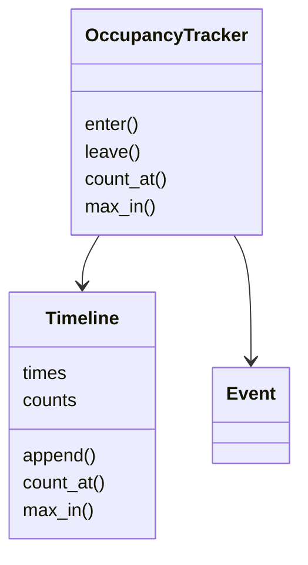

# 办公室人数追踪（Occupancy Tracker）（low priority）

## 题目

根据刷卡的进出事件，回答「任意时刻楼里有多少人」，后面还会问「某段时间里最多有多少人」。使用者是安保和楼宇运营。**面试官真正在看的是：你是不是想到「不存人数，存事件」，并且用前缀和加二分把查询做到 O(log n)，同时把重复事件、迟到事件这些失败路径处理干净。**

面试官的原话大概是：「设计一个办公室人数追踪器：`enter(person, ts)`、`leave(person, ts)`、`count_at(t)`，再加 `max_in(a, b)`。」

常见追问：

- 有多个楼层或楼栋，能把各区域的峰值加起来吗？
- 刷卡事件重发了，或者比已入账的更晚到达？
- 能写成 SQL 吗？

## 先问这几个问题

- 只问现在，还是要问任意历史时刻？→ 要问历史，就必须**存事件而不是存人数**。
- 事件按时间顺序到达吗？同一秒内谁先谁后？→ 顺序到达才能只追加；同一秒要有稳定的先后。
- 有几个楼层或楼栋？→ 决定要不要**每个区域一条时间线**。
- 重发的事件怎么算？→ 与该人最近一次事件完全相同才算重试，忽略；否则是非法序列。
- 查询频率和事件量？→ 决定区间最大值用扫描还是线段树。

## 核心对象

| 类 | 职责（一句话） | 守住的不变量 |
|---|---|---|
| `Event` | 一次进出：时间、人、区域、+1 或 −1 | 不可变 |
| `Timeline` | 一条只追加的时间线，回答 `count_at` 和 `max_in` | 时间数组非递减，且与前缀和数组等长 |
| `OccupancyTracker` | 校验事件合法，写进相关时间线 | 校验在写入之前，失败不改任何状态 |
| 错误类 | `AlreadyInside`、`NotInside`、`OutOfOrder` | 每种失败有自己的类型 |



## 主流程

`enter(person, ts, zone)`：

1. 加锁。若该人已在楼里：与他最近一次事件**完全相同**就是重试，忽略并返回 False；否则抛 `AlreadyInside`。
2. 若 `ts` 比已入账的最后一个事件更早，抛 `OutOfOrder`。
3. **校验全部通过之后才写**：把事件追加到该区域的时间线和全局时间线（时间数组追加 `ts`，前缀和数组追加 `上一个值 + 1`）。
4. 记录该人当前所在区域和最近一次事件。

`leave` 对称：不在楼里抛 `NotInside`，离开的区域必须与进入时一致。

`count_at(t)`：`i = bisect_right(times, t) - 1`，答案是 `counts[i]`，没有事件则为 0。

`max_in(a, b)`：答案是 **`count_at(a)`** 与区间内每个事件之后的人数的最大值。

## 关键决策

### 存什么：事件还是人数

- 只存当前人数：O(1)，但答不出任何历史问题。
- 存事件日志，人数由前缀和得出。

**选事件加前缀和。** 事件按时间追加，所以前缀和数组也只追加：追加 O(1)，`count_at` 是一次二分 O(log n)。用 `bisect_right`，因为时间恰好等于 t 的事件也算。例：a进@10、b进@20、c进@30、a出@40、d进@40，前缀和 `[1,2,3,2,3]`，`count_at(25)=2`，`count_at(40)=3`。

### 区间最大值：扫描还是线段树

- 扫描区间内的前缀和：O(k)，最简单。
- 稀疏表：查询 O(1)，但追加要重建。
- 线段树：查询 O(log n)，追加摊还 O(1)。

**查询少就先写扫描，查询频繁又持续追加就换线段树**，接口不变，只换 `Timeline` 里一个方法。无论哪种，都**别漏掉 `count_at(a)`**：`+1@10, +1@20, −1@30`，`max_in(25, 25)` 应为 2，只看区间内事件会得 0。

### 迟到的事件：拒绝还是接受

- 拒绝：时间比最后一个事件早就抛 `OutOfOrder`，因为插入中间会让后面所有前缀和失效。
- 接受乱序：水位线缓冲（等 T−5 分钟之前的事件到齐再入账），或换 Fenwick 树。

**默认拒绝，并说出接受乱序的代价。** 拒绝时不改变任何状态。

### 多区域：峰值不能相加

**每个区域一条时间线，再加一条全局时间线，每个事件同时写进两条。** 前缀和可以相加，**峰值不能**：1 楼 1 点有 1 人，2 楼 3 点有 1 人，两个峰值相加得 2，办公室任意时刻最多 1 人。全局峰值要查全局时间线。这里不需要任何模式，就是一个字典加几个列表。

## Python 骨架

```python
import bisect
import threading


class OccupancyError(Exception):
    pass


class AlreadyInside(OccupancyError):
    pass


class NotInside(OccupancyError):
    pass


class OutOfOrder(OccupancyError):
    pass


class Timeline:
    """只追加：times 非递减，counts[i] 是处理完第 i 个事件后的人数。"""

    def __init__(self):
        self.times, self.counts = [], []

    def append(self, ts, delta):
        self.times.append(ts)
        prev = self.counts[-1] if self.counts else 0
        self.counts.append(prev + delta)

    def count_at(self, t):  # 最后一个时间 <= t 的事件之后的人数
        i = bisect.bisect_right(self.times, t) - 1
        return self.counts[i] if i >= 0 else 0

    def max_in(self, a, b):  # 区间开始时已在楼里的人数，与区间内每个事件之后的人数，取最大
        lo = bisect.bisect_right(self.times, a)
        hi = bisect.bisect_right(self.times, b)
        # 查询频繁时，这里的 max 换成线段树即可，接口不变
        return max([self.count_at(a)] + self.counts[lo:hi])


class OccupancyTracker:
    def __init__(self):
        self._lock = threading.Lock()
        self._zones = {}  # zone -> Timeline
        self._all = Timeline()  # 全局时间线
        self._inside = {}  # person -> zone
        self._last = {}  # person -> 最近一次事件，用来识别重试

    def _record(self, person, ts, zone, delta):
        ev = (ts, zone, delta)
        with self._lock:  # 校验加追加必须在同一把锁里
            if self._last.get(person) == ev:
                return False  # 完全相同：重试，忽略
            if delta == 1 and person in self._inside:
                raise AlreadyInside(person)
            if delta == -1 and self._inside.get(person) != zone:
                raise NotInside(person)  # 不在楼里，或离开的区域与进入时不一致
            if self._all.times and ts < self._all.times[-1]:
                raise OutOfOrder(ts)
            # 以上全部通过，才开始写：失败不留脏数据
            self._zones.setdefault(zone, Timeline()).append(ts, delta)
            self._all.append(ts, delta)
            if delta == 1:
                self._inside[person] = zone
            else:
                del self._inside[person]
            self._last[person] = ev
            return True

    def enter(self, person, ts, zone="main"):
        return self._record(person, ts, zone, 1)

    def leave(self, person, ts, zone="main"):
        return self._record(person, ts, zone, -1)

    def _line(self, zone):
        return self._all if zone is None else self._zones.get(zone, Timeline())

    def count_at(self, t, zone=None):  # zone=None 表示整个办公室
        with self._lock:
            return self._line(zone).count_at(t)

    def max_in(self, a, b, zone=None):
        with self._lock:  # 读也在锁里，保证读到等长的数组
            return self._line(zone).max_in(a, b)


if __name__ == "__main__":
    t = OccupancyTracker()
    t.enter("a", 10); t.enter("b", 20); t.enter("c", 30)
    t.leave("a", 40); t.enter("d", 40)
    assert t.count_at(25) == 2 and t.count_at(40) == 3 and t.count_at(5) == 0
    assert t.max_in(25, 25) == 2  # 只看区间内事件会得 0，必须并上 count_at(a)
    assert t.max_in(0, 100) == 3
    assert t.enter("d", 40) is False  # 完全相同的重发，被忽略
    for bad, exc in [(lambda: t.enter("b", 50), AlreadyInside),
                     (lambda: t.leave("zed", 50), NotInside),
                     (lambda: t.enter("e", 5), OutOfOrder)]:
        try:
            bad()
        except exc:
            pass
        else:
            raise AssertionError(exc)
    assert t.count_at(100) == 3  # 失败的调用没有改变任何状态
    z = OccupancyTracker()
    z.enter("x", 1, "f1"); z.leave("x", 2, "f1"); z.enter("y", 3, "f2")
    assert z.max_in(0, 10, "f1") == 1 and z.max_in(0, 10, "f2") == 1
    assert z.max_in(0, 10) == 1  # 全局峰值是 1，不是 1+1
    print("ok")
```

## 面试官加需求时

| 新需求 | 改哪里 | 不用动哪里 |
|---|---|---|
| 多楼层 / 楼栋 | 事件加 `zone`，每区域一条 `Timeline` | `Timeline` 的实现 |
| 区间最大值要更快 | `Timeline.max_in` 换成线段树 | `OccupancyTracker`、对外接口 |
| 接受乱序事件 | 水位线缓冲，或 `Timeline` 换 Fenwick 树 | 校验规则 |
| 换楼层 | 一次离开加一次进入，离开的区域必须与进入时一致 | 时间线 |
| 写成 SQL | 事件表 `(seq, ts, person, zone, delta)`，窗口函数求前缀和 | 事件模型 |
| 谁在楼里 | 直接读 `_inside` | 时间线 |

## 并发与扩展

- 写入是「校验加追加」的**复合操作**（全局时间线、区域时间线、每人最近事件三处），GIL 只保证单条字节码原子。两个线程可能都通过「时间没倒流」的校验再交错追加，时间数组乱序、数组长度不一致。**`_record` 整个在一把锁里**，读也在锁里，保证读到等长的数组。
- 吞吐更高：每个入口一个队列，单个消费者按时间归并后写入（单写者），锁也不需要。
- SQL 版：`SELECT COALESCE(SUM(delta),0) FROM presence_events WHERE ts <= :t`；区间最大用 `SUM(delta) OVER (ORDER BY ts, seq)` 求前缀和再取 `MAX`，并上区间开始时的人数。`seq` 自增，给同一秒的事件定序。
- 窗口函数每次查询 O(n)，所以写入时物化前缀和，或每分钟存一行（期末人数、该分钟峰值），区间最大只读区间内的分钟行。一天一亿事件约每秒 1157 个。

## 常见错误

- **只存当前人数**，历史问题全答不出。存事件，人数由前缀和得出。
- **`max_in` 漏掉 `count_at(a)`**：区间内没有事件时答案是 0，实际是区间开始时已在楼里的人数。
- **用 `bisect_left` 查 `count_at`**，时间恰好等于 t 的事件被漏掉。用 `bisect_right`。
- **先改状态再校验**，抛异常时留下半个写入。校验全部放在写入之前。
- **把各区域的峰值相加**当全局峰值。峰值不能相加，查全局时间线。

## 30 秒复述

- 对象：`Event`、`Timeline`（时间数组加前缀和数组）、`OccupancyTracker`（校验加写入）。
- **不存人数，存事件；人数是前缀和**，`count_at` 是一次 `bisect_right`，O(log n)。
- `max_in(a, b)` 是 `count_at(a)` 与区间内各前缀和的最大值；查询多就上线段树，接口不变。
- 失败路径：完全相同的事件是重试，忽略；非法序列抛 `AlreadyInside` / `NotInside`；倒流抛 `OutOfOrder`；全部先校验再写，失败不改状态。
- 多区域：每区域一条时间线加一条全局的；峰值不能相加。
- 并发：校验加追加在一把锁里；高吞吐用每入口一个队列，单写者。

## 来源

- [[solution-amz-occupancy-tracker]]
