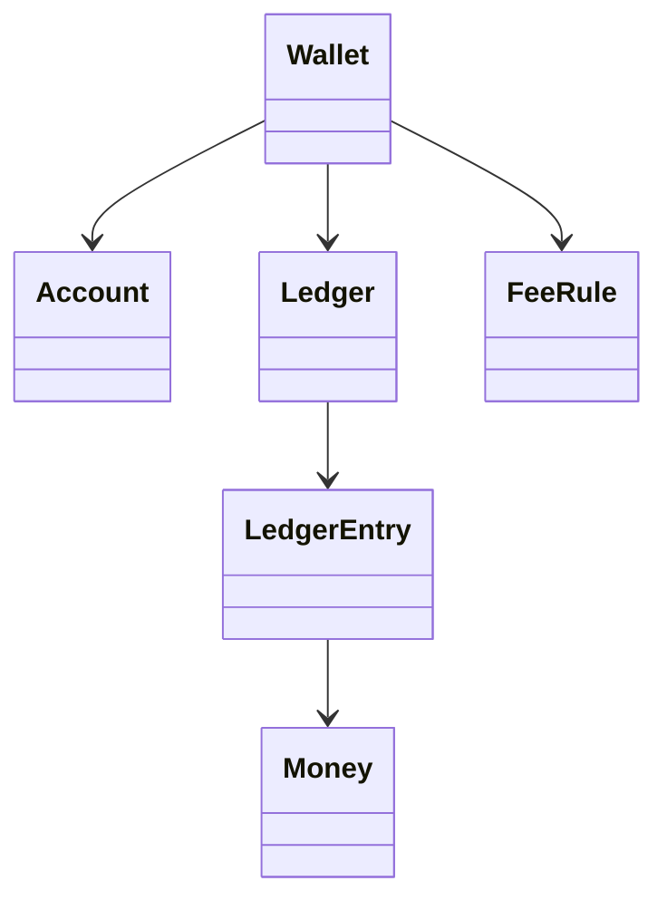

# 钱包与银行账户（Wallet）（low priority）

## 题目

设计一个钱包系统：用户可以开户、存入、取出、转账，并能查询某个月的汇总。用的人是终端用户和客服后台。**面试官真正考的是「钱在系统内部怎么被记录、怎么被并发地改动」：整数金额、只追加的账本、转账的原子性和加锁顺序。** 支付网关、鉴权、银行对接都不在范围内。

面试官会这样说：「余额不能为负，转账两边必须一致，多一分少一分都不行。」

常见追问：

- 转账要收手续费，利息要交税，以后还会加规则。
- A 转 B 和 B 转 A 同时发生会怎样。
- 客户端超时重发同一笔转账，会不会扣两次。

## 先问这几个问题

- 金额用什么单位、几种币种？ → **用整数最小单位（分），`Money` 带币种，混币种直接报错。** 多币种换算放到扩展里谈。
- 能否透支？ → 决定「余额不足」是在锁内检查并抛异常，还是允许负数加额度字段。默认不能透支。
- 有哪些费用和税，以后会不会加？ → **决定费用做成可插拔的规则（strategy），而不是写死在转账里。**
- 失败和重试语义？ → 同一请求重发是否只生效一次，决定要不要幂等键（idempotency key）。
- 要不要查历史和月报？ → 决定余额是否只能由流水推出来。

## 核心对象

| 类 | 职责（一句话） | 守住的不变量 |
|---|---|---|
| `Money` | 不可变的整数金额加币种 | 不同币种不能相加；不用浮点 |
| `LedgerEntry` | 一条只读分录：账户、带符号变动额、类型、转账号 | 创建后永不修改 |
| `Ledger` | 只追加的分录列表 | 同一转账号的分录之和为 0 |
| `Account` | 账户 id、缓存余额、一把锁 | 缓存余额等于该账户分录之和；不为负 |
| `FeeRule` | 给一笔转账算出额外分录 | 费用也走账本，可追溯 |
| `Wallet` | 对外入口：存、取、转、汇总，持有所有账户 | 全账本总和恒为 0；一笔转账要么全成要么全不成 |



## 主流程

**转账 `transfer(src, dst, amount, key)`：**

1. 先查幂等表：这个 `key` 做过，直接返回上次结果，什么都不动。
2. **按账户 id 排序后依次加锁**（不是按参数顺序），两把锁都拿到才往下走。
3. 在锁内检查 `src` 余额是否够（含手续费）。不够就抛 `InsufficientFunds`，此时还没写任何东西。
4. 写两条同转账号的分录（`src -amount`、`dst +amount`），再依次执行 `FeeRule` 列表追加费用分录。
5. 更新两个账户的缓存余额，记下幂等表，释放锁。

**存入和取出** 是同一个流程的特例：对手方是一个保留的 `EXTERNAL` 系统账户，代表「系统外面」。这样存入也是两条分录，**全账本总和永远是 0**，不需要给存取开小灶。

**月度汇总 `summary(acct, start, end)`：** 期初 = 本月前所有分录之和；本月按类型分组求和；期末 = 期初 + 本月合计。只读流水，不改数据，可以随时重算。

## 关键决策

### 金额：整数分，不用浮点

浮点算 `0.1 + 0.2` 得 `0.30000000000000004`，累加后账对不平。`Decimal` 可以用，但整数更简单：账本里每条分录都是整数，「两条相加为零」可以精确断言。税的舍入也固定下来：`(金额 × 千分点 + 500) // 1000`，四舍五入。**选整数分加不可变 `Money`，把「美元加欧元」挡在类型层。**

### 余额：存字段，还是每次从流水算

- 每次现算：永远对，但查余额是 O(n)，而查余额是钱包最高频的操作。
- 缓存字段：O(1)，但可能和流水不一致。

**选缓存字段，同时提供 `reconcile`：缓存值必须等于流水求和，不等就是 bug。** 流水是真相，缓存是加速。每一分钱都能追到来源。

### 转账的加锁顺序

A 转 B 的线程先锁 A 等 B，B 转 A 的线程先锁 B 等 A，互相等待就是死锁。**固定按账户 id 排序后加锁，两个方向的线程都先锁 id 小的，环形等待不可能出现。** 一把全局大锁也正确，但所有转账串行，吞吐太低；面试里可以先说它，再说为什么换成有序加锁。

### 手续费和税：一个规则类，不用复杂模式

规则列表加一个 `apply(txn)` 方法返回额外分录，已经够用。**不需要工厂、不需要责任链。** 新规则就是新增一个类并放进列表，转账代码不动。规则返回分录而不是直接改金额，所以费用也在账本上。

## Python 骨架

```python
import threading
from collections import Counter
from dataclasses import dataclass
from itertools import count

EXTERNAL = "EXTERNAL"  # 保留账户：代表系统外部


class InsufficientFunds(Exception):
    pass


@dataclass(frozen=True)
class Money:  # 不可变；整数最小单位
    minor: int
    currency: str = "USD"

    def __add__(self, o):
        if o.currency != self.currency:
            raise ValueError("currency mismatch")
        return Money(self.minor + o.minor, self.currency)


@dataclass(frozen=True)
class LedgerEntry:
    acct: str
    delta: int  # 带符号：+入账 -出账
    kind: str
    txn: int
    ts: int


class PercentFee:  # 手续费规则：返回额外 (账户, 变动, 类型)
    def __init__(self, permille):
        self.permille = permille

    def fee(self, amount):
        return (amount * self.permille + 500) // 1000  # 整数四舍五入

    def apply(self, src, amount):
        f = self.fee(amount)
        return [(src, -f, "fee"), (EXTERNAL, f, "fee")] if f else []


class Account:
    def __init__(self, acct_id):
        self.id = acct_id
        self.balance = 0  # 缓存；真相在流水里
        self.lock = threading.Lock()


class Wallet:
    def __init__(self, rules=()):
        self.accounts = {EXTERNAL: Account(EXTERNAL)}
        self.ledger: list[LedgerEntry] = []  # 只追加
        self.rules = list(rules)
        self._txn = count(1)
        self._clock = count(1)
        self._done: dict[str, int] = {}  # 幂等表：key -> 转账号

    def open(self, acct_id):
        self.accounts[acct_id] = Account(acct_id)

    def _post(self, acct, delta, kind, txn):
        self.ledger.append(LedgerEntry(acct, delta, kind, txn, next(self._clock)))
        self.accounts[acct].balance += delta

    def deposit(self, acct, amount, key):
        return self.transfer(EXTERNAL, acct, amount, key, kind="deposit")

    def withdraw(self, acct, amount, key):
        return self.transfer(acct, EXTERNAL, amount, key, kind="withdraw")

    def transfer(self, src, dst, amount, key, kind="transfer"):
        if amount <= 0:
            raise ValueError("amount must be positive")
        first, second = sorted((src, dst))  # 固定加锁顺序，防死锁
        with self.accounts[first].lock, self.accounts[second].lock:
            if key in self._done:  # 幂等：重试不重复扣款
                return self._done[key]
            extra = [e for r in self.rules for e in r.apply(src, amount)] if kind == "transfer" else []
            need = amount + sum(-d for a, d, _ in extra if a == src)
            if src != EXTERNAL and self.accounts[src].balance < need:
                raise InsufficientFunds(src)  # 还没写任何分录
            txn = next(self._txn)
            self._post(src, -amount, kind, txn)
            self._post(dst, +amount, kind, txn)
            for acct, delta, k in extra:
                self._post(acct, delta, k, txn)
            self._done[key] = txn
            return txn

    def reconcile(self, acct):  # 缓存余额必须等于流水之和
        return sum(e.delta for e in self.ledger if e.acct == acct) == self.accounts[acct].balance

    def summary(self, acct, start, end):  # 只读，可重复算
        opening = sum(e.delta for e in self.ledger if e.acct == acct and e.ts < start)
        by_kind = Counter()
        for e in self.ledger:
            if e.acct == acct and start <= e.ts < end:
                by_kind[e.kind] += e.delta
        return opening, dict(by_kind), opening + sum(by_kind.values())


if __name__ == "__main__":
    w = Wallet(rules=[PercentFee(10)])  # 1% 手续费
    w.open("a"); w.open("b")
    w.deposit("a", 10_000, "k1")
    w.transfer("a", "b", 5_000, "k2")
    assert w.accounts["a"].balance == 4_950 and w.accounts["b"].balance == 5_000  # 手续费 50
    assert w.transfer("a", "b", 5_000, "k2") == 2 and w.accounts["b"].balance == 5_000  # 重试不重复
    assert sum(e.delta for e in w.ledger) == 0 and w.reconcile("a")  # 全账本守恒
    try:
        w.transfer("a", "b", 99_999, "k3")
        raise SystemExit("应当失败")
    except InsufficientFunds:
        pass
    assert w.summary("a", 1, 100)[2] == 4_950 and len(w.ledger) == 6  # 失败未写分录
    print("ok")
```

## 面试官加需求时

| 新需求 | 改哪里 | 不用动哪里 |
|---|---|---|
| 再加一种费用或税 | 新增一个规则类，放进 `rules` | `transfer` 的流程、账本 |
| 多币种 | `Money` 加汇率换算分录，账户按币种分账 | 加锁顺序、幂等表 |
| 交易记录分页 | 新增 `history(acct, offset, limit)` 读流水 | 账本写入路径 |
| 冻结账户或限额 | 在锁内检查前加一个检查点 | 分录结构 |
| 撤销一笔转账 | 追加一笔方向相反的分录，绝不删除旧分录 | 账本只追加的约定 |
| 每月自动出账单 | 复用 `summary`，外面加定时任务 | 钱包核心类 |

## 并发与扩展

- **竞争点是同一账户上的「检查余额再扣款」。** 在两把账户锁内一起做检查和写分录，不会出现只扣不加或透支。
- **死锁靠固定顺序避免。** 按 id 排序，不是按参数顺序；这是转账题最常被追问的一点。
- **幂等的检查放在锁内。** 两个相同 `key` 的请求同时到，第二个等锁，拿到锁后发现已做过，直接返回。
- 汇总和 `reconcile` 读整个流水，生产里要么拿快照，要么按账户分流水，不要边写边扫。
- 上规模后：流水落数据库，一笔转账是一个数据库事务；幂等键变成唯一索引；账户按 id 分片，跨分片转账需要两阶段提交或补偿（saga），这是新的复杂度，面试里点到即可。

## 常见错误

- 用 `float` 存金额。改成整数分。
- 转账只改两个余额字段，不写分录。改成先写成对分录，再更新缓存，并提供 `reconcile`。
- 按 `(from, to)` 的参数顺序加锁。改成按账户 id 排序。
- 检查余额在锁外。改成在锁内检查并写入。
- 失败时已写了一条分录。改成先检查，全部通过后再写。

## 30 秒复述

- 对象：`Money`、只追加的 `LedgerEntry`、`Account`（缓存余额加锁）、`FeeRule`、`Wallet`。
- **金额是整数分，账本只追加，转账写两条同转账号的分录，全账本总和为 0。**
- 存取也是转账，对手方是 `EXTERNAL` 账户，没有特例。
- 余额是缓存，流水是真相，`reconcile` 校验两者相等。
- **转账锁两个账户，按 id 排序加锁，避免死锁；检查和写入都在锁内。**
- 幂等键让重试只生效一次。
- 扩展：新费用就是新增一个规则类，转账代码不动。

## 来源

- [[solution-digital-wallet]]
- [[solution-bank-account]]
