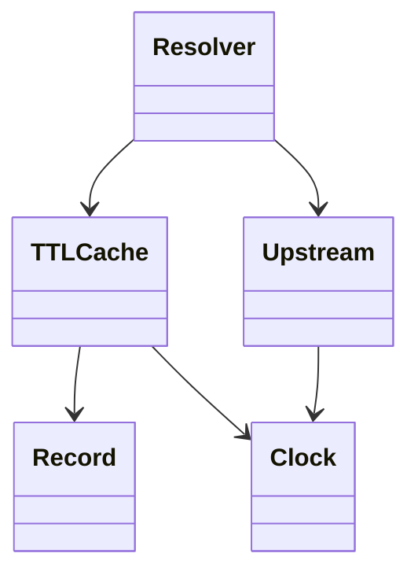

# DNS 解析器与 TTL 缓存（DNS Resolver）（low priority）

## 题目

设计一个 DNS 解析器：把域名翻译成 IP，先查本地缓存，没有再问上游，并把结果缓存起来。用的人是应用代码，缓存要读多写少、并发安全。**面试官真正考的是 TTL 缓存怎么过期（惰性加主动）、上游失败怎么处理、读多写少时并发怎么做。** 上游协议本身（递归查询、报文格式）不是重点。

面试官会这样说：「每条记录自带 TTL，过期后要重新查；上游可能超时。」

常见追问：

- 查不存在的域名要不要缓存。
- 主上游挂了怎么切换备用上游。
- 同一个域名同时未命中，上游会被打多少次。

## 先问这几个问题

- 上游是真实 DNS，还是要自己递归查？ → **把上游抽象成接口 `resolve(name)`**，测试时换成假的。
- 缓存多久？ → 每条记录自带 TTL（生存时间，Time To Live），**不能写死一个全局过期时间。**
- 上游超时或不存在怎么办？ → 决定要不要负缓存（negative caching）、健康检查、返回过期旧数据（serve stale）。
- 读写比例和线程数？ → 读远多于写，决定并发方案：一把锁、读写锁还是写时复制。
- 时间从哪来？ → **时钟必须注入**，测试才能不用 `sleep` 就验证过期。

## 核心对象

| 类 | 职责（一句话） | 守住的不变量 |
|---|---|---|
| `Record` | 域名、IP 列表、TTL | 不可变 |
| `TTLCache` | 存记录并判断过期 | 读到的数据一定没过期 |
| `Upstream` | 问一个上游，自带健康状态 | 连续失败达阈值就暂停使用 |
| `Resolver` | 门面：查缓存，未命中按序问健康上游，写缓存 | 失败不进缓存；不存在只缓存很短时间 |
| `Clock` | 提供当前时间（可注入） | 单调递增 |



## 主流程

**`lookup(name)`：**

1. 查缓存：命中且未过期，直接返回。读到过期项就当没有，并顺手删除（惰性过期）。
2. 缓存里是「不存在」哨兵（NXDOMAIN），直接抛 `NameNotFound`，不再问上游。
3. 未命中：按顺序遍历上游，**跳过正处于冷却期的不健康上游**。
4. 上游成功：写缓存，过期时间 = 现在加记录自带的 TTL，返回。
5. 上游说「不存在」：以较短的负 TTL 写入哨兵，抛 `NameNotFound`。
6. 上游超时：记一次失败，换下一个。全部失败抛 `ResolveError`，**不写缓存**。

这条流程里有三个容易被问到的点：读到过期项为什么要删除（否则字典只增不减）；过期时间为什么是写入时的「现在加 TTL」而不是上游返回的绝对时间（本地时钟才是唯一可信的）；上游全部失败时为什么不写缓存（失败是暂时的，缓存会把它固化）。

## 关键决策

### 过期：惰性、主动，还是两者都要

- 只惰性：读到才检查，永远正确，但再也没人查的域名会一直占内存。
- 只主动：后台线程扫描，有间隔窗口内会读到过期数据。

**两者都要：惰性保证正确，主动保证内存有界。** 主动过期用按到期时间排序的最小堆，定期弹出到期项。面试时先写惰性，再口头补主动即可。

### 失败要不要缓存

查不存在的域名（拼写错误、扫描器）不缓存的话每次都打到上游，所以**不存在要缓存，但用短 TTL（如 30 秒）**。缓存值用哨兵对象区分「查过且不存在」和「没查过」，否则 `None` 有歧义。**上游超时和服务器故障绝不缓存**：否则一次短暂故障被放大成整个 TTL 长度的故障。

### 并发：一把锁，还是写时复制

- 整个缓存一把互斥锁：简单，但读也互相排队。
- 读写锁：读并行，但 Python 标准库没有。
- 写时复制（copy-on-write）：写者复制字典、改完原子替换引用，读者无锁读，每次写 O(n)。

**这里选一把互斥锁，不用任何模式。** 持锁只做字典读写，不做网络请求，临界区是微秒级。读写比例真的极端、面试官追问时，再说写时复制。

### 上游切换：不用复杂机制

每个上游记连续失败次数，达到 3 次标为不健康，冷却 30 秒内直接跳过；冷却后放一个请求试探（半开，half-open），成功就恢复。**一个计数器加一个时间戳就够了**，不需要熔断器框架。全部失败时可以返回过期缓存而不是报错，这是可选的加分项。

## Python 骨架

```python
import threading
from dataclasses import dataclass


class NameNotFound(Exception):
    pass


class ResolveError(Exception):
    pass


NXDOMAIN = object()  # 哨兵：查过且不存在


@dataclass(frozen=True)
class Record:
    name: str
    ips: tuple
    ttl: int


class TTLCache:
    def __init__(self, clock):
        self._data = {}  # name -> (value, expires)
        self._clock = clock
        self._lock = threading.Lock()

    def get(self, name):
        """返回 value；没有或已过期返回 None（过期顺手删除）。"""
        with self._lock:
            item = self._data.get(name)
            if item is None:
                return None
            value, expires = item
            if expires <= self._clock():  # 惰性过期
                del self._data[name]
                return None
            return value

    def put(self, name, value, ttl):
        with self._lock:
            self._data[name] = (value, self._clock() + ttl)


class Upstream:
    FAILS, COOLDOWN = 3, 30

    def __init__(self, table, clock):
        self.table, self._clock = table, clock  # table: name -> Record；"timeout" 表示超时
        self.fails, self.down_until = 0, 0

    def healthy(self):
        return self._clock() >= self.down_until  # 冷却结束后放一个请求试探

    def resolve(self, name):
        rec = self.table.get(name)
        if rec == "timeout":
            self.fails += 1
            if self.fails >= self.FAILS:
                self.down_until = self._clock() + self.COOLDOWN
            raise TimeoutError(name)
        self.fails = 0
        if rec is None:
            raise NameNotFound(name)
        return rec


class Resolver:
    NEG_TTL = 30

    def __init__(self, cache, upstreams):
        self.cache, self.upstreams = cache, upstreams

    def lookup(self, name):
        hit = self.cache.get(name)
        if hit is NXDOMAIN:  # 负缓存命中
            raise NameNotFound(name)
        if hit is not None:
            return hit
        for up in self.upstreams:
            if not up.healthy():
                continue
            try:
                rec = up.resolve(name)
            except NameNotFound:
                self.cache.put(name, NXDOMAIN, self.NEG_TTL)
                raise
            except TimeoutError:  # 超时不缓存，换下一个
                continue
            self.cache.put(name, rec, rec.ttl)
            return rec
        raise ResolveError(name)


if __name__ == "__main__":
    now = [0]
    clock = lambda: now[0]  # 注入时钟：不用 sleep 就能测过期
    rec = Record("a.com", ("1.1.1.1",), ttl=60)
    primary = Upstream({"a.com": rec, "slow.com": "timeout"}, clock)
    backup = Upstream({"slow.com": Record("slow.com", ("2.2.2.2",), 10)}, clock)
    r = Resolver(TTLCache(clock), [primary, backup])
    assert r.lookup("a.com") is rec
    primary.table["a.com"] = None  # 上游已变，缓存仍有效
    assert r.lookup("a.com") is rec
    now[0] = 61  # TTL 到期，重新问上游，这次不存在
    try:
        r.lookup("a.com")
        raise SystemExit("应当失败")
    except NameNotFound:
        pass
    assert r.lookup("slow.com").ips == ("2.2.2.2",)  # 主上游超时，切到备用
    now[0] = 62
    try:
        r.lookup("a.com")  # 负缓存命中，不再问上游
        raise SystemExit("应当失败")
    except NameNotFound:
        pass
    print("ok")
```

## 面试官加需求时

| 新需求 | 改哪里 | 不用动哪里 |
|---|---|---|
| 主动清理过期项 | `TTLCache` 加最小堆和后台线程 | `Resolver` |
| 一个域名多个记录类型（A、AAAA） | 缓存键改成 `(name, type)` | 上游接口、过期逻辑 |
| 上游全挂时返回过期旧数据 | `lookup` 末尾读一次不删除的旧值 | 健康检查 |
| 限制缓存条数 | `TTLCache` 加淘汰策略（先清已过期，再 LRU） | `Resolver` |
| 并发未命中只问一次上游 | `Resolver` 加按域名的单飞（single-flight） | 缓存、上游 |
| 统计命中率 | `TTLCache` 加两个计数器 | 其余全部 |

## 并发与扩展

- **竞争点：同一域名同时未命中，每个线程都去问上游。** 解决：单飞（single-flight），第一个请求去问，其余等同一个结果；用按域名的 `Event` 或 future 实现。
- 缓存锁里只放字典读写，**绝不在持锁时做网络请求**，否则一个慢上游卡住所有读。
- 读多写少到极端时用写时复制：读者无锁，写者复制整个字典再替换引用。
- 时钟用单调时钟，不用墙上时间，系统改时间不会让记录提前或永久不过期。
- 上规模后：缓存换成进程外的 Redis 或分片，TTL 交给存储的原生过期；上游健康状态要在多实例间共享或各自独立判断。

## 常见错误

- 全局写死一个过期时间。改成每条记录自带 TTL。
- 过期只靠后台线程。改成读时也检查，惰性保证正确。
- 缓存上游超时的结果。改成只缓存成功和「不存在」，且不存在用短 TTL。
- 用 `None` 同时表示「没查过」和「不存在」。改成哨兵对象。
- 测试里 `time.sleep`。改成注入时钟，直接拨动。
- 冷却期结束后放所有请求同时去试探。改成只放一个，成功再恢复，失败继续冷却。

## 30 秒复述

- 对象：`Record`、`TTLCache`、`Upstream`、`Resolver`，时钟注入。
- **每条记录自带 TTL；过期惰性加主动，惰性保证正确，主动保证内存有界。**
- 不存在用哨兵和短 TTL 缓存；超时和故障绝不缓存。
- 上游记连续失败，达阈值冷却，冷却后半开试探，按序切换备用。
- 并发：一把锁够用，持锁不做网络请求；同名并发未命中用单飞。
- 扩展：新记录类型改缓存键，新淘汰策略只动缓存。

## 来源

- [[solution-ttl-cache]]
