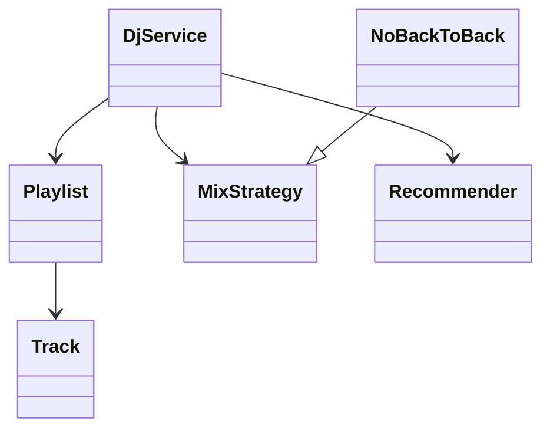

# 音乐播放与播放列表（Playlist DJ）（low priority）

## 题目

设计一个音乐播放服务：用户有若干歌单，服务把它们按规则混成一个播放队列，一首一首往下放，队列快放完时由推荐补歌。用的人是听歌的用户。**面试官真正考的是需求不断追加时，代码能不能只靠「新增一个类」来扩展：混音规则、推荐来源、「同一艺人不连播」这类约束各放哪里。** 音频解码、网络串流不在范围内。

面试官会这样说：「把几个歌单混在一起播，一次一首，还要能暂停和切歌。」

常见追问：

- 再加一种混法：按 2:1 的比例混。
- 同一个艺人不能连着播两首。
- 队列快空时自动推荐，但不要推荐刚播过的歌。

## 先问这几个问题

- 「混」指什么：轮流、随机、按比例？ → **混音做成可替换的策略（strategy）接口。**
- 推荐依据什么：同艺人、热门、历史？ → **推荐也做成接口**，由服务在队列快空时调用。
- 随机要不要可复现？ → 随机策略接收种子，**测试才能稳定。**
- 需求有很多条，哪些第一版必须有？ → 先分档：能播下一首是第一档，其余可口头扩展。
- 多人同时编辑歌单吗？ → 默认单用户；多人放到扩展里谈。

## 核心对象

| 类 | 职责（一句话） | 守住的不变量 |
|---|---|---|
| `Track` | 曲目：id、艺人 | 不可变 |
| `Playlist` | 名字加有序曲目 | 曲目顺序由用户决定 |
| `MixStrategy` | `mix(playlists)` 返回曲目顺序 | 只依赖输入，不改歌单 |
| `NoBackToBack` | 包住任一策略，挑出艺人不连续的顺序 | 实在无法满足时放行，不死循环 |
| `Recommender` | `recommend(history, k)` 返回候选曲目 | 不负责去重 |
| `DjService` | 持有队列和历史，取下一首，必要时补歌 | 队列和最近播放里的歌不会被重复推荐 |



## 主流程

**开始播放 `start(playlists)`：**

1. `DjService` 调用当前策略的 `mix(playlists)`，得到曲目顺序，放进队列。
2. 策略只管顺序，不碰歌单本身，同一份歌单可以反复混。

**取下一首 `next()`：**

1. 队列剩余曲目少于阈值，先调用 `Recommender` 补歌。
2. 推荐结果里去掉队列中和最近播放过的曲目，再追加到队列尾。
3. 弹出队首，记入历史，返回。
4. 队列和推荐都空，返回 `None`，由调用方决定停止。

**「轮流取」的写法：** 每个歌单一个队列，取队首一首，歌单没空就排到队尾，总复杂度 O(总曲目数)。

**这条流程里值得说出口的三点：** 策略只产出顺序，不持有状态，所以同一个策略对象可以被多个用户共用；推荐只在队列快空时才调用，不是每首都调，省掉大量无用调用；历史只记最近若干首，既够去重也不会无限增长。

## 关键决策

### 混音规则：策略接口

混音是最容易被追加的需求：轮流、随机、按比例。**做成只有一个 `mix(playlists)` 方法的接口，`RoundRobin`、`Shuffle(seed)`、`Weighted(ratio)` 各是一个类，`DjService` 持有一个策略对象。** 加一种新混法就是新增一个类，服务和已有策略一行不动。这里用模式是值得的：变化点明确，每条新需求都落在同一个位置。

### 「同艺人不连播」：装饰器，还是改每个策略

新需求是对结果加约束，不是换算法。

- 改每个策略：每个策略都要重复写一遍约束，漏一个就出 bug。
- 装饰器 `NoBackToBack(inner)`：先让内层混出顺序，再逐个挑「艺人和上一首不同」的第一首。

**选装饰器：它可以叠在任何策略上，服务和已有策略都不改。** 判断标准：新需求是「对结果加约束」用装饰器；是「换算法」用新策略。

### 去重放哪一层

推荐实现可以有很多种。去重如果写进每个推荐里，每写一个新推荐都要重复一遍，还容易漏。**去重放在 `DjService` 统一过滤，推荐只负责给候选。**

### 持久化和队列：不需要任何模式

队列就是一个 `deque`，历史就是一个有长度上限的列表。**不需要播放器状态机、不需要观察者**，第一版只要「取下一首」跑通。暂停和切歌如果被追问，再加一个 `state` 字段，而不是预先设计状态模式。

## Python 骨架

```python
import random
from collections import deque
from dataclasses import dataclass


@dataclass(frozen=True)
class Track:
    id: str
    artist: str


@dataclass
class Playlist:
    name: str
    tracks: list


class RoundRobin:  # 轮流取：每个歌单取一首
    def mix(self, playlists):
        queues = [deque(p.tracks) for p in playlists if p.tracks]
        out = []
        while queues:
            q = queues.pop(0)
            out.append(q.popleft())
            if q:  # 没空就排到队尾
                queues.append(q)
        return out


class Shuffle:
    def __init__(self, seed):
        self.rng = random.Random(seed)  # 带种子：可复现

    def mix(self, playlists):
        pool = [t for p in playlists for t in p.tracks]
        self.rng.shuffle(pool)
        return pool


class NoBackToBack:  # 装饰器：包住任意策略
    def __init__(self, inner):
        self.inner = inner

    def mix(self, playlists):
        pool, out = self.inner.mix(playlists), []
        while pool:
            # 挑第一首艺人和上一首不同的；找不到就放行第一首
            i = next((k for k, t in enumerate(pool)
                      if not out or t.artist != out[-1].artist), 0)
            out.append(pool.pop(i))
        return out


class SameArtist:  # 推荐：同艺人的其他歌
    def __init__(self, catalog):
        self.catalog = catalog

    def recommend(self, history, k):
        if not history:
            return []
        return [t for t in self.catalog if t.artist == history[-1].artist][:k]


class DjService:
    LOW = 1  # 队列少于这个数就补歌

    def __init__(self, strategy, recommender):
        self.strategy, self.recommender = strategy, recommender
        self.queue: deque = deque()
        self.history: list = []

    def start(self, playlists):
        self.queue = deque(self.strategy.mix(playlists))

    def next(self):
        if len(self.queue) < self.LOW:
            seen = set(self.queue) | set(self.history)  # 去重统一放在这一层
            fresh = [t for t in self.recommender.recommend(self.history, 5) if t not in seen]
            self.queue.extend(fresh)
        if not self.queue:
            return None
        track = self.queue.popleft()
        self.history.append(track)
        return track


if __name__ == "__main__":
    a1, a2, b1, c1 = Track("a1", "A"), Track("a2", "A"), Track("b1", "B"), Track("c1", "C")
    p1, p2 = Playlist("p1", [a1, a2]), Playlist("p2", [b1, c1])
    assert RoundRobin().mix([p1, p2]) == [a1, b1, a2, c1]  # 轮流
    assert Shuffle(7).mix([p1, p2]) == Shuffle(7).mix([p1, p2])  # 同种子同结果
    mixed = NoBackToBack(RoundRobin()).mix([Playlist("x", [a1, a2]), Playlist("y", [b1])])
    assert all(x.artist != y.artist for x, y in zip(mixed, mixed[1:]))  # 无连播
    svc = DjService(RoundRobin(), SameArtist([a1, a2, b1, c1]))
    svc.start([p1])
    assert [svc.next(), svc.next()] == [a1, a2]
    assert svc.next() is None  # 队列空，推荐的 a1 a2 已播过，被去重
    print("ok")
```

需求多的时候，先用三分钟分档，并把分档说出口：第一档（骨架，必须跑通）是建歌单、加删歌、混成队列、取下一首；第二档（留好接口，实现最简版）是推荐、去重、不连播；第三档（只口头说怎么扩展）是持久化、多人编辑、实时同步。判断标准：这条需求改的是数据、策略，还是核心流程；改策略的可以后做，改核心流程的必须先定。

## 面试官加需求时

| 新需求 | 改哪里 | 不用动哪里 |
|---|---|---|
| 按 2:1 比例混 | 新增 `Weighted` 策略类 | `DjService`、其他策略 |
| 同艺人不连播 | 新增 `NoBackToBack` 装饰器 | 所有已有策略 |
| 热门推荐 | 新增 `Recommender` 实现 | 去重、队列 |
| 单曲循环或随机播放模式 | 新增策略或在服务里加一个模式字段 | 歌单、推荐 |
| 暂停和切歌 | `DjService` 加 `state` 字段和 `skip()` | 混音策略 |
| 多人共享歌单 | 歌单加锁或版本号 | 策略、推荐 |

## 并发与扩展

- 第一版单用户单线程，**队列和历史只被一个播放循环修改**，不需要锁。
- 多人往同一个歌单加歌时，竞争点是歌单的曲目列表：对歌单加一把锁，或每次修改产生新列表（不可变）再原子替换。
- 混音在播放开始时一次算完，之后改歌单不影响当前队列；想要实时跟随，需要版本号，变化时重新混。
- 推荐可能是慢调用（模型、网络）：队列剩余多于阈值时提前异步预取，不要在 `next()` 里同步等。
- 上规模后：歌单和历史落库，队列放缓存，每个用户一个独立队列，天然分片。

## 常见错误

- 把混音规则写成一堆 `if mode == ...`。改成策略接口。
- 随机混音不带种子，测试不稳定。改成注入种子。
- 把「不连播」塞进每个策略。改成包住策略的装饰器。
- 去重写进每个推荐实现。改成服务统一过滤。
- 「不连播」找不到可选曲目时死循环。改成找不到就放行第一首。
- 一开始就设计播放器状态机和观察者。改成先让「取下一首」跑通，被追问再加状态字段。

## 30 秒复述

- 对象：`Track`、`Playlist`、`MixStrategy`、`Recommender`、`DjService`。
- **混音和推荐都是接口，新需求就是新增一个类，服务不动。**
- **「同艺人不连播」是对结果加约束，用装饰器包住任一策略，而不是改每个策略。**
- 去重放在服务层统一做，推荐只给候选。
- 随机带种子，测试可复现。
- 并发：单用户播放循环无锁；多人编辑歌单时给歌单加锁或用不可变列表替换。

## 来源

- [[solution-music-streaming]]
