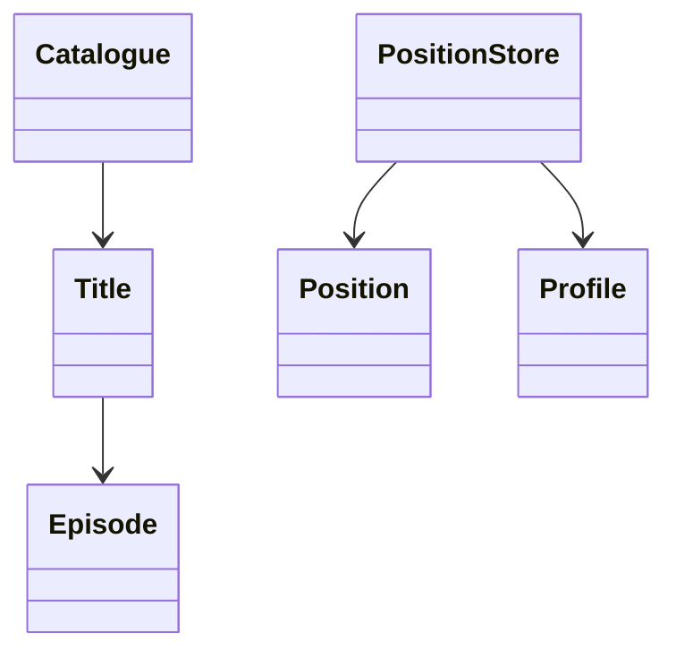

# 视频目录与续播（Video Catalogue）（low priority）

## 题目

设计一个视频目录：用户可以按类型浏览片子，暂停后系统记住看到哪里，下次点开接着看。用的人是同一个账号下的多个用户档案（profile）。**面试官真正考的是两件事：目录和观看位置读写特征相反，要分成两个对象；多设备同时看时，续播点以谁为准。** 视频编码、串流、推荐不在范围内。

面试官会这样说：「用户在电视上看到一半，换手机能接着看。」

常见追问：

- 按类型浏览不要每次扫全库。
- 电视上 20:00，手机上随后暂停在 05:00，以谁为准。
- 用户量到千万级，怎么拆。

## 先问这几个问题

- 位置按什么记？ → 同一账号有多个档案，各看各的，**键是（档案，视频）。**
- 剧集按集记还是按整部记？ → 决定要不要 `Episode`；按集记，「继续观看」取最近更新的一集。
- 两台设备同时在看，以谁为准？ → **决定冲突规则：最后写入者胜（last-writer-wins）。**
- 看到多少算看完？ → 决定何时清除续播点。
- 一部片能有几个类型？ → 决定类型索引是一对多。

## 核心对象

| 类 | 职责（一句话） | 守住的不变量 |
|---|---|---|
| `Title` | 片名、类型列表、电影或剧集 | 不可变 |
| `Episode` | 所属片、季、集、时长 | 一集属于且只属于一部片 |
| `Catalogue` | 添加片子，按类型浏览 | 类型索引和片子表一致 |
| `Position` | 秒数加服务端更新时间 | 不可变 |
| `PositionStore` | `(档案, 视频)` 到 `Position` 的映射 | 旧时间戳的写入不会覆盖新的 |
| `Profile` | 档案，属于账号 | 位置按档案隔离 |



## 主流程

**添加片子 `add(title)`：**

1. 写入片子表。
2. 对片子的每个类型，把片子 id 追加到该类型的列表。

**按类型浏览 `browse(genre)`：** 直接取该类型的 id 列表，再查片子表。耗时和返回条数成正比，不是和全库大小成正比。

**暂停时保存 `save(profile, video, seconds, duration, now)`：**

1. 看到 95% 以上就视为看完，删除续播点，下次从头开始。
2. 否则，如果已存的更新时间比这次写入还晚，**忽略这次写入**，返回 `False`。
3. 否则写入 `Position(秒数, 更新时间)`。

**续播 `resume(profile, video)`：** 读 `(档案, 视频)`，没有就从 0 开始。

这条流程里有两个容易漏的细节：续播点清除要发生在时间戳比较之前，否则看完后一次迟到的旧写入又会把续播点写回来；浏览返回的是片子对象而不是 id，调用方不用再查一次。

## 关键决策

### 按类型浏览：倒排索引，还是扫全库

- 扫全库：代码最少，但每次 O(N)。
- 倒排索引 `genre → id 列表`：加片子时顺手维护，浏览 O(返回条数)。

**选倒排索引，因为浏览是最高频的读操作，索引只是一个 `defaultdict(list)`。** 一部片有多个类型就进多个列表；删片或改类型时要同步更新索引，否则会出现点进去已不存在的片子。

### 多设备冲突：最后写入者胜

电视上看到 20:00，手机上随后暂停在 05:00，续播点怎么定？

- 取秒数更大的：看起来「进度最远」，但用户主动回看前面一段时会被覆盖回去。
- 最后写入者胜：每次写带更新时间，已存的比新写的晚就忽略。

**选最后写入者胜，时间用服务端时间。** 设备时钟可能差几分钟，会让旧写入盖掉新的。弱网设备补发的迟到老写入被丢弃是对的。代价：「手机上回看前面一段」会覆盖电视的 20:00，产品上可接受。

### 剧集：按集记

键仍是 `(档案, 视频)`，其中视频就是具体某一集。「继续观看」取该档案下更新时间最近的一条。**不为整部剧再建一个对象。**

### 什么时候清除续播点

看到 95% 以上就删掉，否则用户会被带到片尾字幕。播放过程中还要每 30 秒写一次心跳，否则暂停前崩溃会丢整段进度。**这是一个阈值判断，不需要状态机。**

## Python 骨架

```python
from collections import defaultdict
from dataclasses import dataclass


@dataclass(frozen=True)
class Title:
    id: str
    name: str
    genres: tuple  # 一部片可以有多个类型


@dataclass(frozen=True)
class Position:
    seconds: int
    updated_at: int  # 服务端时间，不是设备时钟


class Catalogue:  # 所有人共享、读多写少
    def __init__(self):
        self._titles = {}
        self._by_genre = defaultdict(list)  # 倒排索引

    def add(self, title):
        self._titles[title.id] = title
        for g in title.genres:  # 加片子时顺手维护索引
            self._by_genre[g].append(title.id)

    def remove(self, title_id):
        t = self._titles.pop(title_id)
        for g in t.genres:  # 同步清索引，否则点进去已不存在
            self._by_genre[g].remove(title_id)

    def browse(self, genre):
        return [self._titles[i] for i in self._by_genre.get(genre, ())]


class PositionStore:  # 每个档案私有、频繁写
    DONE = 0.95

    def __init__(self):
        self._pos = {}  # (profile, video) -> Position

    def save(self, profile, video, seconds, duration, server_now):
        key = (profile, video)
        if seconds >= self.DONE * duration:  # 看完了：清除续播点
            self._pos.pop(key, None)
            return True
        old = self._pos.get(key)
        if old is not None and old.updated_at > server_now:  # 迟到的老写入：丢弃
            return False
        self._pos[key] = Position(seconds, server_now)
        return True

    def resume(self, profile, video):
        pos = self._pos.get((profile, video))
        return pos.seconds if pos else 0

    def continue_watching(self, profile):  # 该档案最近更新的一条
        mine = [(p.updated_at, v) for (pf, v), p in self._pos.items() if pf == profile]
        return max(mine)[1] if mine else None


if __name__ == "__main__":
    cat = Catalogue()
    cat.add(Title("t1", "Alien", ("scifi", "horror")))
    cat.add(Title("t2", "Dune", ("scifi",)))
    assert [t.id for t in cat.browse("scifi")] == ["t1", "t2"]  # 走索引
    cat.remove("t1")
    assert [t.id for t in cat.browse("scifi")] == ["t2"] and cat.browse("horror") == []
    ps = PositionStore()
    assert ps.save("kid", "t2", 1200, 6000, server_now=10)  # 电视 20:00
    assert ps.save("kid", "t2", 300, 6000, server_now=20)   # 手机 05:00，更晚者胜
    assert ps.resume("kid", "t2") == 300
    assert not ps.save("kid", "t2", 1500, 6000, server_now=5)  # 弱网补发的老写入被丢弃
    assert ps.resume("kid", "t2") == 300 and ps.resume("adult", "t2") == 0  # 档案隔离
    ps.save("kid", "t2", 5800, 6000, server_now=30)  # 超过 95%：清除
    assert ps.resume("kid", "t2") == 0
    print("ok")
```

时间不够时的取舍：先把「目录加按类型浏览」和「保存加续播」两条路径跑通，冲突规则和清除阈值各用一句话说明；剧集、多档案隔离靠键的设计自然得到，不需要额外代码。

## 面试官加需求时

| 新需求 | 改哪里 | 不用动哪里 |
|---|---|---|
| 按演员或年份浏览 | 再加一个倒排索引 | `PositionStore` |
| 多条件筛选（类型且年份） | 取两个索引列表求交集 | 片子表 |
| 观看历史列表 | `PositionStore` 另记一份只追加的历史 | 续播逻辑 |
| 下一集自动播放 | `Catalogue` 加按季集排序的取下一集 | 位置存储 |
| 不同设备分别续播 | 键改成 `(档案, 视频, 设备)` | 目录 |
| 家长控制（按年龄隐藏） | `browse` 加一个过滤参数 | 索引结构 |

## 并发与扩展

- **竞争点：同一 `(档案, 视频)` 同时被两台设备写。** 检查时间戳和写入必须在同一把锁里，或用比较并设置（compare-and-set）。
- 目录读多写少，位置写多读少：**两者分开存放，各自选锁和存储**，目录甚至可以用不可变快照替换。
- 到千万用户后分成两个服务。目录：前面放缓存（CDN），类型索引搬到搜索服务或带二级索引的表，可以接受分钟级过期。续播点：放键值存储，按档案 id 分区，主键 `(档案, 视频)`。
- 续播点要求「自己的写马上读到」，所以靠客户端 30 秒心跳合并成低频写，读走主副本。
- 服务端时间在多机时要用同一时间源，否则「最后写入者」本身不可靠。

## 常见错误

- 位置按账号记，不分档案。改成键 `(档案, 视频)`。
- 冲突时用设备时钟判断先后。改成服务端时间。
- 浏览每次扫全库。改成倒排索引，删片时同步清索引。
- 看完了仍保留续播点，下次直接跳到片尾。改成超过 95% 清除。
- 把目录和位置放在同一个类里。改成两个对象，读写特征不同。
- 删片时只删片子表，忘了清续播点和类型索引。改成删除时一并清理，浏览才不会点进空页面。

## 30 秒复述

- 对象：`Title`、`Episode`、`Catalogue`、`PositionStore`，目录和位置分开。
- **按类型浏览用倒排索引，浏览耗时和返回条数成正比；删片要同步清索引。**
- **位置键是（档案，视频），多设备冲突用服务端时间的最后写入者胜，迟到的老写入丢弃。**
- 看到 95% 清除续播点；播放中 30 秒心跳防崩溃丢进度。
- 并发：比较时间戳和写入在同一把锁里。
- 扩展：目录走缓存加搜索，位置走键值存储按档案分区。

## 来源

- [[solution-music-streaming]]
- [[solution-movie-booking]]
