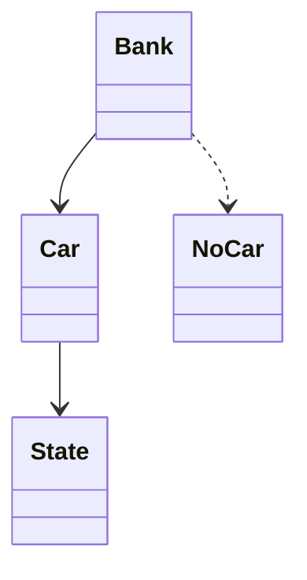

# 电梯系统（Elevator）（low priority）

## 题目

设计一栋楼的电梯系统：楼里有几部电梯，人在楼层外按上或下，在轿厢里按目标楼层，你来决定电梯怎么跑。用的人是乘客和楼宇管理员。**面试官真正考的是三件事：时间怎么建模才能测试、停靠请求怎么存才不会让乘客坐过站、一个外呼怎么保证只派一部梯。** 电机控制和门的机械安全不在范围内。

面试官会这样说：「设计一个多部电梯的调度系统，外呼和内选都要支持。」

常见追问：

- 怎么保证低楼层一直有人时，20 楼不会永远等不到。
- 一部电梯检修停用，它手上的请求怎么办。
- 同一个外呼按了两次，会不会叫来两部梯。

## 先问这几个问题

- 时间怎么建模？ → **问「我可以把时间抽象成离散的 tick 吗」。** 得到肯定后，整套逻辑变成可单步推进、可逐步断言的确定过程，不需要线程和 `sleep`。
- 外呼和内选是一回事吗？ → 外呼带方向（5 楼按「上」），内选不带方向（按 7 楼）。**决定停靠请求要分开存。**
- 允许有人一直等不到电梯吗？ → 不允许，就必须用有方向的扫描算法（SCAN），不能贪心追最近请求。
- 一个外呼由几部梯响应？ → 只能一部。**决定谁来记住「这个外呼派给了谁」。**
- 有没有直达梯、分区梯、检修状态？ → 决定派梯前要有一道过滤。

## 核心对象

| 类 | 职责（一句话） | 守住的不变量 |
|---|---|---|
| `State` | 枚举：待命、行驶、开门 | 只表示「此刻在做什么」 |
| `Car` | 一部电梯：楼层、方向、三个请求集合，`step()` 推进一个 tick | 一个 tick 只做一件事；请求服务后立即移除 |
| `next_stop` | 普通函数：给轿厢状态，回答下一站去哪（SCAN） | 一次扫描最多一个来回 |
| `Bank` | 梯群：分派外呼，持有分派表 | 同一个外呼绝不派给两部梯 |
| `NoCar` | 异常：没有可用轿厢 | 派不出去时不静默丢请求 |



## 主流程

**外呼 `hall_call(floor, direction)`：**

1. 在梯群的锁内先查分派表：这个（楼层，方向）已有主，直接返回同一部梯的 id（幂等）。
2. 没有主：在可用（未停用）轿厢里按距离挑一部，登记到分派表，再把楼层加入该轿厢对应方向的外呼集合。
3. 没有可用轿厢：抛 `NoCar`，不登记。

**推进一个 tick `Car.step()`：**

1. 开着门：倒计时减一，到 0 就回到待命，返回。
2. 问 `next_stop` 要目标楼层。没有目标，待命。
3. 目标就是当前楼层：服务它（从集合里移除，只销掉这一个方向的外呼），开门。
4. 否则朝目标方向走一层。

梯群每个 tick 调用所有轿厢的 `step()`，看到「已服务外呼」事件就从分派表销账。

## 关键决策

### 时间：tick 推进，不用线程加 sleep

- 每部梯一个线程，循环里 `time.sleep`：看上去真实，但测试只能睡眠加运气，调度逻辑和线程生命周期纠缠。
- `step()` 推进一个离散 tick：调度逻辑全是可断言的状态转移，「多久一个 tick」是部署参数。

**选 tick。这里的正确答案是拒绝机器：没有线程池、没有调度器，只有一个方法。** 真实时间只在需要时间戳时才用，通过注入的时钟取得。

### 状态：枚举，停用不进状态机

一状态一类是状态模式的标准形态，但电梯四个状态的行为差异很小，拆成类会得到三个空壳。**选一个 `Enum` 加 `step()` 里的一次分支。** 「停用」和「此刻在做什么」是两个正交的维度，一部梯可以「停用中并且门开着」。塞进枚举会让状态数乘二。**用一个布尔字段 `in_service`，只影响能不能接新外呼，`step()` 完全不看它**，车里的人自然会被送到。

### 停靠请求：三个集合，不用优先队列

- 一个堆：上行时找上方最近，掉头后找下方最近，比较函数随方向翻转，要不断重建。
- 一个集合：丢掉外呼的方向，下行经过 5 楼会给想上行的人开门。

**选 `up_calls`、`down_calls`、`car_calls` 三个集合。** 内选在两个方向都要停，外呼只在方向一致时停。同一层的上下外呼互不吞并；停用时能只撤外呼、不动车里人的内选。

### 外呼派给谁：梯群持有分派表

不记，同一个按钮按两次就叫来两部梯。让轿厢自己记，判断「有没有人接」要遍历所有轿厢，无法被一把锁保护。**选梯群里一张 `dict[(楼层, 方向)] → 梯 id`，一把锁保护**，服务完销账，否则表单调增长。

## Python 骨架

```python
import threading
from enum import Enum

UP, DOWN = 1, -1


class State(Enum):
    IDLE = "idle"
    MOVING = "moving"
    OPEN = "open"


class NoCar(Exception):
    pass


class Car:
    DOOR_TICKS = 2

    def __init__(self, cid, floor=1):
        self.id, self.floor, self.sweep = cid, floor, UP
        self.state, self.door = State.IDLE, 0
        self.up_calls, self.down_calls, self.car_calls = set(), set(), set()
        self.in_service = True  # 与 state 正交，step() 不看它

    def _halls(self, d):
        return self.up_calls if d == UP else self.down_calls

    def next_stop(self):  # SCAN：先走完当前方向，再掉头
        for _ in range(2):
            d = self.sweep
            ahead = lambda f: f >= self.floor if d == UP else f <= self.floor
            pick = min if d == UP else max
            stops = [f for f in self._halls(d) | self.car_calls if ahead(f)]
            if stops:
                return pick(stops)
            far = [f for f in self._halls(-d) if ahead(f)]  # 反方向外呼：去最远的那个
            if far:
                return max(far) if d == UP else min(far)
            self.sweep = -d
        return None

    def _serve(self):
        f, served = self.floor, None
        self.car_calls.discard(f)
        if f in self._halls(self.sweep):  # 只销掉本方向的外呼，反方向的留着
            self._halls(self.sweep).discard(f)
            served = self.sweep
        elif f in self._halls(-self.sweep):
            self.sweep = -self.sweep
            self._halls(self.sweep).discard(f)
            served = self.sweep
        return served

    def step(self):  # 一个 tick 只做一件事；返回已服务的外呼 (楼层, 方向)
        if self.state is State.OPEN:
            self.door -= 1
            if self.door <= 0:
                self.state = State.IDLE
            return None
        target = self.next_stop()
        if target is None:
            self.state = State.IDLE
            return None
        if target == self.floor:
            served = self._serve()
            self.state, self.door = State.OPEN, self.DOOR_TICKS
            return (self.floor, served) if served else None
        self.floor += 1 if target > self.floor else -1
        self.state = State.MOVING
        return None


class Bank:
    def __init__(self, cars, top=20):
        self.cars = {c.id: c for c in cars}
        self.top, self._assigned = top, {}  # (楼层, 方向) -> 梯 id
        self._lock = threading.Lock()

    def hall_call(self, floor, direction):
        if not 1 <= floor <= self.top:
            raise ValueError("bad floor")
        key = (floor, direction)
        with self._lock:  # 检查加登记必须原子
            if key in self._assigned:  # 幂等：重复按钮不叫第二部梯
                return self._assigned[key]
            ok = [c for c in self.cars.values() if c.in_service]
            if not ok:
                raise NoCar(floor)
            car = min(ok, key=lambda c: abs(c.floor - floor))
            car._halls(direction).add(floor)
            self._assigned[key] = car.id
            return car.id

    def tick(self):
        for c in self.cars.values():
            done = c.step()
            if done:  # 已服务：销账，表不会无限增长
                with self._lock:
                    self._assigned.pop(done, None)


if __name__ == "__main__":
    a = Car("A", floor=1)
    bank = Bank([a])
    assert bank.hall_call(3, UP) == "A" and bank.hall_call(3, UP) == "A"  # 重复只算一次
    a.car_calls.add(5)  # 车里有人去 5
    bank.hall_call(4, DOWN)  # 4 楼要下行：上行途中不该停
    seen = []
    for _ in range(30):
        bank.tick()
        if a.state is State.OPEN and a.door == a.DOOR_TICKS:
            seen.append(a.floor)
    assert seen[:2] == [3, 5], seen  # 先 3、再 5，4 楼的下行外呼等掉头
    assert 4 in seen and bank._assigned == {}  # 掉头后服务，分派表已销账
    a.in_service = False
    try:
        bank.hall_call(9, UP)
        raise SystemExit("应当失败")
    except NoCar:
        pass
    print("ok")
```

## 面试官加需求时

| 新需求 | 改哪里 | 不用动哪里 |
|---|---|---|
| 换成「最近请求优先」或别的停靠规则 | 换 `next_stop` 这个函数 | `Bank`、状态枚举 |
| 换派梯规则（轮流、空闲优先） | 抽出 `dispatch` 函数传给 `Bank` | `Car` |
| 一部梯检修停用 | `in_service=False`，梯群撤回外呼重派，内选保留 | `step()` |
| 载重上限 | `Car` 加人数字段，满载时 `next_stop` 忽略外呼 | `Bank` |
| 直达梯、分区梯 | 派梯前加一道楼层过滤 | `Car` |
| VIP 或消防模式 | 在 `next_stop` 前加一个优先请求集合 | 其余请求集合 |

## 并发与扩展

- **竞争点：同一个外呼被两个线程同时派出。** 检查分派表和登记在梯群同一把锁内完成。
- 每部轿厢只被它自己的 `step()` 修改；外部往轿厢加请求时，要么持有轿厢锁，要么把请求放进一个线程安全的队列，在下一个 tick 吸收。
- 分派表在外呼被服务时销账，否则请求数随运行时间单调增长。
- 停用一部梯：先撤回它手上的外呼并重派，保留内选，让它把车里的人送到再停。
- 上规模后：每栋楼一个梯群，天然独立；调度状态可以随时被一个快照完整描述，落库只需存这些集合和位置。

## 常见错误

- 用线程加 `sleep` 模拟时间。改成 `step()` 推进 tick，测试里零 sleep。
- 把外呼和内选放进同一个集合。改成三个集合，外呼带方向。
- 贪心追最近请求，远处楼层饿死。改成 SCAN，一趟扫描最多一个来回。
- 把「停用」做成第五个状态。改成正交的布尔字段。
- 同一个外呼没有去重。改成梯群里的分派表，并在服务后销账。

## 30 秒复述

- 对象：`Car`（枚举状态、三个请求集合）、`next_stop` 函数（SCAN）、`Bank`（分派表加锁）。
- **时间用 tick 推进，不用线程；测试里没有一句 sleep。**
- **停靠请求是上行外呼、下行外呼、内选三个集合：内选两个方向都停，外呼只在方向一致时停。**
- SCAN 保证等待有上界；最近优先会饿死远处楼层。
- **同一个外呼靠梯群里的分派表保证只派一部梯，检查和登记在同一把锁内，服务完销账。**
- 停用是正交布尔字段，撤外呼不撤内选。
- 扩展：换停靠规则只换 `next_stop`，换派梯规则只换 `dispatch`。

## 来源

- [[solution-elevator]]
