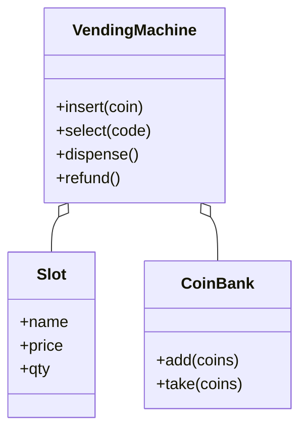

# 自动售货机（Vending Machine）（low priority）

## 题目

一台机器接受硬币，买家选一件商品，机器出货并找零。用它的是站在机器前的买家，补货的是维护人员。顺手能跑通的只是顺路径，**面试官真正在看的是机器必须拒绝的那些时刻：没投币就按选择、出货中再投币、找不开零钱，以及拒绝之后买家的钱还在不在他名下。**

你会听到的原话：设计一台自动售货机，支持投币、选货、出货、找零、退币。

常见追问：
- 零钱找不开的时候怎么办？
- 再加一个刷卡读卡器，状态机要改吗？
- 补货和装币怎么加？

## 先问这几个问题

- 钱怎么表示？**用整数的分，不用 `float`；** 一句话说出口，面试官就知道你处理过金额。
- 投进去的硬币在成交前算谁的？**先放进临时托管槽，成交才并入币箱；** 这样退币退回的就是原来那几枚，不用现凑一个组合。
- 找不开算什么错？**货出来之前就要发现，整笔拒绝；** 这是整题的题眼，先把这个答案和面试官确认。
- 一次买几件，几个买家同时用？默认一次一件、一台机器同一时刻一笔交易，**状态机本身就是这条约束。**
- 要不要刷卡？**答案决定「这笔付款」是一个数字还是一个有两种实现的抽象。**
- 范围外要主动声明：硬币识别硬件、支付网关对接、掉电恢复。

## 核心对象

| 类 | 职责（一句话） | 守住的不变量 |
|---|---|---|
| `State` / `Event` / `TRANSITIONS` | 流程阶段、动作，和「哪个动作在哪个阶段合法」 | 表里没有的组合一律非法，没有第二个地方能放行 |
| `Slot` | 一个货道：商品、价格、库存 | 库存只有这一份真源 |
| `CoinBank` | 币箱里每种面额有几枚 | 计数归零的面额立刻删掉，找零算法不会看到「0 枚」 |
| `change()` | 纯函数：应找金额 + 可用硬币 → 一种凑法或 `None` | 凑不出就返回 `None`，不抛异常 |
| `VendingMachine` | 组织一次购买 | 要么完整成交，要么原样退款；失败路径不改库存、不改币箱 |



没有 `Inventory`、`Display` 这类类：它们只会转发一个字典，守不住任何不变量。屏幕要显示的内容就是「当前状态的提示语 + 余额」。

## 主流程

**买一件（`select` 与 `dispense`）：**
1. `insert(coin)`：查转移表，`IDLE` 或 `COIN_INSERTED` 下的 `PAY` 合法；硬币进托管槽，状态变 `COIN_INSERTED`。
2. `select(code)`：先查转移表，再依次过四道守卫：货道存在、有库存、余额够、**找零方案算得出来**。任何一道没过，抛对应异常，状态和钱原地不动。
3. 守卫全过，把「货道、找零方案」记成待成交（pending），状态变 `DISPENSING`。
4. `dispense()`：在同一把锁里扣库存、托管硬币并入币箱、从币箱取出找零、状态变 `RETURNING_CHANGE`。
5. `collect_change()` 取走找零，回到 `IDLE`。

**退币（`refund`）：** 只在 `COIN_INSERTED` 合法，托管的硬币原样退回。一旦进入 `DISPENSING`，货已经在路上，就不再允许退币。

## 关键决策

### 状态怎么表示：Enum 加转移表，还是一状态一类

- 方案 A，一个状态一个类（State 模式）：每个类实现五个方法，大多数方法都是「抛非法操作」。四个状态五个动作，二十个方法里大半是重复的拒绝。
- 方案 B，`Enum` 加一张转移表：非法组合由表统一拒绝，一个穷举测试就能盖满。
- **选 B，状态的差别只是数据（提示语），不是行为，不需要多态。** 状态之间真有不同行为时再换成状态类。

### 「不行」有两种：非法动作与数据不足

- 非法动作（没投币就选货）：转移表里没有这一项，**抛 `IllegalTransitionError`。**
- 数据不足（余额不够、缺货、找不开）：转移本身合法，是守卫没过，**抛各自的异常，状态原地不动。**
- 分开的理由：界面对两种错误的提示不同，测试也不同。

### 找零：必须在货出来之前算好

- 先出货再发现找不开：机器只能吞掉买家的零钱，这是最招投诉的故障。
- **选在 `select` 里就算出找零方案，算不出就整笔拒绝，买家可以补零钱或按退币。** 找零方案存进 pending，`dispense` 只执行，不再判断。
- 算法注意：币箱缺货时贪心会失败。要找 30 分，币箱里只有 25 和 10 分，贪心先拿 25，剩 5 分凑不出，而三枚 10 分就是解。**真实面额下默认用有界背包（bounded knapsack）动态规划，金额是几百分、硬币几十枚，代价可以忽略。** 简单币制且货足时贪心够用，说清楚它的失效条件即可。

### 刷卡：简单答案先赢

- 只要硬币：付款就是一个 `balance`，不必有 `Tender` 协议。
- **要加刷卡时再把付款抽象成两种实现（现金托管、刷卡预授权），状态机眼里都是同一个 `PAY`，一行不改。** 在面试官没提之前不要先抽象。

## Python 骨架

```python
from __future__ import annotations
import threading
from dataclasses import dataclass
from enum import Enum


class State(Enum):
    IDLE = "待机"
    COIN_INSERTED = "已投币"
    DISPENSING = "出货中"
    RETURNING = "找零中"


class Event(Enum):
    PAY = 1
    SELECT = 2
    DISPENSE = 3
    COLLECT = 4
    REFUND = 5


# 全部合法转移；表里没有的组合一律非法
TRANSITIONS = {
    (State.IDLE, Event.PAY): State.COIN_INSERTED,
    (State.COIN_INSERTED, Event.PAY): State.COIN_INSERTED,
    (State.COIN_INSERTED, Event.SELECT): State.DISPENSING,
    (State.COIN_INSERTED, Event.REFUND): State.IDLE,
    (State.DISPENSING, Event.DISPENSE): State.RETURNING,
    (State.RETURNING, Event.COLLECT): State.IDLE,
}


class VendingError(Exception): pass
class IllegalTransition(VendingError): pass
class OutOfStock(VendingError): pass
class InsufficientFunds(VendingError): pass
class CannotMakeChange(VendingError): pass


@dataclass
class Slot:
    name: str
    price: int  # 分
    qty: int


def make_change(amount: int, avail: dict[int, int]) -> list[int] | None:
    """有界背包：只要存在一种凑法就一定找得到（贪心在缺货时会漏解）。"""
    best: list[list[int] | None] = [None] * (amount + 1)
    best[0] = []
    for coin, n in sorted(avail.items(), reverse=True):
        for _ in range(n):  # 每种面额最多用 n 次
            for t in range(amount, coin - 1, -1):
                if best[t] is None and best[t - coin] is not None:
                    best[t] = best[t - coin] + [coin]
    return best[amount]


class VendingMachine:
    def __init__(self, slots: dict[str, Slot], bank: dict[int, int]) -> None:
        self.slots, self.bank = slots, dict(bank)
        self.state, self.escrow = State.IDLE, []  # escrow: 托管的硬币
        self.pending: tuple[str, list[int]] | None = None
        self.change_ready: list[int] = []
        self._lock = threading.Lock()  # 一台机器一个出货口，一把粗锁足够

    def _next(self, ev: Event) -> State:
        nxt = TRANSITIONS.get((self.state, ev))
        if nxt is None:
            raise IllegalTransition(f"{self.state.name} 下不能 {ev.name}")
        return nxt

    @property
    def balance(self) -> int:
        return sum(self.escrow)

    def insert(self, coin: int) -> int:
        with self._lock:
            self.state = self._next(Event.PAY)
            self.escrow.append(coin)
            return self.balance

    def select(self, code: str) -> None:
        with self._lock:
            nxt = self._next(Event.SELECT)
            slot = self.slots.get(code)
            if slot is None or slot.qty <= 0:
                raise OutOfStock(code)
            if self.balance < slot.price:
                raise InsufficientFunds(f"{slot.price} > {self.balance}")
            # 找零用「币箱 + 刚投入的托管硬币」，货出来之前就算好
            pool = dict(self.bank)
            for c in self.escrow:
                pool[c] = pool.get(c, 0) + 1
            plan = make_change(self.balance - slot.price, pool)
            if plan is None:
                raise CannotMakeChange(f"找不开 {self.balance - slot.price}")
            self.pending, self.state = (code, plan), nxt  # 到这里才改状态

    def dispense(self) -> str:
        with self._lock:
            nxt = self._next(Event.DISPENSE)
            code, plan = self.pending
            self.slots[code].qty -= 1
            for c in self.escrow:  # 先入箱，找零才能用到买家刚投的硬币
                self.bank[c] = self.bank.get(c, 0) + 1
            for c in plan:
                self.bank[c] -= 1
            self.escrow, self.change_ready, self.pending = [], plan, None
            self.state = nxt
            return self.slots[code].name

    def collect(self) -> list[int]:
        with self._lock:
            self.state = self._next(Event.COLLECT)
            change, self.change_ready = self.change_ready, []
            return change

    def refund(self) -> list[int]:
        with self._lock:
            self.state = self._next(Event.REFUND)
            coins, self.escrow = self.escrow, []  # 原封不动退回
            return coins


if __name__ == "__main__":
    vm = VendingMachine({"A1": Slot("可乐", 70, 1)}, {10: 3, 25: 1})
    vm.insert(100)
    vm.select("A1")  # 应找 30：币箱 25+10 贪心会失败，背包给出 3 个 10
    assert vm.dispense() == "可乐" and vm.collect() == [10, 10, 10]
    assert vm.state is State.IDLE and vm.slots["A1"].qty == 0
    try:
        vm.select("A1")  # 待机下选货：非法转移
        raise SystemExit("应抛 IllegalTransition")
    except IllegalTransition:
        pass
    vm2 = VendingMachine({"B1": Slot("糖", 60, 1)}, {})
    vm2.insert(100)
    try:
        vm2.select("B1")  # 币箱空，找不开 40
        raise SystemExit("应抛 CannotMakeChange")
    except CannotMakeChange:
        pass
    assert vm2.state is State.COIN_INSERTED and vm2.slots["B1"].qty == 1
    assert vm2.refund() == [100] and vm2.state is State.IDLE  # 钱原样退回
    print("ok")
```

## 面试官加需求时

| 新需求 | 改哪里 | 不用动哪里 |
|---|---|---|
| 刷卡 | 新增 `CardTender`，与现金托管同一个 `Tender` 协议 | `TRANSITIONS`、状态机方法 |
| 补货、装币 | 加 `restock` / `load_coins`，只在待机且无托管时允许（一道守卫） | 状态枚举，不新增状态 |
| 换找零算法 | 把 `make_change` 作为构造参数注入 | `select` 的守卫顺序 |
| 显示屏 | 订阅状态变化事件，显示提示语和余额 | 机器内部 |
| 一次买多件 | `PendingSale` 带数量，库存检查改为数量 | 转移表 |

## 并发与扩展

- 竞态：**两个线程同时 `insert` 和 `refund`，「查状态、改状态」是读改写，用一把锁罩住每个动作。** 一台机器只有一个出货口，没有并行度可言，细粒度锁只会引入死锁风险。
- 不要在锁里调用外部支付网关：刷卡的预授权放在锁外，拿到结果再进锁改状态。
- 持久化：掉电会丢掉托管的硬币，实际机器要把「托管、pending」写入日志，重启后回滚到退币。
- 规模变大：每台机器独立，中心只收销售流水和库存告警；库存以机器为准，不做分布式事务。

## 常见错误

- 用 `float` 存金额：累加有误差。**用整数分。**
- 先出货再算找零：找不开时只能吞零钱。**`select` 里就算好，`dispense` 只执行。**
- 一投币就并入币箱：退币无法原样退回。**先托管，成交才入箱。**
- 贪心找零不说失效条件：币箱缺货时明明有解却报找不开。**说清楚，或默认用背包。**
- 守卫失败时已经改了状态：钱和状态不一致。**所有检查通过之后才改状态。**

## 30 秒复述

- 对象：`Enum` 状态加一张转移表，`Slot` 管库存，`CoinBank` 管硬币，找零是一个纯函数，`VendingMachine` 把它们串成一次购买。
- 核心决策：非法动作由转移表统一拒绝，数据不足由守卫拒绝，两种错误分开。
- 找零方案在货出来之前算好，算不出整笔拒绝，买家的钱一分不少。
- 硬币先托管、成交才入箱，所以退币是原样退回。
- 扩展：刷卡是第二种付款实现，补货是一道守卫，状态机都不动。
- 并发：一把锁罩住每个动作；外部调用放锁外。

## 来源

- [[solution-vending-machine]]
