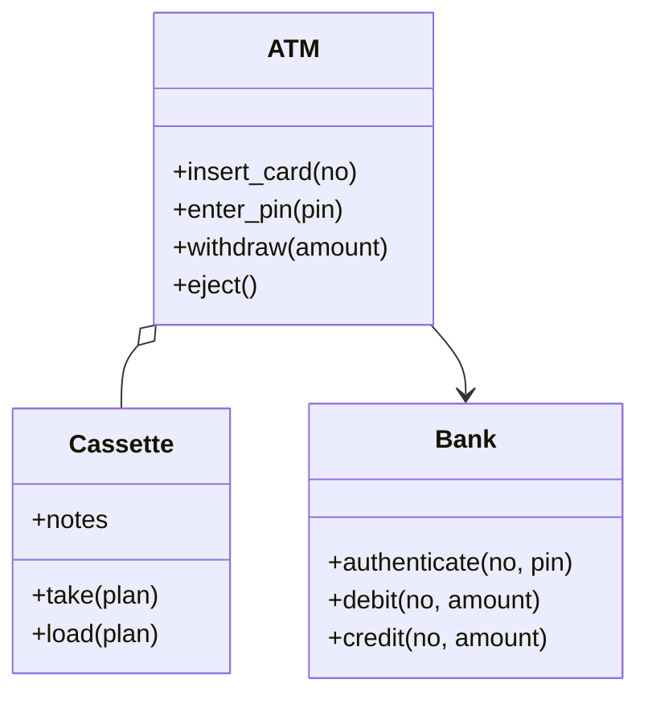

# ATM 取款机（ATM）（low priority）

## 题目

客户插卡、输 PIN、查余额、取钱、存钱，机器从自己的钞箱里吐钞，账记在银行那边。**面试官真正在看的是两件事：一是机器和银行是两个权威，没有一次提交能同时管住「扣账」和「吐钞」，先后顺序怎么定、出事怎么补；二是「连错三次吞卡」这个计数到底归机器还是归银行。**

你会听到的原话：设计一台 ATM，支持插卡、验证 PIN、取款、查余额、存款；钞箱里有几种面额。

常见追问：
- 扣了账但钞没吐出来怎么办？
- 再接第二家银行要改什么？
- 取款金额凑不出来时怎么提示？

## 先问这几个问题

- 钱怎么表示？**整数的分，面额用枚举。**
- PIN 错误次数怎么算？**次数是卡的属性，不是机器的属性，要放在发卡行；** 否则小偷换一台机器就清零。
- 取款失败有哪几种？**金额不是最小面额的倍数、机器钞箱总额不够、总额够但凑不出，三种提示不同。** 先确认要分开。
- 存款当场入账吗？默认现金存款直接入账；支票、延迟入账放范围外。
- 机器同时只服务一个人吗？**是，会话状态就是一个枚举，没有并发会话，也就不需要会话表。**
- 范围外要主动声明：读卡硬件、网络协议、纸质凭条、多币种。

## 核心对象

| 类 | 职责（一句话） | 守住的不变量 |
|---|---|---|
| `Bank` | 账户权威：验 PIN、扣款、入账、记失败次数 | 余额不为负；失败次数和冻结都在这里 |
| `Cassette` | 本机钞箱：每种面额几张 | 张数不为负；取走前已验证够 |
| `ATM` | 一次会话的协调者：状态、选钞、先扣账后吐钞 | 回滚只发生在本地那一半 |
| `Session` 状态 | 无卡、已插卡、已验证 | 未验证不能取款，状态由枚举加检查表达 |



## 主流程

一次会话分三段：插卡、验证、交易。机器本身不知道谁有多少钱，它只持有钞箱和一个当前卡号；一切关于账户的事实都向银行问。下面写最容易被追问的两个操作：取款决定钱和钞的先后，输 PIN 决定次数由谁数。每一步都先问「这一步失败了，另一半还能不能原样放回」。

**取款（`withdraw`）：**
1. 检查会话已验证，金额为正。
2. **选钞：** `plan(amount)` 先查是否是最小面额的倍数、钞箱总额是否够，再从大面额往小拿；凑不出就报错。此刻钞箱一张没动。
3. **留钞：** 把 `plan` 从钞箱里 `take` 出来，之后没有人能再取走这些钞。
4. **扣账：** `bank.debit`。失败（余额不足、账户冻结、网络错误）就把钞票 `load` 放回钞箱，原样抛出。
5. 扣账成功，钞票交给出钞口，返回给客户。

**输 PIN（`enter_pin`）：** 交给 `bank.authenticate`，银行数失败次数；第三次错误银行冻结卡，机器看到冻结就吞卡。输对一次，计数清零。

## 关键决策

### 密码错误次数归谁

- 方案 A，机器里 `self._attempts += 1`：单机演示没问题；小偷在每台机器上各试两次，永远触发不了冻结。
- 方案 B，银行按卡号记失败次数。
- **选 B：次数是卡的属性，不是机器的属性。** 机器只负责看到「冻结」后吞卡。

### 先扣账还是先吐钞：两个权威之间没有事务

- 先吐钞再扣账：钞票一旦出去就收不回来，扣账失败只能事后追人。把不可逆的一步放在可逆之前，方向错了。
- 先扣账再吐钞：钞箱在检查和取走之间可能被另一笔交易掏空，账扣了钞没有，只能事后冲正。
- **选第三种：先从钞箱留钞，再扣账，扣成了才交给出钞口。** 纪律只有一条：**回滚永远只发生在本地那一半。** 钞箱在本进程、同一把锁下，放回去一定成功；账户在对面，动了就放不回，只能补一笔冲正。
- 卡钞、客户没取走这类事故做不到零损失，只能做到可发现：钞票进回收箱，向银行发冲正，流水里新增一条冲正记录，原记录永远不改。

### 选钞：简单的贪心赢，不要责任链

- 责任链（一个 handler 一种面额）：每增加面额就多一个类，顺序藏在装配里。
- **选一个函数：从大面额往小面额贪心，凑不出就报错。** 常见面额（100、50、20）下贪心正确，三种失败分别抛不同异常。面额组合怪异（如 50 和 30）时贪心会漏解，说一句改用背包即可，不要提前做。

### 取款、存款、查询：不要三个类

- 每种交易一个 Command 类，只有一个 `execute`。
- **选三个方法加一个共用的「要求已验证」检查。** 交易记录就是一条流水数据，不需要类层级。

## Python 骨架

```python
from __future__ import annotations
import threading
from enum import Enum


class ATMError(Exception): pass
class WrongPin(ATMError): pass
class CardBlocked(ATMError): pass
class NotAuthenticated(ATMError): pass
class InsufficientFunds(ATMError): pass
class BadAmount(ATMError): pass          # 不是最小面额的倍数
class OutOfCash(ATMError): pass          # 钞箱总额不够
class CannotCompose(ATMError): pass      # 总额够但凑不出


class Bank:
    """账户权威：余额、PIN、失败次数都在这里。"""
    def __init__(self, max_attempts: int = 3) -> None:
        self.cards: dict[str, tuple[str, int]] = {}  # 卡号 -> (pin, 余额分)
        self.failed: dict[str, int] = {}
        self.blocked: set[str] = set()
        self.max_attempts = max_attempts
        self._lock = threading.Lock()

    def authenticate(self, card: str, pin: str) -> None:
        with self._lock:
            if card in self.blocked:
                raise CardBlocked(card)
            if self.cards[card][0] != pin:
                n = self.failed.get(card, 0) + 1
                self.failed[card] = n
                if n >= self.max_attempts:
                    self.blocked.add(card)
                    raise CardBlocked(card)
                raise WrongPin(f"还剩 {self.max_attempts - n} 次")
            self.failed.pop(card, None)  # 输对一次清零

    def debit(self, card: str, amount: int) -> None:
        with self._lock:  # 读余额、判断、写回在一把锁里
            pin, bal = self.cards[card]
            if bal < amount:
                raise InsufficientFunds(f"{bal} < {amount}")
            self.cards[card] = (pin, bal - amount)

    def credit(self, card: str, amount: int) -> None:
        with self._lock:
            pin, bal = self.cards[card]
            self.cards[card] = (pin, bal + amount)

    def balance(self, card: str) -> int:
        return self.cards[card][1]


class State(Enum):
    IDLE = 1
    CARD_IN = 2
    AUTHED = 3


class ATM:
    def __init__(self, bank: Bank, notes: dict[int, int]) -> None:
        self.bank, self.notes = bank, dict(notes)  # notes: 面额(分) -> 张数
        self.state, self.card = State.IDLE, ""
        self._lock = threading.Lock()  # 保护钞箱和会话

    def insert_card(self, card: str) -> None:
        with self._lock:
            if self.state is not State.IDLE:
                raise ATMError("机器正在使用")
            self.state, self.card = State.CARD_IN, card

    def enter_pin(self, pin: str) -> None:
        with self._lock:
            try:
                self.bank.authenticate(self.card, pin)
            except CardBlocked:
                self._eject()  # 吞卡
                raise
            self.state = State.AUTHED

    def _plan(self, amount: int) -> dict[int, int]:
        """选钞：三种「取不出」分开报错；此刻钞箱一张没动。"""
        if amount <= 0 or amount % min(self.notes) != 0:
            raise BadAmount(amount)
        if amount > sum(d * n for d, n in self.notes.items()):
            raise OutOfCash(amount)
        plan, rest = {}, amount
        for d in sorted(self.notes, reverse=True):
            k = min(rest // d, self.notes[d])
            if k:
                plan[d], rest = k, rest - d * k
        if rest:
            raise CannotCompose(amount)
        return plan

    def withdraw(self, amount: int) -> dict[int, int]:
        with self._lock:
            if self.state is not State.AUTHED:
                raise NotAuthenticated()
            plan = self._plan(amount)
            for d, k in plan.items():  # 先留钞：之后没人能再取走
                self.notes[d] -= k
            try:
                self.bank.debit(self.card, amount)
            except ATMError:
                for d, k in plan.items():  # 回滚只在本地这一半
                    self.notes[d] += k
                raise
            return plan  # 扣账成功才交到出钞口

    def balance(self) -> int:
        with self._lock:
            if self.state is not State.AUTHED:
                raise NotAuthenticated()
            return self.bank.balance(self.card)

    def eject(self) -> None:
        with self._lock:
            self._eject()

    def _eject(self) -> None:
        self.state, self.card = State.IDLE, ""


if __name__ == "__main__":
    bank = Bank()
    bank.cards["c1"] = ("1234", 100_00)
    atm = ATM(bank, {50_00: 2, 10_00: 8})
    atm.insert_card("c1")
    try:
        atm.withdraw(20_00)  # 未验证
        raise SystemExit("应抛 NotAuthenticated")
    except NotAuthenticated:
        pass
    atm.enter_pin("1234")
    assert atm.withdraw(70_00) == {50_00: 1, 10_00: 2}
    assert atm.balance() == 30_00 and atm.notes == {50_00: 1, 10_00: 6}
    try:
        atm.withdraw(40_00)  # 余额只有 30，扣账失败，钞票要放回
        raise SystemExit("应抛 InsufficientFunds")
    except InsufficientFunds:
        assert atm.notes == {50_00: 1, 10_00: 6}
    try:
        atm.withdraw(5_00)
        raise SystemExit("应抛 BadAmount")
    except BadAmount:
        pass
    atm.eject()
    atm.insert_card("c1")
    for _ in range(2):
        try:
            atm.enter_pin("0000")
        except WrongPin:
            pass
    try:
        atm.enter_pin("0000")  # 第三次错误：银行冻结，机器吞卡
        raise SystemExit("应抛 CardBlocked")
    except CardBlocked:
        assert atm.state is State.IDLE
    print("ok")
```

## 面试官加需求时

| 新需求 | 改哪里 | 不用动哪里 |
|---|---|---|
| 第二家银行 | `Bank` 抽成协议，按卡号前缀路由到不同实现 | `ATM` 的取款流程 |
| 存款 | `ATM.deposit`：先收钞进钞箱，再 `credit`，失败则钞票进回收箱 | 选钞和取款 |
| 查看流水 | `Bank` 的每次扣款记一条流水 | 钞箱、状态 |
| 每日限额 | 银行侧加当日累计，和余额检查放同一把锁 | `ATM` |
| 新面额 | 钞箱字典里多一个键 | 选钞函数 |
| 对账 | 加不变式：装入 = 钞箱 + 出钞口 + 回收箱 + 已取走 | 其它所有 |

## 并发与扩展

- 竞态 1：**同一张账户在两台 ATM 上同时取款，银行的「读余额、判断、扣减」放在同一把锁里。** 不然两台机器都看到余额够，各取一次，账户变负。
- 竞态 2：同一台机器的钞箱，留钞（检查加取走）要在 ATM 的锁里一步完成。
- 扣账请求要带一个唯一引用号（ref）：网络超时重发时，银行用它去重，不会重复扣款。
- 规模变大后：银行是远程服务，扣账超时的结果未知，要按 ref 查询状态再决定回滚还是冲正；机器本地的钞箱和流水落盘，重启后能恢复。

## 常见错误

- 在机器里数 PIN 错误次数：换台机器就清零。**放银行，按卡号记。**
- 先吐钞再扣账：扣账失败时钞已经出去。**先留钞、再扣账、成功才交钞。**
- 扣账失败后改写原流水：销毁证据。**冲正是新增一条带原引用号的记录。**
- 三种「取不出」用同一个错误：客户不知道该换金额还是换机器。**分三个异常。**
- 未验证就允许查余额或取款：**每个交易方法先检查状态。**
- 吞卡后不清会话：下一位客户插卡会继承上一个人的已验证状态。**吞卡和退卡都回到无卡，并清掉卡号。**

## 30 秒复述

- 对象：`Bank` 是账户权威，`Cassette`（钞箱）和 `ATM` 在本机，状态是无卡、已插卡、已验证三种。
- 核心决策：PIN 错误次数归银行，按卡号记，机器看到冻结就吞卡。
- 取款顺序：选钞、留钞、扣账、成功才交钞；回滚只在本地那一半，银行那一半只能冲正。
- 选钞用一个贪心函数，三种取不出分三个异常；不用责任链，也不为三种交易建三个类。
- 并发：银行扣款的读、判、写在一把锁里；机器的钞箱在自己的锁里；扣账请求带引用号去重。

## 来源

- [[solution-atm]]
