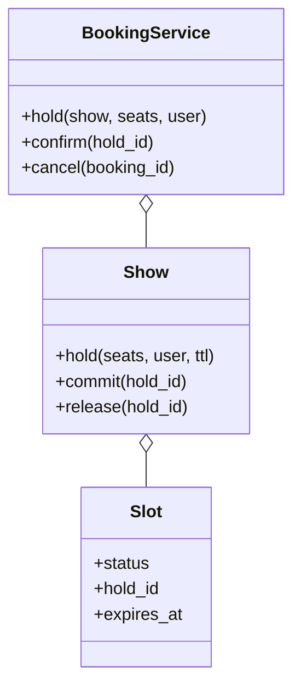

# 电影订票（Movie Ticket Booking）（low priority）

## 题目

影院有若干影厅，每个影厅有一张座位图，每个场次（show）是「某部电影在某个影厅的某个时间」。用户选座、付款、拿到订单，也可以取消。同一个座位同一场只能卖给一个人，用户选座到付款之间要先把座位占住一小段时间。**面试官真正在看的是：「这个座位被谁占着」这份状态放在哪个对象里、占座过期怎么释放、锁加多大、付款这种慢的外部调用放不放在锁里。**

你会听到的原话：设计一个电影订票系统，用户可以按城市和电影查场次，选座，付款，取消。

常见追问：
- 两个人同时抢同一个座位，怎么保证只有一个人成功？
- 占座十分钟不付款，座位怎么放回去？
- 支付网关很慢，你的锁会不会被拖住？

## 先问这几个问题

- 占座要不要有时限？**要，选座和付款之间有一个占座窗口（TTL）；没有它，一个人开着页面就能锁死整场。**
- 一次能选几个座？**多座必须整笔成功或整笔失败，不能买到一半。**
- 价格按座位类型还是固定？先按座位类型定价；**价格做成可替换的函数**，加周末加价不改核心。
- 取消退款怎么算？先问是否有退款规则；**策略也是一个函数，按开场前多久分档。**
- 范围外要主动声明：真实支付、通知、座位图的可视化、候补队列。

## 核心对象

| 类 | 职责（一句话） | 守住的不变量 |
|---|---|---|
| `Show` | 一个场次：持有这一场每个座位的状态 | 一个座位同一时刻只有一个状态；一场一把锁 |
| `Slot`（座位状态） | 不可变小记录：状态、占用者、过期时间 | 每场一份真源，没有第二张表 |
| `Booking` | 一笔订单 | 订单的座位和场次里 BOOKED 的座位一致 |
| `BookingService` | 目录和订单表，协调占座、付款、确认 | 不在持有服务锁时去拿场次锁 |
| `Clock` / `Payment` | 注入的时钟和支付网关 | 时间和外部调用都可替换，测试可控 |



## 主流程

**占座（`hold`）：**
1. 取当前时间 `now`，进入这一场的锁。
2. 逐个检查要选的座位：存在，并且按「惰性判断」是空闲的（已过期的占用等同空闲）。
3. 有一个不空闲就整笔失败，抛 `SeatNotAvailable`，一个座位都不改。
4. 全部空闲，把它们写成 HELD，带上收据号 `hold_id` 和过期时间，返回收据。

**确认（`confirm`，两段式）：**
1. 锁内：验证收据还活着，把过期时间延长一个支付窗口，释放锁。
2. **锁外：调用支付网关。**
3. 锁内：把这些座位从 HELD 翻成 BOOKED，记录订单。
4. 支付失败就释放占座；第 3 步发现收据已失效（支付比窗口还慢），宁可抛错并提示退款，也不覆盖别人的订单。

## 关键决策

### 「谁占着座位」归谁持有

- 方案 A，挂在物理座位上：一个影厅的座位被所有场次共用，状态挂上去就要给每场克隆一份。
- 方案 B，挂在订单和收据上：查「A7 还空着吗」要遍历所有订单，「没被占」没有任何对象守着。
- 方案 C，全局的锁座表：已售在场次里、占用在表里，两份真源，一把全局锁串行化所有场次，过期条目没人删就泄漏。
- **选：每个 `Show` 自己持有一张「座位号到 Slot」的表。** 每场一份真源，一次字典查找得到状态；状态只有空闲、占用、已订三种，用 `Enum` 加不可变小记录，不为此建三个状态类。

### 过期释放：惰性判断，不靠后台线程

- 只靠后台清扫：清扫间隔内，已过期的座位仍显示被占，用户看到空座买不到；测试要么 sleep，要么把线程调度也注入。
- **选惰性判断：每次读写都拿注入的时钟和过期时间比，过期的占用一律当作空闲。** 正确性完全不依赖后台任务；清扫只是把结论落实、清掉残留，可有可无。测试里一次清扫都不调，把时钟拨快十一分钟，可用座位数必须已经恢复。
- 不为此上按到期时间排序的堆：那是第二份必须和座位表同步的状态，影厅几百个座，扫一遍是微秒级。

### 锁的粒度：一场一把

- 全局一把：首映日全国所有场次的下单排同一条队，而它们之间没有共享数据。
- 一座一把：选三个座要拿三把锁，必须按座位号排序，否则死锁。
- **选一场一把，放在 `Show` 里。** 竞争边界和数据边界重合；一笔下单只涉及一个场次，永远不会同时持两把场次锁，死锁从问题定义上就不存在。GIL 不保护「读状态、判断、写状态」这种复合操作，这把锁是为正确性加的。

### 付款放锁内还是锁外：两段式

- 整个 `confirm` 包在锁里：支付网关抖动三秒，这一场所有人的选座都被堵住。
- **选两段：锁内延长占座并检查，锁外付款，锁内提交。** 延长发生在锁内，所以和抢座之间没有缝隙，付款途中清扫线程跑过也扫不走这些座位。不引入新的状态和模式。

## Python 骨架

```python
from __future__ import annotations
import threading
import uuid
from dataclasses import dataclass, replace
from datetime import datetime, timedelta
from enum import Enum
from typing import Callable


class BookingError(Exception): pass
class SeatNotAvailable(BookingError): pass
class HoldExpired(BookingError): pass
class PaymentFailed(BookingError): pass


class SeatStatus(Enum):
    AVAILABLE = 1
    HELD = 2
    BOOKED = 3


@dataclass(frozen=True)
class Slot:  # 不可变：状态变化 = 换一个新的 Slot
    status: SeatStatus = SeatStatus.AVAILABLE
    hold_id: str | None = None
    expires_at: datetime | None = None


class Show:
    def __init__(self, seats: list[str], clock: Callable[[], datetime]) -> None:
        self.slots = {s: Slot() for s in seats}  # 每场一份真源
        self.clock = clock
        self._lock = threading.Lock()  # 一场一把

    def _status(self, s: Slot, now: datetime) -> SeatStatus:
        if s.status is SeatStatus.HELD and s.expires_at <= now:
            return SeatStatus.AVAILABLE  # 惰性：过期的占用当作空闲
        return s.status

    def hold(self, seats: list[str], ttl: timedelta) -> str:
        with self._lock:
            now = self.clock()
            for x in seats:
                if x not in self.slots or self._status(self.slots[x], now) is not SeatStatus.AVAILABLE:
                    raise SeatNotAvailable(x)  # 整笔失败，一个都没改
            hid = uuid.uuid4().hex
            for x in seats:
                self.slots[x] = Slot(SeatStatus.HELD, hid, now + ttl)
            return hid

    def _mine(self, hid: str, now: datetime) -> list[str]:
        return [k for k, s in self.slots.items()
                if s.hold_id == hid and self._status(s, now) is SeatStatus.HELD]

    def extend(self, hid: str, window: timedelta) -> list[str]:
        with self._lock:  # 锁内验证并延长
            now = self.clock()
            mine = self._mine(hid, now)
            if not mine:
                raise HoldExpired(hid)
            for k in mine:
                self.slots[k] = replace(self.slots[k], expires_at=now + window)
            return mine

    def commit(self, hid: str, seats: list[str]) -> None:
        with self._lock:
            now = self.clock()
            if sorted(self._mine(hid, now)) != sorted(seats):
                raise HoldExpired(hid)  # 付款期间收据失效：不覆盖别人的订单
            for k in seats:
                self.slots[k] = Slot(SeatStatus.BOOKED, hid)

    def release(self, hid: str) -> None:
        with self._lock:
            for k, s in self.slots.items():
                if s.hold_id == hid and s.status is SeatStatus.HELD:
                    self.slots[k] = Slot()

    def available(self) -> int:
        with self._lock:
            now = self.clock()
            return sum(self._status(s, now) is SeatStatus.AVAILABLE for s in self.slots.values())


class BookingService:
    def __init__(self, pay: Callable[[str, int], bool], window=timedelta(minutes=2)) -> None:
        self.pay, self.window = pay, window
        self.bookings: dict[str, tuple[Show, list[str]]] = {}
        self._lock = threading.Lock()  # 只保护订单表，绝不在持有它时拿场次锁

    def confirm(self, show: Show, hid: str, price: int) -> str:
        seats = show.extend(hid, self.window)  # 1) 锁内：延长占座
        if not self.pay(hid, price * len(seats)):  # 2) 锁外：慢的外部调用
            show.release(hid)
            raise PaymentFailed(hid)
        show.commit(hid, seats)  # 3) 锁内：翻成 BOOKED
        with self._lock:
            self.bookings[hid] = (show, seats)
        return hid


if __name__ == "__main__":
    now = [datetime(2026, 10, 19, 18, 0)]
    show = Show(["A1", "A2", "A3"], lambda: now[0])
    svc = BookingService(lambda hid, amount: amount <= 3000)
    h1 = show.hold(["A1", "A2"], timedelta(minutes=10))
    try:
        show.hold(["A2", "A3"], timedelta(minutes=10))  # A2 已被占：整笔失败，A3 不受影响
        raise SystemExit("应抛 SeatNotAvailable")
    except SeatNotAvailable:
        assert show.available() == 1
    now[0] += timedelta(minutes=11)  # 不调用任何清扫，时钟拨快
    assert show.available() == 3  # 惰性过期：座位已经恢复
    h2 = show.hold(["A1", "A2"], timedelta(minutes=10))
    assert svc.confirm(show, h2, 1000) == h2
    assert show.slots["A1"].status is SeatStatus.BOOKED
    try:
        show.hold(["A1"], timedelta(minutes=10))  # 已订座位不能再占
        raise SystemExit("应抛 SeatNotAvailable")
    except SeatNotAvailable:
        pass
    h3 = show.hold(["A3"], timedelta(minutes=10))
    try:
        svc.confirm(show, h3, 5000)  # 付款失败：座位释放
        raise SystemExit("应抛 PaymentFailed")
    except PaymentFailed:
        assert show.available() == 1
    print("ok")
```

## 面试官加需求时

| 新需求 | 改哪里 | 不用动哪里 |
|---|---|---|
| 周末加价、按行加价 | 价格函数外面再包一层函数 | `Show` 和锁 |
| 取消和分档退款 | 退款策略函数，取消时 `release_booking` 把 BOOKED 翻回空闲 | 占座和确认 |
| 按城市、电影查场次 | `BookingService` 目录加一个按城市索引的字典 | `Show` |
| 候补队列 | 取消释放座位后，通知队首并给他一个占座 | 座位表 |
| 不同影厅布局 | 座位图是创建 `Show` 的输入 | 占座逻辑 |
| 多城市大规模 | 场次按 id 分片，每个场次仍是单一写入者 | 单场的状态机 |

## 并发与扩展

- 竞态 1：**两个人同时抢同一个座，检查加写入都在同一场的锁里，先拿到锁的人成功，另一个得到 `SeatNotAvailable`。** 测试用 `Barrier` 放行两个线程，断言恰好一个成功。
- 竞态 2：付款期间收据过期、座位被别人买走：`commit` 重新核对，宁可抛错并提示退款，也不覆盖。
- 纪律：服务锁和场次锁不嵌套；`release_expired` 先在服务锁内取场次快照，出锁，再逐场拿各自的锁。
- 规模变大后：座位状态放进外部存储，占座用「带过期时间的条件写入」（如 Redis 的 `SET NX PX`）替代进程内锁；惰性判断的思路不变。

## 常见错误

- 把座位状态挂在物理座位上：一个影厅多个场次会互相串。**状态挂在场次里。**
- 只靠后台线程释放过期占座：两次清扫之间用户看到空座买不到。**读写时惰性判断。**
- 整个确认流程包在锁里调用支付：网关一抖整场卡死。**锁内延长、锁外付款、锁内提交。**
- 多座逐个占：买到一半失败留下残留。**先全部检查，再全部写入。**
- 在 `confirm` 里直接 `datetime.now()`：测不了过期。**注入时钟。**

## 30 秒复述

- 对象：`Show` 持有这一场每个座位的状态，`Slot` 是不可变小记录，`BookingService` 管订单并协调。
- 核心决策：座位状态归场次持有，每场一份真源，每场一把锁。
- 过期靠惰性判断，不靠后台线程；清扫只是落实。
- 付款两段式：锁内延长，锁外付款，锁内提交；收据失效就抛错提示退款，不覆盖别人。
- 价格和退款是可替换的函数，加规则不改核心。
- 并发：抢座的检查和写入在同一把场次锁里；规模变大换成外部存储的条件写入。

## 来源

- [[solution-movie-booking]]
