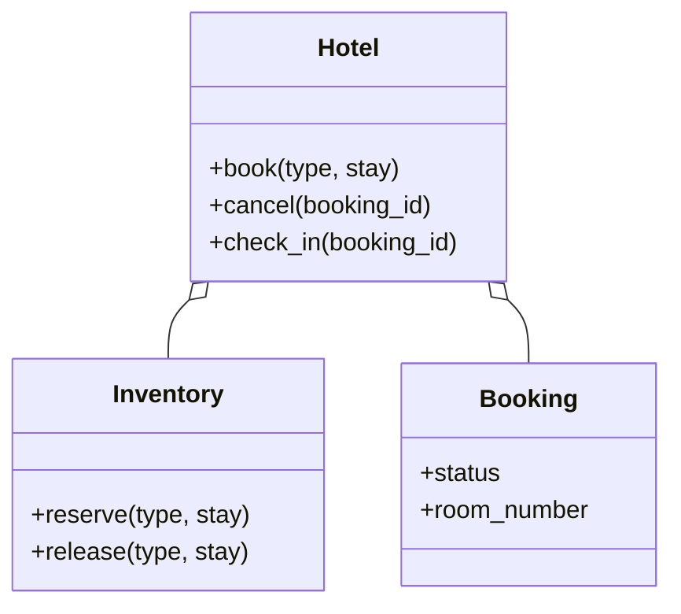

# 酒店预订（Hotel Booking）（low priority）

## 题目

酒店有几种房型，每种房型有若干间房。客人给出入住和退房日期、房型，系统查有没有房、下单、取消，到店当天才分到具体房间。用它的是客人和前台。**面试官真正在看的是：库存的单位是什么（一晚，不是一间房）、多晚预订的「查加订」怎么做到整段原子、房间为什么晚绑定，以及要不要为区间查询上线段树。**

你会听到的原话：设计一个酒店预订系统，支持按日期和房型查可订房、预订、取消、入住。

常见追问：
- 同时两个人订最后一间房，怎么办？
- 五晚预订，第四晚没房了，前三晚的库存会不会白扣？
- 能不能允许超卖，像航空公司那样？

## 先问这几个问题

- 订单订的是房型还是具体房间？**订房型；到店时再分房。** 这决定库存是「每晚一个计数」而不是「每间房一条时间线」。
- 退房当天算不算占用？**不算，区间是半开的 `[入住, 退房)`。** 6 月 3 日上午退房的人和下午入住的人不冲突。
- 取消有没有费用或期限？先做简单取消（库存立刻放回），**政策做成可替换的函数。**
- 允许超卖吗？默认不允许；**以后加超卖，只改「可订量」的判断，不碰库存结构。**
- 范围外要主动声明：支付、动态定价的数据来源、多酒店搜索排序、房间清洁排期。

## 核心对象

| 类 | 职责（一句话） | 守住的不变量 |
|---|---|---|
| `Stay` | 入住和退房日期，提供「每一晚」的迭代 | 退房晚于入住；区间半开 |
| `Inventory` | 每个房型的总间数和每晚已订数 | 每晚已订数不超过总数；查和订在一把锁里 |
| `Booking` | 一笔订单，状态：已确认、已入住、已取消 | 状态只按转移表走；入住前 `room_number` 为空 |
| `Hotel` | 对外入口：预订、取消、入住 | 取消只放回一次库存 |
| `FrontDesk`（入住分房） | 到店时从该房型的空房里挑一间 | 同一间房同一时刻只住一个人 |



## 主流程

**预订（`book`）：**
1. 校验日期：退房晚于入住，入住不早于今天。
2. 进入库存的锁，对区间里每一晚检查「总数减已订数」是否大于 0。
3. 有任何一晚没房，抛 `NoAvailability` 并说出是哪一晚；此刻一个计数都没动。
4. 每一晚都有房，才对每一晚计数加一，生成订单（`room_number` 为空）。

**取消（`cancel`）：**
1. 订单必须是已确认状态，否则抛错（转移表里没有这一项）。
2. 状态改为已取消，对每一晚计数减一；减到 0 的格子从字典里删掉。

**入住（`check_in`）：** 前台从该房型当前没人住的房间里挑一间，写回订单；挑不出来抛 `NoRoomToAssign`，这就是现实里「升级房型或安排到隔壁」的那一刻。

## 关键决策

### 库存的单位：晚，不是房间

- 单位是「一间房的一段连续区间」：要处理区间合并、切分、冲突检测，全部来自一个可以不做的决定：提前指定房间。
- **选「一个房型的一晚」：可订量是每晚一个整数。** 区间半开，判重叠只剩 `a.入住 < b.退房 and b.入住 < a.退房`；加减计数能在一把锁里原子完成。
- 提前分房还会碎片化：1207 房被订走 1 到 2 号和 4 到 5 号，3 号单独空着，想住 1 到 5 号的客人明明全店有连续空房，系统却找不到。**所以房间晚绑定，到店才分。**

### 区间可订量：朴素计数表，不用线段树

- 区间列表：写入 O(1)，查询要扫所有重叠订单，越积越慢。
- 线段树：区间加加区间最小值，O(log n)。
- **选按晚计数表（`dict[(房型, 晚)] -> 已订数`）。** 一次入住典型 1 到 5 晚，只动 1 到 5 个键；线段树一次 3 晚要走几十个结点，还要把日期映射成下标，反而更慢也更长。线段树在单次操作跨越很多格子时才赢（月租公寓、按分钟订的会议室）。判据是「区间长度相对格子数大不大」，不是哪个听起来高级。

### 多晚预订的原子性：先全查，再全写

- 边查边写：五晚订单第四晚发现满了，前三晚已经扣了，库存凭空少了三晚。单线程就能复现，月底对账才发现。
- 先乐观写入、失败再回滚：回滚窗口里别人能看到从未存在过的状态。
- **选「锁内先全量检查，再全量写入」。** 检查和写入中间一旦放锁，两个线程都会看到最后一间空着而都订上去。锁放在一家酒店的库存上，一笔订单只涉及一家店的一个房型，不会同时持两把锁。

### 订单生命周期：一张转移表

- 散落的 `if status == ...`：取消两次会放回两次库存。
- **选一张小转移表（已确认到已入住或已取消，其余非法）。** 只有三个状态，不用状态类，也不引入模式。

## Python 骨架

```python
from __future__ import annotations
import threading
import uuid
from dataclasses import dataclass, field
from datetime import date, timedelta
from enum import Enum


class HotelError(Exception): pass
class NoAvailability(HotelError): pass
class InvalidStay(HotelError): pass
class IllegalTransition(HotelError): pass
class NoRoomToAssign(HotelError): pass


@dataclass(frozen=True)
class Stay:
    check_in: date
    check_out: date  # 半开区间：退房当天不占用

    def __post_init__(self) -> None:
        if self.check_out <= self.check_in:
            raise InvalidStay("退房必须晚于入住")

    def nights(self) -> list[date]:
        return [self.check_in + timedelta(d) for d in range((self.check_out - self.check_in).days)]


class Status(Enum):
    CONFIRMED = 1
    CHECKED_IN = 2
    CANCELLED = 3


ALLOWED = {Status.CONFIRMED: {Status.CHECKED_IN, Status.CANCELLED}}  # 其余状态没有出口


@dataclass
class Booking:
    room_type: str
    stay: Stay
    status: Status = Status.CONFIRMED
    room_number: str | None = None  # 晚绑定：入住前为空
    id: str = field(default_factory=lambda: uuid.uuid4().hex[:8])

    def move(self, to: Status) -> None:
        if to not in ALLOWED.get(self.status, set()):
            raise IllegalTransition(f"{self.status.name} -> {to.name}")
        self.status = to


class Inventory:
    def __init__(self, totals: dict[str, int]) -> None:
        self.totals, self._booked = dict(totals), {}  # _booked: (房型, 晚) -> 已订数
        self._lock = threading.Lock()  # 一家酒店一把锁

    def available(self, room_type: str, night: date) -> int:
        return self.totals[room_type] - self._booked.get((room_type, night), 0)

    def reserve(self, room_type: str, stay: Stay) -> None:
        with self._lock:  # 先全量检查，再全量写入，同在一把锁里
            full = [n for n in stay.nights() if self.available(room_type, n) <= 0]
            if full:
                raise NoAvailability(f"{room_type} 在 {full[0]} 已满")
            for n in stay.nights():
                self._booked[(room_type, n)] = self._booked.get((room_type, n), 0) + 1

    def release(self, room_type: str, stay: Stay) -> None:
        with self._lock:
            for n in stay.nights():
                left = self._booked[(room_type, n)] - 1
                if left > 0:
                    self._booked[(room_type, n)] = left
                else:
                    del self._booked[(room_type, n)]  # 归零的格子删掉，字典不无限增长


class Hotel:
    def __init__(self, rooms: dict[str, list[str]]) -> None:  # 房型 -> 房号列表
        self.rooms = rooms
        self.inventory = Inventory({t: len(r) for t, r in rooms.items()})
        self.bookings: dict[str, Booking] = {}
        self._occupied: set[str] = set()
        self._lock = threading.Lock()  # 保护订单表和已入住房间

    def book(self, room_type: str, stay: Stay) -> Booking:
        self.inventory.reserve(room_type, stay)
        b = Booking(room_type, stay)
        with self._lock:
            self.bookings[b.id] = b
        return b

    def cancel(self, booking_id: str) -> None:
        with self._lock:
            b = self.bookings[booking_id]
            b.move(Status.CANCELLED)  # 先过转移表：取消两次会在这里抛错
        self.inventory.release(b.room_type, b.stay)

    def check_in(self, booking_id: str) -> str:
        with self._lock:
            b = self.bookings[booking_id]
            free = [r for r in self.rooms[b.room_type] if r not in self._occupied]
            if not free:
                raise NoRoomToAssign(b.room_type)  # 超卖在前台暴露
            b.move(Status.CHECKED_IN)
            b.room_number = free[0]
            self._occupied.add(free[0])
            return free[0]


if __name__ == "__main__":
    hotel = Hotel({"double": ["101", "102"]})
    d = date(2026, 11, 1)
    a = hotel.book("double", Stay(d, d + timedelta(3)))
    hotel.book("double", Stay(d + timedelta(2), d + timedelta(5)))  # 第 3 晚两间都订出去了
    try:
        hotel.book("double", Stay(d, d + timedelta(5)))  # 第 3 晚已满，整笔失败
        raise SystemExit("应抛 NoAvailability")
    except NoAvailability:
        assert hotel.inventory.available("double", d) == 1  # 前几晚没被白扣
    hotel.cancel(a.id)
    assert hotel.inventory.available("double", d) == 2
    try:
        hotel.cancel(a.id)  # 取消两次：转移表拒绝，库存不会放回两次
        raise SystemExit("应抛 IllegalTransition")
    except IllegalTransition:
        pass
    b = hotel.book("double", Stay(d, d + timedelta(1)))
    assert hotel.check_in(b.id) == "101" and b.room_number == "101"
    try:
        Stay(d, d)
        raise SystemExit("应抛 InvalidStay")
    except InvalidStay:
        pass
    print("ok")
```

## 面试官加需求时

| 新需求 | 改哪里 | 不用动哪里 |
|---|---|---|
| 超卖（overbooking） | `available` 的上限乘一个超卖系数 | 计数表、订单状态 |
| 动态定价 | 新增一个按房型和晚算价格的函数，订单记总价 | 库存结构 |
| 取消费用和期限 | 取消时调用一个策略函数算退款 | 转移表 |
| 延住、提前退房 | 对新旧区间的差异做 `reserve` 或 `release` | `Inventory` 的接口 |
| 房型升级 | 入住时在更高房型里找空房，订单记录升级 | 库存（按原房型扣） |
| 多家酒店 | 每家酒店一个 `Hotel`，搜索层汇总 | 单店逻辑 |

## 并发与扩展

- 竞态 1：**两个人订最后一间房，检查加写入在同一把库存锁里，先拿到锁的成功。** 测试用 `Barrier` 同时放行多个线程，断言订单数恰好等于总间数。
- 竞态 2：取消和入住并发：两者都先过订单的转移表，同一订单只有一个能成功。
- 锁顺序：库存锁和订单锁不同时持有（先放库存，再拿订单表），不会死锁。
- 规模变大后：库存放进数据库，「检查加扣减」用一条带条件的更新语句（`available > 0`）原子完成；区间很长（月租）时再考虑线段树。

## 常见错误

- 订单直接绑定具体房间：碎片化，取消和延住要搬人。**订房型，到店才分房。**
- 边查边写：多晚订单半途失败，库存白扣。**先全量检查，再全量写入，同一把锁。**
- 区间用闭区间：退房当天被算占用，要到处写 `-1`。**用半开区间。**
- 取消不查状态：重复取消重复放回库存。**先过转移表。**
- 没房时返回 `None` 或 `False`：调用方忘了判断就当成功。**抛异常，带上哪一晚满。**

## 30 秒复述

- 对象：`Stay`（半开区间）、`Inventory`（每晚计数）、`Booking`（三个状态）、`Hotel`（入口）。
- 核心决策：库存单位是房型的一晚，下单只认房型，到店才分房，所以没有碎片化。
- 区间可订量用按晚计数表，不用线段树；线段树在区间很长时才值得。
- 多晚预订在同一把锁里先全查再全写，失败时一个计数都不动。
- 订单状态走一张小转移表，取消两次不会放回两次库存。
- 并发：最后一间房的竞争靠库存锁；规模变大换成数据库的条件更新。

## 来源

- [[solution-hotel-booking]]
