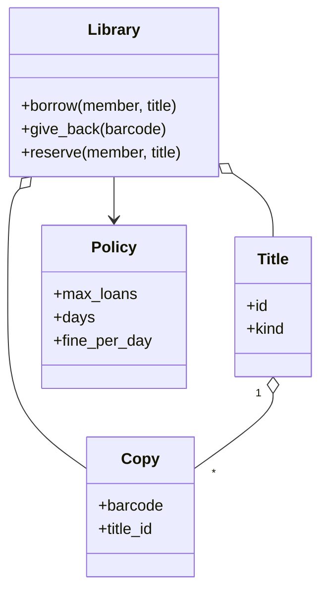

# 图书馆管理（Library Management）（low priority）

## 题目

图书馆有书目，每个书目有若干本实体副本。读者可以搜索、借书、还书、续借；逾期要交罚金；想借的书都借光了可以预约排队，书还回来时留给队首。用它的是读者和馆员。**面试官真正在看的是：书目和副本为什么是两个类，预约队列由谁来分配副本，预约的人不来取时系统会不会被锁死，以及借阅规则（几本、几天、罚多少）按读者类型变化时怎么不写一堆 `if`。**

你会听到的原话：设计一个图书馆管理系统，支持搜索、借书、还书、罚金、预约。

常见追问：
- 预约的人收到通知却一直不来，那本书怎么办？
- 学生、教师借的册数和天数不同，怎么写？
- 再加 DVD、期刊，借期也不同，要改哪里？

## 先问这几个问题

- 同一本书有几份实体吗？**有多份副本；这决定要把「书目」和「副本」拆成两个类。**
- 预约的人不来取，保留多久？到期后他回队尾还是出局？**出局：预约是意愿表达，两天没来说明意愿不成立；要再借就重新排。** 把选择说出口比选哪边更重要。
- 借阅规则按什么变？**读者类型和介质两个维度，将来可能有第三个。** 决定用一张政策表，而不是继承或分支。
- 罚金怎么算？按逾期天数乘每日费率，**用整数分。**
- 范围外要主动声明：馆际互借、图书采购、会员缴费、真实通知渠道。

## 核心对象

| 类 | 职责（一句话） | 守住的不变量 |
|---|---|---|
| `Title` | 书目：名字、著者、介质 | 搜索和预约挂在它上面 |
| `Copy` | 一本实体：条码、所属书目 | 借、还、罚金、丢失都挂在它上面 |
| `Policy` 表 | 按（读者类型，介质）查最多借几本、借几天、日罚金 | 规则是数据，流程代码不写 `if 类型` |
| `Library` | 借还、预约队列、取书架 | 一本副本同一时刻只在一个地方：书架、读者手里、取书架 |
| `Clock` | 注入的时钟 | 到期判断可测 |



## 主流程

**借书（`borrow`）：**
1. 先跑一次 `_sweep(now)`：过期的取书架保留先下架，再按队列把空闲副本留给队首。
2. 查政策：这位读者类型对这个介质最多借几本，手里已借的是否到上限。
3. 找一本空闲副本：不在借出、也不在别人的取书架上；该读者自己的取书架保留也算可借。
4. 没有空闲副本就抛 `NoCopyAvailable`，调用方可以改为 `reserve`。
5. 记录借阅：副本、读者、到期日 = 今天 + 政策天数。

**还书（`give_back`）：**
1. 按条码找到借阅，算逾期天数，乘日罚金得到罚金。
2. 副本回到书架；调用 `_sweep`，若该书目队列里有人，立刻把这本留给队首，带一个取书期限。

## 关键决策

### 书目不是副本

- 合成一个 `Book` 加 `available: bool`：只能表达有没有，表达不了还剩几本；改成计数又丢了副本的身份。
- **拆成两个类：搜索和预约挂在书目上，借还和罚金挂在副本上。** 读者找的是《沙丘》，不是某个条码；但「这本给你留着」之后，两本副本就不可互换了，必须能指名道姓。

### 预约队列：一个 `_sweep` 统一分配

- 在还书那一步就地决定：新进一本书、取消预约、保留到期时同样要重新分配，逻辑被复制三遍，更常见的是漏写两遍。
- 每条保留挂定时器：一万条预约一万个定时任务，且测试只能 `sleep`。
- **选一个 `_sweep(now)`：归还、过期、取消都只改事实，改完调用它；每次读写入口惰性调用。** 分配规则只有一份，没有后台线程，时钟注入后完全可测。代价：只读的方法也得先 `_sweep`，否则会报出早该下架的保留。

### 不来取的人：两个容器都必须会缩

- 预约涉及队列和取书架两个容器。读者收到通知却再也没来，如果没有过期，这本副本就永远停在「给他留着」，馆里有书谁也借不到。
- **取书架到期即删；队列在排上取书架、主动取消、已经借到同书目三条路径上删，队空时连键一起删。** 否则一个人既借着书又排着队，下一本还回来还会再留给他一次。
- 保留过期后他出局，不回队尾：自动回队尾等于让不来的人无限挡在后面的人前面。

### 借阅政策：一张表，不要继承，不要分支

- 给读者建继承树：读者类型会变（学生毕业），而且类型是属性，不是种类。
- `if 类型 and 介质` 的分支：维度一多就是笛卡尔积，分散在借、续、还、扫描四处。
- **选一张按（读者类型，介质）查、允许退化的表：先查最具体的键，没有再查粗的，最后是默认值。** 加「教师借 DVD 七天」就是往字典加一个键，流程代码不动。这不需要任何模式的名字；策略里只有数字，就让它是数据。

## Python 骨架

```python
from __future__ import annotations
import threading
from collections import deque
from dataclasses import dataclass
from datetime import datetime, timedelta
from typing import Callable


class LibraryError(Exception): pass
class NoCopyAvailable(LibraryError): pass
class LoanLimitReached(LibraryError): pass


@dataclass(frozen=True)
class Policy:
    max_loans: int
    days: int
    fine_per_day: int  # 分


DEFAULT = Policy(3, 14, 25)
# 按（读者类型, 介质）查；None 表示「任意」，由具体到粗依次尝试
POLICIES = {("student", "book"): Policy(5, 21, 10), (None, "dvd"): Policy(2, 3, 100)}


def resolve(member_type: str, kind: str) -> Policy:
    for key in ((member_type, kind), (member_type, None), (None, kind)):
        if key in POLICIES:
            return POLICIES[key]
    return DEFAULT


@dataclass(frozen=True)
class Title:
    id: str
    kind: str = "book"


class Library:
    def __init__(self, clock: Callable[[], datetime], hold_days: int = 2) -> None:
        self.clock, self.hold_days = clock, timedelta(days=hold_days)
        self.titles: dict[str, Title] = {}
        self.copies: dict[str, str] = {}  # 条码 -> 书目 id
        self.loans: dict[str, tuple[str, str, datetime]] = {}  # 条码 -> (读者, 类型, 到期)
        self.queues: dict[str, deque[str]] = {}  # 书目 -> 排队的读者
        self.shelf: dict[str, tuple[str, datetime]] = {}  # 条码 -> (读者, 保留到期)
        self._lock = threading.Lock()  # 一把锁罩住借还预约，扫描也在锁内

    def add_copy(self, barcode: str, title: Title) -> None:
        self.titles[title.id], self.copies[barcode] = title, title.id

    def _free(self, tid: str) -> list[str]:
        return [b for b, t in self.copies.items()
                if t == tid and b not in self.loans and b not in self.shelf]

    def _sweep(self, now: datetime) -> None:
        for b in [b for b, (_, exp) in self.shelf.items() if exp <= now]:
            del self.shelf[b]  # 取书架到期即删：预约者出局，不回队尾
        for tid, q in list(self.queues.items()):
            while q and (free := self._free(tid)):
                self.shelf[free[0]] = (q.popleft(), now + self.hold_days)
            if not q:
                del self.queues[tid]  # 队空连键一起删

    def borrow(self, member: str, mtype: str, tid: str) -> str:
        with self._lock:
            now = self.clock()
            self._sweep(now)
            pol = resolve(mtype, self.titles[tid].kind)
            if sum(1 for m, _, _ in self.loans.values() if m == member) >= pol.max_loans:
                raise LoanLimitReached(member)
            mine = [b for b, (m, _) in self.shelf.items() if m == member and self.copies[b] == tid]
            free = mine or self._free(tid)  # 自己的保留优先
            if not free:
                raise NoCopyAvailable(tid)
            self.shelf.pop(free[0], None)
            q = self.queues.get(tid)
            if q and member in q:  # 已借到同一书目：同时退出队列
                q.remove(member)
            self.loans[free[0]] = (member, mtype, now + timedelta(days=pol.days))
            return free[0]

    def give_back(self, barcode: str) -> int:
        with self._lock:
            now = self.clock()
            _, mtype, due = self.loans.pop(barcode)
            pol = resolve(mtype, self.titles[self.copies[barcode]].kind)
            late = max(0, (now - due).days)
            self._sweep(now)  # 还回的这本立刻留给队首
            return late * pol.fine_per_day

    def reserve(self, member: str, tid: str) -> None:
        with self._lock:
            self._sweep(self.clock())
            self.queues.setdefault(tid, deque()).append(member)
            self._sweep(self.clock())

    def shelf_of(self, member: str) -> list[str]:
        with self._lock:
            self._sweep(self.clock())  # 只读也先扫描
            return [b for b, (m, _) in self.shelf.items() if m == member]


if __name__ == "__main__":
    t = [datetime(2026, 10, 19, 9)]
    lib = Library(lambda: t[0])
    lib.add_copy("D1", Title("dune"))
    c = lib.borrow("amy", "student", "dune")
    try:
        lib.borrow("bob", "public", "dune")  # 唯一一本已借出
        raise SystemExit("应抛 NoCopyAvailable")
    except NoCopyAvailable:
        lib.reserve("bob", "dune")
    t[0] += timedelta(days=24)  # 学生借期 21 天，逾期 3 天，每天 10 分
    assert lib.give_back(c) == 30
    assert lib.shelf_of("bob") == ["D1"]  # 还回即留给队首
    t[0] += timedelta(days=3)  # bob 没来，保留过期
    assert lib.shelf_of("bob") == [] and "dune" not in lib.queues  # 出局，队列键已删
    assert lib.borrow("cat", "public", "dune") == "D1"  # 书没有被锁死
    print("ok")
```

## 面试官加需求时

| 新需求 | 改哪里 | 不用动哪里 |
|---|---|---|
| 新读者类型或新介质 | 政策表加一个键 | `borrow`、`give_back`、`_sweep` |
| 第三个维度（如新书） | 键从二元组变三元组，`resolve` 多循环一档 | 流程代码 |
| 续借 | 加 `renew`：检查无人预约，到期日顺延政策天数 | 取书架、队列 |
| 丢失注销 | 副本从 `copies` 和 `loans` 移除，罚金按赔偿价 | 书目 |
| 通知读者 | 保留成立时回调一个通知函数 | 分配逻辑 |
| 搜索 | 书目上建名字、著者的倒排索引，搜索返回书目 | 副本、借还 |

## 并发与扩展

- 竞态 1：**两个人同时借最后一本，找空闲副本和写入借阅在同一把锁里。** 否则同一本被借出两次。
- 竞态 2：还书时队列有人：还书、扫描、留架是同一次加锁里的三步，中间不会有第三个人插队借走。
- 容器泄漏要逐个回答「什么时候删」：取书架到期删，队列四条路径都删，队空删键。
- 规模变大后：借阅记录和预约放数据库，扫描改成按到期时间的索引批量处理；通知走异步队列，不放在锁内。

## 常见错误

- 一个 `Book` 类带 `available` 布尔值：多副本压成单副本。**书目与副本分开。**
- 预约保留没有过期：副本永远给不来的人留着。**取书架到期即删。**
- 借到书后还留在队列里：下一本还回来又留给他。**借到同书目就退队列。**
- 给每条保留挂定时器：测试只能 `sleep`。**惰性 `_sweep` 加注入时钟。**
- 用继承表达读者类型：学生毕业要换类。**读者类型是属性，规则放表里。**

## 30 秒复述

- 对象：`Title` 管搜索和预约，`Copy` 管借还和罚金，政策表管规则，`Library` 管借还和队列。
- 核心决策：书目与副本分开；分配规则只写在一个 `_sweep` 里，每次读写惰性调用。
- 不来取的人：保留到期就删，预约者出局；队列和取书架都有明确的删除时机，不会泄漏或锁死。
- 规则是一张按（读者类型，介质）查的表，允许退化，加类型只加一个键，不用继承。
- 并发：借还预约同在一把锁里；时钟注入让到期可测。

## 来源

- [[solution-library]]
