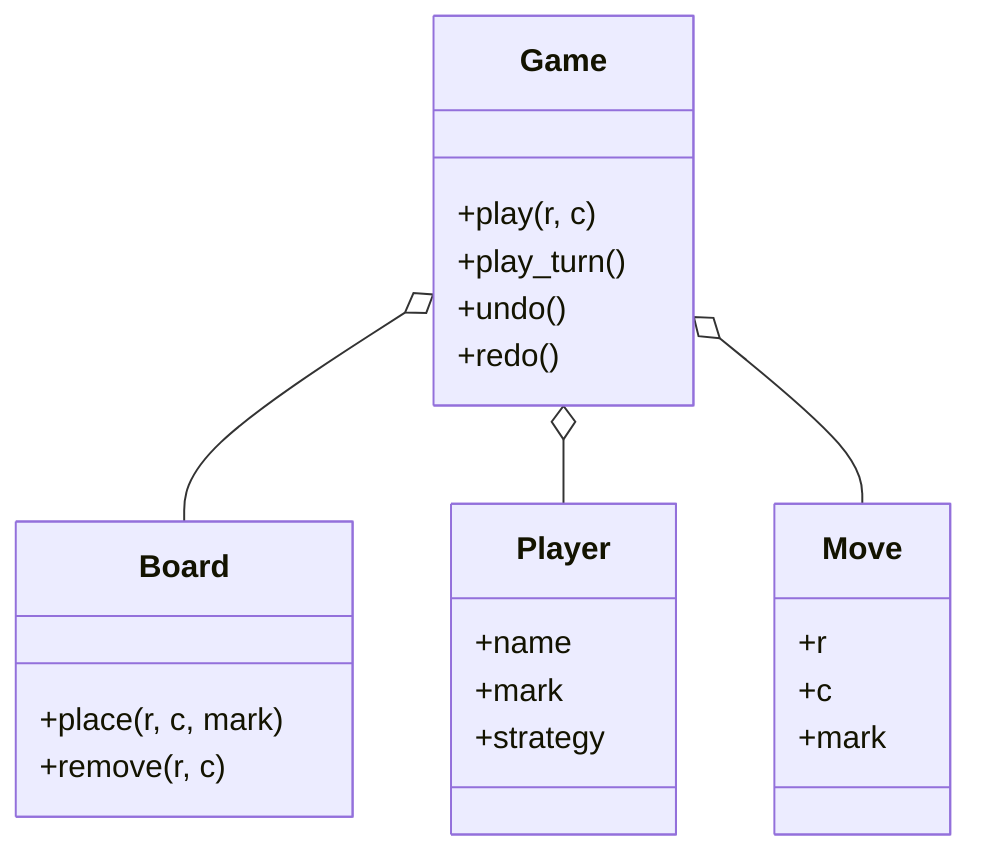

# 井字棋（Tic-Tac-Toe）（low priority）

## 题目

两个玩家轮流在 3×3 的棋盘上落子，先让自己的三个子连成一线（横、竖、对角）的人赢，棋盘下满没人赢就是平局。用它的是两个玩家，或者玩家加一个电脑。题目简单，所以**面试官真正在看的是：胜负判定的复杂度能不能做到每手 O(1)、悔棋用不用套命令模式、玩家和电脑玩家怎么抽象才不把读输入的代码拖进库里。**

你会听到的原话：设计一个井字棋，支持落子、判定输赢和平局，棋盘大小可以是 N×N。

常见追问：
- 棋盘改成 N×N，判定怎么不每手扫全盘？
- 加悔棋（undo）和重做（redo）。
- 加一个电脑玩家，要改哪些类？

## 先问这几个问题

- 棋盘固定 3×3，还是 N×N？**N×N 时，胜负判定要从扫全盘改成增量计数。**
- 连几个子算赢？先默认连满一整行 N 个；K 子连珠放在追问里。
- 要不要悔棋？**要的话，判定用到的所有状态都必须能退回去。**
- 对手是人还是电脑？**人类的决策在进程外，电脑的决策是一个函数；** 这决定玩家怎么建模。
- 范围外要主动声明：图形界面、网络对战、最强 AI（极小极大算法）、计时。

## 核心对象

| 类 | 职责（一句话） | 守住的不变量 |
|---|---|---|
| `Board` | 棋盘格子和每条线的计数 | 一个格子只能落一次；计数与格子内容一致 |
| `Move` | 不可变记录：第几手、哪个格子、谁的子 | 纯数据，可存可重放 |
| `Player` | 不可变身份：名字、棋子符号、可选的决策函数 | 人类玩家没有决策函数 |
| `Game` | 回合、状态（进行中、胜、平）、历史、悔棋 | 只有轮到的玩家能走；终局后不能再走 |



## 主流程

**落子（`play(r, c)`）：**
1. 游戏已结束就抛 `GameOver`。
2. `Board.place` 检查格子在棋盘内、没有子，否则抛错，棋盘不变。
3. 落下的格子命中的那几条线（它所在的行、列，以及它在对角线上时的两条对角线）计数加一，加到 N 就是赢。
4. 记一条 `Move` 到历史，清空重做栈。
5. 赢了结束；步数等于 N×N 是平局；否则轮到另一个玩家。

**悔棋（`undo`）：** 弹出最后一条 `Move`，把格子清空，被命中的线计数减一，回合退回，状态恢复为进行中；这一手进入重做栈。

## 关键决策

### 胜负判定：扫全盘、增量计数，还是从落子点走

- 每手扫全盘：O(N²)，无状态所以悔棋什么都不用做。3×3 上这就是正确答案；19×19 一局十几万次格子访问。
- 从落子点沿四个方向局部行走：适合 K 子连珠，O(K)，不用额外状态。
- **选增量计数：每行、每列、两条对角线各一个计数，按棋子符号分开；落子时命中的最多四条线加一，加到 N 即赢，每手 O(1)。** 悔棋就是把同样几条线减一。3×3 面试时先说「扫全盘也行，N×N 时我换计数器」，让面试官看到你知道复杂度。

### 悔棋：不用命令模式，一条不可变记录就够

- 命令模式：`MoveCommand` 有 `execute` 和 `undo`，持有棋盘引用。
- **选一个不可变的 `Move` 记录，加 `Game` 自己的 `play` 和 `undo` 两处。** 命令模式解决的是很多种互不相同的操作都要统一执行和撤销，比如文本编辑器的插入、删除、缩进。井字棋只有「落一个子」这一种，用命令是一个类加一个栈换一个三字段记录加一个列表，多一层间接；命令还持有棋盘引用，历史就不再是纯数据，存不了也重放不了。如果以后加认输、提和这类也要入历史的操作，再换 Command。
- 细节：走出新的一手时必须清空重做栈，否则 `redo` 会接回一段没发生过的历史。

### 玩家：身份加可选函数，不要读输入的子类

- 抽象基类加人类、电脑两个子类，`HumanPlayer.choose_move` 里读 `input()`：I/O 进了库代码，没有 stdin 就没法驱动棋局，测试要造假输入。
- **选 `Player` 是不可变身份，`strategy` 是一个可选的普通函数。** 人类的 `strategy` 是 `None`，他的决策本来就在进程外，由外部调用 `play(r, c)`；电脑把一个闭包放进同一个字段，`play_turn()` 去问它要这一手。`Game` 有两个入口从第一天就存在，所以加电脑玩家不改 `Board` 和 `Game`。判据：两个「子类」只差一个字段的取值，它们就是同一个类的两个实例。

### 给电脑的是真棋盘还是只读包装

- 只读包装类：挡住写坏棋盘的机器人，但多一个类转发所有读方法。
- **选传 `Board` 本身，约定策略只读。** 面试里不为一个假想的坏机器人加类；真有不可信的策略代码，再包只读视图。

## Python 骨架

```python
from __future__ import annotations
from dataclasses import dataclass
from enum import Enum
from typing import Callable


class GameError(Exception): pass
class CellTaken(GameError): pass
class OutOfBoard(GameError): pass
class GameOver(GameError): pass
class NoStrategy(GameError): pass


class Status(Enum):
    PLAYING = 1
    WON = 2
    DRAW = 3


@dataclass(frozen=True)
class Move:  # 纯数据：可存、可重放
    r: int
    c: int
    mark: str


class Board:
    def __init__(self, n: int) -> None:
        self.n = n
        self.grid = [[None] * n for _ in range(n)]
        self.count: dict[tuple, int] = {}  # (线, 符号) -> 该线上这个符号的子数

    def _lines(self, r: int, c: int) -> list[tuple]:
        lines = [("row", r), ("col", c)]
        if r == c:
            lines.append(("diag", 0))
        if r + c == self.n - 1:
            lines.append(("anti", 0))
        return lines

    def place(self, r: int, c: int, mark: str) -> bool:
        """落子；返回这一手是否让某条线满了。"""
        if not (0 <= r < self.n and 0 <= c < self.n):
            raise OutOfBoard((r, c))
        if self.grid[r][c] is not None:
            raise CellTaken((r, c))
        self.grid[r][c] = mark
        won = False
        for ln in self._lines(r, c):  # 最多 4 条线，每手 O(1)
            self.count[(ln, mark)] = self.count.get((ln, mark), 0) + 1
            won = won or self.count[(ln, mark)] == self.n
        return won

    def remove(self, r: int, c: int) -> None:
        mark, self.grid[r][c] = self.grid[r][c], None
        for ln in self._lines(r, c):  # 悔棋：把同样几条线减回去
            self.count[(ln, mark)] -= 1


@dataclass(frozen=True)
class Player:
    name: str
    mark: str
    strategy: Callable[[Board, str], tuple[int, int]] | None = None  # 人类为 None


class Game:
    def __init__(self, n: int, p1: Player, p2: Player) -> None:
        self.board, self.players = Board(n), (p1, p2)
        self.turn, self.status, self.winner = 0, Status.PLAYING, None
        self.history: list[Move] = []
        self.redo_stack: list[Move] = []

    @property
    def current(self) -> Player:
        return self.players[self.turn]

    def _apply(self, mv: Move) -> None:
        won = self.board.place(mv.r, mv.c, mv.mark)
        self.history.append(mv)
        if won:
            self.status, self.winner = Status.WON, self.current
        elif len(self.history) == self.board.n ** 2:
            self.status = Status.DRAW
        else:
            self.turn = 1 - self.turn

    def play(self, r: int, c: int) -> Status:
        if self.status is not Status.PLAYING:
            raise GameOver()
        self._apply(Move(r, c, self.current.mark))
        self.redo_stack.clear()  # 新走一手，旧的重做分支作废
        return self.status

    def play_turn(self) -> Status:  # 电脑走这个入口，问它要这一手
        if self.current.strategy is None:
            raise NoStrategy(self.current.name)
        return self.play(*self.current.strategy(self.board, self.current.mark))

    def undo(self) -> None:
        mv = self.history.pop()
        self.board.remove(mv.r, mv.c)
        if self.status is Status.PLAYING:
            self.turn = 1 - self.turn  # 终局那一手没有换回合
        self.status, self.winner = Status.PLAYING, None
        self.redo_stack.append(mv)

    def redo(self) -> None:
        self._apply(self.redo_stack.pop())


def first_free(board: Board, mark: str) -> tuple[int, int]:  # 最简单的电脑策略
    return next((r, c) for r in range(board.n) for c in range(board.n) if board.grid[r][c] is None)


if __name__ == "__main__":
    g = Game(3, Player("amy", "X"), Player("bot", "O", first_free))
    g.play(0, 0)  # amy
    g.play_turn()  # bot 走第一个空格 (0,1)
    g.play(1, 1)
    g.play_turn()  # bot (0,2)
    assert g.status is Status.PLAYING
    g.play(2, 2)  # amy 对角线满
    assert g.status is Status.WON and g.winner.name == "amy"
    try:
        g.play(2, 0)
        raise SystemExit("应抛 GameOver")
    except GameOver:
        pass
    g.undo()  # 悔掉制胜一手
    assert g.status is Status.PLAYING and g.current.name == "amy"
    try:
        g.play(0, 0)  # 已有子
        raise SystemExit("应抛 CellTaken")
    except CellTaken:
        pass
    g.redo()
    assert g.winner.name == "amy"
    try:
        Game(3, Player("a", "X"), Player("b", "O")).play_turn()  # 人类没有策略
        raise SystemExit("应抛 NoStrategy")
    except NoStrategy:
        pass
    print("ok")
```

## 面试官加需求时

| 新需求 | 改哪里 | 不用动哪里 |
|---|---|---|
| N×N 棋盘 | 构造时传 N；判定已是计数 | 其余所有类 |
| K 子连珠 | 判定改为从落子点沿四个方向数连续子 | `Game`、`Player` |
| 电脑玩家 | 写一个返回 `(r, c)` 的函数放进 `strategy` | `Board`、`Game` |
| 加认输、提和 | 历史里的记录变成多种操作，这时才用 Command | 棋盘计数 |
| 保存和回放 | 历史是纯数据，直接序列化、按序 `_apply` | 棋盘 |
| 多个玩家 | `turn` 取模换成玩家数，计数的符号本来就是分开的 | 判定逻辑 |

## 并发与扩展

- 本地单局没有真正的并发：两个玩家轮流走，回合状态本身就是约束。
- 网络对战时，两个请求可能同时到达：**每个对局一把锁，罩住「检查轮次、落子、换回合」这一整步**；不是该玩家的回合直接拒绝。
- 对局之间零共享，所以可以按对局编号分片；对局状态就是历史列表，持久化只存历史，重启后重放得到棋盘。
- 电脑策略可能很慢（极小极大搜索）：放到锁外计算出这一手，再带着「当前手数」提交，手数对不上就丢弃。

## 常见错误

- 每手扫全盘：N 大时慢，被追问复杂度时答不出。**行、列、对角线各一个计数。**
- 悔棋时只清格子不减计数：之后判定出错。**格子和计数一起回退。**
- 终局那手悔棋时多换了一次回合：**赢棋的一手没有换回合，悔棋时不要再换。**
- 走出新的一手不清重做栈：`redo` 接回没发生过的历史。**`play` 里清空。**
- 玩家基类里读 `input()`：没法测试。**人类的手由外部传入，电脑才是函数。**

## 30 秒复述

- 对象：`Board` 管格子和计数，`Move` 是不可变记录，`Player` 是身份加可选函数，`Game` 管回合、状态和历史。
- 核心决策：每行、每列、两条对角线各一个计数，落子时加一，到 N 即赢，每手 O(1)。
- 悔棋不用命令模式：只有「落一个子」一种操作，一个不可变记录加反向操作就够；加了多种操作再换。
- 电脑玩家就是给 `Player` 放一个函数，`Board` 和 `Game` 一行不改。
- 并发：网络对战时每局一把锁，罩住检查轮次、落子、换回合。

## 来源

- [[solution-tic-tac-toe]]
