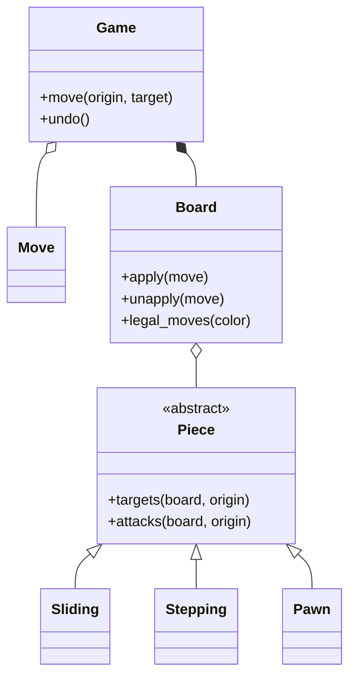

# 国际象棋（Chess）（low priority）

## 题目

两人轮流走棋，六种棋子各有走法，吃掉对方的王（被将死）就赢。用它的是两位棋手和一个裁判程序。完整规则写完要两三个小时，面试只有 45 分钟，所以**面试官真正在看的是：你会不会先谈范围；棋子的走法能不能用多态写干净；「走完自己的王不能被将」这一条合法性规则放在哪里，是不是一次写对、将军将死都从它推出来。**

你会听到的原话：设计一个国际象棋游戏。

常见追问：
- 王车易位、吃过路兵、升变怎么加，会不会把模型冲垮？
- 怎么悔棋？
- 怎么判将死、逼和、和棋？

## 先问这几个问题

- 做到什么程度？**把三档摆出来让面试官选：走法加判将军；再加将死逼和；再加易位、吃过路兵、升变。** 先做第一二档，这是有依据的优先级，因为将死从「没有合法着法」推出来。
- 要不要 AI？**默认不要：生成走法是规则，评估局面是引擎，两件事正交。** 这一句话省掉一半工作量。
- 输入是起点加终点，还是代数记号（algebraic notation，如 `Nf3`）？**默认起点加终点；记谱只做输出方向。** 解析记号要多写二十分钟。
- 要不要悔棋？**要的话从第一步就要让 `Move` 带上被它覆盖的旧状态，否则易位权和吃过路兵格推不回去。**
- 并发吗？一局棋天然串行，**一局一把锁**即可。

## 核心对象

| 类 | 职责（一句话） | 守住的不变量 |
|---|---|---|
| `Piece` | 棋子的值：只有颜色，能说出自己的落点 | 不可变，**不知道自己在哪一格** |
| `Sliding` / `Stepping` | 车象后共用「沿方向滑」，马王共用「跳固定几步」 | 撞到子就停；落点在盘内 |
| `Pawn` | 唯一走法和吃法不同的子 | `attacks` 只有斜前方，`targets` 才含正前方 |
| `Move` | 一手棋加被它吃掉的子 | 纯数据，可存盘可重放 |
| `Board` | 「哪一格站着谁」的唯一真源，负责试走和合法性过滤 | `apply` 与 `unapply` 严格互逆 |
| `Game` | 回合、历史、悔棋、终局状态 | 终局是算出来的，不是存出来的 |



没有建 `Player` 类：玩家不持有状态也不做决策（决策是引擎的事），只会变成一层转发。

## 主流程

**走一手 `Game.move(起点, 终点)`：**
1. 拿这局的锁。
2. `Board.legal_moves(轮到的一方)`：每个己方棋子先生成**伪合法着法**（pseudo-legal，只管走法，不管自己的王）。
3. 对每个着法在原盘上 `apply`，问一句「我的王被攻击吗」，再 `unapply` 退回来。**被攻击的丢掉，剩下的就是合法着法。**
4. 在合法着法里找起点终点相符的一个：找不到抛 `IllegalMoveError`；找到就 `apply`、记入历史、换边。

**终局 `status()`：** 没有任何合法着法时，在将中是将死，不在将中是逼和；其余是将军或进行中。

## 关键决策

### 棋子知不知道自己在哪一格

- 方案 A，棋子带 `(row, col)`：棋盘字典和棋子坐标是两份真源，走一步改两处，漏一处棋盘上就有幽灵；每个子必须是独立实例，复制棋盘要深拷贝 32 个对象。
- 方案 B，棋子只有颜色，`origin` 作为参数传进来：棋子成了不可变的值，全局只要 12 个实例，`apply` 只动一张字典。
- **选 B：「谁在哪一格」只能有一个持有者，就是棋盘。** 易位权同理不放在棋子的 `has_moved` 上，放在棋盘的权利集合里。

### 合法性属于棋子还是属于局面

- 方案 A，每个棋子的 `can_move` 里判自己的王会不会挨将：六份重复，而且棋子答不了「别的子能不能挡」。
- 方案 B，棋子只生成伪合法着法，棋盘统一过滤。
- **选 B：合法性是局面的性质。** 牵制、应将、王不能走进攻击格、两王不能相邻，全部不需要专门代码。

### 过滤时深拷贝还是 make/unmake

- 方案 A，每试一手深拷贝一份棋盘：安全，但一个局面三十手就是三十次深拷贝，Python 里很慢。
- 方案 B，在原盘上 `apply`、问、`unapply`：快，代价是两个方法必须严格互逆，错了几十手后才露出来。
- **选 B，并把「推不回去的旧状态」塞进 `Move`。** 这里只有被吃的子；加易位后要再存旧的易位权、吃过路兵目标格、五十步计数。

### 将军要不要做成状态机

- 方案 A：`Normal -> Check -> Checkmate` 的状态模式，每次走子后手动迁移。
- **选现算，不用任何模式：`status()` 每次按局面现算。** 状态存了就可能和局面不一致，算出来的永远对。

## Python 骨架

这份骨架只做前两关：六种棋子、统一过滤、将军将死逼和、悔棋。易位、吃过路兵、升变留作面试官加需求（见下表）。

```python
from __future__ import annotations
import threading
from dataclasses import dataclass
from enum import Enum

class Color(Enum):
    WHITE = 1   # 值同时是兵前进的方向
    BLACK = -1

    @property
    def opponent(self) -> Color:
        return Color(-self.value)

class IllegalMoveError(Exception): ...

def on(sq) -> bool:
    return 0 <= sq[0] < 8 and 0 <= sq[1] < 8

@dataclass(frozen=True)
class Piece:  # 值对象：只有颜色，不知道自己在哪一格；位置由棋盘的字典说了算
    color: Color

    def targets(self, board, o):  # 伪合法落点：只管走法，不管自己的王会不会挨将
        raise NotImplementedError
    def attacks(self, board, o):  # 默认攻击范围 = 落点；兵是例外
        return self.targets(board, o)

class Sliding(Piece):  # 车 / 象 / 后共用：沿方向一直滑，撞到子就停
    dirs = ()

    def targets(self, board, o):
        for dr, dc in self.dirs:
            t = (o[0] + dr, o[1] + dc)
            while on(t):
                yield t
                if t in board.sq:
                    break
                t = (t[0] + dr, t[1] + dc)

class Stepping(Piece):  # 马 / 王共用：跳固定几步
    steps = ()

    def targets(self, board, o):
        return (t for dr, dc in self.steps if on(t := (o[0] + dr, o[1] + dc)))

ORTH = ((1, 0), (-1, 0), (0, 1), (0, -1))
DIAG = ((1, 1), (1, -1), (-1, 1), (-1, -1))

class Rook(Sliding): dirs = ORTH
class Bishop(Sliding): dirs = DIAG
class Queen(Sliding): dirs = ORTH + DIAG
class Knight(Stepping): steps = ((1, 2), (2, 1), (-1, 2), (-2, 1), (1, -2), (2, -1), (-1, -2), (-2, -1))
class King(Stepping): steps = ORTH + DIAG

class Pawn(Piece):  # 唯一走法和吃法不同的子
    def attacks(self, board, o):  # 只有斜前方；将军判断用它
        return (t for dc in (-1, 1) if on(t := (o[0] + self.color.value, o[1] + dc)))

    def targets(self, board, o):
        f = self.color.value
        one = (o[0] + f, o[1])
        if on(one) and one not in board.sq:
            yield one
            two = (o[0] + 2 * f, o[1])
            if o[0] == (1 if f == 1 else 6) and two not in board.sq:
                yield two
        for t in self.attacks(board, o):  # 斜吃：只有对方的子在才算
            if t in board.sq and board.sq[t].color != self.color:
                yield t

@dataclass(frozen=True)
class Move:  # 纯数据，带上被吃的子，unapply 才能精确退回
    origin: tuple
    target: tuple
    piece: Piece
    captured: Piece | None = None

class Board:  # 「哪一格站着谁」的唯一真源
    def __init__(self, squares=None) -> None:
        self.sq = dict(squares) if squares is not None else self.initial()

    @staticmethod
    def initial() -> dict:
        sq = {}
        for c, cls in enumerate((Rook, Knight, Bishop, Queen, King, Bishop, Knight, Rook)):
            sq[(0, c)], sq[(7, c)] = cls(Color.WHITE), cls(Color.BLACK)
            sq[(1, c)], sq[(6, c)] = Pawn(Color.WHITE), Pawn(Color.BLACK)
        return sq

    def apply(self, m: Move) -> None:
        del self.sq[m.origin]
        self.sq[m.target] = m.piece

    def unapply(self, m: Move) -> None:  # 与 apply 严格互逆
        del self.sq[m.target]
        self.sq[m.origin] = m.piece
        if m.captured:
            self.sq[m.target] = m.captured

    def is_attacked(self, square, by: Color) -> bool:
        return any(p.color == by and square in p.attacks(self, o) for o, p in list(self.sq.items()))

    def in_check(self, color: Color) -> bool:
        king = next(o for o, p in self.sq.items() if p == King(color))
        return self.is_attacked(king, color.opponent)

    def legal_moves(self, color: Color) -> list[Move]:
        pseudo = [Move(o, t, p, self.sq.get(t)) for o, p in list(self.sq.items()) if p.color == color
                  for t in p.targets(self, o) if t not in self.sq or self.sq[t].color != color]
        legal = []
        for m in pseudo:  # 试走一手、问一句、退回来：牵制、应将、王不能送吃全靠这一个过滤
            self.apply(m)
            if not self.in_check(color):
                legal.append(m)
            self.unapply(m)
        return legal

class Game:  # 回合 + 历史；终局是算出来的，不是存出来的
    def __init__(self, board: Board | None = None) -> None:
        self.board, self.turn, self.history = board or Board(), Color.WHITE, []
        self._lock = threading.Lock()  # 一局一把锁

    def move(self, origin, target) -> Move:
        with self._lock:
            for m in self.board.legal_moves(self.turn):
                if (m.origin, m.target) == (origin, target):
                    self.board.apply(m)
                    self.history.append(m)
                    self.turn = self.turn.opponent
                    return m
            raise IllegalMoveError((origin, target))

    def undo(self) -> None:
        with self._lock:
            self.board.unapply(self.history.pop())
            self.turn = self.turn.opponent

    def status(self) -> str:  # 没有合法着法：在将中是将死，否则逼和
        check = self.board.in_check(self.turn)
        if not self.board.legal_moves(self.turn):
            return "checkmate" if check else "stalemate"
        return "check" if check else "ongoing"

def sq(name: str):
    return int(name[1]) - 1, ord(name[0]) - 97

if __name__ == "__main__":
    g = Game()
    assert len(g.board.legal_moves(Color.WHITE)) == 20
    for m in "e2e4 e7e5 f1c4 b8c6 d1h5 g8f6".split():
        g.move(sq(m[:2]), sq(m[2:]))
    g.move(sq("h5"), sq("f7"))  # 学者杀
    assert g.status() == "checkmate"
    g.undo()
    assert g.status() == "ongoing" and g.board.sq[sq("f7")] == Pawn(Color.BLACK)
    pinned = Game(Board({sq("e1"): King(Color.WHITE), sq("e2"): Bishop(Color.WHITE),
                         sq("e8"): Rook(Color.BLACK), sq("a8"): King(Color.BLACK)}))
    try:
        pinned.move(sq("e2"), sq("d3"))  # 被牵制的象不能离开 e 列
        raise SystemExit("应当拒绝")
    except IllegalMoveError:
        pass
    print("ok")
```

## 面试官加需求时

| 新需求 | 改哪里 | 不用动哪里 |
|---|---|---|
| 王车易位 | `Move` 加可选的 `rook_move`；棋盘加易位权集合，用「离开或被吃的格子」小表维护；生成时检查途经格是否被攻击 | 六种棋子的走法、合法性过滤 |
| 吃过路兵 | 棋盘加 `en_passant_target`，每走一手覆盖；`Move` 把被吃的格和 `target` 分成两个字段 | `Sliding`、`Stepping` |
| 升变 | `Pawn.targets` 在底线对一个落点吐出四手不同的棋；`move()` 要求调用方声明升变成什么，不声明抛错 | 过滤逻辑 |
| 五十步、三次重复 | `Game` 里一个计数和一张局面计数表（局面含轮到谁、易位权、吃过路兵格） | 走法生成 |
| 记谱 | 写在 `Game` 之外的自由函数 `san(move, board)` | 走法生成不知道它存在 |
| 新棋子 | 新写一个 `Piece` 子类 | 其余一行不改 |

## 并发与扩展

- 竞态：两手棋同时到达，都在旧局面上判断自己合法。**一局一把锁，`move` 和 `undo` 整体在锁里。**
- **`legal_moves` 会临时改棋盘，它不是只读方法**，两个线程同时问同一局就会互相踩。要让很多人观战，读路径给不可变快照，别给 `Board` 加读写锁。
- 存档只存「起始局面加走子历史」，`Move` 是纯数据，重放就是逐手 `apply`；派生状态不存。
- 性能：每次重算合法着法对面试够用。引擎的做法是位棋盘（bitboard）和增量攻击表；**知道怎么优化，并且知道现在不该优化。**

## 常见错误

- 把坐标存进棋子：**两份真源，每次试走都要同步，坐标交给棋盘。**
- 在棋子里判「会不会自杀」：**棋子只生成伪合法着法，棋盘统一过滤。**
- 专门写找牵制线的代码：**统一过滤已经包含，写了是重复。**
- 把将死判成「王被将且无路可走」：漏掉别的子可以挡可以吃。**正确定义只有一句：没有合法着法，且在将中。**
- `unapply` 漏退旧状态：**推不回去的量必须在落子时随 `Move` 存下来。**
- 用 `isinstance` 链区分棋子：**走法属于棋子自己，棋盘只问「你能去哪」。**

## 30 秒复述

- 先谈范围：做走法加合法性，再加将死逼和，特殊规则按时间补；不做 AI。
- 对象：`Piece` 是只有颜色的值，位置只在 `Board` 的字典里；车象后共用滑动，马王共用跳步，兵单独处理。
- 核心决策：**棋子生成伪合法着法，棋盘用 make/unmake 统一过滤「走完王不被攻击」**，将军将死逼和和牵制都从它推出来。
- 悔棋：旧状态存在 `Move` 里，`unapply` 与 `apply` 严格互逆。
- 扩展：易位、吃过路兵、升变各改 `Move` 和棋盘状态，不碰棋子的走法代码。
- 并发：一局一把锁；`legal_moves` 会临时改盘，不能并发调用。

## 来源

- [[solution-chess]]
