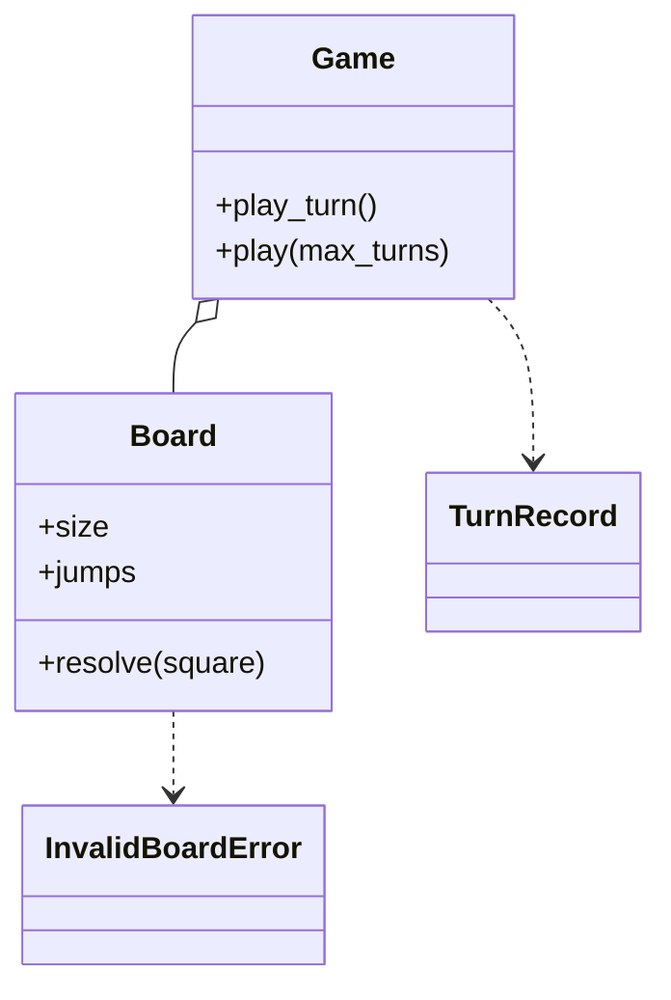

# 蛇梯棋（Snake and Ladder）（low priority）

## 题目

一块 100 格的棋盘，上面有蛇（把人送回低处）和梯子（把人送到高处），几个玩家轮流掷骰子，先走到 100 的赢。用它的是一局棋里的玩家和一个渲染层。听上去十分钟就能写完，所以评分点都不在「能不能跑」：**面试官真正在看的是：循环为什么一定停得下来；换骰子、换玩法要改几行；随机的东西怎么测。**

你会听到的原话：写一个蛇梯棋，几个玩家轮流掷骰子，先到 100 的赢。

常见追问：
- 掷到六再掷一次，连续三个六作废，六点才能出发，怎么加？
- 必须精确踩到 100，超出怎么办？
- 蛇和梯子首尾相接怎么办？

## 先问这几个问题

- 蛇和梯子可以首尾相接吗？**大多数面试官说不允许：这把「一次移动最多一次跳跃」从运行时的循环变成构造时的校验。** 说允许就必须带环检测。
- 必须精确踩到终点吗？**超出原地不动、超出算到终点、超出往回弹，三种都常见：「目标格怎么算」要做成可替换的部件。**
- 掷到六有什么特殊待遇？**再掷一次、三个六作废、六点才出发常同时出现，互相纠缠：作废整轮意味着回合要么整体生效要么整体退回。**
- 棋盘是固定的吗？**可配置就必须校验，下面第一个决策整条都是为它。**
- 几个人，要名次还是只要赢家？一格能站几个人？默认只要赢家，一格不限。

## 核心对象

| 类 | 职责（一句话） | 守住的不变量 |
|---|---|---|
| `Board` | 棋盘大小和跳跃表 | 构造即校验、之后只读：没有任何跳跃的落点又是跳跃起点 |
| `Die`（一个可调用对象） | 给出 1 到 6 的点数 | 随机源是注入的，测试可以带种子或给脚本 |
| 规则函数 | 例如 `exact_finish`、`bounce`：算出目标格 | 纯函数，互相独立，可以单独测试 |
| `TurnRecord` | 一手棋的结果：谁、点数、落点、最终格 | 纯数据，渲染层只看它 |
| `Game` | 谁在哪一格、轮到谁、谁赢了 | 位置只有它持有；一手棋要么完整生效要么不生效 |



没有 `Snake`、`Ladder` 子类：差别只是方向，方向能由起点和落点算出来。没有 `Player` 类：它只会拿着一个 `position`，而「同时移动两个人」的规则一出现位置就得由一个对象整体维护。

## 主流程

**掷一手 `play_turn`：**
1. 拿这局的锁；有赢家就抛 `GameOverError`。
2. 轮到的玩家掷骰子，当前位置加点数，交给规则函数得到目标格（超出终点怎么办在这里决定）。
3. `board.resolve(目标格)` 最多跳一次：踩蛇头往下，踩梯脚往上。
4. 写回位置；到了终点就记赢家，否则看掷到六是否再来一次，不再来就换人；返回 `TurnRecord`。

**整局 `play`：** 循环 `play_turn`，带一个轮数上限，到顶还没有赢家就返回 `None`。

## 关键决策

### 什么让循环停得下来

- 一手之内：棋盘上有梯子 12 到 25 和蛇 25 到 12，用 `while` 追跳跃链就会转不出来，而且没有任何一次掷骰的校验能发现，它是棋盘配置的问题。
- 整局之内：「精确踩到终点」下，停在 97 的玩家可能一直掷不出想要的点。
- **两种不停止性质不同，药也不同：构造时禁止首尾相接，移动时只查一次表；整局用轮数上限，到顶返回「没下完」。** 允许连跳的备选是运行时记录走过的格子检测环，成本是死循环从配置问题变成运行时问题。

### 骰子：策略类层次还是一个可调用对象

- 方案 A，抽象的骰子策略加子类，再加一个只会转发的 `Dice`。
- **选 `Callable[[], int]`：Python 里策略的载体就是函数，没有状态就不需要类。** 测试给 `lambda: next(rolls)` 的脚本，或带种子的 `random.Random`。

### 玩法变体往哪放

- 方案 A，`play_turn` 里四个布尔开关加四个 `if`：互相纠缠，每加一条复杂度翻倍，没有一条能单独测。
- 方案 B，每种玩法一个 `Game` 子类：组合一多就要多继承。
- **选固定的回合循环，把变化挂在决策点上做成纯函数：超出终点怎么办是一个函数，掷到几点再来一次是一个函数。** 这里没有模式，只是把参数从布尔开关换成函数。

### 一手棋的位移能不能直接相加

- **掷到六再掷一次，两次点数不能加起来走：中间那一格的蛇和梯子必须生效。** 每次掷骰都是完整的一手，各自 `resolve`；「连续三个六作废」要整轮退回，需要把这一轮的位移先记下来再提交。

## Python 骨架

```python
from __future__ import annotations
import random
import threading
from dataclasses import dataclass
from typing import Callable

Die = Callable[[], int]  # 骰子就是一个可调用对象：注入种子或脚本，测试才可复现


class InvalidBoardError(Exception): ...
class GameOverError(Exception): ...


class Board:  # 构造即校验，之后只读；校验过的棋盘保证一次移动最多触发一次跳跃
    def __init__(self, size: int, jumps: dict[int, int]) -> None:
        for a, b in jumps.items():
            if not (1 < a < size and 1 <= b <= size and a != b):
                raise InvalidBoardError(f"跳跃 {a}->{b} 越界或原地不动")
            if b in jumps:  # 蛇梯首尾相接 = 连跳，甚至死循环：在这里一次性禁掉
                raise InvalidBoardError(f"{a}->{b} 的落点又是一个跳跃起点")
        self.size, self.jumps = size, dict(jumps)

    def resolve(self, square: int) -> int:  # 蛇还是梯子由方向算出来，不建子类
        return self.jumps.get(square, square)


def exact_finish(pos: int, pips: int, size: int) -> int:  # 规则 = 纯函数：超出终点原地不动
    return pos if pos + pips > size else pos + pips


def bounce(pos: int, pips: int, size: int) -> int:  # 另一种玩法：超出终点往回弹
    t = pos + pips
    return t if t <= size else 2 * size - t


@dataclass(frozen=True)
class TurnRecord:  # 一手的结果是数据，不 print
    player: str
    pips: int
    landed: int
    final: int


class Game:
    def __init__(self, board: Board, players: list[str], die: Die,
                 overshoot=exact_finish, extra_turn: Callable[[int], bool] = lambda pips: pips == 6) -> None:
        self.board, self.players, self.die = board, list(players), die
        self.overshoot, self.extra_turn = overshoot, extra_turn
        self.pos = {p: 0 for p in players}  # 谁在哪一格，只有 Game 持有
        self.seat, self.winner = 0, None
        self._lock = threading.Lock()  # 一局一把锁

    def play_turn(self) -> TurnRecord:
        with self._lock:
            if self.winner:
                raise GameOverError(self.winner)
            who = self.players[self.seat]
            pips = self.die()
            landed = self.overshoot(self.pos[who], pips, self.board.size)
            final = self.board.resolve(landed)  # 最多跳一次
            self.pos[who] = final
            if final == self.board.size:
                self.winner = who
            elif not self.extra_turn(pips):  # 掷到 6 不换人，但位移不能加起来：中间格的蛇梯要生效
                self.seat = (self.seat + 1) % len(self.players)
            return TurnRecord(who, pips, landed, final)

    def play(self, max_turns: int = 10_000) -> str | None:  # 预算：精确落子规则下理论上可能不终止
        for _ in range(max_turns):
            if self.winner:
                break
            self.play_turn()
        return self.winner


if __name__ == "__main__":
    board = Board(100, {4: 14, 9: 31, 17: 7, 98: 78})
    rolls = iter([4, 6, 3])  # 脚本骰子
    g = Game(board, ["A", "B"], lambda: next(rolls))
    assert g.play_turn() == TurnRecord("A", 4, 4, 14)  # 梯子
    assert g.play_turn().final == 6 and g.seat == 1  # B 掷到 6，没换人
    assert g.play_turn().final == 31 and g.pos["B"] == 31  # 6 之后再 3 落在 9，爬到 31
    small = iter([6, 6, 4])
    h = Game(Board(10, {}), ["A"], lambda: next(small))
    h.play_turn()
    assert h.play_turn().final == 6  # 6+6 超出终点，原地不动
    h.play_turn()
    assert h.winner == "A"
    try:
        h.play_turn()
        raise SystemExit("应当拒绝")
    except GameOverError:
        pass
    try:
        Board(100, {5: 10, 10: 20})  # 首尾相接
        raise SystemExit("应当拒绝")
    except InvalidBoardError:
        pass
    assert bounce(98, 6, 100) == 96  # 换玩法 = 换一个函数
    rng = random.Random(7)  # 带种子的随机源：同一个种子，同一局棋
    assert Game(board, ["A", "B"], lambda: rng.randint(1, 6)).play() in ("A", "B")
    print("ok")
```

## 面试官加需求时

| 新需求 | 改哪里 | 不用动哪里 |
|---|---|---|
| 超出终点往回弹 | 换成 `bounce` 函数传进去 | `Game`、`Board` |
| 六点才能出发 | 加一个「能不能走」的规则函数，在算目标格前调用 | 棋盘、骰子 |
| 连续三个六整轮作废 | `play_turn` 先记本轮位移，满足条件时整体退回（唯一要动核心的一条） | 棋盘、骰子 |
| 两颗骰子 | `lambda: d1() + d2()`；先问「掷到六」指单颗还是合计 | `Game` |
| 后到者把先到者踢回起点 | 格子效果多一个函数；常查「这格有谁」就加反向索引 | 棋盘校验 |
| 随机生成棋盘 | 新函数逐条生成，冲突就重抽 | `Board` 的校验兜底，生成器写错会当场炸 |

## 并发与扩展

- 一局棋天然串行，**`play_turn` 里「读位置、算目标、写位置」是 check-then-act，一局一把锁**；全局一把锁会让所有对局排队。
- `Board` 构造后只读，不需要锁；规则函数必须是纯函数。
- 存档要存棋盘配置、玩家、位置、轮到谁、赢家，还有随机数发生器的状态，否则恢复出来是另一局棋。
- 日志用定长队列封顶；要完整回放就流到外部，不在内存里攒。几万局同时跑，瓶颈在调度和 I/O，不在这份模型。

## 常见错误

- 不校验棋盘：**首尾相接会连跳甚至死循环，且只在特定配置下发作，测试碰不到。**
- `while` 追跳跃链却没有环检测：**把能在构造时发现的问题推迟成挂住线程。**
- 整局循环没有上限：**精确落子下理论上不终止，加轮数预算并返回显式结果。**
- 把「掷到六再掷」写成点数相加：**跨过中间格的蛇梯，整局都错而且仍能跑通。**
- `random.randint` 直接写在游戏里：**骰子必须注入，随机源必须能带种子。**
- 为骰子写策略类层次、给蛇梯各写一个子类：**函数就够了，方向算得出来。**

## 30 秒复述

- 对象：`Board` 构造即校验、只读；`Game` 独占位置和回合；骰子是注入的可调用对象；一手的结果是 `TurnRecord`。
- 核心决策：**停得下来靠两层：构造时禁止首尾相接，所以一手最多跳一次；整局用轮数上限，没下完返回 `None`。**
- 玩法变体是挂在决策点上的纯函数，不是布尔开关也不是子类；换玩法就是换一个函数。
- 扩展：弹回、六点出发、两颗骰子、踢人，都只加一个函数；只有「整轮作废」要让回合变成事务。
- 并发：一局一把锁，棋盘只读不用锁。

## 来源

- [[solution-snake-and-ladder]]
