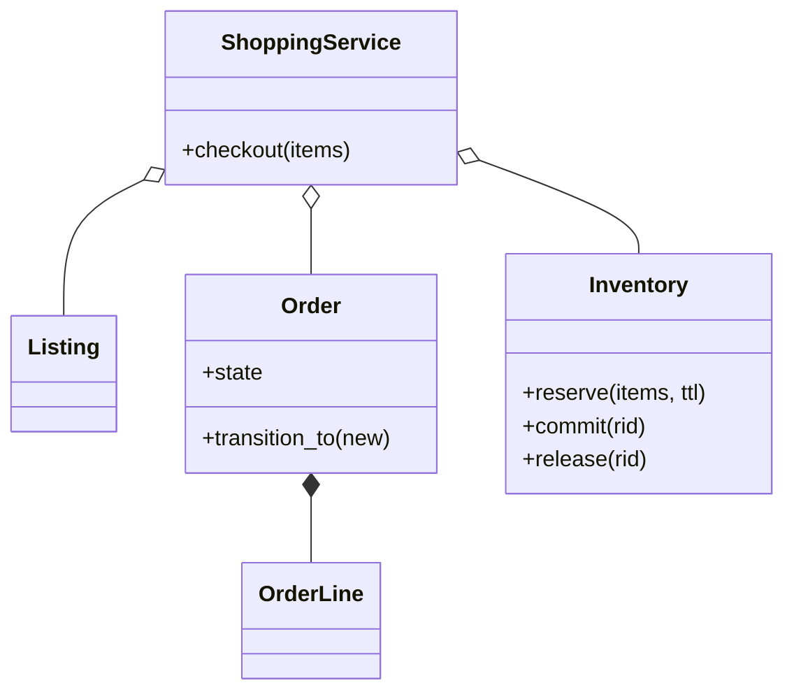

# 在线购物（Online Shopping）（low priority）

## 题目

用户浏览商品、放进购物车、下单，库存要扣对，订单要能跟踪状态。用它的是买家、卖家和仓库。范围大到能做一整年，所以先切小。**面试官真正在看的是：库存什么时候扣，说不说得出代价；一次下单跨库存、支付、发货三个会失败的系统，失败时怎么收场；订单状态是不是一张显式的转移表。**

你会听到的原话：设计一个像 Amazon 那样的在线购物系统，能浏览商品、加购物车、下单，库存要正确扣减，订单要能跟踪状态。

常见追问：
- 同一件商品有第二个卖家怎么办？
- 加一条促销规则要改哪里？
- 一百个人同时抢最后一件货呢？

## 先问这几个问题

- 一次下单跨几个会失败的系统？**至少库存、支付、发货，它们不在一个数据库事务里，所以下单是一个带补偿的流程（Saga），不是一串 `try/except`。**
- 库存什么时候扣：加购、下单、发货？**这是真正的岔路口，背后是超卖与少卖的取舍；没有标准答案，只有说得出代价的选择。**
- 一个商品有几个卖家？**有的话，价格和库存要挂在「挂牌」（Listing）上，不长在商品上。**
- 钱怎么表示？**整数分，全程无浮点。**
- 要不要支持退货、部分发货、预售？**先问一句，多半排除；问过之后状态机就知道将来往哪长，部分发货是唯一会迫使模型下沉一层的追问。** 搜索、鉴权、真实支付通道和持久化不在范围内，目录只提供按 id 查。
- 并发有多真？**抢同一件货是日常，预留必须在锁里做「检查加写入」。**

## 核心对象

| 类 | 职责（一句话） | 守住的不变量 |
|---|---|---|
| `Listing` | 谁按什么价卖哪件商品，价格和库存都按它计 | 金额是整数分 |
| `OrderLine` | 订单行，抄下下单那一刻的单价 | 之后改价不追溯 |
| `Order` | 一张订单和它的状态 | 状态只能沿转移表走，`state` 只读 |
| `Inventory` | 库存账：现货、带过期时间的预留 | 可用量 = 现货 - 未过期预留，永不为负 |
| `run_saga` | 通用执行器：按顺序跑成对声明的（动作，补偿） | 失败时只补偿已成功的步骤，倒序 |
| `ShoppingService` | 门面：把结账编排成一个 Saga | 失败的订单一定被取消 |



## 主流程

**结账 `checkout`：**
1. 按挂牌抄价格生成订单行和订单，状态是待支付（`PENDING`）。
2. 预留库存：在库存锁里检查每一行，全部够才一起占住，带过期时间；有一行不够整单失败，什么都不占。
3. 扣款，幂等键用订单号；响应丢了重试也不会扣两次。
4. 提交预留，变成真扣减；然后创建运单。
5. 任何一步抛错：倒序补偿已成功的步骤（退款、补库存、释放预留），订单转为已取消，把原异常抛给调用方。
6. 全部成功：订单依次转为已支付、已发货。

## 关键决策

### 库存什么时候扣

- 方案 A，加购即预留：永不结账的购物车把货占死，少卖。
- 方案 B，下单时才检查不预留：两个人同时通过检查，超卖。
- **选下单时预留，预留带过期时间，由注入的时钟判定。** 过期的预留在读可用量时顺手忽略，不依赖后台清扫准时。预留的删除有三条出口：过期、释放、提交。

### 订单状态

- 方案 A，一堆布尔字段：`is_paid` 与 `is_cancelled` 同时为真是什么意思？
- 方案 B，每个状态一个类（State 模式）：状态少、规则只是「谁能到谁」，类是空壳。
- **选枚举加一张转移表，`transition_to` 查表，非法转移抛错。** 退货只是表里多两行。这里不用模式。

### 结账失败怎么收场

- 方案 A，嵌套 `try/except`：参与方每多一个缩进多一层，补偿顺序全靠手写。
- **选把「做什么」和「怎么撤销」成对声明，交给通用执行器倒序补偿。** 执行器不知道订单和库存，可以单独测试。补偿必须幂等，`release` 找不到预留就什么也不做。

### 价格挂在哪里

- **选价格挂在 `Listing` 上，订单行抄一份。** 商品没有价格和库存，第二个卖家只是目录里多一行挂牌。

## Python 骨架

```python
from __future__ import annotations
import itertools
import threading
from dataclasses import dataclass
from enum import Enum
from typing import Callable

class OutOfStockError(Exception): ...
class ReservationExpiredError(Exception): ...
class InvalidTransitionError(Exception): ...

class OrderState(Enum):
    PENDING = 1
    PAID = 2
    SHIPPED = 3
    CANCELLED = 4

ALLOWED = {OrderState.PENDING: {OrderState.PAID, OrderState.CANCELLED},  # 状态机 = 一张转移表
           OrderState.PAID: {OrderState.SHIPPED, OrderState.CANCELLED},
           OrderState.SHIPPED: set(), OrderState.CANCELLED: set()}

@dataclass(frozen=True)
class Listing:  # 「谁按什么价卖这件商品」：价格和库存归挂牌，不归商品；金额一律整数分
    id: str
    product: str
    seller: str
    price: int

@dataclass(frozen=True)
class OrderLine:  # 抄下下单那一刻的单价，之后卖家改价不追溯
    listing_id: str
    qty: int
    unit_price: int

class Order:
    def __init__(self, oid: str, lines: list[OrderLine]) -> None:
        self.id, self.lines, self._state = oid, tuple(lines), OrderState.PENDING

    @property
    def state(self) -> OrderState:  # 只读：唯一的改法是 transition_to
        return self._state

    @property
    def total(self) -> int:
        return sum(l.qty * l.unit_price for l in self.lines)
    def transition_to(self, new: OrderState) -> None:
        if new not in ALLOWED[self._state]:
            raise InvalidTransitionError(f"{self._state.name} -> {new.name}")
        self._state = new

class Inventory:  # 不变量：可用量 = 现货 - 未过期预留之和，且永不为负
    def __init__(self, stock: dict, clock: Callable[[], float]) -> None:
        self.stock, self.clock = dict(stock), clock
        self._res: dict[str, tuple[dict, float]] = {}
        self._ids = itertools.count(1)
        self._lock = threading.RLock()

    def available(self, lid: str) -> int:
        with self._lock:  # 读的时候顺手忽略过期预留，不依赖后台清扫准时
            held = sum(items.get(lid, 0) for items, exp in self._res.values() if exp > self.clock())
            return self.stock.get(lid, 0) - held

    def reserve(self, items: dict, ttl: float) -> str:
        with self._lock:  # 检查和写入必须在同一把锁里，否则两个线程各自通过检查就是超卖
            if any(self.available(l) < q for l, q in items.items()):
                raise OutOfStockError(items)  # 整张订单要么全部预留，要么一件都不占
            rid = f"R{next(self._ids)}"
            self._res[rid] = (dict(items), self.clock() + ttl)
            return rid

    def commit(self, rid: str) -> None:  # 预留变成真扣减
        with self._lock:
            items, exp = self._res.pop(rid)
            if exp <= self.clock():
                raise ReservationExpiredError(rid)
            self.stock.update({l: self.stock[l] - q for l, q in items.items()})

    def release(self, rid: str) -> None:  # 补偿：幂等，预留不在就什么也不做
        self._res.pop(rid, None)

    def restock(self, items: dict) -> None:
        with self._lock:
            self.stock.update({l: self.stock[l] + q for l, q in items.items()})

def run_saga(steps) -> None:  # 通用执行器：(动作, 补偿) 成对声明，失败时只补偿已成功的步骤，倒序
    done = []
    try:
        for action, undo in steps:
            action()
            done.append(undo)
    except Exception:
        for undo in reversed(done):
            undo()
        raise

class ShoppingService:
    def __init__(self, listings, inventory: Inventory, payments, ship: Callable[[str], None], ttl: float = 900) -> None:
        self.catalogue = {l.id: l for l in listings}
        self.inventory, self.payments, self.ship, self.ttl = inventory, payments, ship, ttl
        self.orders, self._ids = {}, itertools.count(1)

    def checkout(self, items: dict) -> Order:
        lines = [OrderLine(lid, q, self.catalogue[lid].price) for lid, q in items.items()]
        order = Order(f"O{next(self._ids)}", lines)
        self.orders[order.id] = order
        box = {}  # 步骤之间传递：预留号、扣款回执
        steps = [
            (lambda: box.update(rid=self.inventory.reserve(items, self.ttl)), lambda: self.inventory.release(box["rid"])),
            (lambda: box.update(charge=self.payments.charge(order.id, order.total)),  # 幂等键 = 订单号
             lambda: self.payments.refund(box["charge"])),
            (lambda: self.inventory.commit(box["rid"]), lambda: self.inventory.restock(items)),
            (lambda: self.ship(order.id), lambda: None),
        ]
        try:
            run_saga(steps)
        except Exception:
            order.transition_to(OrderState.CANCELLED)
            raise
        order.transition_to(OrderState.PAID)
        order.transition_to(OrderState.SHIPPED)
        return order

class FakeGateway:
    def __init__(self) -> None:
        self.charged, self.refunded = [], []

    def charge(self, key: str, amount: int) -> str:
        self.charged.append((key, amount))
        return f"ch_{key}"

    def refund(self, receipt: str) -> None:
        self.refunded.append(receipt)

if __name__ == "__main__":
    now = [0.0]
    inv = Inventory({"L1": 5, "L2": 1}, lambda: now[0])
    pay, fail = FakeGateway(), [False]

    def ship(oid: str) -> None:
        if fail[0]:
            raise RuntimeError("无运力")

    svc = ShoppingService([Listing("L1", "书", "s1", 1000), Listing("L2", "笔", "s2", 500)], inv, pay, ship)
    o = svc.checkout({"L1": 2, "L2": 1})
    assert o.state is OrderState.SHIPPED and o.total == 2500 and inv.stock == {"L1": 3, "L2": 0}
    svc.catalogue["L1"] = Listing("L1", "书", "s1", 9999)  # 改价不追溯已下的单
    assert o.total == 2500
    try:
        svc.checkout({"L2": 1})  # 没货：什么都不占、不收钱
        raise SystemExit("应当缺货")
    except OutOfStockError:
        assert len(pay.charged) == 1
    fail[0] = True  # 最后一步发货失败：退款、补库存、订单取消
    try:
        svc.checkout({"L1": 1})
        raise SystemExit("应当失败")
    except RuntimeError:
        assert pay.refunded == ["ch_O3"] and inv.stock["L1"] == 3 and svc.orders["O3"].state is OrderState.CANCELLED
    try:
        o.transition_to(OrderState.PENDING)  # 非法转移要抛，不能静默
        raise SystemExit("应当拒绝")
    except InvalidTransitionError:
        pass
    inv.reserve({"L1": 3}, ttl=10)
    assert inv.available("L1") == 0
    now[0] = 11  # 预留过期，库存自动还回来
    assert inv.available("L1") == 3
    print("ok")
```

## 面试官加需求时

| 新需求 | 改哪里 | 不用动哪里 |
|---|---|---|
| 第二个卖家 | 目录里多一行 `Listing` | 结账、库存、订单 |
| 促销、优惠券 | 一个 `(订单行) -> 折扣` 的函数，装进规则列表 | `Saga`、`Inventory` |
| 退货退款 | 状态表加状态和边，退款复用带幂等键的 `refund` | `Order` 其余代码、预留机制 |
| 部分发货 | 状态下沉到发货单，订单状态聚合它们：不是加一行能解决的，要说清这点 | 库存 |
| 购物车持久化 | 购物车换成从仓储加载 | 结账流程 |
| 换支付渠道 | 传另一个有 `charge` 和 `refund` 的对象 | 其余全部 |

## 并发与扩展

- 竞态：**`reserve` 里「检查可用量，写入预留」是一段复合操作，必须在同一把锁里，否则两个线程各自通过检查就超卖。** 测试用十个线程抢五件货。
- 锁粒度的下一步是一个挂牌一把锁；一笔订单跨多个挂牌时**按 id 排序后依次加锁**，否则两笔交叉的订单死锁。
- 多实例时内存锁失效，把不变式下沉到存储：`UPDATE ... SET stock = stock - ? WHERE stock >= ?`，看影响行数。Saga 也要持久化已完成到哪一步，重启后才能续跑补偿。
- 预留在库里是带 `expires_at` 的表，后台定期清扫，读时仍然过滤过期行。

## 常见错误

- 加购时扣库存：**会把货占死，要说得出它少卖在哪。**
- 先扣款再扣库存，中间没有预留：**把会失败的步骤排在了不可逆步骤之后。**
- 预留有过期字段但没人执行：**可用量计算和提交时都要检查。**
- 补偿不幂等，或动作没生效也补偿：**补偿要能安全重复，只补已成功的。**
- 用布尔字段表示状态，非法转移被静默忽略：**转移表加抛错。**
- 价格和库存写在商品上、金额用 `float`：**挂牌承载价格，整数分。**

## 30 秒复述

- 对象：`Listing` 承载价格和卖家；`Inventory` 管现货和带过期的预留；`Order` 只拥有状态转移表；`run_saga` 是通用的补偿执行器；`ShoppingService` 编排结账。
- 核心决策：**下单时预留库存，预留带过期；结账是一个 Saga，预留、扣款、提交、发货成对声明补偿，失败倒序撤销。**
- 订单状态是枚举加转移表，非法转移抛错；订单行抄下下单时的价格。
- 扩展：第二个卖家、促销、退货各只改数据或加一条规则，结账流程不动；部分发货会迫使状态下沉，要诚实说。
- 并发：预留的检查加写入在一把锁里；多实例下沉到存储的条件更新。

## 来源

- [[solution-online-shopping]]
