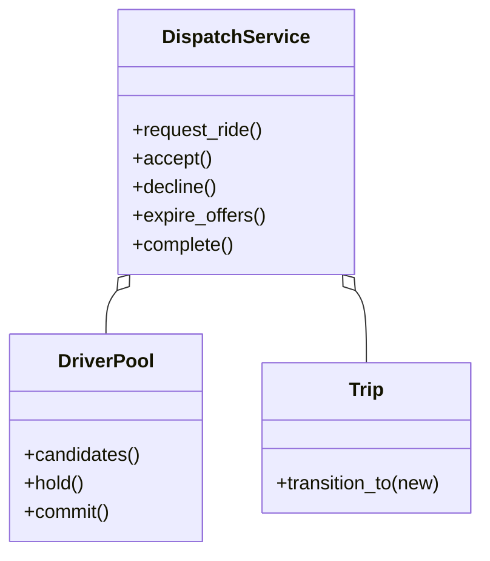

# 网约车（Ride Sharing）（low priority）

## 题目

乘客叫车，系统给他匹配一位司机，行程要能跟踪状态，结束时算钱。用它的是乘客、司机和调度系统。这句话里有三个子问题：找车、流转、算钱，**面试官真正在看的是第一个：司机是被「指派」还是被「询问」；两位乘客会不会同时匹配到同一位司机；超时和拒单之后行程怎么收场。**

你会听到的原话：设计一个网约车系统，乘客叫车，系统匹配司机，行程要能跟踪状态，结束时算钱。

常见追问：
- 不想按最近派，想综合评分和空闲时长呢？
- 下单时显示 1.5 倍，结束时街上车多了，按几倍收？
- 加拼车、预约单呢？

## 先问这几个问题

- 司机是被指派还是被问？**现实里系统只是发一张要约（offer），司机可以接、拒、不吭声：这决定了需要一个「要约」对象和一个「被要约」的司机状态。**
- 一张要约发给几个人？**广播抢单，还是一次只问一位、超时顺延。** 并发难度、司机体验完全不同，默认一次一位。
- 地图做到什么程度？**主动排除：假设有一个给出附近司机的服务，距离用直线近似。** 否则四十五分钟都花在 geohash 上，那是另一道题。
- 能不能拼车？**答案是能，行程就不能只挂一个乘客一个起终点。** 默认不拼车，但不把模型写死。
- 钱怎么表示？**整数分；倍数用分数（`Fraction`），不用 `float`。**
- 谁能在什么时候取消？**这是许可问题，不是状态问题，单独一张表。**

## 核心对象

| 类 | 职责（一句话） | 守住的不变量 |
|---|---|---|
| `DriverPool` | 司机位置和状态（空闲、被要约、忙）的唯一持有者 | 每个状态变化是锁内的一次比较并交换 |
| `Trip` | 一趟行程：乘客、起终点、倍数、当前要约 | 状态只能沿转移表走；倍数下单时锁死 |
| `ALLOWED` / `CANCELLABLE_BY` | 两张表：状态怎么走，谁能取消 | 上车之后不能取消 |
| `DispatchService` | 编排：派单、接单、拒单、超时、结束计价 | 持有自己的锁；锁序只有一个方向，服务锁到池锁 |



## 主流程

**叫车 `request_ride`：**
1. 拿服务锁，建行程（状态 `REQUESTED`），把倍数写进行程。
2. 从池里取附近空闲司机，近的在前，跳过已拒绝过的。
3. 对第一位做 `hold`（空闲到被要约，锁内的比较并交换）；失败说明被别人先占，试下一位；成功就记下要约对象和过期时刻。
4. 候选耗尽：行程直接取消，乘客得到明确的终态。

**司机回应：**
1. `accept`：要约必须是发给这位司机的，且没有过期（惰性判断，不靠定时器）；通过后 `commit` 变成忙，行程转已匹配。
2. `decline` 或超时：`release` 这位司机，记入排除集，顺位给下一位，重复上面的步骤 3 和 4。

**结束 `complete`：** 行程转已完成，司机回空闲，按「起步价 + 里程」乘下单时锁死的倍数，只在最后取整一次。

## 关键决策

### 派单：广播、指派还是逐个要约

- 方案 A，直接指派：把一个未经司机同意的事实写进数据，他不接单怎么办。
- 方案 B，广播抢单：谁先点谁赢，但「谁先」仍然要锁里的一次比较并交换来裁决，司机体验和并发都更乱。
- **选逐个要约：一次问一位，超时或拒绝就顺位。** 代价是匹配慢一点，换来每个时刻一位司机只对一位乘客有承诺。

### 司机为什么需要「被要约」这个状态

- 布尔字段 `is_available` 加先查后写：两个线程同时看到同一位空闲司机，各写一遍，同一位司机被派给两个人。
- **选三态（空闲、被要约、忙），`hold` 是锁内的一次比较并交换。** 要约敞开的十五秒里这位司机对别人不可见。

### 行程状态：转移表加许可表

- 方案 A，每个状态一个类（State 模式）：状态只是数据，没有各自的行为。
- **选两张表：转移表管「能到哪」，许可表管「谁能取消」。** 取消费再加一张同构的表就行，不用模式。

### 加价倍数什么时候锁死

- 方案 A，结束时再算：代码短，但下单时的报价不作数。
- **选下单那一刻算出来写进行程，结束时只读。** 倍数是合同的一部分。倍数用 `Fraction`，金额用整数分，全程只在最后一步取整。

### 匹配打分

- **用一个函数 `(请求, 司机, 时间) -> 分数`，不建策略类层次。** 最近优先只是默认函数，换成「评分加空闲时长」是传另一个函数；骨架里就是 `candidates` 的排序键。

## Python 骨架

```python
from __future__ import annotations
import itertools
import threading
from dataclasses import dataclass
from enum import Enum
from fractions import Fraction
from typing import Callable


class OfferError(Exception): ...
class CancelNotAllowedError(Exception): ...
class InvalidTransitionError(Exception): ...


class DriverStatus(Enum):
    FREE = 1
    OFFERED = 2  # 要约敞开期间被独占持有：不能再被别人匹配
    BUSY = 3


class TripState(Enum):
    REQUESTED = 1
    MATCHED = 2
    IN_PROGRESS = 3
    COMPLETED = 4
    CANCELLED = 5


S = TripState
ALLOWED = {S.REQUESTED: {S.MATCHED, S.CANCELLED}, S.MATCHED: {S.IN_PROGRESS, S.CANCELLED},  # 转移表：状态怎么走
           S.IN_PROGRESS: {S.COMPLETED}, S.COMPLETED: set(), S.CANCELLED: set()}
CANCELLABLE_BY = {S.REQUESTED: {"rider", "system"}, S.MATCHED: {"rider", "driver", "system"}}  # 许可表：谁能取消


def dist(a: tuple, b: tuple) -> int:  # 地图不在范围内：整数坐标上的曼哈顿距离
    return abs(a[0] - b[0]) + abs(a[1] - b[1])


class DriverPool:  # 司机状态的唯一持有者；每个状态变化都是锁内的一次比较并交换
    def __init__(self, locations: dict) -> None:
        self.loc = dict(locations)
        self.status = {d: DriverStatus.FREE for d in locations}
        self._lock = threading.Lock()

    def candidates(self, pickup, exclude) -> list[str]:  # 附近空闲司机，近的在前；换索引只改这个方法
        with self._lock:
            free = [d for d, s in self.status.items() if s is DriverStatus.FREE and d not in exclude]
        return sorted(free, key=lambda d: dist(self.loc[d], pickup))

    def _cas(self, did: str, old: DriverStatus, new: DriverStatus) -> bool:
        with self._lock:
            if self.status[did] is not old:
                return False
            self.status[did] = new
            return True

    def hold(self, did):    return self._cas(did, DriverStatus.FREE, DriverStatus.OFFERED)
    def release(self, did): return self._cas(did, DriverStatus.OFFERED, DriverStatus.FREE)
    def commit(self, did):  return self._cas(did, DriverStatus.OFFERED, DriverStatus.BUSY)
    def finish(self, did):  return self._cas(did, DriverStatus.BUSY, DriverStatus.FREE)


class Trip:
    def __init__(self, tid: str, rider: str, pickup, dropoff, surge: Fraction) -> None:
        self.id, self.rider, self.pickup, self.dropoff = tid, rider, pickup, dropoff
        self.surge = surge  # 倍数在下单那一刻锁死，报价才作数
        self.state, self.driver, self.offered_to, self.expires_at, self.declined = S.REQUESTED, None, None, 0, set()

    def transition_to(self, new: TripState) -> None:
        if new not in ALLOWED[self.state]:
            raise InvalidTransitionError(f"{self.state.name} -> {new.name}")
        self.state = new


class DispatchService:  # 锁序只有一个方向：服务锁 -> 池锁，池从不回调服务
    def __init__(self, pool: DriverPool, clock: Callable[[], float], ttl: float = 15, base: int = 300, per_km: int = 100):
        self.pool, self.clock, self.ttl, self.base, self.per_km = pool, clock, ttl, base, per_km
        self.trips, self._ids, self._lock = {}, itertools.count(1), threading.Lock()

    def request_ride(self, rider: str, pickup, dropoff, surge: Fraction = Fraction(1)) -> Trip:
        with self._lock:
            trip = Trip(f"T{next(self._ids)}", rider, pickup, dropoff, surge)
            self.trips[trip.id] = trip
            self._offer_next(trip)
            return trip

    def _offer_next(self, trip: Trip) -> None:  # 调用方已持有服务锁；一次只问一位，被问的人被独占
        for did in self.pool.candidates(trip.pickup, trip.declined):
            if self.pool.hold(did):  # 抢占失败（被别人先占）就试下一位
                trip.offered_to, trip.expires_at = did, self.clock() + self.ttl
                return
        trip.transition_to(S.CANCELLED)  # 候选耗尽：给乘客一个明确的终态

    def _pass_on(self, trip: Trip) -> None:  # 拒单或超时：释放这位、记入排除集、顺位下一位
        self.pool.release(trip.offered_to)
        trip.declined.add(trip.offered_to)
        trip.offered_to = None
        self._offer_next(trip)

    def accept(self, tid: str, did: str) -> None:
        with self._lock:
            trip = self.trips[tid]
            if trip.offered_to != did or self.clock() >= trip.expires_at:  # 惰性判断过期，测试不用 sleep
                raise OfferError(f"{did} 没有 {tid} 的有效要约")
            self.pool.commit(did)
            trip.driver, trip.offered_to = did, None
            trip.transition_to(S.MATCHED)

    def decline(self, tid: str, did: str) -> None:
        with self._lock:
            trip = self.trips[tid]
            if trip.offered_to == did:
                self._pass_on(trip)

    def expire_offers(self) -> None:
        with self._lock:
            for trip in self.trips.values():
                if trip.state is S.REQUESTED and trip.offered_to and self.clock() >= trip.expires_at:
                    self._pass_on(trip)

    def start(self, tid: str) -> None:
        with self._lock:
            self.trips[tid].transition_to(S.IN_PROGRESS)
    def complete(self, tid: str) -> int:
        with self._lock:
            trip = self.trips[tid]
            trip.transition_to(S.COMPLETED)
            self.pool.finish(trip.driver)
            return int((self.base + self.per_km * dist(trip.pickup, trip.dropoff)) * trip.surge)  # 只在这里取整一次

    def cancel(self, tid: str, by: str) -> None:
        with self._lock:
            trip = self.trips[tid]
            if by not in CANCELLABLE_BY.get(trip.state, ()):
                raise CancelNotAllowedError(f"{by} 不能在 {trip.state.name} 取消")
            if trip.offered_to:
                self.pool.release(trip.offered_to)
            if trip.driver:
                self.pool.finish(trip.driver)
            trip.offered_to = None
            trip.transition_to(S.CANCELLED)


if __name__ == "__main__":
    now, pool = [0.0], DriverPool({"d1": (1, 0), "d2": (3, 0), "d3": (50, 50)})
    svc = DispatchService(pool, lambda: now[0])
    t1 = svc.request_ride("r1", (0, 0), (10, 0), Fraction(3, 2))
    t2 = svc.request_ride("r2", (0, 0), (5, 0))
    assert (t1.offered_to, t2.offered_to) == ("d1", "d2")  # d1 被独占，r2 问不到它
    svc.decline(t1.id, "d1")
    assert t1.offered_to == "d3" and pool.status["d1"] is DriverStatus.FREE  # 顺位给下一位，d1 不会被反复问
    svc.accept(t1.id, "d3")
    svc.start(t1.id)
    assert svc.complete(t1.id) == 1950 and pool.status["d3"] is DriverStatus.FREE  # (300+100*10)*3/2
    try:
        svc.cancel(t1.id, "rider")
        raise SystemExit("应当拒绝")
    except CancelNotAllowedError:
        pass
    now[0] = 16  # d2 沉默，要约过期，转给 d1
    svc.expire_offers()
    assert t2.offered_to == "d1" and "d2" in t2.declined
    try:
        svc.accept(t2.id, "d2")  # 过期的司机再接单
        raise SystemExit("应当拒绝")
    except OfferError:
        pass
    print("ok")
```

## 面试官加需求时

| 新需求 | 改哪里 | 不用动哪里 |
|---|---|---|
| 车型（经济、豪华） | 请求加字段，`candidates` 加过滤，价目表变成「车型到表」 | 状态机、要约机制 |
| 综合评分匹配 | 换打分函数 | 派单流程 |
| 拼车 | 行程上追加「一段乘客行程」，独享只是一段 | 状态机、要约 |
| 预约单 | 加一个 `SCHEDULED` 状态，只通向 `REQUESTED` 和 `CANCELLED`；这是唯一真的会动状态机的追问，要老实承认 | 现有的边 |
| 取消费 | `cancel` 里按（状态，谁取消）查一张费率表 | 其他 |
| 附近司机用 geohash | 只改 `candidates` | 其余 |

## 并发与扩展

- 竞态：**两位乘客同时选中同一位司机。`hold` 在池锁里比较并交换，只有一个成功，另一个试下一位。**
- 两把锁不会死锁，因为锁序只有一个方向：服务锁到池锁，池从不回调服务。这靠约定，写进文档。
- 要约超时用注入时钟加惰性判断，`accept` 自己检查，`expire_offers` 把结论落成真状态：测试不用 `sleep`，清扫线程挂了也不出错。
- 规模变大：要约放带过期的键值存储，`hold` 对应 `SET NX EX`；派单按城市或区域分片，每片一个决策循环；`candidates` 换空间索引。
- 收款是外部会失败的参与方，应是带补偿的流程（Saga），边界停在算出金额明细。

## 常见错误

- 把司机直接指派给行程：**先发要约，司机同意才成立。**
- 用布尔 `is_available` 先查后写：**占用做成状态，占用是锁内一次比较并交换。**
- 拒单后没有排除集：**同一位司机被反复问；候选耗尽时也要给行程终态，别让乘客永远「正在找车」。**
- 行程只挂一个乘客：**拼车一加就推倒重来，用一段一段的列表。**
- 状态用一堆布尔、非法转移被静默吞掉：**转移表加抛错。**
- 倍数和金额用 `float`：**整数分加 `Fraction`，最后取整一次。**

## 30 秒复述

- 对象：`DriverPool` 持有司机三态；`Trip` 持有状态和锁死的倍数；`DispatchService` 编排派单、回应和计价。
- 核心决策：**系统只发要约，一次问一位；被要约的司机进入独占状态，占用是池锁里的一次比较并交换，所以不会派给两个人。**
- 拒单和超时顺位给下一位，带排除集；候选耗尽就取消行程。
- 行程是转移表加取消许可表；倍数下单时锁死，结束时只取整一次。
- 扩展：车型、拼车、取消费都不动状态机，只有预约单要加一个状态。
- 并发：服务锁到池锁单向；超时用注入时钟惰性判断。

## 来源

- [[solution-ride-sharing]]
