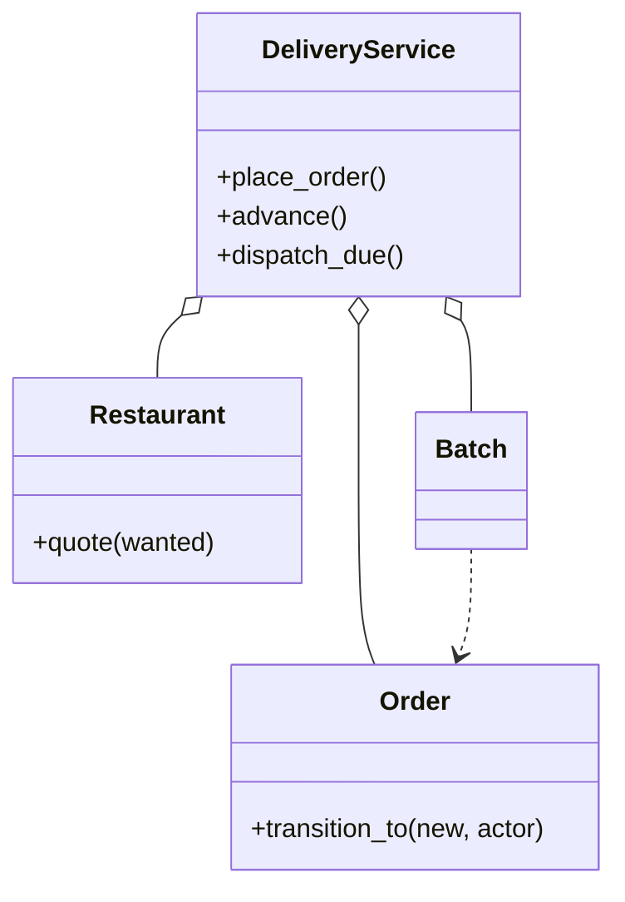

# 外卖平台（Food Delivery）（low priority）

## 题目

顾客点餐，餐厅做菜，骑手送达，平台居中撮合。它像网约车的变体，但多出来的餐厅改变了全部结构：一次状态转移不只问「能不能走」，还要问「谁有资格走」。**面试官真正在看的是：三方各自能做什么，状态机的每条边有没有写明角色；骑手什么时候派，说不说得出派早派晚各自谁买单；一位骑手带两单时，怎么保证不坑第一位顾客。**

你会听到的原话：设计一个外卖平台，顾客点餐，餐厅做菜，骑手送达。

常见追问：
- 一位骑手能不能一次带两单？
- 点餐过程中一道菜被标成售罄怎么办？
- 餐厅中途打烊，已接的单算不算数？

## 先问这几个问题

- 参与方是几个？**顾客、餐厅、骑手加平台，状态转移要带角色：顾客不能把订单标成已送达，餐厅接单后顾客不能单方面取消。**
- 骑手什么时候派？**下单就派、接单就派、掐着出餐时间派：这是唯一没有正确答案、只有说得出代价的选择。**
- 骑手能不能同时带两单？**能的话「骑手和订单」不是一对一，要有批次，还要一条硬规则保护第一单。**
- 菜单会不会在下单过程中变？**会，所以「校验有货」和「生成订单」必须是同一个原子动作。**
- 缺货少送一道，还是整单失败？默认整单失败。范围外：地图、支付、骑手拒单（骨架里只保留一次比较并交换式的占用）。

## 核心对象

| 类 | 职责（一句话） | 守住的不变量 |
|---|---|---|
| `Restaurant` | 菜单、售罄集合、营业开关；`quote` 一次性校验并抄价 | 营业、有货、抄价在一次加锁里完成，全成立或全失败 |
| `Order` | 一张订单：行、状态、出餐时刻 | 状态只能沿 `TRANSITIONS` 走，且必须由有权的角色走 |
| `TRANSITIONS` | 键是（起点，终点），值是允许的角色集合 | 流程错和越权是两个不同的异常 |
| `Batch` | 一位骑手一次带走的几单，只是一条记录 | 没有自己的状态机 |
| `DeliveryService` | 下单、推进、按时钟派单、拼单 | 一位骑手不会同时拿到两个批次 |



## 主流程

**下单 `place_order`：**
1. 拿服务锁，调餐厅的 `quote`：营业中吗，每道菜还有吗，抄下价格，全部在餐厅锁里完成；任何一项不满足整单失败。
2. 生成订单，状态 `PLACED`。

**推进 `advance`：**
1. 查（当前状态，目标状态）对应的角色集合：没有这条边抛 `InvalidTransitionError`，角色不在集合里抛 `NotPermittedError`。
2. 餐厅接单时算出 `ready_at`：订单里最慢那道菜的制作时间。
3. 最后一单送达时，批次里所有订单都已送达，释放骑手并删批次。

**派单 `dispatch_due`（由时钟驱动地拉取）：**
1. 取已接单、还没有批次的订单，按出餐时刻排序，最早的是锚单（先送它）。
2. 选离餐厅最近的空闲骑手；如果骑手到店的时刻还早于 `ready_at` 减去允许的等待，这一轮不派。
3. 找一单愿意拼进来的：它给锚单增加的送达时延不超过上限。建批次，占住骑手。

## 关键决策

### 状态机每条边写明谁有权走

- 方案 A，只有转移表，权限散在十个方法的十个 `if` 里。
- 方案 B，转移表加一张只管取消的权限表（网约车的做法）：外卖里每条边都分角色，只管取消不够。
- **选一张表，键是（起点，终点），值是允许的角色集合。** 流程错和越权分成两个异常，线上才分得清。

### 骑手什么时候派

- 方案 A，下单就派：餐厅可能拒单，骑手白跑，成本平台吃。直接出局。
- 方案 B，接单就派：骑手立刻出发，到店干等。
- **选接单之后、掐着出餐时刻派。** 派早了骑手空等，派晚了菜在出餐口变凉；`ready_at` 在接单时算出，到店时刻不早于 `ready_at` 减等待上限才派。

### 拼单：一条不等式，不是三个旋钮

- 方案 A，三个参数：店要近、出餐差要小、别太耽误第一单。三个阈值会互相打架（店很近但出餐差二十分钟，拼不拼？）。
- **选一条：拼进来让锚单多等的时间不超过上限。** 公式是「骑手去第二家店与等它出餐，取大者，再加从第二家去锚单地址比直接去多走的」。两家店远或出餐差大，它自己就变大；这是一个能向顾客承诺的话：「最多晚五分钟」。

### 批次要不要自己的状态机

- **不要，这是简单答案胜出：批次的状态就是各单状态之和。** 另起一套是两份会不一致的真相，所以批次是一条没有方法的记录，「批次送完了吗」是对订单状态的一次查询。判据：对象只有在拥有别人答不了的问题时才需要自己的状态。

### 缺货在哪一刻校验

- 方案 A，加购时校验一次，下单时相信它：顾客下单成功，餐厅做不出来。
- 方案 B，不校验，餐厅接单时拒：顾客白等两分钟。
- **选下单时在餐厅自己的锁里一次性校验并抄价，同时保留餐厅拒单这条边。** 乐观校验加权威兜底。缺货整单失败，因为少送一道配送成本不减、满意度断崖。

## Python 骨架

```python
from __future__ import annotations
import itertools
import threading
from dataclasses import dataclass
from enum import Enum
from typing import Callable


class InvalidTransitionError(Exception): ...  # 流程错
class NotPermittedError(Exception): ...       # 越权：和流程错分开，排障时才分得清
class ItemUnavailableError(Exception): ...


class Actor(Enum):
    CUSTOMER = 1
    RESTAURANT = 2
    COURIER = 3
    PLATFORM = 4


class OS(Enum):
    PLACED = 1
    ACCEPTED = 2
    REJECTED = 3
    READY = 4
    PICKED_UP = 5
    DELIVERED = 6
    CANCELLED = 7


A = Actor
TRANSITIONS = {  # 每一条边写明谁有权走：三方系统里，角色是转移的一部分
    (OS.PLACED, OS.ACCEPTED): {A.RESTAURANT}, (OS.PLACED, OS.REJECTED): {A.RESTAURANT, A.PLATFORM},
    (OS.PLACED, OS.CANCELLED): {A.CUSTOMER}, (OS.ACCEPTED, OS.READY): {A.RESTAURANT},
    (OS.READY, OS.PICKED_UP): {A.COURIER}, (OS.PICKED_UP, OS.DELIVERED): {A.COURIER}}


def travel(a: tuple, b: tuple) -> int:  # 地图不在范围内：整数分钟，曼哈顿距离
    return abs(a[0] - b[0]) + abs(a[1] - b[1])


@dataclass(frozen=True)
class OrderLine:  # 抄下下单那一刻的价格
    item: str
    qty: int
    price: int


class Restaurant:
    def __init__(self, name: str, loc: tuple, menu: dict) -> None:  # menu: 菜名 -> (价格分, 制作分钟)
        self.name, self.loc, self.menu, self.sold_out, self.open = name, loc, menu, set(), True
        self._lock = threading.Lock()

    def quote(self, wanted: dict) -> tuple:  # 是否营业、有没有货、抄价格：在一次加锁里做完；全成立或全失败
        with self._lock:
            if not self.open or any(i not in self.menu or i in self.sold_out for i in wanted):
                raise ItemUnavailableError(wanted)
            return tuple(OrderLine(i, n, self.menu[i][0]) for i, n in wanted.items())


class Order:  # 不带锁，永远在服务的锁里被改
    def __init__(self, oid: str, rest: Restaurant, lines: tuple, dropoff: tuple) -> None:
        self.id, self.rest, self.lines, self.dropoff = oid, rest, lines, dropoff
        self.state, self.ready_at, self.batch = OS.PLACED, None, None

    def transition_to(self, new: OS, actor: Actor) -> None:
        who = TRANSITIONS.get((self.state, new))
        if who is None:
            raise InvalidTransitionError(f"{self.state.name} -> {new.name}")
        if actor not in who:
            raise NotPermittedError(f"{actor.name} 不能 {self.state.name} -> {new.name}")
        self.state = new


@dataclass(frozen=True)
class Batch:  # 只是一条记录，没有自己的状态机：状态就是各单状态之和
    id: str
    courier: str
    order_ids: tuple


class DeliveryService:  # 锁序：服务锁 -> 餐厅锁
    def __init__(self, couriers: dict, clock: Callable[[], int], max_wait: int = 3, max_added_delay: int = 5) -> None:
        self.couriers, self.clock, self.max_wait, self.max_added = couriers, clock, max_wait, max_added_delay
        self.orders, self.batches, self.busy = {}, {}, set()
        self._ids, self._lock = itertools.count(1), threading.Lock()

    def place_order(self, rest: Restaurant, wanted: dict, dropoff: tuple) -> Order:
        with self._lock:
            order = Order(f"O{next(self._ids)}", rest, rest.quote(wanted), dropoff)
            self.orders[order.id] = order
            return order

    def advance(self, oid: str, new: OS, actor: Actor) -> None:
        with self._lock:
            o = self.orders[oid]
            o.transition_to(new, actor)
            if new is OS.ACCEPTED:  # 接单那一刻算出出餐时刻，派单的全部时机判断都挂在它上面
                o.ready_at = self.clock() + max(o.rest.menu[l.item][1] for l in o.lines)
            if new is OS.DELIVERED and all(self.orders[i].state is OS.DELIVERED for i in self.batches[o.batch].order_ids):
                self.busy.discard(self.batches.pop(o.batch).courier)  # 批次表唯一会缩小的地方

    def _added_delay(self, a: Order, b: Order) -> int:  # 拼进 b 给第一单 a 增加的送达时延：一条不等式，一个旋钮
        gap = b.ready_at - a.ready_at
        return max(travel(a.rest.loc, b.rest.loc), gap) + travel(b.rest.loc, a.dropoff) - travel(a.rest.loc, a.dropoff)

    def dispatch_due(self) -> list[Batch]:  # 接单之后才派，且掐着出餐时间派；由时钟驱动地拉取
        with self._lock:
            now, made = self.clock(), []
            due = sorted((o for o in self.orders.values() if o.state is OS.ACCEPTED and not o.batch), key=lambda o: o.ready_at)
            for anchor in due:
                idle = [c for c in self.couriers if c not in self.busy]
                if anchor.batch or not idle:
                    continue
                c = min(idle, key=lambda c: travel(self.couriers[c], anchor.rest.loc))
                if now + travel(self.couriers[c], anchor.rest.loc) < anchor.ready_at - self.max_wait:
                    continue  # 还早：派早了骑手在店里空等
                mates = [o for o in due if o is not anchor and not o.batch and self._added_delay(anchor, o) <= self.max_added][:1]
                batch = Batch(f"B{next(self._ids)}", c, (anchor.id, *(o.id for o in mates)))
                for o in (anchor, *mates):
                    o.batch = batch.id
                self.batches[batch.id] = batch
                self.busy.add(c)
                made.append(batch)
            return made


if __name__ == "__main__":
    now = [0]
    a = Restaurant("A", (0, 0), {"burger": (800, 10), "fries": (300, 5)})
    b = Restaurant("B", (1, 0), {"pizza": (1000, 12)})
    svc = DeliveryService({"c1": (0, 3)}, lambda: now[0])
    a.sold_out.add("fries")
    try:
        svc.place_order(a, {"burger": 1, "fries": 1}, (0, 5))  # 缺货：整单失败，不少送一道
        raise SystemExit("应当缺货")
    except ItemUnavailableError:
        assert not svc.orders
    a.sold_out.clear()
    o1 = svc.place_order(a, {"burger": 1, "fries": 1}, (0, 5))
    o2 = svc.place_order(b, {"pizza": 1}, (1, 6))
    try:
        svc.advance(o1.id, OS.ACCEPTED, Actor.CUSTOMER)  # 越权
        raise SystemExit("应当拒绝")
    except NotPermittedError:
        pass
    for o in (o1, o2):
        svc.advance(o.id, OS.ACCEPTED, Actor.RESTAURANT)
    assert (o1.ready_at, o2.ready_at) == (10, 12) and svc.dispatch_due() == []  # 骑手 3 分钟到，还早
    now[0] = 4
    (batch,) = svc.dispatch_due()  # 掐着点派；o2 给 o1 只多 3 分钟，拼上
    assert batch.order_ids == (o1.id, o2.id)
    for o in (o1, o2):
        for new, who in ((OS.READY, Actor.RESTAURANT), (OS.PICKED_UP, Actor.COURIER), (OS.DELIVERED, Actor.COURIER)):
            svc.advance(o.id, new, who)
            if new is OS.DELIVERED and o is o1:
                assert "c1" in svc.busy  # 批次里还有一单没送完
    assert not svc.busy and not svc.batches
    print("ok")
```

## 面试官加需求时

| 新需求 | 改哪里 | 不用动哪里 |
|---|---|---|
| 配送费按距离分档 | 一个注入的函数 `(订单, 餐厅) -> 价格`，在下单时调用 | 状态机 |
| 骑手可以拒单 | 把占用换成「带超时的要约，可拒，顺位」（见网约车） | 订单状态机，只动骑手池和派单 |
| 定时单 | 加 `SCHEDULED` 状态和一条出边，到点放行 | 派单 |
| 餐厅中途打烊 | 批量走一条已有的边：只把没接的单拒掉，已接的照常送完 | 派单 |
| 顾客改地址 | 只允许在取餐之前，重算批次绕路；是一个受检的动作，不是赋值 | 状态表 |
| 餐厅评分 | 送达之后的一条独立记录 | `Order` |

## 并发与扩展

- 竞态：**两个 `dispatch_due` 同时选中同一位骑手。** 占用是服务锁内的检查加写入；跨机器时对应数据库条件更新或 `SET NX`，批次 id 就是 fencing token。
- 锁序只有一个方向：服务锁到餐厅锁，下层从不回调上层。这靠约定，写进文档。
- 缺货与下单的竞态靠 `quote` 的一次加锁：校验和抄价之间没有缝。
- `dispatch_due` 现在是全表扫描，规模大了换成按 `ready_at` 排的小顶堆，只看到点的；只影响这个方法。
- 订单落库只需在 `transition_to` 挂钩子；批次表送完即删，订单表保留作档案。

## 常见错误

- 忘了「谁」这一维：**顾客能标已送达、骑手能替餐厅接单，而代码看不出问题。**
- 餐厅接单前就派骑手：**骑手白跑的成本平台自己吃。**
- 拼单没有硬约束，或约束是「五公里内」这种和顾客体验无关的量：**直接写成顾客关心的那句话。**
- 给批次也配一套状态机：**两份会不一致的真相。**
- 校验和抄价分两步，或缺货少送一道：**一次加锁，全成立或全失败。**
- 非法转移和越权合并成一个异常：**排障时分不清是流程错还是权限错。**

## 30 秒复述

- 对象：`Restaurant` 的 `quote` 原子校验并抄价；`Order` 持有状态和出餐时刻；`TRANSITIONS` 是带角色的转移表；`Batch` 是一条记录；`DeliveryService` 编排。
- 核心决策：**状态机的每条边带角色；接单之后、掐着出餐时刻派骑手；拼单只看一条不等式，锚单最多晚多少。**
- 批次不要状态机，状态就是各单状态之和。
- 扩展：配送费、骑手拒单、定时单、打烊，各动一个函数或一个状态，派单和状态表基本不动。
- 并发：骑手占用在锁内检查加写入，锁序服务到餐厅单向。

## 来源

- [[solution-food-delivery]]
- [[solution-ride-sharing]]
