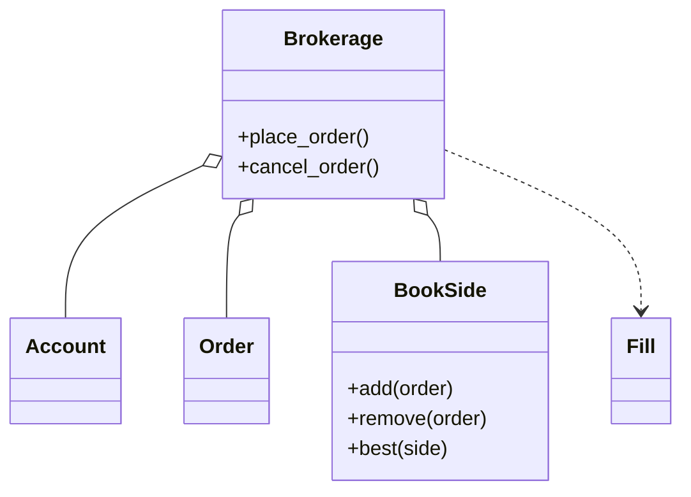

# 股票交易系统（Stock Brokerage）（low priority）

## 题目

用户有账户，能下买单和卖单，系统把它们撮合成交。这句话底下是两道题：经纪商（开户、入金、风控）和撮合引擎（一本订单簿，按价格优先、同价时间优先配对）。**面试官真正在看的是后者：订单簿用什么数据结构，撤单为什么也要快；成交价打在谁的价上；钱和股在成交时会不会凭空多出或消失。**

你会听到的原话：设计一个股票交易系统，用户有账户，能下买单和卖单，系统要把它们撮合成交。

常见追问：
- 部分成交、撤单怎么处理？
- 加市价单、止损单要改哪里？
- 成交价取买方的、卖方的，还是中间价？

## 先问这几个问题

- 钱用什么类型？**整数分，不用 `float`；这样「全场现金总额不变」是一个可以直接断言的等式。**
- 有哪几种订单？**先做限价单，市价单、止损单、IOC 留作追问；把「什么时候能成交」和「剩余量怎么办」分开，后面加类型只改这两处。**
- 允许卖空吗？**默认不允许：卖单的校验就是可用持仓够不够，持仓恒非负。** 允许则要保证金、盯市、强平，校验不再是下单那一刻算一次。
- 连续竞价还是集合竞价？**连续竞价：每来一张单立刻尝试撮合。**
- 单场所、进程内、不分片？**是；分片、落盘、重放放在扩展里。**

## 核心对象

| 类 | 职责（一句话） | 守住的不变量 |
|---|---|---|
| `Account` | 现金、持仓，以及下单时冻结的现金和股 | 可用量（总量减冻结）恒非负；不带锁 |
| `Order` | 一张报单：方向、数量、限价、已成交量、状态 | 进入终态后冻结必为 0 |
| `Fill` | 一笔成交回报 | 记单号不记引用，订单被清出后流水仍完整 |
| `BookSide` | 订单簿一侧：价位到挂单表，加一个升序价位列表 | 价位表与列表键集相同，空价位当场消失 |
| `Brokerage` | 校验、冻结、撮合、结算，一把锁 | 一笔成交不凭空造钱、不丢股票 |



## 主流程

**下单 `place_order`（整个过程在一把锁里）：**
1. 校验：数量和价格为正；买单要可用现金够 `数量 × 限价`，卖单要可用持仓够。不通过则订单记成 `REJECTED`，异常上挂着它。
2. 冻结：买单冻结现金，卖单冻结股。从此撮合只花已锁住的额度，不会再失败。
3. 撮合：对手侧最优价与限价交叉就成交，同价先到的先成交，数量取两者剩余的较小值，成交价取挂单方的价。
4. 结算：买方按冻结价解冻、按成交价扣钱，卖方得钱减股；记入流水；吃完的挂单从簿子上摘掉。
5. 还有剩余量就挂到自己这一侧簿子。

**撤单 `cancel_order`：** 终态单不能撤；否则从簿子摘掉，把剩余的冻结还回去，状态转 `CANCELLED`。

## 关键决策

### 订单簿用什么装

- 方案 A，每侧一个堆：取最优 O(log n)，但撤单要么 O(n)，要么打标记留垃圾，垃圾随历史报单量增长；同价先后要另配序号。
- 方案 B，价位表加每价位一个按插入序的 `dict`，外加升序价位列表：挂到已有价位 O(1)，开新价位 O(L)（L 是活跃价位数，几十到几百），取最优 O(1)，撤单 O(1)。
- **选 B：真实市场撤单远多于成交，L 远小于订单数；`dict` 的插入序就是时间优先，不需要序号字段。**

### 成交价取谁的

- 方案 A，永远取卖单的价：买单先挂、卖单后到时是错的，买家公开承诺过 237.80，凭什么只付 236。
- **选成交在挂单方的价：挂单方公布的价是市场已承诺的价，来单方愿意出更好的价是它自己的事，差额退还。** 买方冻结 `数量 × 限价`，按成交价扣钱，差额自动回到可用余额。

### 资金校验放在哪一步

- 方案 A，撮合完再扣钱：撮合已改了对手单，此时才发现没钱，回滚要把对手单放回原位置和原时间优先级，部分成交后几乎做不对。
- **选下单就冻结：撮合阶段不可能再失败。** 代价是账户多两个冻结字段，每条终结路径都要记得把剩余冻结还回去，所以撤单里有那几行。

### 订单状态：不用状态模式

- 唯一受状态影响的行为是「能不能撤」。**一行 `if not status.is_terminal` 就够，不建 `OpenState`、`FilledState` 类。** 买卖两侧同理，一个 `Side` 枚举加 `opposite` 属性，撮合代码两侧共用。

## Python 骨架

这份骨架只做限价单；市价单见下表。

```python
from __future__ import annotations
import bisect
import itertools
import threading
from dataclasses import dataclass, field
from enum import Enum

class InsufficientFundsError(Exception):
    def __init__(self, order: Order) -> None:
        super().__init__(order.id)
        self.order = order  # 被拒的单仍然建出来、记成 REJECTED，异常上挂着它：留痕

class CannotCancelError(Exception): ...

class Side(Enum):
    BUY = 1
    SELL = 2

    @property
    def opposite(self) -> Side:  # 买卖共用同一段撮合代码，不建 BuyOrder / SellOrder
        return Side.SELL if self is Side.BUY else Side.BUY

class Status(Enum):
    NEW = 1
    PARTIAL = 2
    FILLED = 3
    CANCELLED = 4
    REJECTED = 5

    @property
    def is_terminal(self) -> bool:  # 状态只影响「能不能撤」这一行 if，不用状态模式
        return self in (Status.FILLED, Status.CANCELLED, Status.REJECTED)

@dataclass
class Order:
    id: str
    account: str
    side: Side
    symbol: str
    qty: int
    price: int  # 整数分
    filled: int = 0
    status: Status = Status.NEW

    @property
    def remaining(self) -> int:
        return self.qty - self.filled

@dataclass(frozen=True)
class Fill:  # 成交回报，记单号不记引用
    buy_id: str
    sell_id: str
    qty: int
    price: int

@dataclass
class Account:  # 不带锁：一笔成交动两个账户，原子性由上层一把锁给
    cash: int
    positions: dict = field(default_factory=dict)
    reserved_cash: int = 0
    reserved_pos: dict = field(default_factory=dict)

    @property
    def available_cash(self) -> int:
        return self.cash - self.reserved_cash

    def available(self, symbol: str) -> int:
        return self.positions.get(symbol, 0) - self.reserved_pos.get(symbol, 0)

class BookSide:  # 价位 -> 挂单（dict 保持插入序 = 同价时间优先），外加升序的活跃价位列表
    def __init__(self) -> None:
        self.levels: dict[int, dict[str, Order]] = {}
        self.prices: list[int] = []

    def add(self, o: Order) -> None:
        if o.price not in self.levels:
            bisect.insort(self.prices, o.price)  # 只有开新价位才付 O(L)
        self.levels.setdefault(o.price, {})[o.id] = o

    def remove(self, o: Order) -> None:  # 撤单 O(1)；价位空了当场摘掉，没有垃圾
        del self.levels[o.price][o.id]
        if not self.levels[o.price]:
            del self.levels[o.price]
            self.prices.remove(o.price)

    def best(self, side: Side) -> Order | None:  # 买方最高价，卖方最低价；同价取最早的
        return next(iter(self.levels[self.prices[-1 if side is Side.BUY else 0]].values())) if self.prices else None

class Brokerage:  # 一把锁罩住「校验、预留、撮合、结算」：跨两个账户和一本簿子必须原子
    def __init__(self, accounts: dict, symbols) -> None:
        self.accounts, self.books = accounts, {s: {Side.BUY: BookSide(), Side.SELL: BookSide()} for s in symbols}
        self.orders, self.tape, self._ids, self._lock = {}, [], itertools.count(1), threading.RLock()

    def place_order(self, acct: str, side: Side, symbol: str, qty: int, price: int) -> Order:
        with self._lock:
            a = self.accounts[acct]
            o = Order(f"O{next(self._ids)}", acct, side, symbol, qty, price)
            self.orders[o.id] = o
            ok = qty > 0 and price > 0 and symbol in self.books
            if ok and side is Side.BUY:  # 下单就冻结：撮合阶段花的是已锁住的额度，不可能再失败一次
                ok = qty * price <= a.available_cash
                a.reserved_cash += qty * price if ok else 0
            elif ok:
                ok = qty <= a.available(symbol)
                a.reserved_pos[symbol] = a.reserved_pos.get(symbol, 0) + (qty if ok else 0)
            if not ok:
                o.status = Status.REJECTED
                raise InsufficientFundsError(o)
            book = self.books[symbol]
            while o.remaining and (m := book[side.opposite].best(side.opposite)) and \
                    (m.price <= price if side is Side.BUY else m.price >= price):
                q = min(o.remaining, m.remaining)
                self._settle(o if side is Side.BUY else m, m if side is Side.BUY else o, q, m.price)  # 成交在挂单方的价
                if m.status is Status.FILLED:
                    book[m.side].remove(m)
            if o.remaining:
                book[side].add(o)
            return o

    def _settle(self, buy: Order, sell: Order, q: int, price: int) -> None:
        b, s = self.accounts[buy.account], self.accounts[sell.account]
        b.reserved_cash -= q * buy.price  # 按冻结时的价解冻，按真实价扣钱：价格改善自动退回
        b.cash -= q * price
        b.positions[buy.symbol] = b.positions.get(buy.symbol, 0) + q
        s.reserved_pos[sell.symbol] -= q
        s.positions[sell.symbol] -= q
        s.cash += q * price
        for o in (buy, sell):
            o.filled += q
            o.status = Status.FILLED if not o.remaining else Status.PARTIAL
        self.tape.append(Fill(buy.id, sell.id, q, price))

    def cancel_order(self, oid: str) -> None:
        with self._lock:
            o = self.orders[oid]
            if o.status.is_terminal:
                raise CannotCancelError(oid)
            self.books[o.symbol][o.side].remove(o)
            a = self.accounts[o.account]  # 终态订单的预留必须为 0：撤单要把剩余预留还回去
            if o.side is Side.BUY:
                a.reserved_cash -= o.remaining * o.price
            else:
                a.reserved_pos[o.symbol] -= o.remaining
            o.status = Status.CANCELLED

if __name__ == "__main__":
    accts = {"alice": Account(100_000), "bob": Account(0, {"AAPL": 100}), "carol": Account(0, {"AAPL": 50})}
    br = Brokerage(accts, ["AAPL"])
    bob = br.place_order("bob", Side.SELL, "AAPL", 10, 237)
    carol = br.place_order("carol", Side.SELL, "AAPL", 3, 237)  # 同价，晚到
    br.place_order("alice", Side.BUY, "AAPL", 4, 240)  # 出价 240，按挂单方的 237 成交
    assert accts["alice"].cash == 100_000 - 4 * 237 and accts["alice"].reserved_cash == 0  # 价格改善退回
    assert bob.status is Status.PARTIAL and bob.remaining == 6
    br.place_order("alice", Side.BUY, "AAPL", 8, 237)  # 同价时间优先：先吃完 bob，再吃 carol
    assert [f.sell_id for f in br.tape[-2:]] == [bob.id, carol.id] and carol.remaining == 1
    try:
        br.place_order("alice", Side.BUY, "AAPL", 1000, 240)  # 买不起
        raise SystemExit("应当拒绝")
    except InsufficientFundsError as e:
        assert e.order.status is Status.REJECTED
    br.cancel_order(carol.id)
    assert accts["carol"].reserved_pos["AAPL"] == 0
    try:
        br.cancel_order(carol.id)
        raise SystemExit("应当拒绝")
    except CannotCancelError:
        pass
    assert sum(a.cash for a in accts.values()) == 100_000  # 现金守恒：一分钱不凭空出现
    print("ok")
```

## 面试官加需求时

| 新需求 | 改哪里 | 不用动哪里 |
|---|---|---|
| 市价买单 | 没有价，先照当前簿子试算，按最差一档价冻结；试算与撮合在同一把锁里所以不会过期；市价单永不挂单 | `BookSide` |
| 止损单 | `Brokerage` 加一张待触发单列表，成交更新最新价后在同一把锁里检查，触发的单走已有的下单路径；触发前不占购买力 | 订单簿 |
| IOC / FOK | 只影响「剩余量怎么办」：IOC 作废剩余，FOK 先试算能否全额成交 | 撮合循环 |
| 手续费 | 结算时从买方多扣，进一个「交易所账户」，守恒式重新成立 | 订单簿 |
| 行情推送 | 订阅者表加退订函数，推送在锁外进行 | `BookSide`、撮合 |
| 冰山单 | `BookSide` 区分公开量和真实量，是唯一会被改到的地方 | 结算 |

## 并发与扩展

- 竞态：**「查可用资金」和「冻结」是两步，必须在同一把锁里；并发容器救不了复合操作。** 校验、冻结、撮合、结算跨两个账户和一本簿子，必须原子；拆成账户锁加簿子锁只会换来锁顺序死锁。
- 第一步优化是按股票分锁；更进一步是每只股票一个单线程，报单从队列进来，撮合无锁，天然给出可重放的报单序列。
- 行情推送要在锁外做：慢订阅者握着撮合锁会让全场停摆。
- 持久化：先把报单写进顺序日志再撮合，重启重放；撮合是确定的，所以重放得到同一本簿子。簿子本身仍是内存结构。
- 内存增长有出口：订单索引定期清理终态单，价位表空了即删，订阅者表有退订函数。

## 常见错误

- 用 `float` 记价和钱：**错账是唯一不可原谅的错误，用整数分。**
- 撮合时扫一遍列表找最优价：**O(n) 且同价顺序未定义，面试官一问「同价怎么排」就崩。**
- 只做全量成交：**部分成交是常态，否则撤单永远碰不到最难的分支。**
- 先撮合再扣钱：**先冻结。**
- 成交价永远取卖单的价：**取挂单方的价。**
- 买卖各建子类、状态各建一个类：**一个 `Side` 枚举和一个终态判断就够。**

## 30 秒复述

- 对象：`Account` 管现金持仓和冻结；`BookSide` 是价位表加按插入序的挂单；`Brokerage` 一把锁罩住校验、冻结、撮合、结算。
- 核心决策：**订单簿用「价位表加 FIFO」，撤单 O(1)；成交价取挂单方；下单就冻结，所以撮合不会失败。**
- 部分成交靠 `PARTIAL` 状态和剩余量；现金守恒是可断言的等式。
- 扩展：市价单试算冻结，止损单是触发器，IOC 只改剩余量，都不动订单簿。
- 并发：一把锁，之后按股票分锁，最终每只股票单线程加日志重放。

## 来源

- [[solution-stock-brokerage]]
