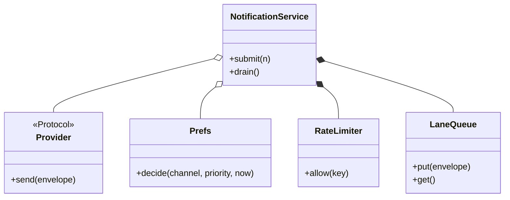

# 通知服务（Notification Service）（low priority）

## 题目

业务系统（下单、风控、营销）调一次 `submit(通知)`，服务按用户的偏好，把消息从邮件、短信、推送里挑合适的渠道发出去。渠道会失败，要重试；用户设了免打扰，营销不能吵醒他；营销群发不能把验证码挤在后面。

四个渠道的差异是最不重要的部分。**面试官真正在看的是：重试、限流、去重、优先级这些逻辑写在哪里。写在每个渠道里，加第五个渠道时要抄一遍；写在派发器里一份，渠道只剩「怎么发出去」。**

你会听到的原话：设计一个通知服务，按用户偏好通过多个渠道发送通知，渠道会失败，要重试，要避免重复发送。

常见追问：
- 营销发两千条，验证码排在第两千零一位怎么办？
- 调用方超时重发，同一条通知会不会发两遍？
- 加一个 webhook 渠道要改多少代码？

## 先问这几个问题

- 调用方指定渠道，还是系统按偏好决定？**默认系统决定：调用方只说「通知这个人这件事」，所以要有 `Prefs` 对象，而不是在 `submit` 参数里塞 `channel`。**
- 同步还是排队？**调用方是下单接口，不能等短信网关三秒超时，所以必须排队；一排队就必须回答「营销和验证码在同一条队里怎么办」。**
- 失败分几种？**超时可以重试，地址非法重试一百次还是同一个结果。分成「瞬时」和「永久」两类，决定了重试的边界。**
- 调用方会重复调用吗？会。**幂等键必须由调用方给：只有它知道两次调用是不是同一件事。**
- 静默时段里的验证码怎么办？必须穿透。范围外：真实网关对接、持久化队列、送达回执。

## 核心对象

| 类 | 职责（一句话） | 守住的不变量 |
|---|---|---|
| `Priority` | 三档重要性（IntEnum） | `URGENT > TRANSACTIONAL > MARKETING`，可比大小 |
| `Notification` | 调用方的一次请求：给谁、内容、多重要 | `id` 由调用方给，服务不自己生成 |
| `Envelope` | 请求在某个渠道上变成的那封信 | 幂等键是 `id:渠道`，一次请求一个渠道一封 |
| `Provider` | 渠道的唯一抽象：`channel` 名加一个会失败的 `send` | 不知道重试、限流、幂等 |
| `Prefs` | 这个人此刻愿不愿意从这个渠道收 | `URGENT` 穿透静默时段 |
| `RateLimiter` | 按用户按渠道的滑动窗口 | 窗口空了的 key 必须删掉 |
| `LaneQueue` | 每个优先级一条 FIFO，加连续服务配额 | 高优先级先出，但不会把低优先级饿死 |
| `NotificationService` | 把上面这些串起来的派发器 | 可靠性只在这里写一份 |



## 主流程

**提交 `submit`（同步，只做判断和入队）：**
1. 对用户地址表里的每个渠道，构造信封，键是 `通知id:渠道`。
2. 拿锁，键已经在去重集合里就返回 `DUPLICATE`，不碰渠道。
3. 依次问：有没有这个渠道的 provider，偏好是否允许（渠道开关、最低重要性、静默时段），限流是否放行。任何一步拒绝，返回具体原因（不是笼统的「失败」），**不占幂等键**，调用方稍后还能重提。
4. 全部通过才**在同一把锁里占键并入队**，返回 `QUEUED`。检查和占键之间不能放开锁。

**派发 `drain`（工作线程循环）：**
1. 先把延迟堆里到期的重试搬回队列，再按优先级取一封。
2. **不持锁**调用 `provider.send`：渠道是外部代码，可能很慢、可能抛任何异常。
3. 成功就记 `SENT`。`TransientError`：次数没用完就按指数退避压进延迟堆（键是时钟加延迟）；用完进死信。`PermanentError`：直接进死信。

## 关键决策

### 可靠性写在派发器里，还是包成渠道装饰器

- 方案 A，每个渠道套一串装饰器 `Retry(RateLimit(Dedup(Email())))`：好看，但每个渠道各包一遍，漏包的渠道悄悄没有重试；更要命的是跨渠道的规则（「每人每小时最多 5 条，不论哪个渠道」「验证码排在营销前面」）在任何一个渠道里都没有位置。
- 方案 B，派发器管道：幂等、偏好、限流、入队、重试都在一处，渠道只有 `channel` 和 `send`。
- **选 B。一句话：渠道之间共享的东西归派发器，渠道之间不同的东西归渠道。** 加 webhook 就是写一个类、注册、在偏好里打开它，派发器一行不动。装饰器只在「某一层只对一个渠道有意义」时才用，比如短信网关自带配额的熔断。

### 渠道名是开放字符串，不是 Enum

- Enum 的价值是穷尽，但渠道集合按定义是开放的：加渠道就要改枚举所在的模块。
- **选字符串，`Provider` 自带 `channel` 名，服务持一张字典。** 代价认下来：拼错渠道名不会在类型层被抓住，所以「没有这个 provider」必须是一个可观测的状态 `NO_PROVIDER`，不能静默跳过。这是用类型安全换扩展性，说出口比装作没代价好。这里没有模式，也不必为模板引入类层次：一个字符串加一个字典就够了。

### 「优先级」在排队上到底是什么

- 方案 A，一条 FIFO：营销挤掉验证码，出局。
- 方案 B，一个 `heapq`：代码最短，但高优先级持续涌入时低优先级永远出不来；「营销积压多少条」得遍历才知道。
- 方案 C，每个优先级一条 FIFO，从高到低取，但同一条道连续服务 `quota` 次后让低优先级过一条。
- **选 C，并把定义说死：同一优先级内严格先进先出；高优先级优先，但连续 `quota` 条之后让位一次。** 配额默认无穷大就退化成严格优先级，是否防饿死变成可配置的取舍。面试官几乎一定追问「低优先级会不会永远发不出去」，这几行就是答案。

### 重试的时间从注入的时钟来，不用 sleep

- `time.sleep(delay)` 会让工作线程睡着，队列里的验证码只能等；测试验证退避 8 秒就得真睡 8 秒。
- **选按到期时间排序的延迟堆，时钟注入。** 「到点没有」是一次比较：推时钟再 `drain`，退避多久、第几次进死信都能断言。堆里存元组 `(到期时刻, 序号, 信封)`，序号是平局裁决，否则两条同时到期的记录会去比较信封而抛 `TypeError`。

## Python 骨架

```python
from __future__ import annotations
import heapq
import itertools
import threading
from collections import deque
from dataclasses import dataclass, field, replace
from datetime import datetime, time, timedelta
from enum import Enum, IntEnum

class Priority(IntEnum):
    MARKETING, TRANSACTIONAL, URGENT = 10, 20, 30

# 每一种「没发出去」都有自己的名字，调用方才知道下一步怎么办
Status = Enum("Status", "QUEUED SENT DUPLICATE CHANNEL_OFF QUIET_HOURS RATE_LIMITED NO_PROVIDER DEAD")

class TransientError(Exception): pass  # 超时之类：可以重试
class PermanentError(Exception): pass  # 地址非法之类：重试没有意义

@dataclass(frozen=True)
class Notification:
    id: str  # 幂等键由调用方给
    user: str
    text: str
    priority: Priority = Priority.TRANSACTIONAL

@dataclass(frozen=True)
class Envelope:
    key: str  # 通知id:渠道
    channel: str
    address: str
    text: str
    priority: Priority
    attempt: int = 0

@dataclass(frozen=True)
class Prefs:
    addresses: dict  # 渠道 -> 地址
    enabled: frozenset
    min_priority: dict = field(default_factory=dict)
    quiet: tuple = ()  # (开始, 结束)，可以跨午夜

    def decide(self, channel: str, priority: Priority, now: datetime):
        if channel not in self.enabled or priority < self.min_priority.get(channel, Priority.MARKETING):
            return Status.CHANNEL_OFF
        if self.quiet and priority < Priority.URGENT:  # URGENT 穿透静默时段
            s, e, t = *self.quiet, now.time()
            if (s <= t < e) if s < e else (t >= s or t < e):
                return Status.QUIET_HOURS
        return None

class RateLimiter:  # 滑动窗口
    def __init__(self, limit: int, window: timedelta, clock) -> None:
        self.limit, self.window, self.clock = limit, window, clock
        self.hits: dict[str, deque] = {}

    def allow(self, key: str) -> bool:
        now, q = self.clock(), self.hits.setdefault(key, deque())
        while q and now - q[0] >= self.window:
            q.popleft()
        ok = len(q) < self.limit
        if ok:
            q.append(now)
        if not q:
            del self.hits[key]  # 空窗口的 key 不能留着泄漏
        return ok

class LaneQueue:  # 分道 FIFO + 连续服务配额
    def __init__(self, quota: int = 1 << 30) -> None:
        self.lanes = {p: deque() for p in Priority}
        self.quota, self.streak = quota, 0

    def put(self, env: Envelope) -> None:
        self.lanes[env.priority].append(env)

    def get(self):
        order = [p for p in sorted(Priority, reverse=True) if self.lanes[p]]
        if not order:
            return None
        if self.streak >= self.quota and len(order) > 1:
            pick, self.streak = order[1], 0  # 让位一次，防饿死
        else:
            pick, self.streak = order[0], self.streak + 1
        return self.lanes[pick].popleft()

class NotificationService:
    def __init__(self, prefs: dict, clock, limiter: RateLimiter, quota: int = 1 << 30, max_attempts: int = 3) -> None:
        self.prefs, self.clock, self.limiter, self.max_attempts = prefs, clock, limiter, max_attempts
        self.providers, self.seen, self.dead, self.sent = {}, set(), [], []
        self.queue, self.delayed, self.tick = LaneQueue(quota), [], itertools.count()
        self._lock = threading.Lock()

    def register(self, provider) -> None: self.providers[provider.channel] = provider

    def submit(self, n: Notification) -> dict:
        prefs, out = self.prefs[n.user], {}
        for ch, addr in prefs.addresses.items():
            env = Envelope(f"{n.id}:{ch}", ch, addr, n.text, n.priority)
            with self._lock:  # 认领幂等键 + 全部准入判断，必须在同一把锁里
                if env.key in self.seen:
                    out[ch] = Status.DUPLICATE
                    continue
                if ch not in self.providers:
                    out[ch] = Status.NO_PROVIDER
                elif (why := prefs.decide(ch, n.priority, self.clock())) is not None:
                    out[ch] = why
                elif not self.limiter.allow(f"{n.user}:{ch}"):
                    out[ch] = Status.RATE_LIMITED
                else:
                    self.seen.add(env.key)  # 只有真正入队的才占幂等键，被抑制的以后还能重提
                    self.queue.put(env)
                    out[ch] = Status.QUEUED
        return out

    def drain(self) -> int:
        done = 0
        while True:
            with self._lock:
                while self.delayed and self.delayed[0][0] <= self.clock():  # 到期的重试回到队列
                    self.queue.put(heapq.heappop(self.delayed)[2])
                env = self.queue.get()
            if env is None:
                return done
            try:
                self.providers[env.channel].send(env)  # 不持锁调用外部代码
                self.sent.append(env.key)
                done += 1
            except TransientError:
                self._retry(env)
            except PermanentError:
                self.dead.append(env)

    def _retry(self, env: Envelope) -> None:
        if env.attempt + 1 >= self.max_attempts:
            self.dead.append(env)  # 用尽进死信
            return
        due = self.clock() + timedelta(seconds=2 ** env.attempt)  # 指数退避
        with self._lock:
            heapq.heappush(self.delayed, (due, next(self.tick), replace(env, attempt=env.attempt + 1)))

class FakeProvider:
    def __init__(self, channel: str, fail_first: int = 0, permanent: bool = False) -> None:
        self.channel, self.fails, self.permanent = channel, fail_first, permanent

    def send(self, env: Envelope) -> None:
        if self.permanent:
            raise PermanentError(env.address)
        if self.fails:
            self.fails -= 1
            raise TransientError("timeout")

if __name__ == "__main__":
    now = [datetime(2026, 10, 19, 12, 0)]
    clock = lambda: now[0]
    prefs = {"u1": Prefs({"email": "a@x", "sms": "123"}, frozenset({"email", "sms"}), quiet=(time(22), time(7)))}
    svc = NotificationService(prefs, clock, RateLimiter(5, timedelta(hours=1), clock))
    svc.register(FakeProvider("email", fail_first=1))
    svc.register(FakeProvider("sms"))
    assert svc.submit(Notification("n1", "u1", "hi")) == {"email": Status.QUEUED, "sms": Status.QUEUED}
    assert svc.drain() == 1 and svc.sent == ["n1:sms"]  # 邮件超时，一个渠道失败不影响另一个
    now[0] += timedelta(seconds=1)  # 退避 1 秒到期
    assert svc.drain() == 1 and "n1:email" in svc.sent
    assert svc.submit(Notification("n1", "u1", "hi"))["sms"] == Status.DUPLICATE  # 重复提交是空操作
    now[0] = datetime(2026, 10, 19, 23, 0)  # 静默时段
    assert svc.submit(Notification("m1", "u1", "sale", Priority.MARKETING))["sms"] == Status.QUIET_HOURS
    assert svc.submit(Notification("o1", "u1", "code", Priority.URGENT))["sms"] == Status.QUEUED  # 验证码穿透
    svc.register(FakeProvider("email", permanent=True))
    svc.drain()
    assert [e.key for e in svc.dead] == ["o1:email"]  # 永久失败不重试，直接进死信
    print("ok")
```

## 面试官加需求时

| 新需求 | 改哪里 | 不用动哪里 |
|---|---|---|
| 加 webhook 渠道 | 写一个有 `channel` 和 `send` 的类，注册，偏好里打开 | 派发器、限流器、队列 |
| 静默时段改成延后到早上发 | `decide` 的返回处改成「算出结束时刻压进延迟堆」 | 队列、渠道 |
| 每个渠道一套模板 | 加一个 `(模板, 渠道)` 到文本的字典，入队前渲染 | 重试、限流 |
| 按渠道降级（推送失败改发短信） | 死信处理处加一个回调 | `Provider` |
| 防止营销饿死事务通知 | 配置 `quota` | 其他全部 |
| 查看死信并人工重发 | 死信列表加重新提交入口 | 派发循环 |

## 并发与扩展

- 竞态 1：**两个线程同时提交同一个幂等键。认领必须在锁内原子完成，写成「先查再写」会发两遍。** 这个 bug 单线程测试永远测不出来。
- 竞态 2：工作线程在锁外调 `send`，不然一个慢渠道会卡住所有提交，还可能回调死锁。锁只保护取队列、改集合、压堆这几个瞬间。
- 幂等表和限流器都要有清理：去重表只写不删，迟早撑爆内存，要加 TTL。
- 规模变大：队列落到 Kafka 或 SQS，按用户分区保证同一用户有序；幂等表放 Redis 带过期；死信进专门的队列。

## 常见错误

- 把重试写进每个渠道：**写在派发器里一份。**
- 瞬时和永久失败不分：**超时重试，地址非法直接进死信。**
- 在重试线程里 `sleep`：**用延迟堆和注入的时钟。**
- 先查幂等键再写：**认领是一个原子动作。**
- 渠道用 Enum，所有失败合成一句「失败」：**渠道是开放字符串；每种没发出去的原因有自己的状态。**

## 30 秒复述

- 对象：`Notification` 是一次请求，`Envelope` 是它在某个渠道上的那封信，`Provider` 是渠道，`Prefs` 回答愿不愿意收，`NotificationService` 是派发器。
- 核心决策：**可靠性（幂等、限流、重试、死信）写在派发器里一份，渠道只管 `send`**；加渠道就是写一个类并注册。
- 优先级：每个优先级一条 FIFO，连续服务配额防饿死；`URGENT` 穿透静默时段，这条规则写在 `Prefs` 里。
- 失败：超时指数退避重试，地址非法直接进死信；退避用延迟堆加注入时钟，不 sleep。
- 并发：幂等键在锁内原子认领；调渠道时不持锁。

## 来源

- [[solution-notification-service]]
