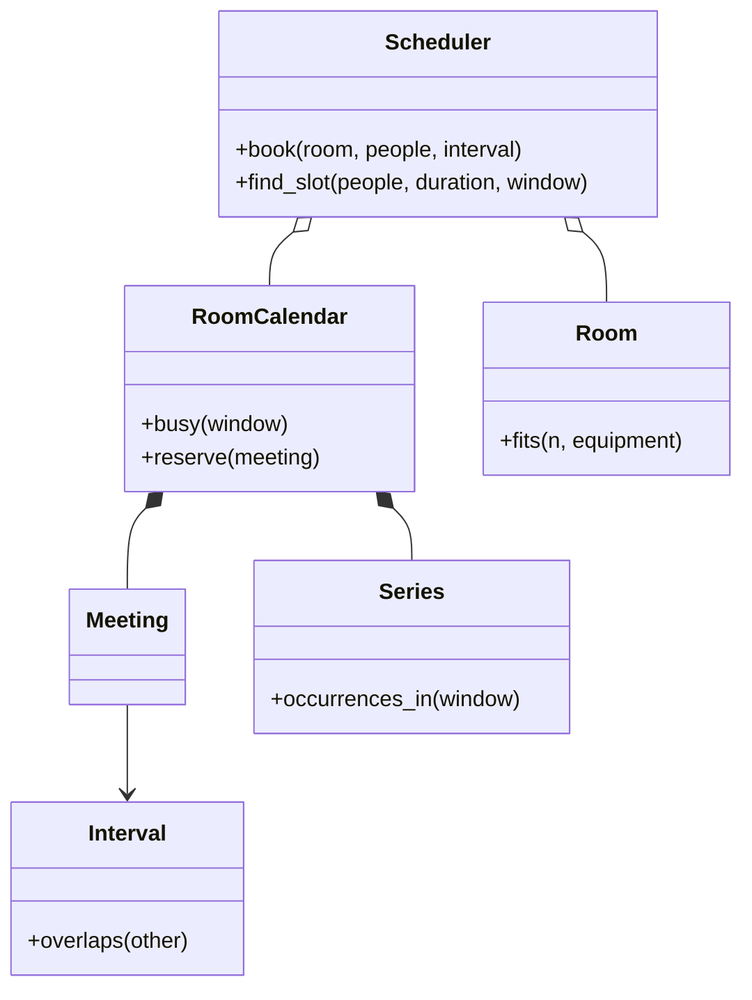

# 会议室预订（Meeting Scheduler）（low priority）

## 题目

公司内部的会议室预订系统。房间有容量和设备，员工订一段时间，冲突要被拒绝；能帮一组人自动找一个大家都有空的时间并配一间房；会议可以每周重复；员工分布在不同时区。用的人是员工和日历客户端。

**面试官真正在看的是：「10:00–11:00 和 11:00–12:00 冲不冲突」这种边界有没有想清楚；「给一组人找公共空档」是不是用区间合并而不是两两比较；周期会议是存规则还是存一堆展开的记录。**

你会听到的原话：设计一个会议室预订系统，支持订会议、冲突检测、找大家都有空的时间、每周重复的会议。

常见追问：
- 只改周期会议的这一次，还是这一次及以后？
- 「每周一 9 点」跨过夏令时切换，会不会变成 10 点？
- 两个组织者同时抢同一间房呢？

## 先问这几个问题

- 一段占用的边界怎么界定？**默认半开区间 `[start, end)`：一场接一场不算冲突，而且代码里没有特判。**
- 找空档是给定房间问，还是给定一组人问？**两者都要。给定一组人是这题真正的难点：要先求这些人的忙碌并集，再配房。**
- 周期会议的每一次完全一样吗？**不是。某一次要取消、某一次要改时间，所以要把「规则」和「例外」分开存。**
- 修改的是这一场，还是这一场及以后？**两种粒度都要支持，落在不同的对象上。**
- 时区怎么处理？**存本地钟点加时区，不存固定 UTC 时刻，这决定了跨夏令时对不对。** 范围外：通知、外部日历同步、权限。

## 核心对象

| 类 | 职责（一句话） | 守住的不变量 |
|---|---|---|
| `Interval` | 半开区间 `[start, end)` | `end > start`；重叠判断只有一行 |
| `Room` | 一间房的容量与设备 | 不可变的物理事实 |
| `Meeting` | 一次性会议 | 存在即已确认 |
| `Series` | 周期规则加一张按日期记的例外表 | 例外只影响它标注的那一天；不存展开后的场次 |
| `RoomCalendar` | 一间房的全部占用（一次性加周期） | 同一时刻占用互不重叠；检查和写入在同一把锁里 |
| `Scheduler` | 门面：订会议、找空档、配房 | 自己不持有占用状态 |

忙闲状态只长在 `RoomCalendar` 上，`Room` 是不变的物理事实，两者生命周期不同。`RoomCalendar.busy` 返回的是（参会人集合，区间）：找空档需要「这些人里任何一个忙的时间」，让忙碌区间自带「谁在忙」，就不用反过来再查。



## 主流程

**订会议 `book`：**
1. 查房间容量和设备是否装得下参会人数。
2. `RoomCalendar.reserve` 拿锁，把一次性会议和周期会议在这个区间内的占用一起查出来；有重叠就抛 `ConflictError`。
3. 没有重叠才写入。检查和写入在同一把锁里，所以两个组织者抢同一间房只有一个成功。

**找空档 `find_slot`：**
1. 收集所有房间日历里，参会人参与的忙碌区间（周期会议只展开查询窗口里的那几天）。
2. **先合并再扫描**：按起点排序，首尾相接或重叠的并成一段，再沿窗口找出长度够的缝。
3. 在每个缝里每隔 30 分钟试一个起点：从容量升序的房间里挑第一间人数、设备都满足并且这段时间空着的。
4. 都没有就返回 `None`，由调用方放宽条件。

## 关键决策

### 区间的边界：半开还是闭区间

- 闭区间 `[start, end]`：11:00 这一刻同时属于两场会议，要么误判冲突，要么在代码里补一条「端点相等放行」的特判，漏一次就出错。
- 半开 `[start, end)`：重叠判断是 `a.start < b.end and b.start < a.end`，代入 10–11 和 11–12，`11:00 < 11:00` 为假，天生不冲突。
- **选半开区间。会议一场接一场是最常见的情形，它应该不需要任何特判就正确。** 合并时方向相反：首尾相接也要并成一段，否则找空档会捏出宽度为零的假空档。

### 找空档：先合并再扫描，不是两两比较

- 两两比较每个人的每段忙碌时间：n 段忙碌区间是 O(n²)。
- 先排序合并，再线性扫描：O(n log n)，由排序主导。
- **选合并加扫描。** 几十个人的大会议里，这是实打实的差别。配房同样是简单的：按容量升序找第一间满足条件的房间，一次排序加一次扫描。这里不建 `RoomSelectionStrategy` 接口：只有一种配房逻辑时，一个排序就够了，模式没有位置。

### 周期会议：存规则，不展开存

- 方案 A，创建时就物化成 N 条 `Meeting`：查询最简单，但改「每周几开会」要批量重写；物化范围选短了会漏，选长了浪费；「不设结束日期」根本无法表示。
- 方案 B，只存规则和例外表，查询时只展开窗口里那几天。
- **选 B。真正会被查询的窗口永远是有限的**（这个月、`find_slot` 的搜索窗口），没有调用方需要「这条规则未来所有场次」。
- 两种编辑粒度：**「这一场」只在例外表里记一条（取消，或改时间）；「这一场及以后」是把老规则在这一天前封顶，再开一条新的系列。** 编辑点是一道硬边界，不是软合并。

### 时区：存本地钟点，不存 UTC 时刻

- 先算好第一次的 UTC 时刻再每次加 7 天：纽约 3 月 2 日 9:00 是 14:00 UTC；过了 3 月 8 日的夏令时切换，同一个 14:00 UTC 变成本地 10:00，站会悄悄晚了一小时。
- **选存本地钟点加时区（`zoneinfo`），查询时才现算当天的 UTC 偏移。** 员工约定的事实是「周一 9 点见」，不是某个 UTC 时刻。骨架的演示里有这一条断言。

## Python 骨架

```python
from __future__ import annotations
import itertools
import threading
from dataclasses import dataclass, field
from datetime import date, datetime, time, timedelta, timezone
from zoneinfo import ZoneInfo


class ConflictError(Exception):
    pass


@dataclass(frozen=True)
class Interval:  # 半开区间 [start, end)：10-11 和 11-12 天生不冲突
    start: datetime
    end: datetime

    def __post_init__(self) -> None:
        if self.end <= self.start:
            raise ValueError("end must be after start")

    def overlaps(self, o: Interval) -> bool:
        return self.start < o.end and o.start < self.end  # 一行，没有 -1 分钟的特判


def merge(ivs) -> list[Interval]:  # 先合并：O(n log n)，不是两两比较 O(n^2)
    out: list[Interval] = []
    for iv in sorted(ivs, key=lambda i: i.start):
        if out and iv.start <= out[-1].end:  # 首尾相接也要并，否则会捏出宽度为零的「空档」
            out[-1] = Interval(out[-1].start, max(out[-1].end, iv.end))
        else:
            out.append(iv)
    return out


def free_gaps(busy, window: Interval, need: timedelta) -> list[Interval]:  # 再线性扫描
    gaps, cur = [], window.start
    for iv in merge(busy):
        if iv.start >= window.end:
            break
        if min(iv.start, window.end) - cur >= need:
            gaps.append(Interval(cur, iv.start))
        cur = max(cur, iv.end)
    if window.end - cur >= need:
        gaps.append(Interval(cur, window.end))
    return gaps


@dataclass(frozen=True)
class Room:  # 物理事实，不变
    id: str
    capacity: int
    equipment: frozenset = frozenset()

    def fits(self, n: int, need: frozenset) -> bool:
        return self.capacity >= n and need <= self.equipment


@dataclass(frozen=True)
class Meeting:
    id: str
    room_id: str
    attendees: frozenset
    interval: Interval


@dataclass
class Series:  # 周期会议：存「规则 + 例外」，不存展开后的场次
    room_id: str
    attendees: frozenset
    local_start: time  # 本地钟点 + 时区，不存 UTC：跨夏令时才不漂移
    duration: timedelta
    zone: ZoneInfo
    weekdays: frozenset
    since: date
    until: date | None = None
    exceptions: dict = field(default_factory=dict)  # 日期 -> None 取消 / time 改时间

    def occurrences_in(self, w: Interval) -> list[Interval]:  # 只展开查询窗口覆盖的那几天
        d, last, out = w.start.astimezone(self.zone).date(), w.end.astimezone(self.zone).date(), []
        while d <= last:
            if d.weekday() in self.weekdays and d >= self.since and (self.until is None or d <= self.until):
                t = self.exceptions.get(d, self.local_start)
                if t is not None:
                    s = datetime.combine(d, t, tzinfo=self.zone)
                    iv = Interval(s, s + self.duration)
                    if iv.overlaps(w):
                        out.append(iv)
            d += timedelta(days=1)
        return out


class RoomCalendar:  # 忙闲状态只长在这里
    def __init__(self) -> None:
        self.meetings: list[Meeting] = []
        self.series: list[Series] = []
        self._lock = threading.Lock()

    def busy(self, w: Interval) -> list[tuple[frozenset, Interval]]:  # 忙碌区间自带「谁在忙」
        out = [(m.attendees, m.interval) for m in self.meetings if m.interval.overlaps(w)]
        return out + [(s.attendees, iv) for s in self.series for iv in s.occurrences_in(w)]

    def reserve(self, m: Meeting) -> None:
        with self._lock:  # 检查和写入在同一把锁里，两个组织者抢同一间房只有一个成功
            if self.busy(m.interval):
                raise ConflictError(m.room_id)
            self.meetings.append(m)


class Scheduler:
    def __init__(self, rooms) -> None:
        self.rooms = {r.id: r for r in rooms}
        self.cals = {r.id: RoomCalendar() for r in rooms}
        self._ids = itertools.count(1)

    def book(self, room_id: str, attendees, iv: Interval) -> Meeting:
        m = Meeting(f"M{next(self._ids)}", room_id, frozenset(attendees), iv)
        if not self.rooms[room_id].fits(len(m.attendees), frozenset()):
            raise ValueError("room too small")
        self.cals[room_id].reserve(m)
        return m

    def find_slot(self, attendees, duration: timedelta, window: Interval, equipment=frozenset()):
        people = frozenset(attendees)
        busy = [iv for c in self.cals.values() for who, iv in c.busy(window) if who & people]
        for gap in free_gaps(busy, window, duration):  # 大家都有空的窗口
            t = gap.start
            while t + duration <= gap.end:
                slot = Interval(t, t + duration)
                for r in sorted(self.rooms.values(), key=lambda r: r.capacity):  # 最小够用的房间
                    if r.fits(len(people), equipment) and not self.cals[r.id].busy(slot):
                        return r.id, slot
                t += timedelta(minutes=30)
        return None


if __name__ == "__main__":
    utc = timezone.utc
    at = lambda h, m=0, d=19: datetime(2026, 10, d, h, m, tzinfo=utc)
    s = Scheduler([Room("small", 4), Room("big", 10)])
    s.book("small", {"alice", "bob"}, Interval(at(10), at(11)))
    s.book("small", {"alice", "bob"}, Interval(at(11), at(12)))  # 紧接着订，不冲突
    try:
        s.book("small", {"carol"}, Interval(at(11, 30), at(12, 30)))
        raise SystemExit("应当冲突")
    except ConflictError:
        pass
    day = Interval(at(9), at(13))
    assert s.find_slot({"alice", "bob"}, timedelta(hours=1), day) == ("small", Interval(at(9), at(10)))
    assert s.find_slot({"alice", "bob"}, timedelta(minutes=90), day) is None  # 10-12 合并成一段，没有 90 分钟的空档
    ny = ZoneInfo("America/New_York")  # 每周一 9 点，3 月 8 日夏令时切换
    ser = Series("big", frozenset({"alice"}), time(9), timedelta(hours=1), ny, frozenset({0}), date(2026, 3, 1))
    march = ser.occurrences_in(Interval(datetime(2026, 3, 1, tzinfo=utc), datetime(2026, 3, 16, tzinfo=utc)))
    assert [iv.start.astimezone(utc).hour for iv in march] == [14, 13]  # 本地一直是 9 点
    ser.exceptions[date(2026, 3, 9)] = None  # 只取消这一场
    assert len(ser.occurrences_in(Interval(datetime(2026, 3, 1, tzinfo=utc), datetime(2026, 3, 16, tzinfo=utc)))) == 1
    print("ok")
```

## 面试官加需求时

| 新需求 | 改哪里 | 不用动哪里 |
|---|---|---|
| 房间设备要求（投影、视频会议） | `Room.equipment`，`fits` 已经支持 | 区间合并、冲突检测 |
| 换一种选房规则（最近、最便宜） | `find_slot` 里的排序键，或传入一个函数 | 日历、合并 |
| 取消一场周期会议的某一次 | `Series.exceptions` 记一条 `None` | 其他场次、规则 |
| 修改这一场及以后 | 老系列设置 `until`，开一条新系列 | 历史场次 |
| 缓冲时间（会议之间留 10 分钟） | 订会议时把区间两端各扩一截再判冲突 | `Interval` |
| 参会人也不能同时在两场会议里 | `book` 前对参会人的忙碌区间再查一遍 | 房间日历 |

## 并发与扩展

- 竞态：**两个组织者同时订同一间房的重叠时段。检查冲突和写入必须在同一把锁里，不能先查后写。** 锁放在每间房的日历上，订不同房间的人互不阻塞。
- 取消会议是从列表里删掉并释放锁内的占用；房间立刻可以被订走。
- 周期规则冲突核验要给一个有限的 horizon：对「永远」无法穷举，只能选足够长的窗口核验，并把这条边界说清楚。
- 规模变大：占用按房间和日期分区存数据库，冲突检测变成数据库里的区间排他约束；周期规则本身存一份，展开仍然在查询时做。

## 常见错误

- 用闭区间，再靠特判放行：**用半开区间。**
- 找空档时两两比较：**先排序合并，再线性扫描。**
- 创建周期会议时展开成几百条记录：**存规则和例外，只在查询窗口里展开。**
- 存固定 UTC 时刻再加 7 天：**存本地钟点加时区，每次现算。**
- 为选房策略建一个接口加三个实现类：**只有一种逻辑时，一个排序就够了。**

## 30 秒复述

- 对象：`Interval` 是半开区间，`Room` 是不变的物理事实，`RoomCalendar` 持有这间房的全部占用，`Series` 存周期规则加例外，`Scheduler` 是门面。
- 核心决策：**区间用半开，一场接一场不冲突；找空档先合并忙碌区间再扫描，O(n log n)**；配房取容量最小且满足条件的。
- 周期会议只存规则和例外，查询时展开窗口；「这一场」记例外，「这一场及以后」封顶老规则、开新系列。
- 时区：存本地钟点加时区，跨夏令时站会仍是 9 点。
- 并发：检查冲突和写入在同一把锁里，两个组织者只有一个成功。

## 来源

- [[solution-meeting-scheduler]]
