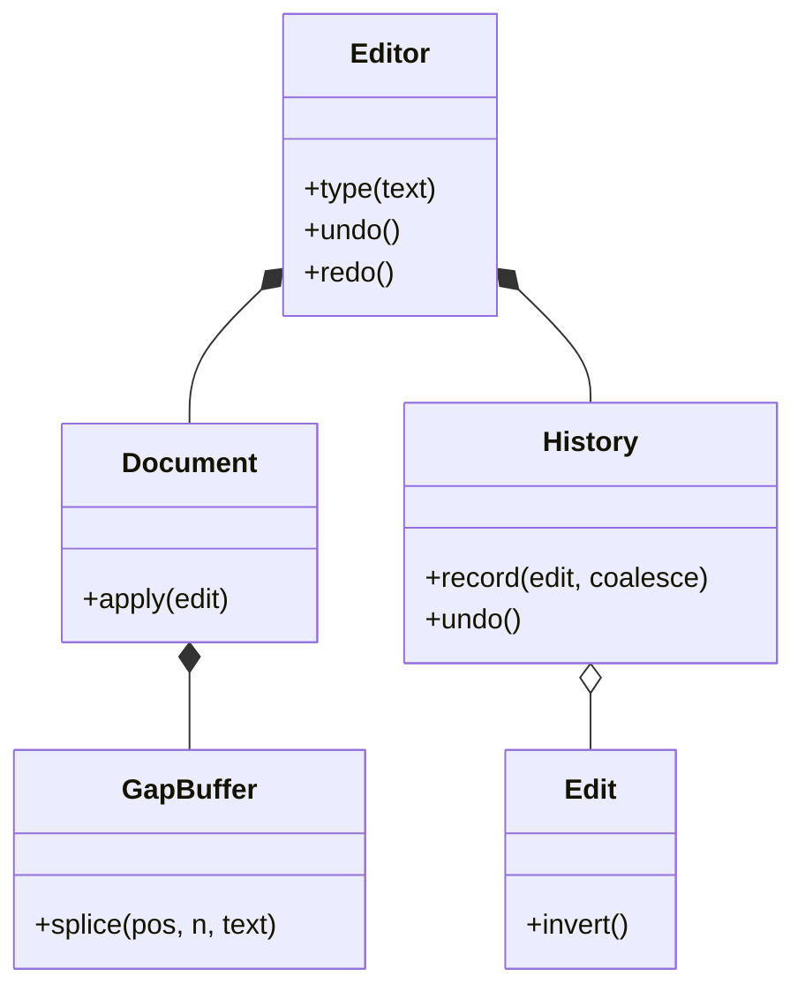

# 文本编辑器与撤销重做（Text Editor）（low priority）

## 题目

一个文本编辑器：能插入、删除、移动光标，支持撤销和重做。用的人是敲字的用户，也是调它的 API 的程序。它看起来只是「两个栈」，写完才发现分数在两个地方。

**面试官真正在看的是：文本用什么数据结构存（决定它是玩具还是能打开大文件）；一次撤销到底撤掉什么（决定它像不像真编辑器）；新的编辑有没有清空重做栈。**

你会听到的原话：设计一个文本编辑器，支持插入、删除、移动光标，以及撤销和重做。

常见追问：
- 敲了 `hello` 五个字符，按一次撤销应该撤掉几个？
- 「替换全部」要撤销几次？
- 加选区、剪切粘贴、多光标怎么办？

## 先问这几个问题

- 文档有多大？**几百字的输入框，一个 `str` 就够，后面都是过度设计；几 MB 的源文件，每敲一个字符复制整篇就出局。先问规模，再选结构。**
- 撤销的粒度是什么？**敲 `hello` 撤销一次删五个字符：「一次编辑」和「一个撤销单元」不是一回事。**
- 有选区吗？**有选区，输入就是替换而不是插入，剪切粘贴才有意义。**
- 单光标还是多光标、单人还是协同？**协同编辑要 OT 或 CRDT，数据结构整个推翻，当场排除。**
- 撤销历史能无限长吗？**不能，无界的撤销栈就是内存泄漏，要有上限。** 范围外：语法高亮、渲染、文件读写。

## 核心对象

| 类 | 职责（一句话） | 守住的不变量 |
|---|---|---|
| `GapBuffer` | 存字符序列，让「在同一处连续编辑」便宜 | 空洞是光标处一段连续的缝 |
| `Edit`（冻结） | 描述一次修改：在某处把一段文本换成另一段 | 不可变；`invert()` 是纯字段对调 |
| `Document` | 文本加光标，只认 `apply(edit)` 一种修改 | 光标在 `0..len`；应用前核对被删文本与现状一致 |
| `History` | 撤销重做的栈，只认 `Edit` | 新编辑清空重做栈；超限丢最旧的单元 |
| `Editor` | 门面：把用户动作翻译成 `Edit`，决定合并与否 | 一个用户动作最多产生一个撤销单元 |

`History` 和 `Document` 之间没有任何关系：`History` 收进去的是 `Edit`，吐出来的也是 `Edit`。它可以单独测试，也可以拿去撤销绘图、表格。撤销逻辑一旦和文档纠缠，就再也测不动了。



## 主流程

**一次敲字 `type`：**
1. `Editor` 在光标处造一个 `Edit`：位置、被删的文本、插入的文本、前后光标。**被删文本在执行的那一刻读，不能提前读**：重做一串编辑时，每一条看到的都是上一条留下的文本。
2. `Document.apply` 先核对被删文本和现状一致，不一致就抛 `InconsistentEditError`，然后改缓冲区、挪光标。
3. `History.record`：先清空重做栈；如果是键盘输入、没有被封住、并且紧接着上一次插入的末尾，就并入上一个撤销单元，否则开一个新单元。

**撤销 `undo`：**
1. 弹出最近的撤销单元，放进重做栈。
2. 把单元里的编辑**逆序**逐条求逆，交给 `Document.apply`。逆序是硬要求：后做的编辑改变了先做的编辑所依赖的下标。

## 关键决策

### 文本用什么存

- 一个 `str` 或字符列表：光标处插入都是 O(n)，10 MB 的文档每敲一个字符搬 10 MB。
- 按行的列表：行是天然单位，行内 O(行长)，一行特别长就退化。
- 片段表（piece table）：原文永不复制，快照近乎免费，但实现复杂度高一个量级，而且撤销用增量，不需要便宜的快照。
- **选空洞缓冲（gap buffer）：它押注「编辑是局部的」，人会在同一处连续敲一阵。** 空洞停在光标处，连续插入、连续退格是摊销 O(1)，只有挪光标才付一次搬运距离。诚实说它的弱点：只有一个空洞，多光标要来回搬。骨架里用左右两段列表实现，不到二十行。

### 一个 Edit 还是四个 Command 类

- 教科书写法：`InsertCommand`、`DeleteCommand`、`ReplaceCommand`、`CompositeCommand`，各自实现 `execute` 和 `undo`，每个都要想对怎么求逆。
- 看一眼：插入是把 `""` 换成 `text`，删除是把 `text` 换成 `""`，替换是把 `old` 换成 `new`，**它们是同一种操作：一次 splice。**
- **选一个冻结的 `Edit`，`invert()` 对调四个字段。** 没有分支、没有多态，`e.invert().invert() == e` 是一条可以直接写的等式。一个撤销单元就是 `tuple[Edit, ...]`，不再包一个类。这里没有模式：命令模式要的是「把操作具体化成可存、可求逆的值」，不要求它是带虚函数的类。

### 撤销用增量还是快照

- 快照（备忘录）：简单且永远正确，但每次编辑付出的是整个文档的大小。
- 增量（命令）：只存改动，付出的是改动的大小。
- **选增量为主；光标这种又小又难反推的状态，在 `Edit` 里带一份前后光标。** 撤销删除之后光标该回到哪，逆操作自己不知道，所以存两个整数就是一份微型备忘录。

### 连打要不要合并：由调用方的意图说了算

- 按「相邻就合并」猜：`insert(0,"abc")` 再 `insert(3,"def")` 相邻，却是两个刻意的独立操作，会被悄悄折成一步。
- **选调用方传意图：键盘 `type` 传 `coalesce=True`，程序化 `insert` 不传。** 并且在换行和光标移动时断开。**相邻不等于同一个意图。**
- 配套的一行：**新编辑清空重做栈。** 撤销三次再敲一个字，那三次重做必须消失，留着只会把「下标 40 处插入」重放到一篇只剩 12 个字符的文档上，悄悄写坏内容。

## Python 骨架

```python
from __future__ import annotations
from dataclasses import dataclass


class InconsistentEditError(Exception):
    pass


class GapBuffer:  # 左右两段，空洞就是两段之间的缝：在同一处连续编辑是摊销 O(1)
    def __init__(self, text: str = "") -> None:
        self.left, self.right = list(text), []  # right 是反着存的，栈顶是光标后的第一个字符

    def _move(self, pos: int) -> None:  # 把空洞挪到 pos，代价是挪动的距离
        while len(self.left) > pos:
            self.right.append(self.left.pop())
        while len(self.left) < pos:
            self.left.append(self.right.pop())

    def splice(self, pos: int, n: int, text: str) -> str:  # 删掉 n 个字符、再插入 text，返回被删的
        self._move(pos)
        removed = "".join(reversed(self.right[len(self.right) - n:]))
        del self.right[len(self.right) - n:]
        self.left.extend(text)
        return removed

    def text(self) -> str:
        return "".join(self.left) + "".join(reversed(self.right))


@dataclass(frozen=True)
class Edit:  # 插入、删除、替换是同一种操作的三个特例：一次 splice，所以只要一个类
    position: int
    removed: str
    inserted: str
    cursor_before: int  # 光标是又小又难反推的状态：Edit 里带一份微型备忘录
    cursor_after: int

    def invert(self) -> Edit:  # 纯字段对调，没有分支
        return Edit(self.position, self.inserted, self.removed, self.cursor_after, self.cursor_before)


class Document:  # 文本 + 光标；只认 apply(edit) 一种修改动作
    def __init__(self, text: str = "") -> None:
        self.buf, self.cursor = GapBuffer(text), len(text)

    def make_edit(self, pos: int, n: int, inserted: str) -> Edit:
        removed = self.buf.text()[pos:pos + n]  # 必须在执行的此刻读，不能提前读（骨架里偷懒用 O(n)）
        return Edit(pos, removed, inserted, self.cursor, pos + len(inserted))

    def apply(self, e: Edit) -> None:
        if self.buf.text()[e.position:e.position + len(e.removed)] != e.removed:
            raise InconsistentEditError(e)  # 历史和文档失去同步时当场失败，不悄悄写坏
        self.buf.splice(e.position, len(e.removed), e.inserted)
        self.cursor = e.cursor_after


class History:  # 只认 Edit，不认识 Document；撤销单元是 tuple[Edit, ...]
    def __init__(self, limit: int = 100) -> None:
        self.undo_stack, self.redo_stack, self.limit, self.sealed = [], [], limit, True

    def record(self, e: Edit, coalesce: bool = False) -> None:
        self.redo_stack.clear()  # 新编辑必须清空重做栈：历史在这里分叉了
        if coalesce and not self.sealed and self.undo_stack and self._joins(self.undo_stack[-1][-1], e):
            self.undo_stack[-1] += (e,)
        else:
            self.record_unit((e,))
        self.sealed = not coalesce

    def record_unit(self, edits: tuple) -> None:  # 一批编辑记成一个撤销单元（替换全部）
        self.redo_stack.clear()
        self.undo_stack.append(tuple(edits))
        if len(self.undo_stack) > self.limit:
            self.undo_stack.pop(0)  # 超限丢最旧的

    @staticmethod
    def _joins(prev: Edit, e: Edit) -> bool:  # 首尾相接的纯插入，且不跨换行
        return not prev.removed and not e.removed and e.position == prev.position + len(prev.inserted) and "\n" not in e.inserted

    def undo(self) -> tuple:
        if not self.undo_stack:
            return ()
        unit = self.undo_stack.pop()
        self.redo_stack.append(unit)
        return tuple(e.invert() for e in reversed(unit))  # 逆序求逆：后做的先倒回去

    def redo(self) -> tuple:
        if not self.redo_stack:
            return ()
        unit = self.redo_stack.pop()
        self.undo_stack.append(unit)
        return unit


class Editor:  # 门面：把用户动作翻译成 Edit，决定合并与否
    def __init__(self, text: str = "") -> None:
        self.doc, self.history = Document(text), History()

    def _do(self, pos: int, n: int, text: str, coalesce: bool = False) -> None:
        e = self.doc.make_edit(pos, n, text)
        self.doc.apply(e)
        self.history.record(e, coalesce)

    def type(self, text: str) -> None:  # 键盘输入：意图是「连打」，才允许合并
        self._do(self.doc.cursor, 0, text, coalesce=True)

    def insert(self, pos: int, text: str) -> None:  # 程序化插入：相邻也不合并
        self._do(pos, 0, text)

    def delete(self, pos: int, n: int) -> None:
        self._do(pos, n, "")

    def move(self, pos: int) -> None:
        self.doc.cursor = max(0, min(pos, len(self.doc.buf.text())))
        self.history.sealed = True  # 光标移动断开合并

    def replace_all(self, old: str, new: str) -> None:  # 从右往左替换，下标不互相影响；整体是一个撤销单元
        text, edits = self.doc.buf.text(), []
        hits = [i for i in range(len(text)) if text.startswith(old, i)]
        for i in reversed(hits):
            e = self.doc.make_edit(i, len(old), new)
            self.doc.apply(e)
            edits.append(e)
        self.history.record_unit(tuple(edits))

    def undo(self) -> None:
        for e in self.history.undo():
            self.doc.apply(e)

    def redo(self) -> None:
        for e in self.history.redo():
            self.doc.apply(e)

    def text(self) -> str:
        return self.doc.buf.text()


if __name__ == "__main__":
    ed = Editor()
    for ch in "hello":
        ed.type(ch)
    assert ed.text() == "hello"
    ed.undo()
    assert ed.text() == ""  # 连打五个字符是一个撤销单元
    ed.redo()
    assert ed.text() == "hello" and ed.doc.cursor == 5
    ed.insert(0, "ab")
    ed.insert(2, "cd")  # 相邻，但是两个独立的操作
    ed.undo()
    assert ed.text() == "abhello"
    ed.undo()
    ed.type("X")  # 新编辑清空重做栈
    ed.redo()
    assert ed.text() == "helloX" and not ed.history.redo_stack
    ed.replace_all("l", "L")
    assert ed.text() == "heLLoX"
    ed.undo()
    assert ed.text() == "helloX"  # 替换全部只需一次撤销
    try:
        ed.doc.apply(Edit(0, "zzz", "", 0, 0))  # 与现状不符的陈旧编辑
        raise SystemExit("应当拒绝")
    except InconsistentEditError:
        pass
    print("ok")
```

## 面试官加需求时

| 新需求 | 改哪里 | 不用动哪里 |
|---|---|---|
| 查找替换，替换全部一次撤销 | `Editor.replace_all`，从右往左替换，记成一个单元 | `Edit`、`Document` |
| 选区，输入即替换 | `Editor` 里先删选区再插入，打包成一个单元 | `History` |
| 剪切、复制、粘贴 | `Editor` 加剪贴板字符串 | 缓冲区、历史 |
| 撤销历史上限 | `History.limit` | 其他全部 |
| 多光标 | 光标改成集合，编辑批量应用 | `Edit`；缓冲区可能要换（只有一个空洞） |
| 大文件 | 缓冲区换成片段表 | `Edit`、`History`（只认 `Edit`） |

## 并发与扩展

- 单用户编辑器通常单线程操作文档，不必加锁；`History` 和 `Document` 的状态必须一起更新，所以 `Editor` 的方法是一个原子动作，多线程时给 `Editor` 整个加一把锁。
- 历史栈和文档一旦失去同步，`apply` 的一致性检查会当场抛错，而不是静默写坏。这个检查在正确实现里永远不会触发，价值就在这里。
- 协同编辑不是在这个设计上加锁就行：需要 OT 或 CRDT，按位置合并别人的编辑。
- 规模变大：缓冲区换成片段表，原文只读可以 mmap；撤销历史落盘，上限按单元数或字节数。

## 常见错误

- 每敲一个字符复制整篇文本，或者撤销用整篇快照：**增量存改动；缓冲区用空洞缓冲。**
- 新编辑没有清空重做栈：**`record` 的第一行就是清空。**
- 撤销一个单元时按原顺序求逆：**逆序逐条求逆。**
- 用「位置相邻」判断是否合并：**由调用方的意图决定。**
- 为插入、删除、替换各写一个 Command 子类：**它们都是一次 splice，一个 `Edit` 就够。**

## 30 秒复述

- 对象：`GapBuffer` 存文本，`Edit` 是一次 splice，`Document` 是文本加光标，`History` 管撤销重做，`Editor` 是门面。
- 核心决策：**文本用空洞缓冲，因为编辑是局部的；撤销用增量 `Edit`，不用整篇快照。**
- 插入、删除、替换是同一种操作，一个冻结的 `Edit` 加 `invert()` 就够，不建四个 Command 类。
- 连打是否合并由调用方的意图决定，换行和光标移动断开；新编辑一定清空重做栈。
- 撤销一个单元是逆序逐条求逆；`apply` 前核对被删文本，历史和文档不同步就当场失败。
- 替换全部是一个撤销单元，从右往左替换让下标互不影响。

## 来源

- [[solution-text-editor]]
