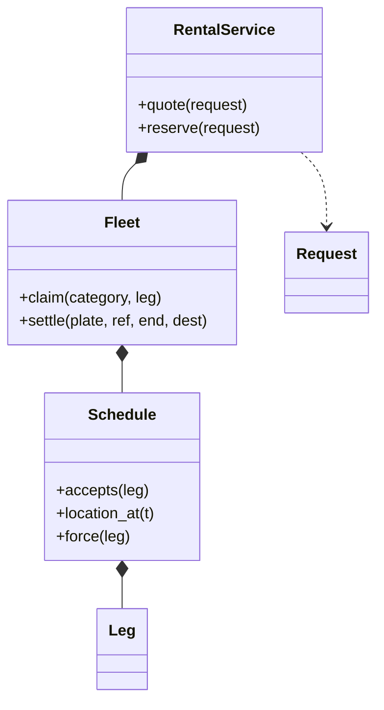

# 租车系统（Car Rental）（low priority）

## 题目

用户按城市、车型和时间段搜索可租的车，下单，到门店取车，用完还车，系统算钱。用的人是客人、门店柜台和运营。表面和酒店预订几乎一样：一份有限的资源、一段时间、不能卖两次，所以很容易把酒店的「(房型, 某一晚) → 已订数」计数表搬过来。**搬过来就错了。**

**面试官真正在看的是：支持异地还车之后，库存还能不能按门店计数。酒店的房间不会离开酒店，车会走：早上从浦东开走、晚上还到虹桥的车，从此就是虹桥的车。**

你会听到的原话：设计一个租车系统，用户可以搜索、预订、取车、还车，系统计算租金。

常见追问：
- 异地还车怎么支持？
- 客人迟还，挤占了这辆车的下一单怎么办？
- 加「周末加价」「机场取车费」要改哪里？

## 先问这几个问题

- 支不支持异地还车？**如果不支持，这题退化成酒店，门店加时段计数就够；如果支持（几乎一定），库存必须按车建模。第一分钟就问，比第三十分钟重写便宜。**
- 时间粒度？**按小时，计费不足一小时按一小时；粒度越细，按格子计数越不划算。**
- 订的是车型还是某一辆车？**客人订车型，但系统在预约时就绑定车牌：位置沿着单辆车的行程传播，不绑定车牌，链就断了。**
- 迟还、还错门店、刮蹭怎么办？**这三件事打翻已排好的未来，要有统一的处理办法。**
- 计费包含什么？基础价乘时长（长租封顶）、异地费、会员折扣；折扣打在小计上。范围外：支付、驾照校验、调度算法。

## 核心对象

| 类 | 职责（一句话） | 守住的不变量 |
|---|---|---|
| `Leg` | 一辆车时间轴上的一段：租约或维修，带起点门店和终点门店 | 不可变；半开区间 |
| `Schedule` | 一辆车的行程链 | 每段起点等于上一段终点（第一段等于基地），且留够周转缓冲 |
| `Fleet` | 车队：找车和占车的原子性 | 每辆车的链自洽 |
| `Request` | 报价与排期需要的全部事实 | 不可变；定价函数只看它 |
| `Component` | 一项收费，一个函数 | 只依赖请求和此前小计 |
| `RentalService` | 门面：报价、预约 | 自己不持有排期数据 |

门店在这版里只是字符串 id，没有 `Branch` 类：门店没有行为，也不持有不变量。「浦东店此刻有几辆 SUV」不是门店的属性，是沿着每辆车的链算出来的。等门店有了营业时间、车位上限这类要守的东西，再加这个类，也不会碰 `Schedule` 一行。



## 主流程

**预约 `reserve`：**
1. 先 `quote`：按顺序跑定价函数，每项返回（名目，分）或 `None`，合计等于明细之和。
2. `Fleet.claim` 拿锁，遍历该车型的车：把候选 `Leg` 插进这辆车的链里排好序，**检查整条链是否仍然自洽**（不重叠、接得上、留够周转）。第一辆通过的，占上并返回车牌。
3. 一辆都没有就抛 `NoVehicleError`。找车和占车在同一把锁里。

**还车 `settle`：**
1. 把那段租约改写成实际发生的样子：终点时刻晚了就是迟还，终点门店变了就是还错门店；事故是再强写一段维修封锁。
2. `force` 重排这条链：已经开始的行程不动，尚未开始的租约从早到晚逐段复核，复核不过的整段交出去改派。
3. 准点、还对门店、没刮蹭时，这次调用什么也挤不掉，所以不需要为「正常还车」单写一条路径。

## 关键决策

### 可用性判据：门店计数表，还是每车行程链

- 方案 A，(门店, 车型, 小时) 计数表：粒度是小时、排期看半年，格子数和业务量脱钩；更致命的是，它只记「这个门店少了一辆」，记不住「这辆车去了哪个门店」，异地还车要把一张表某时刻之后全部加一、另一张全部减一。
- 方案 B，净流量事件表（取车 -1，还车 +1，可用量是前缀和）：省空间，也是对的，但丢了车的身份：刮蹭、迟还、改派都要知道是哪辆车。
- 方案 C，每辆车一条行程链，可用性等于插入后整条链仍自洽。判定要遍历该车型的车，一个门店一个车型几十辆、每车半年几十段，是几百次比较。
- **选 C。当资源会移动时，库存必须按实例建模，不能按地点计数；不移动（酒店房间、影院座位）才轮得到计数表。** 位置是沿链算出来的纯函数 `location_at`，不是 `Vehicle` 上的 `current_branch` 字段：字段只能表达现在，而可用性问的是未来。

### 迟还、还错门店、事故：三件事其实是一件事

- 朴素写法是三个分支：迟还去改下一单，还错门店去改位置，事故去标 `under_repair`。三个分支各写各的，又迟还又刮蹭时没人想过。
- **选「往时间轴上强行写一段，然后修复时间轴」**：迟还是 `end` 变大，还错门店是 `destination` 变了，事故是再强写一段维修。`force` 复核的是同一条不变量。
- 一个只有异地还车下才存在的推论：**挤占会连锁。** 排了 A→B、B→C、C→A 三段，第一段迟还挤掉第二段，第三段的取车门店是 C，可车现在停在 B，它也留不住。逐段复核的循环天生处理了这一点，三个分支的版本几乎必然漏掉。
- 被挤掉的预约不取消：先换一辆同型车；换不到也留着，运营在取车前还有时间补救。偷偷替客人取消，客人到柜台才知道没单了。

### 计费：策略类、模板方法，还是一串函数

- 方案 A，`PricingStrategy` 抽象类加每种定价一个子类：定价不是「几选一」而是「几项相加」，立刻需要一个组合类，还要给接口加 `subtotal` 参数。
- 方案 B，模板方法写死「基础价、附加费、折扣」的顺序，加一项要改基类。
- **选一串 `Callable[[请求, 此前小计], 名目与金额 | None]`，按顺序跑。** 策略只有一个方法且不共享状态时，它就是一个函数；要参数就用闭包（`one_way_fee(30000)`）。**这里没有模式**，加一项收费就是往列表里加一个函数，不碰时间轴。金额用整数分，返回分项而不是一个总数，第一次客诉就用得上。

## Python 骨架

```python
from __future__ import annotations
import itertools
import threading
from dataclasses import dataclass, replace
from datetime import datetime, timedelta
from typing import Callable

TURNAROUND = timedelta(hours=1)  # 还车后清洁、加油、检查的缓冲


class NoVehicleError(Exception):
    pass


@dataclass(frozen=True)
class Leg:  # 库存的单位：一辆车的一段行程，带着「从哪取、还到哪」
    start: datetime
    end: datetime  # 半开区间 [start, end)
    origin: str
    destination: str
    ref: str
    rental: bool = True  # False 表示维修封锁


class Schedule:  # 一辆车的行程链，全题唯一的不变量写在 consistent 里
    def __init__(self, base: str) -> None:
        self.base, self.legs = base, []

    def consistent(self, legs) -> bool:  # 每段起点 = 上一段终点（第一段 = 基地），且留够周转
        loc, free_at = self.base, None
        for l in legs:
            if l.origin != loc or (free_at is not None and l.start < free_at + TURNAROUND):
                return False
            loc, free_at = l.destination, l.end
        return True

    def accepts(self, leg: Leg) -> bool:  # 不重叠、接得上、周转：一个判断说完三件事
        return self.consistent(sorted(self.legs + [leg], key=lambda l: l.start))

    def location_at(self, t: datetime) -> str:  # 位置是沿链算出来的，不是存在车上的字段
        loc = self.base
        for l in sorted(self.legs, key=lambda l: l.start):
            if l.end <= t:
                loc = l.destination
        return loc

    def force(self, actual: Leg) -> list[str]:  # 迟还、还错门店、事故：往链上强写一段，再修复后面的
        kept, bumped = [], []
        for l in sorted([x for x in self.legs if x.ref != actual.ref] + [actual], key=lambda l: l.start):
            if l.start <= actual.start or self.consistent(kept + [l]):  # 已经开始的不动
                kept.append(l)
            else:
                bumped.append(l.ref)  # 复核不过的整段交出去改派，连锁挤占天然成立
        self.legs = kept
        return bumped


class Fleet:  # 找车 + 占车必须是同一个原子动作
    def __init__(self, vehicles: dict) -> None:  # 车牌 -> (车型, 基地门店)
        self.cat = {p: c for p, (c, _) in vehicles.items()}
        self.sched = {p: Schedule(b) for p, (_, b) in vehicles.items()}
        self._lock = threading.Lock()

    def claim(self, category: str, leg: Leg) -> str:
        with self._lock:  # 两个人抢最后一辆车，只有一个能占上
            for plate, s in self.sched.items():
                if self.cat[plate] == category and s.accepts(leg):
                    s.legs.append(leg)
                    return plate  # 早绑定：预约时就定下车牌，位置才能沿着这辆车的链传播
        raise NoVehicleError(category)

    def settle(self, plate: str, ref: str, end: datetime, destination: str) -> list[str]:
        with self._lock:
            s = self.sched[plate]
            leg = next(l for l in s.legs if l.ref == ref)
            return s.force(replace(leg, end=max(end, leg.start + timedelta(hours=1)), destination=destination))


@dataclass(frozen=True)
class Request:
    category: str
    start: datetime
    end: datetime
    origin: str
    destination: str
    member: bool = False


Charge = tuple  # (名目, 分)：报价必须分项，客人要看到「异地费 300 元」
Component = Callable[[Request, int], "Charge | None"]  # 定价是「几项相加」，每项就是一个函数


def base_rate(rates: dict) -> Component:
    def comp(r: Request, subtotal: int):
        h = -(-int((r.end - r.start).total_seconds()) // 3600)  # 不足一小时按一小时
        return ("基础价", (h // 24 * 20 + min(h % 24, 20)) * rates[r.category])  # 每 24 小时最多收 20 小时
    return comp


def one_way_fee(cents: int) -> Component:
    return lambda r, subtotal: ("异地费", cents) if r.origin != r.destination else None


def loyalty(pct: int) -> Component:  # 折扣打在此前的小计上
    return lambda r, subtotal: ("会员折扣", -subtotal * pct // 100) if r.member else None


class RentalService:
    def __init__(self, fleet: Fleet, components) -> None:
        self.fleet, self.components, self._ids = fleet, list(components), itertools.count(1)

    def quote(self, r: Request) -> list:
        lines, total = [], 0
        for comp in self.components:  # 加一项收费不碰时间轴一行代码
            if (c := comp(r, total)) is not None:
                lines.append(c)
                total += c[1]
        return lines

    def reserve(self, r: Request) -> tuple:
        ref = f"R{next(self._ids)}"
        plate = self.fleet.claim(r.category, Leg(r.start, r.end, r.origin, r.destination, ref))
        return ref, plate, sum(c for _, c in self.quote(r))


if __name__ == "__main__":
    at = lambda d, h: datetime(2026, 7, d, h)
    svc = RentalService(Fleet({"SH-1": ("SUV", "PVG")}), [base_rate({"SUV": 5000}), one_way_fee(30000), loyalty(10)])
    req = Request("SUV", at(1, 9), at(1, 19), "PVG", "HQ", member=True)
    assert svc.quote(req) == [("基础价", 50000), ("异地费", 30000), ("会员折扣", -8000)]
    ref, plate, price = svc.reserve(req)
    assert price == 72000
    s = svc.fleet.sched[plate]
    assert s.location_at(at(3, 12)) == "HQ"  # 车在虹桥，不在浦东
    try:
        svc.reserve(Request("SUV", at(3, 9), at(3, 12), "PVG", "PVG"))  # 纯时间判据会放行，位置判据拒绝
        raise SystemExit("应当没车")
    except NoVehicleError:
        pass
    ref2, _, _ = svc.reserve(Request("SUV", at(1, 21), at(2, 9), "HQ", "HQ"))  # 同一辆车接着租
    assert svc.fleet.settle(plate, ref, at(1, 22), "HQ") == [ref2]  # 迟还挤掉下一单，交出去改派
    print("ok")
```

## 面试官加需求时

| 新需求 | 改哪里 | 不用动哪里 |
|---|---|---|
| 周末加价、机场取车费 | 定价列表里加一个函数 | `Schedule`、`Fleet` |
| 保险等加购项 | 请求里加字段，加一个定价函数 | 行程链 |
| 车辆进厂维修 | `force` 一段 `rental=False` 的封锁 | 判据本身 |
| 门店营业时间、车位上限 | 引入 `Branch`，在 `claim` 里校验 | 行程链（门店只是 id） |
| 取消预约 | 从链里删掉那一段，整段删除即释放 | 其他车 |
| 客人爽约（no-show） | 预约标记爽约，删掉那一段 | 判据 |

## 并发与扩展

- 竞态：**两个人同时抢同一门店最后一辆 SUV。找车和占车必须在同一把锁里，不能先查有没有再去占。**
- 定价函数拿不到 `Fleet`：它不可能绕过锁去读内部状态，「剩余几辆」只能被喂进来。
- 早绑定的代价是排期会碎片化，现实（迟还、事故）会打翻计划。设计的回答是改派，不是取消。
- 规模变大：按城市或门店分片，每辆车的链放在一条数据库行或一个有序集合里，占车用乐观锁（版本号）；运营调度（把车从虹桥调回浦东）是另一个问题，不在这个设计里。

## 常见错误

- 照搬酒店的计数表：**车会走，库存按车建模。**
- 给 `Vehicle` 加 `current_branch` 字段：**位置沿链算出来，`location_at` 是纯函数。**
- 迟还、还错、事故各写一个分支：**统一成强写一段再修复行程链。**
- 被挤掉的预约直接取消：**先改派，换不到也保留，让运营补救。**
- 为定价写策略类层次，或金额用 `float`：**一串函数，整数分。**

## 30 秒复述

- 对象：`Leg` 是一辆车的一段行程，`Schedule` 是一辆车的行程链，`Fleet` 找车并占车，定价是一串函数，`RentalService` 是门面。
- 核心决策：**车会走，所以库存按车的行程链建模，可用性等于插入后整条链仍自洽（不重叠、接得上、留周转）；位置是算出来的，不是存的字段。**
- 车牌在预约时就绑定，位置才能沿着这辆车传播；被打翻时改派而不是取消。
- 迟还、还错门店、事故统一成「强写一段，再修复行程链」，连锁挤占天然成立。
- 计费是一串函数，加一项收费不碰时间轴；并发上找车和占车在同一把锁里。

## 来源

- [[solution-car-rental]]
