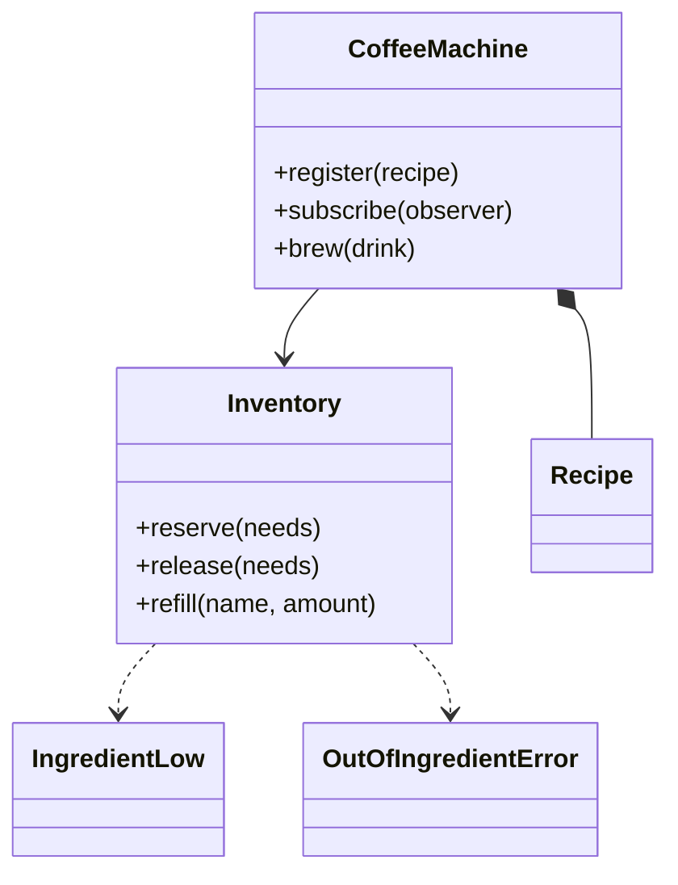

# 咖啡机（Coffee Machine）（low priority）

## 题目

一台咖啡机有几款饮品，每款有自己的配方；机器有多个出水口，可以同时做好几杯；原料快用完的时候要通知运维。用的人是站在机器前按按钮的客人，和给机器加料、看告警的运维。

这是整套题里最干净的并发题：没有调度算法，没有复杂的状态机，只有一个共享库存和几个抢它的线程。**面试官真正在看的是：临界区到底是哪几行，你有没有把几十秒的冲煮圈进锁里。**

你会听到的原话：设计一台咖啡机，支持多种饮品配方、多个出水口并行出杯，原料不足时报警。

常见追问：
- 牛奶不够了，浓缩已经扣了怎么办？
- 缺料告警的订阅者回头去补货，会不会死锁？
- 加一款用新原料的饮品要改哪里？

## 先问这几个问题

- 多个出口共用一份原料吗？**共用：出口是并行的，原料是共享的，并发才有内容；各有各的料仓就退化成几台互不相干的机器。**
- 一杯要做多久？**几十秒，比扣一次库存慢六七个数量级。说出这个数量级，「锁能不能跨越冲煮」就不是风格问题，而是算术。**
- 原料不够怎么办？**这一杯直接拒绝，而且一滴原料都不许被扣掉；半杯咖啡没有意义。**
- 原料种类固定吗？**不固定：糖浆、燕麦奶随时加，所以原料名是运维配的字符串，不是枚举。**
- 要做收钱找零吗？不做，那是自动售货机的题。范围外：杯子库存、清洗周期、异步下单队列。

## 核心对象

| 类 | 职责（一句话） | 守住的不变量 |
|---|---|---|
| `Recipe` | 一款饮品要用哪些原料、各多少 | 不可变；用量为正 |
| `Inventory` | 共享原料的余量与警戒线 | 余量不为负；扣减全有或全无；告警不重复 |
| `CoffeeMachine` | 菜单、出口调度、事件发布 | 并发冲煮数不超过出口数；锁不跨越冲煮 |
| `IngredientLow` / `DrinkServed` / `BrewFailed` | 发生了什么 | 不可变；自带订阅者需要的全部字段 |

`Inventory` 是构造时注入的协作者：一台机器背后是一个料仓，运维直接对着料仓补货。所以没有 `machine.refill()`，那只是把调用原样转发。也没有 `Menu` 类和 `Outlet` 类：菜单只是一个字典，出口需要的全部性质是「有编号、数量有限、用完归还」，`queue.Queue` 恰好就是这个。



## 主流程

**做一杯 `brew`：**
1. 从出口池 `Queue` 取一个出口编号；没有空闲出口就阻塞等。**这一步不持任何锁。**
2. `Inventory.reserve`：拿库存锁，先算出全部缺口；有缺口就抛 `OutOfIngredientError`（带着每种原料还差多少，什么都没扣）；没有就逐项扣，同时看谁跌破了警戒线，生成 `IngredientLow` 事件，返回。**锁只盖这几行，微秒级。**
3. 调冲煮函数，几十秒。**这一步不持任何锁。** 失败就 `release` 原样退回，发 `BrewFailed`。
4. `finally` 里归还出口，然后在锁外把事件投递给订阅者。

## 关键决策

### 临界区到底是哪几行

- 方案 A，`brew` 整个方法一把大锁：线程安全，测试也能过，只要测试不看时间。但四个出口退化成一个（冲煮 30 秒、扣库存几微秒，99.999% 的持锁时间在等和共享数据无关的事）；运维补货要等同一把锁，冲煮卡死时连「查还剩多少奶」都做不到。
- 方案 B，锁只盖「算缺口、扣、看警戒线」，等出口和冲煮都在锁外。
- **选 B。判断一段代码该不该进临界区，就问它是不是在读写共享数据。** 等出口不是（`Queue` 自己线程安全），冲煮不是（它只碰这一杯的水和粉），只有库存这份数据被争用。另外：任何时刻最多持一把锁，持有并等待的死锁条件就被结构性地破掉了。

### 全有或全无：先算缺口，再动手

- 边查边扣：牛奶不够时，浓缩已经被扣走了。这个 bug 在单线程下就会发生。
- **选所有校验排在第一次赋值之前：先用一个字典推导算出全部缺口，为空才进入扣减。** 好处有二：一次报出全部缺口；查和扣在同一把锁里，不存在「查的时候够、扣的时候不够」。
- 冲煮失败的回滚：原料已扣、水泵坏了，就 `release` 退回。**不要用长锁把「扣、做、退」包成一个事务**，那又回到上一条的错误。库存的不变量是「不为负」，不是「任何时刻都等于某个预期值」。

### 事件在锁内算出来，在锁外投递

- 在锁内投递：最自然的订阅者是「缺料自动补货」，它会回头调 `refill`，立刻死锁。
- 换成 `RLock` 让它能重入：把一个当场崩掉的 bug 换成更坏的安静 bug，订阅者从此在持锁状态下运行，它多慢所有出口就陪它等多久。
- **选 `Inventory` 里算事件、返回给调用方，在锁外投递，库存锁保持不可重入的 `Lock`。** 误用会变成立刻可见的死锁，而不是悄悄的吞吐塌方。事件自带 `remaining` 和 `low_water`，订阅者不必回头查库存（回头查是一次没有锁保护的事后读取）。告警用一个闩：跌破只告警一次，补货到警戒线以上才解除，否则运维会被刷屏而关掉告警。

### 原料名用字符串，不用 Enum；也不要生产者-消费者

- 原料集合是运维配的数据，枚举每加一种糖浆就要改代码、发版。**选字符串。** 代价是丢了拼写检查，所以补偿是：不认识的原料就是缺口为全量的缺料，而不是 `KeyError`，报错清清楚楚说「matcha 差 8」。
- 看到「多出口并发」不要立刻画订单队列加线程池：调用方就是站在机器前的人，他就是那个线程。**这里没有模式；`Queue` 在这里是资源池（装出口编号），不是任务队列。** 等出现「手机远程下单、到店取杯」，下单方不再等待，才需要真正的队列。

## Python 骨架

```python
from __future__ import annotations
import queue
import threading
from dataclasses import dataclass
from types import MappingProxyType
from typing import Callable, Mapping


class OutOfIngredientError(Exception):
    def __init__(self, drink: str, missing: Mapping[str, int]) -> None:
        super().__init__(f"{drink}: 缺料 {dict(missing)}")
        self.missing = dict(missing)  # 一次说清全部缺口


class BrewingFailedError(Exception):
    pass


@dataclass(frozen=True)
class Recipe:  # 原料名是字符串：原料集合是运维配的数据，不是代码里的枚举
    name: str
    ingredients: Mapping[str, int]


@dataclass(frozen=True)
class IngredientLow:  # 事件自带全部字段，订阅者不必回头查库存
    ingredient: str
    remaining: int
    low_water: int


@dataclass(frozen=True)
class DrinkServed:
    drink: str
    outlet: str


@dataclass(frozen=True)
class BrewFailed:
    drink: str
    outlet: str
    reason: str


class Inventory:  # 唯一被争用的共享数据，锁只盖住碰它的那几行
    def __init__(self, levels: dict, low_water: dict | None = None) -> None:
        self._levels, self._low, self._alerted = dict(levels), dict(low_water or {}), set()
        self._lock = threading.Lock()  # 故意不用 RLock：订阅者在锁内回调会当场死锁，而不是悄悄拖垮吞吐

    def levels(self) -> Mapping[str, int]:
        with self._lock:
            return MappingProxyType(dict(self._levels))

    def reserve(self, needs: Mapping[str, int], label: str = "order") -> list[IngredientLow]:
        with self._lock:  # 临界区只有三件事：算缺口、扣、看谁跌破警戒线
            missing = {n: q - self._levels.get(n, 0) for n, q in needs.items() if self._levels.get(n, 0) < q}
            if missing:  # 所有校验在第一次赋值之前：全有或全无
                raise OutOfIngredientError(label, missing)
            events = []
            for n, q in needs.items():
                self._levels[n] -= q
                if n in self._low and self._levels[n] < self._low[n] and n not in self._alerted:
                    self._alerted.add(n)  # 闩：跌破只告警一次，不刷屏
                    events.append(IngredientLow(n, self._levels[n], self._low[n]))
            return events  # 事件在锁内算出来，由调用方在锁外投递

    def release(self, needs: Mapping[str, int]) -> None:  # 冲煮失败，原样退回
        with self._lock:
            for n, q in needs.items():
                self._levels[n] += q

    def refill(self, ingredient: str, amount: int) -> int:
        with self._lock:
            self._levels[ingredient] = self._levels.get(ingredient, 0) + amount
            if self._levels[ingredient] >= self._low.get(ingredient, 0):
                self._alerted.discard(ingredient)  # 补货后重新武装
            return self._levels[ingredient]


class CoffeeMachine:
    def __init__(self, inventory: Inventory, outlets: int, brewer: Callable[[Recipe, str], None]) -> None:
        self.inventory, self._brewer = inventory, brewer  # 料仓是注入的协作者，运维直接对它补货
        self._recipes: dict[str, Recipe] = {}
        self._observers: list[Callable] = []
        self._outlets: queue.Queue = queue.Queue()  # 资源池：装的是出口编号，不是订单
        for i in range(outlets):
            self._outlets.put(f"outlet-{i + 1}")

    def register(self, recipe: Recipe) -> None:  # 新饮品、新原料：冲煮路径一行不改
        self._recipes[recipe.name] = recipe

    def subscribe(self, observer: Callable) -> None:
        self._observers.append(observer)

    def brew(self, drink: str) -> DrinkServed:
        recipe = self._recipes[drink]
        outlet = self._outlets.get()  # 等出口：不持任何锁
        events: list = []
        try:
            events += self.inventory.reserve(recipe.ingredients, drink)  # 临界区：微秒级
            try:
                self._brewer(recipe, outlet)  # 冲煮：几十秒，不持任何锁
            except Exception as exc:
                self.inventory.release(recipe.ingredients)
                events.append(BrewFailed(drink, outlet, str(exc)))
                raise BrewingFailedError(drink) from exc
            events.append(DrinkServed(drink, outlet))
            return events[-1]
        finally:
            self._outlets.put(outlet)  # 无论成败都归还出口
            for e in events:  # 锁外投递：订阅者可以回头 refill
                for obs in self._observers:
                    obs(e)


if __name__ == "__main__":
    def brewer(recipe: Recipe, outlet: str) -> None:
        if recipe.name == "broken":
            raise RuntimeError("水泵故障")

    inv = Inventory({"espresso": 100, "milk": 400}, {"milk": 250})
    m, seen = CoffeeMachine(inv, 4, brewer), []
    m.subscribe(seen.append)
    m.register(Recipe("latte", {"espresso": 30, "milk": 180}))
    m.register(Recipe("broken", {"espresso": 10}))
    m.brew("latte")
    m.brew("latte")
    assert [type(e) for e in seen] == [IngredientLow, DrinkServed, DrinkServed]  # 跌破警戒线只告警一次
    try:
        m.brew("latte")  # 牛奶只剩 40
        raise SystemExit("应当缺料")
    except OutOfIngredientError as e:
        assert e.missing == {"milk": 140} and inv.levels()["espresso"] == 40  # 浓缩一滴没扣
    try:
        m.brew("broken")
        raise SystemExit("应当失败")
    except BrewingFailedError:
        assert inv.levels()["espresso"] == 40  # 冲煮失败原样退回
    inv.refill("milk", 600)
    m2 = CoffeeMachine(Inventory({"espresso": 50}), 4, brewer)  # 8 个线程抢只够 5 杯的料
    m2.register(Recipe("shot", {"espresso": 10}))
    ok = []

    def worker() -> None:
        try:
            ok.append(m2.brew("shot"))
        except OutOfIngredientError:
            pass

    ts = [threading.Thread(target=worker) for _ in range(8)]
    [t.start() for t in ts]
    [t.join() for t in ts]
    assert len(ok) == 5 and m2.inventory.levels()["espresso"] == 0  # 一杯不多一杯不少
    print("ok")
```

## 面试官加需求时

| 新需求 | 改哪里 | 不用动哪里 |
|---|---|---|
| 新饮品、新原料 | `register` 一个 `Recipe`，补货时加原料名 | 冲煮路径、库存 |
| 缺料自动补货 | 订阅者里回调 `inventory.refill` | `Inventory`（事件在锁外投递，不会死锁） |
| 出口故障下线 | 从出口池里不再归还那个编号 | 库存 |
| 支付和找零 | 机器外面加一层，成功后才调 `brew` | 库存、出口池 |
| 手机远程下单 | 在机器前面加订单队列和取单号 | `Inventory` |
| 某款饮品需要预热等阶段 | `brewer` 函数里按阶段处理 | 临界区 |

## 并发与扩展

- 竞态：**多个线程同时抢最后几杯的原料。查和扣在同一把库存锁里，成功的杯数恰好等于库存能支撑的杯数。** 骨架的演示里用 8 个线程抢只够 5 杯的料。
- 补货不会被冲煮卡住：冲煮不持锁，`refill` 随时能拿到库存锁。
- 池里只有 N 个出口编号，取不到就阻塞，所以并发冲煮数天然不超过出口数，不需要另写信号量。
- 规模变大：多台机器共用一个远程库存时，扣减变成带条件的原子更新（库存足够才扣），事件进消息队列；冲煮仍然在本机。

## 常见错误

- 一把大锁罩住整个 `brew`：**锁只盖库存的读写，冲煮在锁外。**
- 边查边扣：**所有校验排在第一次赋值之前。**
- 在锁内投递事件，或为了不死锁改成 `RLock`：**锁内算事件、锁外投递，保持不可重入。**
- 每次低于警戒线都发告警：**用闩，补货后才重新武装。**
- 原料写成 `Enum`，或为单个调用方画订单队列和线程池：**字符串；队列只在异步下单时才需要。**

## 30 秒复述

- 对象：`Recipe` 是配方，`Inventory` 是共享库存，`CoffeeMachine` 管菜单、出口池和事件，三个不可变事件说明发生了什么。
- 核心决策：**锁只盖库存的「算缺口、扣、看警戒线」；等出口和几十秒的冲煮都在锁外**，所以四个出口真的能并行。
- 全有或全无：所有校验排在第一次赋值之前；冲煮失败就原样退回，不用长锁包事务。
- 事件在锁内算出来、锁外投递，库存锁不可重入；告警用闩防刷屏。
- 原料名是字符串，加新饮品、新原料不改冲煮路径。

## 来源

- [[solution-coffee-machine]]
