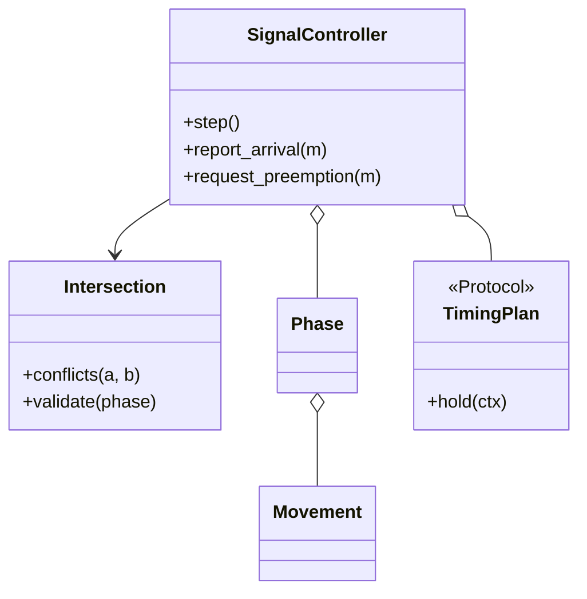

# 交通信号灯（Traffic Signal）（low priority）

## 题目

一个路口的信号灯控制器：四个方向，红绿黄轮流，还要能让救护车优先通过。用的人是路口的车辆和行人，驱动它的是信号机或仿真器。它看着最简单，却最容易写出一份没法测试的答案：很多实现把 `time.sleep(green)` 写进状态处理函数，再开一个后台线程 `while True` 跑。

**面试官真正在看的是：安全到底怎么定义（不是「南北绿时东西红」，而是任意两个冲突流向不能同时放行）；时间怎么推进（`step()` 一格一格走，不 sleep）；切换那一瞬间的安全余量（黄灯加全红）。**

你会听到的原话：设计一个路口的交通信号灯控制器，四个方向红绿黄轮流，紧急车辆可以优先通行。

常见追问：
- 救护车来了能不能把红灯直接改成绿？
- 加行人相位、左转箭头要改引擎吗？
- 感应式配时（有车就延长绿灯）怎么放？

## 先问这几个问题

- 时间怎么推进？**控制器只提供 `step()` 推进一格，真实时间只通过注入的时钟进入时间戳，逻辑里没有 `sleep`。谁来每秒调一次是部署问题。说出口，面试官就知道你打算怎么证明它是对的。**
- 「安全」怎么定义？**任意两个互相冲突的流向不能同时放行。把冲突写成数据，而不是东西南北的 `if`，加流向时引擎才可能一行不改还依然安全。**
- 黄灯之后要不要全红？**必须要：黄灯让已经进入路口的车驶离，全红才是真正离开的余量。没有它，不变量在稳态成立，恰恰在切换的瞬间破掉。**
- 配时是固定的还是感应的？**两种都真实存在，所以配时方案值得一个可替换的抽象。**
- 抢占能不能跳过间隔？**不能：抢占改变的是「下一个相位是谁」，不是「能不能跳过相位间隔」。抢占要有上限。** 范围外：多路口绿波协调、检测器故障降级。

## 核心对象

| 类 | 职责（一句话） | 守住的不变量 |
|---|---|---|
| `Movement` | 一个流向：一股车流或一条人行横道 | 不可变、可哈希 |
| `Phase` | 一组同时放行的流向，加最短绿和最长绿 | 最短绿是安全参数；最长绿防饿死 |
| `Intersection` | 路口的冲突图 | 拥有「安全」的定义；相位在启动时校验 |
| `Ctx` | 交给配时方案的只读快照 | 方案看得见数字，碰不到控制器 |
| `FixedTime` / `Actuated` | 绿灯还要不要再保持一格 | 两个真实实现，所以抽象是挣来的 |
| `SignalController` | 相位轮转、抢占、每格复核安全 | 冲突流向永不同时放行；切换必经清空加全红；抢占有上限 |

没有 `Road` 类和 `TrafficLight` 类：`Road` 只转发调用，灯只存一个枚举值，两个类加起来守不住任何一条不变量，还把「安全」拆散在三个对象里。显示状态是控制器身上的一个集合，安全判据是 `Intersection` 身上的一张冲突图，每一格末尾对账一次。



## 主流程

**每一格 `step`：**
1. 先处理抢占计时：超过上限就自动取消。
2. 绿灯阶段：已走时长加一，每个放行流向放走一辆排队的车；然后问 `_hold`：最短绿没走完一定保持；有抢占就只看当前相位是不是在为它放行；否则超过最长绿一定结束，没超过就问配时方案。
3. 不再保持就进入清空段（黄灯）；清空倒计时走完进入全红段；全红走完，才选下一个相位变绿。**抢占只影响「选谁」，切换路径永远是绿、清空、全红、绿。**
4. 每一格末尾复核：放行的流向里有没有冲突对，有就抛 `SafetyViolationError`。

## 关键决策

### 安全定义：冲突图，还是按方向硬编码

- 方案 A，每个状态处理函数里手写「南北绿，东西红」：没有任何东西在检查它，第 4 关加一个左转箭头，要在每个函数里补一行，漏一处代码照跑、路口出事。
- 方案 B，冲突是数据（哪两个流向冲突），安全判据是一个和方向无关的函数：枚举放行流向的所有两两组合，看有没有冲突对。
- **选 B。** 判据只有一处；相位里放了两个冲突流向，启动时就失败，不会运行到半夜才撞车；还能做随机演练：每一格问一次「冲突对是不是空的」。复核写成显式检查加异常，**不用 `assert`**：`python -O` 会把它整条删掉，而这条不变量不能在优化模式下消失。

### 时间推进：`step()` 加注入时钟，不 sleep

- 方案 A，状态里 `sleep` 加后台线程：能演示，但整份设计不可测。验证「抢占后确实走了全红」要真的等几秒，一万个 tick 的演练要等三个小时；而且控制器不该知道一秒有多长。
- 方案 B，`step()` 一格一格走，一格是一秒还是一百毫秒由外面决定。
- **选 B。** 每一步都能单独断言，整套测试几百毫秒跑完。顺带：控制器完全被外部驱动、内部没有线程，所以不需要锁。要主动说这件事：不是「忘了并发」，而是「把并发挡在了边界之外」。

### 全红清空：切换那一瞬间最危险

- 稳态好证：一个相位绿的时候别的流向都是红。难的是切换。直接从南北绿跳到东西绿，南北向最后一辆车正以 50 公里时速进入路口中央，此时东西向的绿灯亮了。不变量在代码里成立，在物理上被破了。
- **选三段切换：清空段（黄不算放行：骨架里这一段放行集合是空的，把黄当成还能走是最常见的语义错误）、全红段、下一个相位变绿。** 实现是一个三成员的枚举加一个倒计时，十几行。这里没有状态模式：三个阶段的差别只有「哪些流向显示什么」和「倒计时多少」，换成六个状态类，加一个相位就要再加两个类，轮转这条主线被拆散。

### 配时方案和抢占

- 配时方案用策略，而且它是挣来的：定周期和感应式两个真实实现，差别不是一个参数能表达的。接口只有一个问题：**绿灯还要不要再保持一格。** 相位轮转、清空、抢占都不归方案管。方案拿到的是只读快照，不是控制器的 `self`。
- 感应式的两条底线写在控制器里，方案改不了：**最短绿**保证已经起步的车有路可走，**最长绿**保证一条车流不断的主路不能让支路永远等下去。
- 抢占三条：**不许把红直接改绿，只改下一个相位是谁；必须有上限，忘了释放信号就是饿死；恢复就是从被抢占到的相位继续环**，因为被打断的相位刚拿到了至少最短绿，环上其他相位一格都没拿到。

## Python 骨架

```python
from __future__ import annotations
import itertools
import random
from dataclasses import dataclass
from enum import Enum


class SafetyViolationError(Exception):
    pass


class Stage(Enum):
    GREEN = 1
    CLEARANCE = 2  # 黄灯：不要再进来，已经进来的赶紧走
    ALL_RED = 3    # 全红：给路口中央的车真正离开的余量


@dataclass(frozen=True)
class Movement:  # 一个流向（一股车流或一条人行横道），值对象
    name: str


@dataclass(frozen=True)
class Phase:
    name: str
    movements: frozenset
    min_green: int  # 最短绿是安全底线，不是调优参数
    max_green: int  # 最长绿是防饿死上限


class Intersection:  # 拥有「安全」的定义：任意两个冲突流向不能同时放行
    def __init__(self, conflicts) -> None:
        self._conf = {frozenset(p) for p in conflicts}

    def conflicts(self, a: Movement, b: Movement) -> bool:
        return frozenset((a, b)) in self._conf

    def validate(self, phase: Phase) -> None:  # 配置错误在启动时失败，不要等到半夜撞车
        for a, b in itertools.combinations(phase.movements, 2):
            if self.conflicts(a, b):
                raise ValueError(f"{phase.name}: {a.name} 与 {b.name} 冲突")


@dataclass(frozen=True)
class Ctx:  # 交给配时方案的只读快照，方案碰不到控制器
    phase: Phase
    elapsed: int
    waiting: int
    since_arrival: int


class FixedTime:  # 方案一：定周期
    def __init__(self, green: dict) -> None:
        self.green = green

    def hold(self, c: Ctx) -> bool:  # 唯一的问题：绿灯还要不要再保持一格
        return c.elapsed < self.green[c.phase.name]


class Actuated:  # 方案二：感应式，只要车还在陆续到达就延长
    def __init__(self, gap: int = 2) -> None:
        self.gap = gap

    def hold(self, c: Ctx) -> bool:
        return c.waiting > 0 or c.since_arrival <= self.gap


class SignalController:  # 不 sleep、没有线程：step() 推进一格，谁来驱动是部署问题
    def __init__(self, inter: Intersection, phases, plan, clearance: int = 2, all_red: int = 1, max_preempt: int = 20) -> None:
        for p in phases:
            inter.validate(p)
        self.inter, self.phases, self.plan = inter, list(phases), plan
        self.clearance, self.all_red, self.max_preempt = clearance, all_red, max_preempt
        self.index, self.stage, self.elapsed, self.left = 0, Stage.GREEN, 0, 0
        self.green = set(self.phases[0].movements)
        self.queues: dict = {}
        self.since_arrival, self.preempt, self.preempt_ticks = 99, None, 0

    @property
    def phase(self) -> Phase:
        return self.phases[self.index]

    def report_arrival(self, m: Movement) -> None:
        self.queues[m] = self.queues.get(m, 0) + 1
        self.since_arrival = 0

    def request_preemption(self, m: Movement) -> None:  # 抢占只改变「下一个相位是谁」
        self.preempt, self.preempt_ticks = m, 0

    def release_preemption(self) -> None:
        self.preempt = None

    def step(self) -> Stage:
        self.since_arrival += 1
        if self.preempt is not None:
            self.preempt_ticks += 1
            if self.preempt_ticks > self.max_preempt:
                self.preempt = None  # 抢占必须有上限，否则忘了释放就是饿死 bug
        if self.stage is Stage.GREEN:
            self.elapsed += 1
            for m in self.phase.movements:  # 绿灯每格放行一辆
                self.queues[m] = max(0, self.queues.get(m, 0) - 1)
            if not self._hold():
                self.green, self.stage, self.left = set(), Stage.CLEARANCE, self.clearance
        else:
            self.left -= 1
            if self.left == 0 and self.stage is Stage.CLEARANCE:
                self.stage, self.left = Stage.ALL_RED, self.all_red
            elif self.left == 0:  # 清空 + 全红之后，才轮到下一个相位变绿
                self.index, self.stage, self.elapsed = self._next_index(), Stage.GREEN, 0
                self.green = set(self.phase.movements)
        self._verify()
        return self.stage

    def _hold(self) -> bool:
        p = self.phase
        if self.elapsed < p.min_green:
            return True  # 抢占也不能跳过最短绿
        if self.preempt is not None:
            return self.preempt in p.movements  # 正在为它放行就保持，否则让路
        if self.elapsed >= p.max_green:
            return False
        waiting = sum(self.queues.get(m, 0) for m in p.movements)
        return self.plan.hold(Ctx(p, self.elapsed, waiting, self.since_arrival))

    def _next_index(self) -> int:
        if self.preempt is not None:
            for off in range(len(self.phases)):
                i = (self.index + off) % len(self.phases)
                if self.preempt in self.phases[i].movements:
                    return i
        return (self.index + 1) % len(self.phases)

    def conflicting(self) -> list:
        return [(a, b) for a, b in itertools.combinations(self.green, 2) if self.inter.conflicts(a, b)]

    def _verify(self) -> None:  # 每一格复核；不用 assert，因为 python -O 会把它删掉
        if self.conflicting():
            raise SafetyViolationError(self.conflicting())


if __name__ == "__main__":
    N, S, E, W = (Movement(x) for x in "NSEW")
    inter = Intersection([(a, b) for a in (N, S) for b in (E, W)])
    ns, ew = Phase("NS", frozenset({N, S}), 2, 6), Phase("EW", frozenset({E, W}), 2, 6)
    try:
        Intersection([(N, E)]).validate(Phase("bad", frozenset({N, E}), 1, 2))
        raise SystemExit("应当拒绝")
    except ValueError:
        pass
    c = SignalController(inter, [ns, ew], FixedTime({"NS": 3, "EW": 3}))
    log = [(c.step(), c.phase.name) for _ in range(9)]
    assert [s.name[0] for s, _ in log] == list("GGCCAGGGC")  # 绿 绿 黄 黄 全红 绿...
    assert all(not (a[0] is Stage.GREEN and b[0] is Stage.GREEN and a[1] != b[1]) for a, b in zip(log, log[1:]))
    rng, c2 = random.Random(7), SignalController(inter, [ns, ew], Actuated())
    for t in range(500):  # 随机到达 + 随机抢占，每一格都复核安全
        if rng.random() < 0.4:
            c2.report_arrival(rng.choice([N, S, E, W]))
        if t % 97 == 5:
            c2.request_preemption(E)
        if t % 97 == 15:
            c2.release_preemption()
        c2.step()
        assert not c2.conflicting()
    print("ok")
```

## 面试官加需求时

| 新需求 | 改哪里 | 不用动哪里 |
|---|---|---|
| 行人相位 | 加行人流向，冲突图里登记与车流的冲突，加一个 `Phase` | 引擎 `step` |
| 保护左转箭头 | 加流向与冲突对，加一个相位 | 轮转、复核 |
| 感应式配时 | 换成 `Actuated` | 控制器 |
| 夜间闪黄模式 | 控制器外面再套一层模式切换 | 相位、冲突图 |
| 配置了冲突的相位 | `validate` 在启动时拒绝 | 运行期代码 |
| 全红时长按路口宽度算 | 全红改成按相位的参数 | 复核逻辑 |

## 并发与扩展

- 控制器没有线程也没有锁：`step()` 由外部单线程驱动。真要多线程喂到达数据，只有 `report_arrival` 和 `step` 需要加锁，而且都很短。
- 抢占的竞态：释放信号丢了怎么办？答案是上限兜底，到了上限控制器自己回到方案，不会让横向一直红。
- 安全是软件之外还有一层硬件互锁（柜内电路），软件不是唯一防线；检测器故障时降级成闪黄或定周期。
- 规模变大：多路口绿波协调是把周期、绿信比、相位差做全网优化，是另一道系统设计题；这里只要能说出它叫什么。

## 常见错误

- 把安全写成「南北绿时东西红」的分支：**冲突图加每格复核。**
- 状态里 `sleep` 加后台线程：**`step()` 推进一格，时钟注入。**
- 黄灯后直接亮对向绿灯，或把黄当成放行：**黄灯不算放行，再过全红。**
- 抢占时把红灯直接改绿，或没有上限：**只改下一个相位是谁，走完最短绿、清空、全红；设上限。**
- 用裸 `assert` 守安全不变量：**显式检查加异常。**

## 30 秒复述

- 对象：`Movement` 是流向，`Phase` 是一组同时放行的流向，`Intersection` 持有冲突图，`SignalController` 轮转并复核，配时方案只回答「绿灯还要不要再保持一格」。
- 核心决策：**安全是「任意两个冲突流向不同时放行」，冲突是数据，每一格复核。**
- 时间：`step()` 推进一格，注入时钟，没有 sleep、没有线程，所以不需要锁，测试几百毫秒跑完。
- 切换必经清空（黄）加全红，不变量才在切换的瞬间仍然成立。
- 抢占只改下一个相位是谁，不跳过间隔，有上限；配时方案是挣来的策略，最短绿和最长绿写在控制器里。

## 来源

- [[solution-traffic-signal]]
