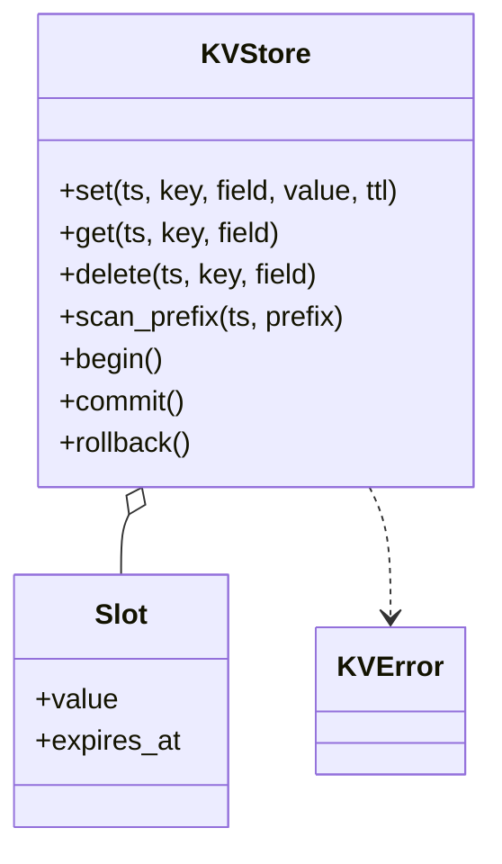

# 内存键值存储（In-Memory Key-Value Store，low priority）

## 题目

一个放在内存里的存储：每个 key 下面不是一个裸值，而是一张小表（字段名到值）。调用方先做基本读写，再要前缀扫描、过期时间，最后要可以嵌套的事务。它像 Redis 的 hash，不像普通的 `dict`。

**面试官真正在看的是：第 1 关的写方法有没有从一开始就知道「怎么把自己撤销」。事务不是事后包一层就能加上的能力，选错表示，第 4 关就要重写。**

你会听到的原话：实现一个内存键值存储，每个 key 对应若干 field。先支持 set / get / delete，后面几关会加扫描、过期和事务。

常见追问：
- 字段 TTL 到了，不访问它会怎样？有没有后台线程？
- 事务里嵌套事务，内层 commit 之后外层 rollback，数据回到哪里？
- 过期的数据在事务里被清理，回滚会不会让它复活？

## 先问这几个问题

- 时间从哪来？**默认每个方法第一个参数是 `timestamp`，类内部不读时钟。这样测试可以任意拨时间，过期完全可复现。**
- 过期是字段级还是 key 级？**两条时间线各自独立，谁先到谁先让数据消失。** 这里先讲字段级，key 级只是再加一张表。
- 删除不存在的字段报错还是静默成功？默认报错；面试官要幂等，把 `raise` 换成 `return`，一行的事。
- 嵌套事务的语义？**`rollback` 只撤销最内层；`commit` 把最内层并进外层，外层仍可撤销。** 只有最外层 commit 才不可逆。
- 范围外：磁盘持久化、多客户端隔离级别、真实并发。评测模型是单线程顺序调用。

## 核心对象

| 类 | 职责（一句话） | 守住的不变量 |
|---|---|---|
| `Slot` | 一个字段的值加它自己的绝对过期时刻 | 不可变；一次 `set` 整体替换，值和过期时间不会不同步 |
| `KVStore` | 唯一有状态的类：字段表和撤销日志 | 每一次真正改动存储之前，先记下怎么变回去 |
| `KVError` 系列 | 失败路径的类型 | 调用方不用匹配错误字符串 |



## 主流程

**写 `set` / `delete`：**
1. 先 `_touch(key, ts)`：把这个 key 下已经到期的字段清掉（惰性过期，没有后台线程）。
2. 记下这个字段当前的旧值 `prior`（可能是空）。
3. 如果在事务里，往最内层日志追加一个闭包：「把这个字段改回 `prior`」。不在事务里就不记，路径上零额外代价。
4. 再真正改存储。

**事务：**
1. `begin`：日志栈压入一个空列表。
2. `commit`：弹出最内层；如果外面还有一层，把它的闭包并进外层（数据已生效，但外层仍能撤销）。
3. `rollback`：弹出最内层，**按逆序**执行里面的闭包。没有活跃事务就抛 `NoTransactionError`。

## 关键决策

### 事务的表示：撤销日志，还是每层一份快照

- 方案 A，每层事务持有存储的覆盖层或整份拷贝，读的时候从内层往外找：commit 要合并两张表，嵌套越深读越慢，写时复制还要处理删除标记。
- 方案 B，撤销日志：写之前记一个「变回去」的闭包，rollback 逆序重放：读路径完全不变，commit 只是列表拼接。
- **选撤销日志。** 正向写入和撤销用同一个 `_apply`，撤销不需要第二套代码，只需要知道「目标状态是什么」。

### 惰性清理在事务里为什么安全

- 清理过期字段也走 `_write`，所以同样会被记进日志，同样可撤销。
- 撤销时恢复的是同一份 `(value, expires_at)`，**过没过期永远由调用时的 `ts` 重新判断**，所以回滚一次清理不会让过期数据复活。

### 不加模式：一个类，不是 Command 类加管理器

- 方案 A，每种操作一个 `Command` 对象，配 `TransactionManager`：对象多，协调逻辑反而比被协调的东西还长。
- **选一个类加一个闭包栈。** 「先记撤销、再改」只有两行，薄到不值得单独开类。面试官要审计日志时再升级。

### 事务控制方法要不要带时间戳

- `begin / commit / rollback` 不读数据，也不判断过期，所以**不带 `ts`**。带了反而暗示它们会触发清理，制造歧义。

## Python 骨架

```python
from __future__ import annotations
from dataclasses import dataclass


class KVError(Exception):
    pass


class FieldNotFound(KVError):
    pass


class InvalidTTL(KVError):
    pass


class NoTransaction(KVError):
    pass


@dataclass(frozen=True)
class Slot:  # 值 + 自己的绝对过期时刻（None = 不单独过期）
    value: str
    expires_at: int | None = None


class KVStore:
    def __init__(self) -> None:
        self._data: dict[str, dict[str, Slot]] = {}
        self._frames: list[list] = []  # 撤销日志栈：每层是一串「变回去」的闭包

    def _apply(self, key: str, field: str, slot: Slot | None) -> None:
        # 正向写和撤销共用同一个入口：slot=None 表示删除
        if slot is None:
            bucket = self._data.get(key)
            if bucket is not None:
                bucket.pop(field, None)
                if not bucket:
                    del self._data[key]  # 字段删空，key 一起消失
        else:
            self._data.setdefault(key, {})[field] = slot

    def _write(self, key: str, field: str, slot: Slot | None) -> None:
        prior = self._data.get(key, {}).get(field)
        if self._frames:  # 不在事务里就不记，读写路径零额外代价
            self._frames[-1].append(lambda: self._apply(key, field, prior))
        self._apply(key, field, slot)

    def _touch(self, key: str, ts: int) -> None:  # 惰性过期：访问前先清到期的字段
        for field, slot in list(self._data.get(key, {}).items()):
            if slot.expires_at is not None and ts >= slot.expires_at:
                self._write(key, field, None)

    def set(self, ts: int, key: str, field: str, value: str, ttl: int | None = None) -> None:
        if ttl is not None and ttl <= 0:
            raise InvalidTTL(ttl)
        self._touch(key, ts)
        self._write(key, field, Slot(value, None if ttl is None else ts + ttl))

    def get(self, ts: int, key: str, field: str) -> str:
        self._touch(key, ts)
        slot = self._data.get(key, {}).get(field)
        if slot is None:  # 不存在和已过期对调用方没有区别
            raise FieldNotFound(f"{key}.{field}")
        return slot.value

    def delete(self, ts: int, key: str, field: str) -> None:
        self._touch(key, ts)
        if field not in self._data.get(key, {}):
            raise FieldNotFound(f"{key}.{field}")
        self._write(key, field, None)

    def scan_prefix(self, ts: int, prefix: str) -> list[str]:
        for key in list(self._data):
            self._touch(key, ts)
        return sorted(k for k in self._data if k.startswith(prefix))  # 机考一定按字典序比较

    def begin(self) -> None:
        self._frames.append([])

    def commit(self) -> None:
        if not self._frames:
            raise NoTransaction()
        done = self._frames.pop()
        if self._frames:  # 并进外层：数据已生效，但外层 rollback 仍能撤销它
            self._frames[-1].extend(done)

    def rollback(self) -> None:
        if not self._frames:
            raise NoTransaction()
        for undo in reversed(self._frames.pop()):  # 逆序重放
            undo()


if __name__ == "__main__":
    s = KVStore()
    s.set(0, "user:1", "name", "Ada")
    s.set(0, "user:1", "otp", "999", ttl=10)
    assert s.get(5, "user:1", "otp") == "999"
    try:
        s.get(10, "user:1", "otp")  # ts >= expires_at：已过期
        raise SystemExit("应当过期")
    except FieldNotFound:
        pass
    s.begin()
    s.set(11, "user:1", "name", "Lovelace")
    s.begin()
    s.delete(11, "user:1", "name")
    s.rollback()  # 只撤销内层：改名还在
    assert s.get(11, "user:1", "name") == "Lovelace"
    s.rollback()  # 撤销外层：回到 Ada
    assert s.get(11, "user:1", "name") == "Ada"
    assert s.scan_prefix(11, "user:") == ["user:1"]
    try:
        s.commit()
        raise SystemExit("应当报错")
    except NoTransaction:
        pass
    print("ok")
```

## 面试官加需求时

| 新需求 | 改哪里 | 不用动哪里 |
|---|---|---|
| key 级整体过期 | 加 `_key_expiry` 表，`_touch` 先查它，写入也走日志 | 事务逻辑 |
| 按字段值计数 | 扫描后统计；要快就加 `(field, value)` 倒排索引，索引的更新也走 `_write` | 日志栈 |
| `get_when(ts_past)` 历史读 | 每个字段存版本链而不是单个 `Slot` | `begin / commit / rollback` 的语义 |
| 幂等删除 | `delete` 里 `raise` 换成 `return` | 其余全部 |
| 事务隔离（多客户端） | 每个客户端一份日志栈，加锁或乐观版本号 | 撤销闭包本身 |

## 并发与扩展

- 当前评测模型是单线程。要多线程：**一把锁罩住「touch → 记日志 → 改存储」整段**，不能只锁最后的改动，否则日志和存储不一致。
- 事务隔离：未提交的改动现在对所有调用方可见（因为只有一份存储）。要隔离，要么每个事务写私有覆盖层，要么 MVCC（多版本并发控制，Multi-Version Concurrency Control）。
- 持久化：把撤销日志换成预写日志（Write-Ahead Log, WAL），崩溃后重放；快照加增量日志控制恢复时间。
- 过期数据多了，惰性清理只在访问时发生，内存会涨：加一个按过期时刻排序的小顶堆（min-heap）定期扫。

## 常见错误

- 事务靠「事后把整张表拷一份」：**深层嵌套和大表下拷贝成本爆炸，用撤销日志。**
- `rollback` 正序重放闭包：**必须逆序，否则同一字段被改两次时会回到中间状态。**
- 内层 `commit` 就丢掉日志：**要并进外层，否则外层 rollback 撤不掉内层已提交的改动。**
- 过期判断写成 `>`：**到点即过期，用 `ts >= expires_at`，并问清楚边界。**
- 字段删空后 key 还留在表里：**`scan_prefix` 会返回空 key，要在 `_apply` 里一并删掉。**

## 30 秒复述

- 对象：`KVStore` 是唯一有状态的类，里面是 `key -> field -> Slot` 的二层表加一个撤销日志栈。
- 所有写都经过一个 `_write`：先记「怎么变回去」，再真正改。**这就是第 4 关免费的原因。**
- 过期是惰性的：访问前先清到期字段，时间由调用方传入，没有后台线程，测试可复现。
- 事务：`begin` 压栈，`commit` 并进外层，`rollback` 逆序重放；清理过期也走同一个入口，所以回滚不会复活过期数据。
- 不加模式：一个类加一个闭包栈；面试官要审计或持久化时再升级成日志对象。

## 来源

- [[solution-kv-store]]
