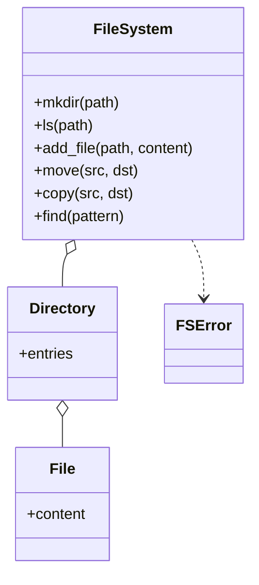

# 内存文件系统（In-Memory File System，low priority）

## 题目

在内存里实现一棵目录树：能建目录、列目录、写文件、读文件，后面几关再加删除、移动、复制、搜索。调用方是程序，不是人在终端里敲命令。

**面试官真正在看的是：目录里能放文件也能放目录，你会不会条件反射写出教科书式的组合模式（Composite），还是能说清楚它在哪里不该用；路径解析写在一个地方还是散在九个方法里；移动目录会不会把树移成环。**

你会听到的原话：实现一个内存文件系统，支持 mkdir、ls、add_file、read_file，之后会加删除、移动、复制和按名字搜索。

常见追问：
- 把目录移到它自己的子目录下面，会发生什么？
- 复制一个很大的文件，是复制引用还是复制字节？
- 加快照和恢复；或者加权限，改哪里？

## 先问这几个问题

- 路径只有绝对路径吗？**默认只支持 `/` 开头的绝对路径，没有「当前目录」，少一整类状态。**
- `..` 越过根目录怎么办？**默认直接拒绝（`PathEscapesRootError`）。** 程序拼错路径时，悄悄钳制到根会让调用方在错误位置读写却毫无察觉。
- `mkdir` 和 `add_file` 对缺失的父目录一样吗？**不一样：`mkdir` 自动建中间目录，`add_file` 要求父目录已存在。** 否则「父目录不存在」和「文件不存在」分不清。
- `move(src, dst)` 的 `dst` 是完整目标路径，还是「移进某目录并保留原名」？默认完整路径，更简单，覆盖核心能力。
- 范围外：符号链接、文件句柄和游标、磁盘 I/O、并发。

## 核心对象

| 类 | 职责（一句话） | 守住的不变量 |
|---|---|---|
| `File` | 一个文件的内容（`bytes`） | 内容不可变，改内容就是换一个新 `File` |
| `Directory` | 名字到子节点的映射（`entries`） | 名字是目录的键，不是节点自己的字段 |
| `FileSystem` | 唯一的门面：持有根，解析路径，做所有操作 | 所有路径先规范化；任何改动都不会产生环 |
| `FSError` 系列 | 失败类型：路径无效、不存在、已存在、非空 | 调用方按类型区分，不匹配字符串 |



## 主流程

**路径解析（所有操作共用）：**
1. `_normalize(path)`：必须以 `/` 开头；按 `/` 切段；跳过空段和 `.`；`..` 弹出上一段，已在根上就抛 `PathEscapesRootError`。
2. `_walk_dir(segments)`：**从根开始**逐段往下走；中途遇到文件就抛 `ExpectedDirectoryError`，缺失就抛 `PathNotFoundError`（`mkdir` 例外，自动建）。

**移动 `move(src, dst)`：**
1. 规范化两个路径；**若 `dst` 等于 `src` 或在 `src` 之下，拒绝**（目录搬进自己的子孙会成环）。
2. 解析 `dst` 的父目录，确认目标名字不存在。
3. 先从旧父目录摘下，再挂到新父目录。整个过程没有锁，也不需要更新任何反向引用。

## 关键决策

### File 和 Directory 要不要共享基类

- 方案 A，教科书组合模式：共同基类 `Node`，文件的 `list_children()` 抛 `NotImplementedError`。这是违反里氏替换原则（Liskov Substitution Principle）的标准反例：以为是 `Node` 的代码在运行时才炸。
- 方案 B，两个互不相干的类，`FileSystem` 里用 `isinstance` 分支。
- **选 B。** 文件和目录可做的操作几乎不相交，假装统一只是伪造一个共同接口。它们唯一的共性是「都能放进 `entries`」，一个联合类型 `File | Directory` 就够了。这是「模式不是默认选项」的典型。

### 路径解析放在节点里还是放在 FileSystem 里

- 方案 A，节点带 `parent` 指针：`move` 要同步更新，`copy` 出来的新节点父亲指向谁？不变量有真有假两种状态。
- 方案 B，节点不知道自己在哪，每次从根重新往下走，代价 `O(路径深度)`。
- **选 B。** 真实文件系统也是这样查的。节点没有反向引用，`move` / `copy` 不需要维护任何东西。

### 复制和删除要不要手写递归

- **删除：一行 `del parent.entries[name]`。** 子树不再被引用，垃圾回收（GC）自己释放，Python 不需要手写「先删子再删自己」。
- **复制：必须递归（`_duplicate`）**，因为复制是重新构造一份独立的数据。
- 复制文件时只多一个 `File` 包装，`bytes` 是不可变的，两个文件共享同一份字节没有数据竞争，复制大文件是 `O(1)`。**前提是内容不可变；换成 `bytearray` 这条就不成立。**

### 第 4 关：快照 / 恢复，还是权限

- 权限要往 `File` / `Directory` 加字段（owner、mode），每个读写方法还要加鉴权，改动面是全局的。
- **选快照 / 恢复：它就是对根做一次 `_duplicate`。** 不碰节点模型。`restore` 也要再复制一次，否则恢复之后的修改会污染那份本应固定的快照。

## Python 骨架

```python
from __future__ import annotations
from dataclasses import dataclass, field
from fnmatch import fnmatch


class FSError(Exception): pass
class PathNotFound(FSError): pass
class PathExists(FSError): pass
class NotEmpty(FSError): pass
class BadPath(FSError): pass  # 非绝对路径、越过根、非法移动


@dataclass
class File:
    content: bytes = b""  # 不可变：改内容 = 换一个新 File


@dataclass
class Directory:
    entries: dict[str, File | Directory] = field(default_factory=dict)  # 名字属于目录，不属于节点


class FileSystem:
    def __init__(self) -> None:
        self._root = Directory()

    def _normalize(self, path: str) -> list[str]:
        if not path.startswith("/"):
            raise BadPath(path)
        out: list[str] = []
        for seg in path.split("/"):
            if seg in ("", "."):
                continue
            if seg == "..":
                if not out:
                    raise BadPath("越过根目录")  # 拒绝，不悄悄钳制
                out.pop()
            else:
                out.append(seg)
        return out

    def _dir(self, segs: list[str], create: bool = False) -> Directory:
        node = self._root  # 每次从根往下走，节点不存 parent
        for name in segs:
            child = node.entries.get(name)
            if child is None:
                if not create:
                    raise PathNotFound(name)
                child = node.entries[name] = Directory()
            if not isinstance(child, Directory):
                raise BadPath(f"{name} 是文件")
            node = child
        return node

    def _get(self, path: str) -> File | Directory:
        segs = self._normalize(path)
        if not segs:
            return self._root
        node = self._dir(segs[:-1]).entries.get(segs[-1])
        if node is None:
            raise PathNotFound(path)
        return node

    def mkdir(self, path: str) -> None:  # 自动建中间目录
        self._dir(self._normalize(path), create=True)

    def ls(self, path: str) -> list[str]:
        node = self._get(path)
        return [path.rstrip("/").split("/")[-1]] if isinstance(node, File) else sorted(node.entries)

    def add_file(self, path: str, content: bytes) -> None:  # 父目录必须已存在
        segs = self._normalize(path)
        if not segs:
            raise BadPath(path)
        self._dir(segs[:-1]).entries[segs[-1]] = File(content)

    def read_file(self, path: str) -> bytes:
        node = self._get(path)
        if not isinstance(node, File):
            raise BadPath(f"{path} 是目录")
        return node.content

    def remove(self, path: str, recursive: bool = False) -> None:
        segs = self._normalize(path)
        if not segs:
            raise BadPath("不能删根")
        parent = self._dir(segs[:-1])
        node = parent.entries.get(segs[-1])
        if node is None:
            raise PathNotFound(path)
        if isinstance(node, Directory) and node.entries and not recursive:
            raise NotEmpty(path)
        del parent.entries[segs[-1]]  # 子树无人引用，GC 自己释放

    def _dup(self, node: File | Directory) -> File | Directory:
        if isinstance(node, File):
            return File(node.content)  # bytes 不可变，共享引用即可，O(1)
        return Directory({n: self._dup(c) for n, c in node.entries.items()})

    def _place(self, dst: str, node: File | Directory) -> None:
        segs = self._normalize(dst)
        if not segs:
            raise BadPath(dst)
        parent = self._dir(segs[:-1])
        if segs[-1] in parent.entries:
            raise PathExists(dst)
        parent.entries[segs[-1]] = node

    def copy(self, src: str, dst: str) -> None:
        self._place(dst, self._dup(self._get(src)))

    def move(self, src: str, dst: str) -> None:
        s, d = self._normalize(src), self._normalize(dst)
        if d[: len(s)] == s:  # dst 在 src 里或就是 src：会成环
            raise BadPath("不能移进自己")
        node = self._get(src)
        self._place(dst, node)  # 先挂新位置：失败时旧位置不变
        del self._dir(s[:-1]).entries[s[-1]]

    def find(self, pattern: str) -> list[str]:
        hits: list[str] = []

        def walk(d: Directory, prefix: str) -> None:
            for name, child in sorted(d.entries.items()):
                if fnmatch(name, pattern):
                    hits.append(f"{prefix}/{name}")
                if isinstance(child, Directory):
                    walk(child, f"{prefix}/{name}")

        walk(self._root, "")
        return hits

    def snapshot(self) -> Directory:
        return self._dup(self._root)  # 复用 copy 的深拷贝

    def restore(self, snap: Directory) -> None:
        self._root = self._dup(snap)  # 再复制一次，防止之后的修改污染快照


if __name__ == "__main__":
    fs = FileSystem()
    fs.mkdir("/a/b")
    fs.add_file("/a/b/x.txt", b"hi")
    assert fs.ls("/a") == ["b"] and fs.read_file("/a/b/x.txt") == b"hi"
    fs.copy("/a", "/c")
    fs.add_file("/c/b/x.txt", b"changed")
    assert fs.read_file("/a/b/x.txt") == b"hi"  # 复制后互不影响
    assert fs.find("*.txt") == ["/a/b/x.txt", "/c/b/x.txt"]
    snap = fs.snapshot()
    fs.remove("/a", recursive=True)
    fs.restore(snap)
    assert fs.read_file("/a/b/x.txt") == b"hi"
    try:
        fs.move("/a", "/a/b/z")  # 移进自己的子孙
        raise SystemExit("应当拒绝")
    except BadPath:
        pass
    try:
        fs.remove("/c")  # 非空目录
        raise SystemExit("应当拒绝")
    except NotEmpty:
        pass
    print("ok")
```

## 面试官加需求时

| 新需求 | 改哪里 | 不用动哪里 |
|---|---|---|
| 相对路径和 `cd` | `FileSystem` 加一个 `cwd` 段列表，`_normalize` 先拼 cwd | `File`、`Directory`、所有操作 |
| 权限（owner、mode） | 节点加字段；`_dir` / `_get` 沿途检查 | 路径规范化、`find` |
| 硬链接 | 同一个 `File` 对象被多个目录引用，加引用计数 | `Directory` 的结构 |
| 符号链接 | 新增 `Link(target)`，解析时跟随并限制跳数防环 | 已有节点类 |
| 文件内容可追加 | `File` 换成可变缓冲；`_dup` 复制字节 | 路径解析 |
| 按大小 / 时间搜索 | `find` 的谓词参数化，节点加元数据 | 遍历骨架 |

## 并发与扩展

- 当前没有并发。要多线程：**一把读写锁罩整棵树最简单**；要更细，按路径逐级加锁，但 `move` 要同时锁两个父目录，必须按固定顺序拿锁防死锁。
- `move` 非原子：先挂新位置、再摘旧位置，中间失败要能恢复。单线程下「先挂后摘」已能保证失败时旧位置不变。
- 规模变大：目录项用有序结构（B 树）支持范围列出；大文件分块存，文件内容变成块列表，复制变成写时复制（Copy-On-Write）。
- 持久化：元数据和数据分开存，元数据改动写日志。

## 常见错误

- 文件和目录共享基类，文件的 `ls` 抛 `NotImplementedError`：**两个类各自干净，联合类型表达共性。**
- 路径解析复制粘贴进每个方法：**一个 `_normalize` 加一个 `_dir`，全部操作共用。**
- `move` 不检查目标是不是自己的子孙：**会把子树从根上断开，成了孤岛。** 路径前缀判断就够。
- `move` 先摘旧位置再挂新位置，挂失败就丢数据：**先挂后摘。**
- 复制目录时只复制 `entries` 引用：**必须递归新建 `Directory`。**

## 30 秒复述

- 对象：`FileSystem` 持有根 `Directory`；`Directory` 是名字到子节点的映射；`File` 只有不可变的字节。
- **不共享基类**：文件和目录的操作集合不相交，共性用联合类型表达；这是一个不用组合模式的决定。
- 路径解析只有一处：规范化后从根逐段往下走，节点不存 `parent`，所以 `move` / `copy` 不需要维护反向引用。
- 删除一行 `del`，GC 释放子树；复制递归新建，文件共享不可变字节。
- 移动先挂后摘并拒绝移进自己的子孙；快照就是对根深拷贝，不碰节点模型。
- 并发：一把读写锁罩整树；细粒度时多目录操作按固定顺序加锁。

## 来源

- [[solution-in-memory-file-system]]
